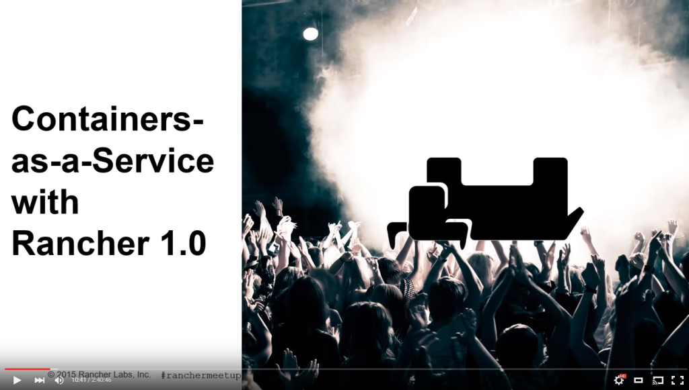

### Rancher is out of Beta, in our March online meetup we shared how to build a full-stack container platform.

After nine months of beta,
hundreds of thousands of downloads, and endless contributions to the
open source community, [Rancher 1.0 is now
available](https://rancher.com/announcing-rancher-1-0-ga/). To celebrate,
we focused our March meetup on demonstrating what’s new in 1.0 and
providing an overview on how to use Rancher to deliver containers as a
service for your organization. During the meetup we were also joined by
Srdjan Boskovic and Don Olmstead from Sony Playstion, who shared how
they were using Rancher and the Rancher Catalog to provide development
tools for their team. As always, we demonstrated all of this live, while
we answer any and all questions you may have about Docker, Rancher,
Swarm, Kubernetes and more. Unfortunately this month we forgot to share
our screen for the first few minutes, but we had it working by the time
we got into the real content. The video is qutie long because there were
so many questions at the end, but you can jump to the main topics by
following the links below:
[10:35](https://youtu.be/hwhxXwT6zlw?t=10m35s) - Containers-as-a-Service
with Rancher 1.0 Overview - Shannon Williams
[23:00](https://youtu.be/hwhxXwT6zlw?t=23m00s) - Demo - Darren Shepherd
[59:55](https://youtu.be/hwhxXwT6zlw?t=59m55s) - Rancher @ Sony Overview
- Srdjan Bosckovic [1:13:30](https://youtu.be/hwhxXwT6zlw?t=1h13m30s) -
Sony Demo - Don Olmstead
[1:31:00](https://youtu.be/hwhxXwT6zlw?t=1h31m00s) - Additional Q&A -
Shannon and Darren

We have also shared the slides from this months meetup on SlideShare.

**[Rancher March 2016 Online Meetup Containers-as-a-Service with Rancher
1.0](//www.slideshare.net/ShannonWilliams14/rancher-march-2016-online-meetup-containersasaservice-with-rancher-10 "Rancher March 2016 Online Meetup Containers-as-a-Service with Rancher 1.0")**
from **[Shannon Williams](//www.slideshare.net/ShannonWilliams14)**
