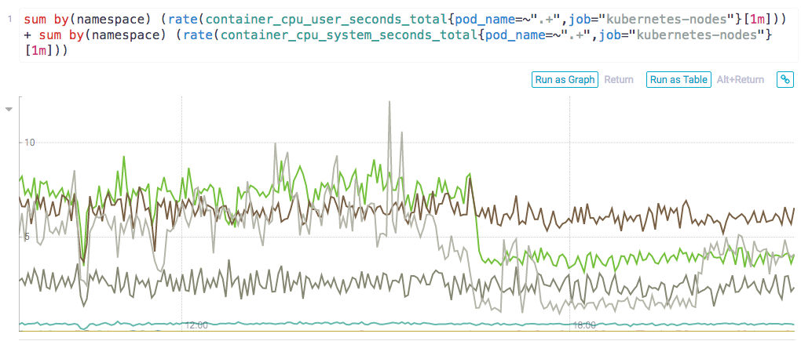
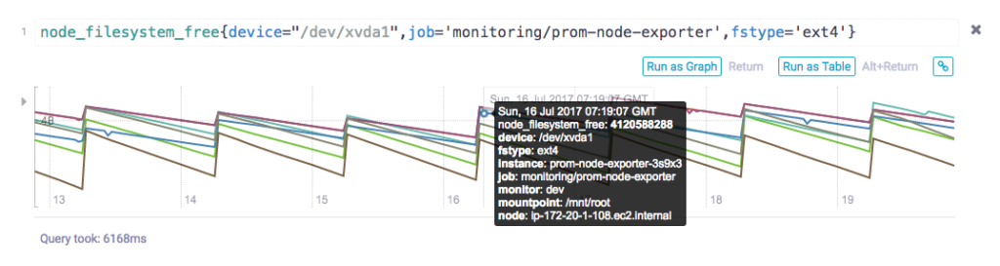

Take a Deep dive into Date Storage Options for Kubernetes and Rancher 2.0Without the ability to persist data, containers might seem to have limited use in many workloads. Join Rancher Labs for a deep dive into storage solutions for Docker containers and Kubernetes as we discuss best practices for a wide variety of storage use cases.[Watch the Training](https://rancher.com/events/2018/2018-09-18-building-data-storage-solution-with-k8s/)

On July 25th, Luke Marsden from Weaveworks and Bill Maxwell from Rancher
Labs led a webinar on ‘[A Practical Toolbox to Supercharge Your
Kubernetes
Cluster](https://www.youtube.com/watch?v=aElxXZAH3Jg&feature=youtu.be)’.
In the talk they described how you can use Rancher and Weave Cloud to
set up, manage and monitor an app in Kubernetes. In this blog, we’ll
discuss how and why Weave developed the best-practice RED method for
monitoring apps with Prometheus.

### What is Prometheus Monitoring?

You may have heard a lot about Prometheus lately, especially when it
comes to monitoring applications in Kubernetes. To provide a bit of
background before we delve into the RED method, apps running in
containers and orchestrated by Kubernetes are highly automated and
dynamic, and so, when it comes to monitoring applications in these
environments, traditional server-based monitoring tools designed for
static services are not sufficient. This is where Prometheus comes in.
Prometheus is [an open source project that was originally developed by
engineers at
SoundCloud](https://prometheus.io/docs/introduction/overview/). It was
built and designed specially to monitor microservices that run in
containers. Data is scraped from running services at time intervals and
saved to a time-series database where it can be queried via the PromQL
language. Because the data is stored as a time series, it allows you to
explore those time intervals to diagnose problems when they occurred and
to also analyze long-term monitoring trends with your infrastructure --
two awesomely powerful features of Prometheus. At Weaveworks we built on
the open source distribution of Prometheus and created a scalable,
multi-tenant version that is part of our Software-as-a-Service called
[Weave Cloud](https://go.weave.works/rancher-weavecloud.html). After
having run this service for several months now, and by using Weave Cloud
to monitor itself, we’ve learned a few things about monitoring cloud
native applications and devised a system that we use in determining what
to measure before instrumenting code.

### What to Instrument?

One of the most important decisions to make when setting up Prometheus
Monitoring is deciding on the type of metrics you need to collect about
your app. The metrics you choose simplifies troubleshooting when a
problem occurs and also enables you to stay on top of the stability of
your services and infrastructure. To help us think about what’s
important to instrument, we defined a system that we call the RED
method. The RED method follows on the principles outlined in the [Four
Golden
Signals](https://landing.google.com/sre/book/chapters/monitoring-distributed-systems.html#xref_monitoring_golden-signals)
developed by Google Site Reliability Engineers or SREs, which focuses on
measuring things that end-users care about when using your web services.
With the RED method, three key metrics are instrumented that monitor
every microservice in your architecture:

- (Request) **R**ate - the number of requests, per second, your
  services are serving.
- (Request) **E**rrors - the number of failed requests per second.
- (Request) **D**uration - The amount of time each request takes
  expressed as a time interval.

**R**ate, **E**rrors and **D**uration attempt to cover the most obvious
web service issues. These metrics also capture an error rate that is
expressed as a proportion of request rate. With these three basic
metrics, we believe the most common problems that can result in poor
customer satisfaction are covered. For even more detailed coverage, you
may also include the Saturation metric. Saturation is used in another
methodology called the [USE or Utilization, Saturation and Errors
method](http://www.brendangregg.com/usemethod.html) and it refers to a
resource with extra work that can’t be serviced and therefore must be
added to the queue for later processing.

#### USE vs. RED Methods

The USE method focuses more on monitoring performance and is meant to be
used as a starting point in identifying the root cause of performance
issues and other systemic bottlenecks. Ideally, both the USE and the RED
Methods can be used together when monitoring your applications.

#### Why you should measure the same metrics for every service

From a monitoring perspective, the benefits of treating each service the
same is scalability in your operations teams.

\*\*What does scalability of an operations team mean? \*\*We look at this
from the point of view of how many services a given team can support. In
an ideal world, the number of services the team can support would be
independent from its team size, and instead dependent on other factors
like what kind of response SLA you want, and whether you need 24/7
coverage, etc.

\*\*How do you decouple the number of services you can support from the
team size? \*\*By making every service look, feel and taste the same. This
reduces the amount of service-specific training the team needs, and also
reduces the service-specific special cases the oncalls need to memorize
for those high-pressure incident response scenarios or what is referred
to as “cognitive load.”

**Capacity planning**: Do it as a function of QPS and latency

\*\*Automating tasks and creating alerts \*\*An advantage of the RED method
is that it helps you to think about how to display information in your
dashboards. With just these three metrics, you can standardize on the
layout of your dashboards to make it even simpler to read and to create
alerts on for when there is a problem. For example, a possible layout
might entail - a different Weave Cloud notebook for each service with
PromQL queries for request & error, and latency for each of those
services.

Also it goes without saying, but if you treat all your services the
same, repetitive tasks are more easily automated.

**PromQL query**

**RED Method Metrics Monitored in Weave Cloud**

#### Limitations

It is fair to say this method only works for request-driven services -
it breaks down for batch-oriented or streaming services for instance. It
is also not all-encompassing. There are times you will need to monitor
other things - the USE Method for example is great when applied to
resources like host CPU & Memory, or caches.

#### What’s next?

These topics were covered in the latest [Rancher and Weaveworks
webinar](https://youtu.be/aElxXZAH3Jg) where we showed you how to
monitor and troubleshoot a service with [Weave
Cloud](https://cloud.weave.works/?utm_source=rancher&utm_medium=link&utm_campaign=webinar)
that was deployed through Rancher. To get right to using Rancher and
Weaveworks together, you can also view just [the demo from the webinar
online as well](https://www.youtube.com/watch?v=d7LO0M0zO8E). Watch a
replay of the webinar with demos and real world examples or recreate it
on [your own with these how-to
steps](https://www.weave.works/blog/how-to-supercharge-your-kubernetes-cluster-with-rancher-weave-cloud?utm_source=rancher&utm_medium=blog&utm_campaign=webinar).
*Anita Buehrle is a developer advocate at Weaveworks.*

Take a Deep dive into Date Storage Options for Kubernetes and Rancher 2.0Without the ability to persist data, containers might seem to have limited use in many workloads. Join Rancher Labs for a deep dive into storage solutions for Docker containers and Kubernetes as we discuss best practices for a wide variety of storage use cases.[Watch the Training](https://rancher.com/events/2018/2018-09-18-building-data-storage-solution-with-k8s/)
