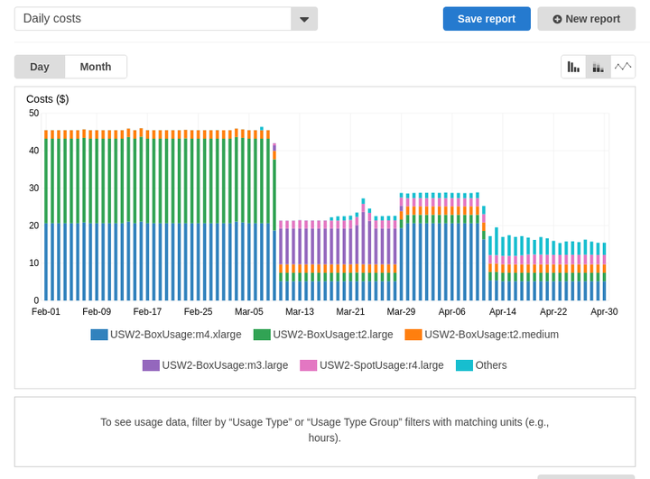
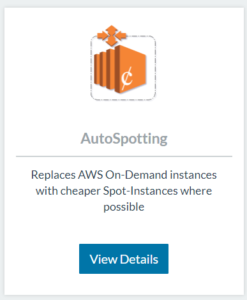
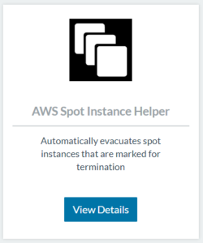

## Ye Olde Worlde

Back in older times, B.C. as in Before Cloud, to put a service live you
had to:

1. Spend months figuring out how much hardware you needed
2. Wait at least eight weeks for your hardware to arrive
3. Allow another four weeks for installation
4. Then, configure firewall ports
5. Finally, add servers to config management and provision them

All of this was in an organised company!

## The Now

The new norm is to use hosted instances. You can scale these up and down
based on requirements and demand. Servers are available in a matter of
seconds. With containers, you no longer care about actual servers. You
only care about compute resource. Once you have an orchestrator like
[Rancher](https://rancher.com/quick-start/), you don’t need to worry
about maintaining scale or setting where containers run, as Rancher
takes care of all of that. Rancher continuously monitors and assesses
the requirements that you set and does its best to ensure that
everything is running. Obviously, we need some compute resource, but it
can run for days or hours. The fact is, with containers, you pretty much
don’t need to worry.

## Reducing Cost

So, how can we take advantage of the flexibility of containers to help
us reduce costs? There are a couple of things that you can do. Firstly
(and this goes for VMs as well as containers), do you need all your
environments running all the time? In a world where you own the kit and
there is no cost advantage to shutting down environments versus keeping
them running, this practice was accepted. But in the on-demand world,
there is a cost associated with keeping things running. If you only
utilise a development or testing environment for eight hours a day, then
you are paying four times as much by keeping it running 24 hours a day!
So, shutting down environments when you’re not using them is one way to
reduce costs. The second thing you can do (and the main reason behind
this post) is using [Spot Instances](https://aws.amazon.com/ec2/spot/).
Not heard of them? In a nutshell, they’re a way of getting cheap
compute resource in AWS. Interested in saving up to 80% of your AWS EC2
bill? Then keep reading. The challenge with Spot Instances is that they
can terminate after only two minutes’ notice. That causes problems for
traditional applications, but containers handle this more fluid nature
of applications with ease. Within AWS, you can directly request Spot
Instances, individually or in a fleet, and you set a maximum price for
the instance. Once you breach this price, AWS gives you two minutes and
then terminates the instance.

## AutoSpotting

What if you could have an Auto Scaling Group (ASG) with an On-Demand
Instance type to which you could revert if you breached the Spot
Instance price? Step forward an awesome piece of open-source software
called AutoSpotting. You can find the source and more information on
[GitHub](https://github.com/cristim/autospotting). AutoSpotting works by
replacing On-Demand Instances from within an ASG with individual Spot
Instances. AutoSpotting takes a copy of the launch config of the ASG and
starts a Spot Instance (of equivalent spec or more powerful) with the
exact same launch config. Once this new instance is up and running,
AutoSpotting swaps out one of the On-Demand Instances in the ASG with
this new Spot Instance, in the process terminating the more expensive
On-Demand Instance. It will continue this process until it replaces all
instances. (There is a configuration option that allows you to specify
the percentage of the ASG that you want to replace. By default, it’s
100%.) AutoSpotting isn’t application aware. It will only start a
machine with an identical configuration. It doesn’t perform any
graceful halting of applications. It purely replaces a virtual instance
with a cheaper virtual instance. For these reasons, it works great for
Docker containers that are managed by an orchestrator like Rancher. When
a compute instance disappears, then Rancher takes care of maintaining
the scale. To facilitate a smoother termination, I’ve created a helper
service, `AWS-Spot-Instance-Helper`, that monitors to see if a host is
terminating. If it is, then the helper uses the Rancher `evacuate`
function to more gracefully transition running containers from the
terminating host. This helper isn’t tied to AutoSpotting, and anyone
who is using Spot Instances or fleets with Rancher can use it to allow
for more graceful terminations. Want an example of what it does to the
cost of running an environment?
[](images/rancher_blog_aws-auto.png)
Can you guess which day I implemented it? OK, so I said up to 80%
savings but, in this environment, we didn’t replace all instances at the
point when I took this measurement. So, why are we blogging about it
now? Simple: We’ve taken it and turned it into a Rancher Catalog
application so that all our Rancher AWS users can easily consume it.

## 3 Simple Steps to Saving Money

### Step 1

Go to the **Catalog > Community** and select **AutoSpotting**.
[](https://cdn.rancher.com/wp-content/uploads/2017/10/13070030/auto.png)

### Step 2

Fill in the **AWS Access Key** and **Secret Key**. (These are the only
mandatory fields.) The user must have the following AWS permissions:

```
autoscaling:DescribeAutoScalingGroups

autoscaling:DescribeLaunchConfigurations

autoscaling:AttachInstances

autoscaling:DetachInstances

autoscaling:DescribeTags

autoscaling:UpdateAutoScalingGroup

ec2:CreateTags

ec2:DescribeInstances

ec2:DescribeRegions

ec2:DescribeSpotInstanceRequests

ec2:DescribeSpotPriceHistory

ec2:RequestSpotInstances

ec2:TerminateInstances
```

Optionally, set the **Tag Name**. By default, it will look for
**spot-enabled**. I’ve slightly modified the original code to allow the
flexibility of running multiple AutoSpotting containers in an
environment. This modification allows you to use multiple policies in
the same AWS account. Then, click **Launch**.

### Step 3

Add the tag (user-specified or **spot-enabled**, with a value of
**true)** to any AWS ASGs on which you want to save money. Cheap (and
often more powerful) Spot Instances will gradually replace your
instances. To deploy the `AWS-Spot-Instance-Helper` service, simply
browse to the **Catalog > Community** and launch the application.
[](https://cdn.rancher.com/wp-content/uploads/2017/10/13070120/helper.png)
Thanks goes out to **Cristian Măgherușan-Stanciu** and [other
contributors](https://github.com/cristim/autospotting/graphs/contributors)
for writing such a great piece of open-source software.

### About the Author

Chris Urwin works
as a field engineer for Rancher Labs based out of the UK, helping our
enterprise clients get the most out of Rancher.
