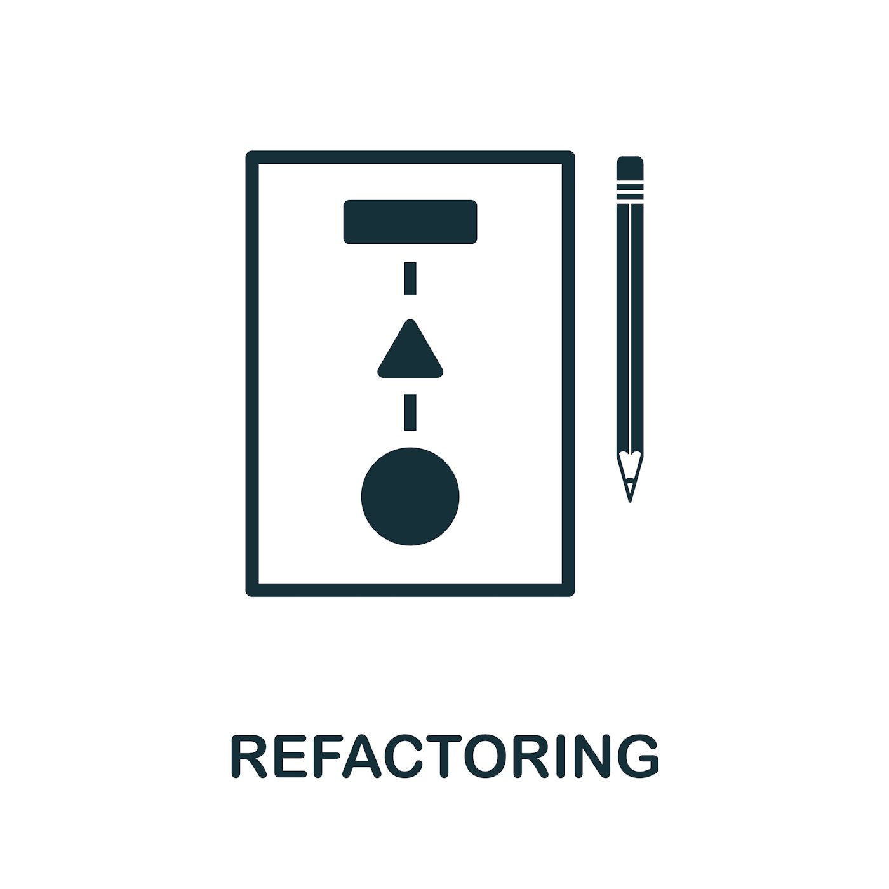

Cloud Native: it's been an industry buzzword for a few years now. It holds different meanings for different people, and even then a different context. While we have overused this word, it does have a place when it comes to modernizing applications.

To set the context here, we are talking about apps you would build *in* the cloud rather than *for* it. This means these apps, if modernized, would run in a cloud platform. In this post, we will discuss how "refactoring," as Gartner puts it, isn't the same for every app.

When we look at legacy applications sitting in data centers across the globe, some are traditional mainframes; others are "Custom off the Shelf Software" (CotS). We care about the business-critical apps we can leverage for the cloud. Some of these are CotS, and many of these applications are custom.

When it comes to the CotS, companies should rely on the vendor to modernize their CotS to a cloud platform. This is the vendor's role, and there is little business value in a company doing it for them.

Gartner came up with the five R's: Rehost, Refactor, Revise, Rebuild and Replace. But when we look at refactoring, it shouldn't be the same for every app because not all apps are the same. Some are mission-critical; most of your company's revenue is made with those apps. Some apps are used once a month to make accounting's life easier. Both might need to be refactored, but not to the same level. When you refactor, you change the structure, architecture, and business logic. All to leverage core concepts and features of a cloud. This is why we break down refactoring into Scale of Cloud Native.

Custom apps are perfect candidates for modernization. With every custom app, modernization brings risks and rewards. Most systems depend on other technologies like libraries, subsystems, and even frameworks. Some of these dependencies are easy to modernize into a cloud platform, but not all are like this. Some pose considerable challenges that limit how much you can modernize.

If we look at what makes an app cloud native, we first have to acknowledge that this term means something different depending on who you ask; however, most of these concepts are at least somewhat universal. Some of these concepts are:

- Configuration
- Disposability
- Isolation
- Scalability
- Logs

Outside of technical limitations, there's the question of how much an application should be modernized. Do you go all in and rewrite an app to be fully cloud native? Or do you do the bare minimum to get the app to run in the cloud?

We delineate these levels of cloud native as Suitable, Compatible, Durable, and Native. These concepts build upon one another so that an app can be Compatible and, with some refactoring, can go to Durable.

What does all this actually mean? Well, let's break them down based on a scale:

- **Suitable** - First on the scale and the bare minimum you need to get your app running in your cloud platform. This could just be the containerization of the application, or that and a little more.
- **Compatible** - Leveraging a few of the core concepts of the cloud. An app that is cloud-compatible leverages things like environmental configs and disposability. This is a step further than Suitable.
- **Durable** - At this point, apps should be able to handle a failure in the system and not let it cascade, meaning the app can handle it when some underlying services are unavailable. Being Durable also means the app can start up fast and shut down gracefully. These apps are well beyond Suitable and Compatible.
- **Native** - These apps leverage most, if not all, of the cloud native core concepts. Generally, this is done with brand-new apps being written in the cloud. It might not make sense to modernize an existing app to this level.

This scale isn't absolute; as such, different organizations may use different scales. A scale is important to ensure you are not over or under-modernizing an app.

When starting any modernization effort, collectively set the scale. This should be done organizationally rather than team-by-team. When it comes to budget and timing, making sure that all teams use the same scale is critical.

### Learn more about this in our Webinar, App Modernization: When and How Far to Modernize. Watch the replay, [Register here](https://www.crowdcast.io/e/when-and-how-far-to-modernize?utm_campaign=appmod&utm_source=MN&utm_medium=blog).

#### Want to make sure you don't miss any of the action? [Join the SUSE & Rancher Community](https://community.suse.com/share/kuN58om1vAuZuSiv?utm_source=manual) to get updates on new content coming your way!
