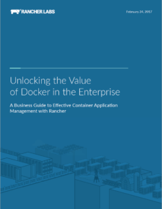

So you’ve decided to use microservices. To help implement them, you may
have already started refactoring your app. Or perhaps refactoring is
still on your to-do list. In either case, if this is your first major
experience with refactoring, at some point, you and your team will come
face-to-face with the very large and very obvious question: How do you
refactor an app for microservices? That’s the question we’ll be
considering in this post.

### Refactoring Fundamentals

Before discussing the *how* part of refactoring into microservices, it
is important to step back and take a closer look at the *what* and
*when* of microservices. There are two overall points that can have a
major impact on any microservice refactoring strategy. **Refactoring =
Redesigning**  A
business guide to effective container   
management -
Refactoring a monolithic application into microservices and designing a
microservice-based application from the ground up are fundamentally
different activities. You might be tempted (particularly when faced with
an old and sprawling application which carries a heavy burden of
technical debt from patched-in revisions and tacked-on additions) to
toss out the old application, draw up a fresh set of requirements, and
create a new application from scratch, working directly at the
microservices level. As Martin Fowler suggests in [this
post](https://martinfowler.com/bliki/MonolithFirst.html), however,
designing a new application at the microservices level may not be a good
idea at all. One of the key takeaway points from Fowler’s analysis is
that starting with an existing monolithic application can actually work
to your advantage when moving to microservice-based architecture. With
an existing monolithic application, you are likely to have a clear
picture of how the various components work together, and how the
application functions as a whole. Perhaps surprisingly, starting with a
working monolithic application can also give you greater insight into
the boundaries between microservices. By examining the way that they
work together, you can more easily see where one microservice can
naturally be separated from another. **Refactoring isn’t generic**
There is no one-method-fits-all approach to refactoring. The design
choices that you make, all the way from overall architecture down to
code-level, should take into account the application’s function, its
operating conditions, and such factors as the development platform and
the programming language. You may, for example, need to consider code
packaging—If you are working in Java, this might involve moving from
large Enterprise Application Archive (EAR) files, (each of which may
contain several Web Application Archive (WAR) packages) into separate
WAR files.

### General Refactoring Strategies

Now that we’ve covered the high-level considerations, let’s take a look
at implementation strategies for refactoring. For the refactoring of an
existing monolithic application, there are three basic approaches.

**Incremental**

With this strategy, you refactor your application piece-by-piece, over
time, with the pieces typically being large-scale services or related
groups of services. To do this successfully, you first need to identify
the natural large-scale boundaries within your application, then target
the units defined by those boundaries for refactoring, one unit at a
time. You would continue to move each large section into microservices,
until eventually nothing remained of the original application.

**Large-to-Small**

The large-to-small strategy is in many ways a variation on the basic
theme of incremental refactoring. With large-to-small refactoring,
however, you first refactor the application into separate, large-scale,
“coarse-grained” (to use Fowler’s term) chunks, then gradually break
them down into smaller units, until the entire application has been
refactored into true microservices.

The main advantages of this strategy are that it allows you to stabilize
the interactions between the refactored units before breaking them down
to the next level, and gives you a clearer view into the boundaries
of—and interactions between—lower-level services before you start
the next round of refactoring.

**Wholesale Replacement**

With wholesale replacement, you refactor the entire application
essentially at once, going directly from a monolith to a set of
microservices. The advantage is that it allows you to do a full
redesign, from top-level architecture on down, in preparation for
refactoring. While this strategy is not the same as
microservices-from-scratch, it does carry with it some of the same
risks, particularly if it involves extensive redesign.

### Basic Steps in Refactoring

What, then, are the basic steps in refactoring a monolithic application
into microservices? There are several ways to break the process down,
but the following five steps are (or should be) common to most
refactoring projects.

\*\*(1) Preparation: \*\*Much of what we have covered so far is preparation.
The key point to keep in mind is that before you refactor an existing
monolithic application, the large-scale architecture and the
functionality that you want to carry over to the refactored,
microservice-based version should already be in place. Trying to fix a
dysfunctional application while you are refactoring it will only make
both jobs harder.

\*\*(2) Design: Microservice Domains: \*\*Below the level of large-scale,
application-wide architecture, you do need to make (and apply) some
design decisions before refactoring. In particular, you need to look at
the style of microservice organization which is best suited to your
application. The most natural way to organize microservices is into
domains, typically based on common functionality, use, or resource
access:

- **Functional Domains.** Microservices within the same functional
  domain perform a related set of functions, or have a related set of
  responsibilities. Shopping cart and checkout services, for example,
  could be included in the same functional domain, while inventory
  management services would occupy another domain.
- **Use-based Domains.** If you break your microservices down by use,
  each domain would be centered around a use case, or more often, a
  set of interconnected use cases. Use cases are typically centered
  around a related group of actions taken by a user (either a person
  or another application), such as selecting items for purchase, or
  entering payment information.
- **Resource-based Domains.** Microservices which access a related
  group of resources (such as a database, storage, or external
  devices) can also form distinct domains. These microservices would
  typically handle interaction with those resources for all other
  domains and services.

Note that all three styles of organization may be present in a given
application. If there is an overall rule at all for applying them, it is
simply that you should apply them when and where they best fit.

**(3) Design: Infrastructure and Deployment**

This is an important step, but one that is easy to treat as an
afterthought. You are turning an application into what will be a very
dynamic swarm of microservices, typically in containers or virtual
machines, and deployed, orchestrated, and monitored by an infrastructure
which may consist of several applications working together. This
infrastructure is part of your application’s architecture; it may (and
probably will) take over some responsibilities which were previously
handled by high-level architecture in the monolithic application.

**(4) Refactor**

This is the point where you actually refactor the application code into
microservices. Identify microservice boundaries, identify each
microservice candidate’s dependencies, make any necessary changes at
the level of code and unit architecture so that they can stand as
separate microservices, and encapsulate each one in a container or VM.
It won’t be a trouble-free process, because reworking code at the scale
of a major application never is, but with sufficient preparation, the
problems that you do encounter are more likely to be confined to
existing code issues.

**(5) Test**

When you test, you need to look for problems at the level of
microservices and microservice interaction, at the level of
infrastructure (including container/VM deployment and resource use), and
at the overall application level. With a microservice-based application,
all of these are important, and each is likely to require its own set of
testing/monitoring tools and resources. When you detect a problem, it is
important to understand at what level that problem should be handled.

### Conclusion

Refactoring for microservices may require some work, but it doesn’t
need to be difficult. As long as you approach the challenge with good
preparation and a clear understanding of the issues involved, you can
refactor effectively by making your app microservices-friendly without
redesigning it from the ground up.
