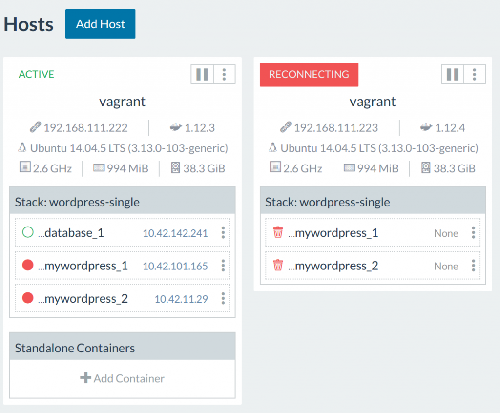
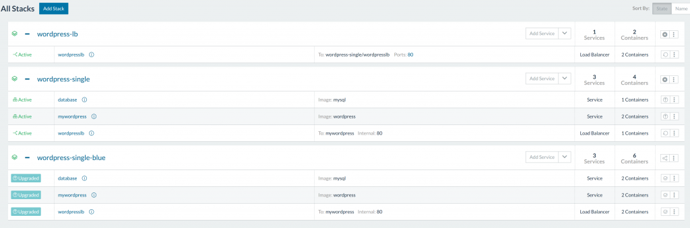

*This is the last part in a series on designing resilient containerized workloads. In case you missed it, Parts 1, 2, 3, and 4 are already available online.* In Part 4 last week, we covered in-service and

rolling updates for single and multiple hosts. Now, let’s dive into

common errors that can pop up during these updates:

### Common Problems Encountered with Updates

Below is a brief accounting of all the supporting components required

during an upgrade. Though the Rancher UI does a great job of presenting

the ideal user experience, it does hides some of the complexities that

occur with operating container deployments in production: [](images/rancher_blog_Codesheppard-4-RancherUpgradeSupport.png)

The blue indicates parts of the system under control by Rancher. The

types of bugs that exist on this layer require the end user to be

comfortable digging into Rancher container logs. We briefly discussed

ways to dig into Rancher networking in [Part 2](https://rancher.com/5-keys-running-workloads-resiliently-rancher-docker-part-2/).

Another consideration is scaling Rancher Server along with your

application size; since Rancher writes to a relational database, the

entire infrastructure may be slowed down by I/O and CPU issues as

multiple services are updated. The yellow parts of the diagram indicate

portions of the system managed by the end user. This requires some

degree of knowledge of setting the infrastructure hosts up for

production. Otherwise, a combination of errors in the yellow and blue

layers will create very odd problems for service upgrades that are very

difficult to replicate. **Broken Network to Agent Communication**

[](https://info.rancher.com/cicd-with-docker-ebook) Free

eBook: Continuous Integration and Deployment with Docker and

Rancher Suppose I shutoff my node2 (the one with my

Wordpress containers). How does a lost host affect the ability of

Rancher to coordinate?

```
$> vagrant halt node2
```

Rancher did not automatically migrate my containers, because there was

no health check in place - we need to establish a

[health-check](https://rancher.com/docs/rancher/v1.6/en/cattle/health-checks/) to

have the containers automatically migrate. With a health-check in place,

our ‘mywordpress’ service will automatically migrate to other hosts.

In this case, our application went down because the load balancer on

node1 was unable to route traffic to services on node2. Since our

application utilizes a HAProxy load balancer that is dynamically

configured by Rancher, this problem is a combination of problems with

user- and Rancher-managed networking. In this setting, though the app

sees downtime, an upgrade still works as expected:

```
$> rancher-compose up --upgrade --force-upgrade
```

Rancher starts the containers on the node1 (which is reachable) and then

marks node2 as being on reconnecting state:

[](https://cdn.rancher.com/wp-content/uploads/2017/01/23104345/Codesheppard-4-reconnecting.png)

**Agent on Host Unable to Locate Image** Suppose now that I have a

custom repository for my organization. We will need to add a registry to

the Rancher instance to pull custom images. A host node might not have

access to my custom registry. When this occurs, Rancher will

continuously attempt to maintain the scale of the service and keep

cycling the containers. Rancher does this by allowing all agents to add

various [Docker registries in Rancher](https://rancher.com/docs/rancher/v1.6/en/environments/registries/#adding-registries).

The credentials are kept on the agents and are not available to the

host. Sometimes, it is also important to check if a host node has access

to the registry. A firewall rule or a IAM profile misconfiguration on

AWS may cause your host to fail to pull the image, even with proper

credentials. This is a issue where errors most commonly reside in the

yellow user-controlled infrastructure. **Docker on Host Frozen** Running

a resilient Docker host is a technical challenge in itself. When using

Docker in a development capacity, all that was required was installing

Docker engine. In production, the Docker engine requires many

configuration options, such as the production OS, the type of [storage driver](https://docs.docker.com/engine/userguide/storagedriver/selectadriver/#/future-proofing) to

be used, and how much space to allocate to the Docker daemon, all of

which play a part in the user-controlled environment. Managing a

reliable Docker host layer carries problems similar those in traditional

hosting: both require maintaining up-to-date software on bare metal.

Since the Rancher agent directly interfaces with the Docker daemon on

the host, if the Docker daemon is unresponsive, then Rancher components

have little control over this component. An example of when a Docker

daemon failure prevents a rollback is when the old containers reside on

one host, but the Docker daemon freezes up. This usually requires the

daemon or host to be force rebooted. Sometimes the containers will be

lost, and our rollback candidates are purged.

### Problems with In Service Deployment

A short list of issues we encountered or discussed in our experiments:

- Port conflicts
- Service State issues
- Network Routing issues
- Registry Authentication issues
- Moving Containers
- Host issues

In summary, in-service deployment suffer from the following issues:

- Unpredictable under failure scenarios
- Rollbacks don’t always work

If you like to dig more into CI/CD theory, you can continue your deep

dive with an exert from the [CI/CD Book](https://rancher.com/docker-based-build-pipelines-part-3-managing-production-environments/#In-place_updates).

In general, we can have confidence that stateless application containers

behind load balancers (like a node app or Wordpress) can be quickly

redeployed when needed. However, more complex stacks with interconnected

behavior and state require a new deployment model. If the deployment

process is not exercised daily in a CI/CD process, an ad-hoc in-place

update may surface unexpected bugs, which require the operator to dig

into Rancher’s behavior. Coupled with multiple lower layer failures,

this may make upgrading more complicated applications a dangerous

proposition. This is why we introduce the blue-green deployment method.

### Blue-Green Deployment

With in-place updates having so many avenues of failure, one should only

rely on it as part of CI/CD pipeline that exercises the updates in a

repeatable fashion. When the deployment is regularly exercised and bugs

are fixed as they arise, the cost of deployment issues is negligible for

most common web-apps and light running services. But what if it is a

stack due for update is rarely touched? Or the stack that requires many

complex data and network interactions? A blue-green deployment pattern

creates breathing space to more reliably upgrade the stack.

The [Blue-Green Deployment Section](https://rancher.com/docker-based-build-pipelines-part-3-managing-production-environments/#Blue-GreenDeployments) of

the CI/CD book details how to leverage internet routing to redirect

traffic to another stack. So instead of keeping traffic coming into a

service or stack while it is updating, we will make upgrades in a

separate stack and then adjust the DNS entry or proxy to switch over the

traffic.

[](images/rancher_blog_Codesheppard-4-blue-green.png)

Once the blue stack is updated, we will update the load-balancer to

redirect traffic to the green stack. Now our blue stack has become our

staging environment, and we make changes and upgrades there until the

next release. To test such a stack, we deploy a new stack of services

that is only load-balancers. We set it as a global service, so it will

intercept requests at port :80 on each host. We will then modify our

Wordpress application to internal port :80, so no conflicts occur.

[](https://cdn.rancher.com/wp-content/uploads/2017/01/23104927/Codesheppard-4-blue-green-setup.png)

We then clone this setup to another stack, and call it

**wordpress-single-blue**.

```
mywordpress:
 tty: true
 image: wordpress
 links:
 - database:mysql
 stdin_open: true
database:
 environment:
 MYSQL_ROOT_PASSWORD: pass1
 tty: true
 image: mysql
 volumes:
 - '/data:/var/lib/mysql'
 stdin_open: true
wordpresslb:
 # internal load balancer
 expose:
 - 80:80
 tty: true
 image: rancher/load-balancer-service
 links:
 - mywordpress:mywordpress
 stdin_open: true
.
.
.
wordpresslb:
 image: rancher/load-balancer-service
 ports:
 # Listen on public port 80 and direct traffic to private port 80 of the service
 - 80:80
 external_links:
 # Target services in a different stack will be listed as an external link
 - wordpress-single/wordpresslb:mywordpress
 # - wordpress-single-blue/wordpresslb:mywordpress
 labels:
 - io.rancher.scheduler.global=true
```

### Summary of Deployments on Rancher

We can see that using clustered environments entails a lot of

coordination work. Leveraging the internal overlay network and various

routing components to support the containers provides flexibility in how

we maintain reliable services within Rancher. This also increases the

amount of knowledge needed to properly operate such stacks. A simpler

way to use Rancher would be to lock environments to specific hosts with

host tags. Then we can schedule containers onto specific hosts, and use

Rancher as a Docker manager. While this doesn’t use all the features

that Rancher provides, it is a good first step to ensure reliability,

and uses Rancher to model a deployment environment that you are

comfortable with. Rancher supports container scheduling policies that

are modeled closely after Docker Swarm. In an excerpt from the Rancher

[documentation](https://rancher.com/docs/rancher/v1.6/en/cattle/scheduling/)on

scheduling, they include scheduling based on:

- port conflicts
- shared volumes
- host tagging
- shared network stack: ‘net=container:dependency
- strict and soft affinity/anti-affinity rules by using both

  environment variables (Swarm) and labels (Rancher)

You can organize your cluster environment however that is needed to

create a comfortable stack.

### Supporting Elements

Since Rancher is a combination of blue Rancher manged components, and

yellow end user managed components. We want to pick robust components

and processes to support our Rancher environment. In this section, we

briefly go through the following:

- Reliable Registry
- Encoding Services for Repeatable Deployments
- Reliable Host

**Reliable Registry** First step is to get a reliable registry, a good

reading would be to look at the requirements to setup your own [private registry](https://rancher.com/create-a-private-docker-registry-to-integrate-with-rancher/) on

the Rancher blogs. If you are unsure there may be interest in taking a

look at [Container Registries You Might Have Missed](https://rancher.com/container-registries-might-missed/). This

article evaluates registry products, and can be a good starting point

for picking out a registry for your use cases. Though, to save on some

mental clutter, we recommend taking a look at an excellent article on

Amazon Elastic Container Registry (ECR) called [Using Amazon Container Registry Service](https://rancher.com/using-amazon-container-registry-service/).

AWS ECR is a fully managed private docker registry. It is cheap (S3

storage prices) and provides fine grained permissions controls.

Caveat, be sure to use a special container tag for production, e.g.

:prod, :dev, :version1. Sometimes with multiple builds, we would like to

avoid one developer builds overwriting the same :latest tag.

**Encoding Services for Repeatable Deployments** We have been encoding

our experiments in compose files over the past few blog posts. Though

the **docker-compose.yml** and **rancher-compose.yml** sections are

great for single services, we can extend this to a large team through

the use of Rancher catalogs. There is an [Article Chain on Rancher Catalog Creation](https://rancher.com/rancher-catalog-templates-from-scratch-part-1/) and

the [documentation for Rancher catalogs](https://rancher.com/docs/rancher/v1.6/en/catalog/). This will

go hand in hand with the Blue-Green deploy method, as we can just start

a new catalog under a new name, then redirect our top level loadbalancer

to the new stack. **Reliable Hosts** Setting up a Docker host is also

critical. For development and testing, using the default Docker

installation is enough. Docker itself has many resources, in particular

a commercial Docker engine and a [compatibility matrix](https://success.docker.com/Policies/Compatibility_Matrix)for

known stable configurations. You can also use Rancher to create AWS

hosts for you, as Rancher provides an add-host feature that provisions

the agent for you, this can be found in the

[documentation](https://rancher.com/docs/rancher/v1.6/en/hosts/amazon/).

Building your own hosts allows for some flexibility for more advanced

use cases, but will require some additional work from the user-end. In a

future article, we will take a look at how to setup a reliable docker

host layer, as part of a complete Rancher deployment from scratch.

### Summary

Now we have a VM environment that can be spun up with Vagrant to test

the latest Rancher. It should be a great first step to test out

multi-node Rancher locally to get a feel for how the upgrades work for

your applications. We have also explored the layers that support a

Rancher environment, and highlighted parts that may require additional

attention such as hosting and docker engine setup. With this, we hope

that we have provided a good reading guide into what additional steps

your infrastructure needs prior to a production deployment. *Nick Ma is an Infrastructure Engineer who blogs about Rancher and Open Source. You can visit Nick’s blog, [CodeSheppard.com](http://codesheppard.com/), to catch up on practical guides for keeping your services sane and reliable with open-source solutions.*
