Recently I have been playing around with Riak and I wanted to get it

running with Docker, using RancherOS and Rancher. If you’re not

familiar with Riak, it is a distributed key/value store which is

designed for high availability, fault tolerance, simplicity, and

near-linear scalability. Riak is written in Erlang programming language

and it runs on an Erlang virtual machine. Riak provides availability

through replication and faster operations and more capacity through

partitions, using the ring design to its cluster, hashed keys

are partitioned by default to 64 partitions (or vnodes), each vnode will

be assigned to one physical node as following: [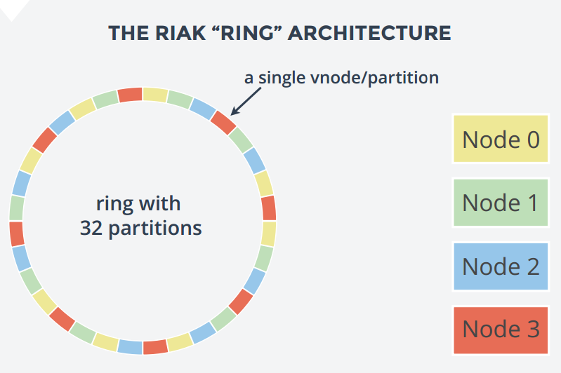](images/rancher_blog_Riak_ring.png)

From [Relational to Riak Whitepaper](http://basho.com/assets/RelationaltoRiak.pdf)

For example, if the cluster consists of 4 nodes: Node1, Node2, Node3,

and Node4, we will count around the nodes assigning each vnode to a

physical node until the all vnodes are accounted for, so in the previous

figure, Riak used 32 partition with 4 node cluster so we get:

```
Node0 : [1, 5, 9, 13, 17, 21, 25, 29]
Node1 : [2, 6, 10, 14, 18, 22, 26, 30]
Node3 : [3, 7, 11, 15, 19, 23, 27, 31]
Node4 : [4, 8, 12, 16, 20, 24, 28, 32]
```

So how about replication? Every time a write process happens Raik will

replicate the value to the next N **vnodes**, where N is the value of

the **n\_val** setting in Riak cluster. By default, N is 3. To explain

this, assume we will use the default **n\_val** value and we will use

the previous cluster setup with 4 nodes and 32 partitions, now lets

assume we will write a key/value to partition (vnode) 2 which is

assigned to the second node then the value will be replicated to vnode 3

and vnode 4 which are assigned to the 3rd and 4th nodes respectively.

For more information about Riak cluster, visit the [official riak documentation](http://docs.basho.com/riak/latest/). In this post, I am

going to deploy Riak cluster using Docker on RancherOS, the setup will

include:

- Five Docker containers as Riak nodes.
- Each Container will be on separate EC2 Instance.
- RancherOS will be installed on each EC2 instance.
- The whole setup will be managed using Rancher platform.

##

## The Riak Docker Image

Before launching your EC2 instances and the Rancher platform, you should

create the Riak Docker image that will run each instance. I used the

implementation of Riak Docker image of

[hectcastro](https://github.com/hectcastro/docker-riak), although I

added and removed some parts to become suitable to run on RancherOS.

First the Dockerfile:

```
FROM phusion/baseimage:latest
MAINTAINER Hussein Galal hussein.galal.ahmed.11@gmail.com

RUN sed -i.bak 's/main$/main universe/' /etc/apt/sources.list
RUN apt-get update -qq && apt-get install -y software-properties-common && 
    apt-add-repository ppa:webupd8team/java -y && apt-get update -qq && 
    echo oracle-java7-installer shared/accepted-oracle-license-v1-1 select true | /usr/bin/debconf-set-selections && 
    apt-get install -y oracle-java7-installer

# Install Riak
RUN curl https://packagecloud.io/install/repositories/basho/riak/script.deb | bash
RUN apt-get install -y riak

# Setup the Riak service
RUN mkdir -p /etc/service/riak
ADD scripts/riak.sh /etc/service/riak/run

RUN sed -i.bak 's/listener.http.internal = 127.0.0.1/listener.http.internal = 0.0.0.0/' /etc/riak/riak.conf && sed -i.bak 's/listener.protobuf.internal = 127.0.0.1/listener.protobuf.internal = 0.0.0.0/' /etc/riak/riak.conf && 
    echo "anti_entropy.concurrency_limit = 1" >> /etc/riak/riak.conf && 
    echo "javascript.map_pool_size = 0" >> /etc/riak/riak.conf && 
    echo "javascript.reduce_pool_size = 0" >> /etc/riak/riak.conf && 
    echo "javascript.hook_pool_size = 0" >> /etc/riak/riak.conf

# Add Automatic cluster support
ADD scripts/run.sh /etc/my_init.d/99_automatic_cluster.sh
RUN chmod u+x /etc/my_init.d/99_automatic_cluster.sh
RUN chmod u+x /etc/service/riak/run

# Enable insecure SSH key
RUN /usr/sbin/enable_insecure_key.sh

EXPOSE 22 8098 8087
CMD ["/sbin/my_init"]
```

A couple of notes on the previous Dockerfile. The phusion/baseimage is

used as the Docker base image, 2 important scripts were added to the

image (riak.sh, automatic\_cluster.sh) which I will explain in a second,

the ports 8098 and 8087 are used for HTTP and Protocol Buffers and

finally ssh support through insecure key was added. The purpose of the

riak.sh script is to start the Riak service and ensure that the node

name is set correctly, while the automatic\_cluster.sh script is used to

join the node to the cluster only if the **RIAK\_JOINING\_IP** is set

during the starting of the contianer. **riak.sh**

```
#! /bin/sh

# Ensure correct ownership and permissions on volumes
chown riak:riak /var/lib/riak /var/log/riak
chmod 755 /var/lib/riak /var/log/riak

# Open file descriptor limit
ulimit -n 4096
IP_ADDRESS=$(ip -o -4 addr list eth0 | awk '{print $4}' | cut -d/ -f1 | sed -n 2p)

# Ensure the Erlang node name is set correctly
sed -i.bak "s/riak@127.0.0.1/riak@${IP_ADDRESS}/" /etc/riak/riak.conf
rm  -rf /var/lib/riak/ring/*

# Start Riak
exec /sbin/setuser riak "$(ls -d /usr/lib/riak/erts*)/bin/run_erl" "/tmp/riak" 
"/var/log/riak" "exec /usr/sbin/riak console"
```

**automatic\_cluster.sh**

```
#!/bin/sh
sleep 10
if env | grep -q "RIAK_JOINING_IP"; then
  # Join node to the cluster
  (sleep 5;riak-admin cluster join "riak@${RIAK_JOINING_IP}"  && echo -e "Node Joined The Cluster") &

  # Are we the last node to join?
  (sleep 8; if riak-admin member-status | egrep "joining|valid" | wc -l | grep -q "${RIAK_CLUSTER_SIZE}"; then
    riak-admin cluster plan  && riak-admin cluster commit && echo -e "nCommiting The Changes..."
  fi) &
fi
```

Also note that RIAK\_CLUSTER\_SIZE is used to specify the size of the

cluster used in this setup. We don’t need more than that to start the

cluster, now build the image and push it to Docker Hub to be used later.

```
# docker build -t husseingalal/riak2 .
# docker push husseingalal/riak2
```

## Launch Rancher Platform

The Rancher Management platform will be used manage the Docker

containers on RancherOS instances. First you need to run Rancher

platform on a machine using the following command:

```
# docker run -d -p 8080:8080 rancher/server
```

[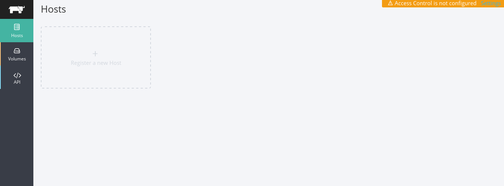](images/rancher_blog_Rancher_platform1.png)

## Create RancherOS EC2 Instances

RancherOS is available as an Amazon Web Services AMI, and can be easily

run on EC2, the next step is to create 5 EC2 instances to setup the

cluster:

[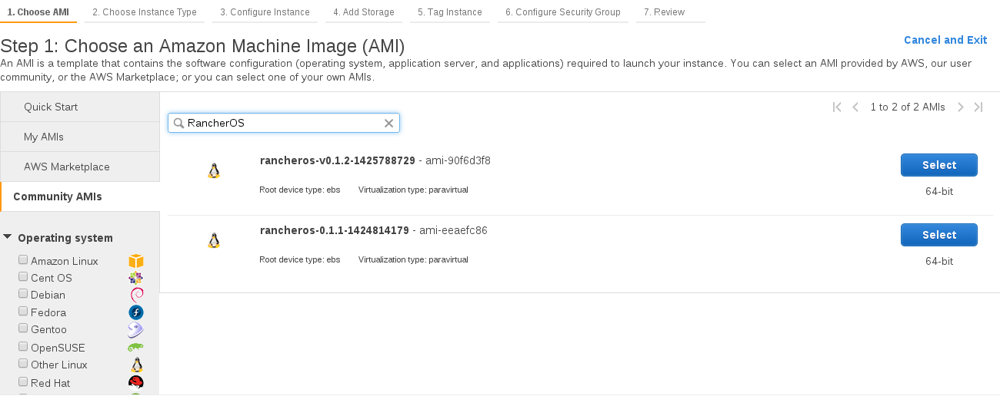](images/rancher_blog_riak1.png)

You will get something like that after creating five instances with

Amazon AWS:

[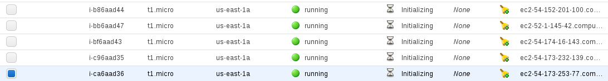](images/rancher_blog_riak3.png)

After creating the five instances, its time to register each instance

with Rancher by running the following command on each server:

```
[rancher@rancher ~]$ sudo docker run --rm -it --privileged -v /var/run/docker.sock:/var/run/docker.sock rancher/agent http://<ip-address>:8080/v1/scripts/4E1D4A26B07A1539CD33:1426626000000:jZskPi71YEPSJo1uMISMEOpbUo
```

After running the previous command on each server you will see that the

servers have been registered with Rancher:

[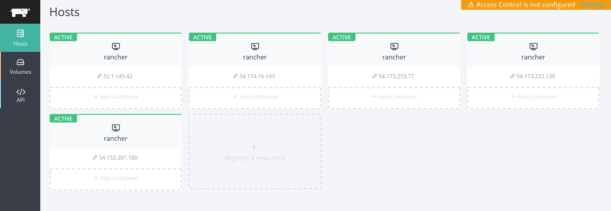](images/rancher_blog_riak4.png)

## Running The Riak cluster

The **RIAK\_CLUSTER\_SIZE** will provide the number of instances needed

to be added to the cluster before committing the changes, its

recommended to add 5 Riak nodes to the cluster of a production

environment, although you can set the **RIAK\_CLUSTER\_SIZE** to more or

fewer as needed. \*\*\*\* \*\*\*\* To create a Docker container using the

Rancher platform, on any instance click on “Add Container”:

[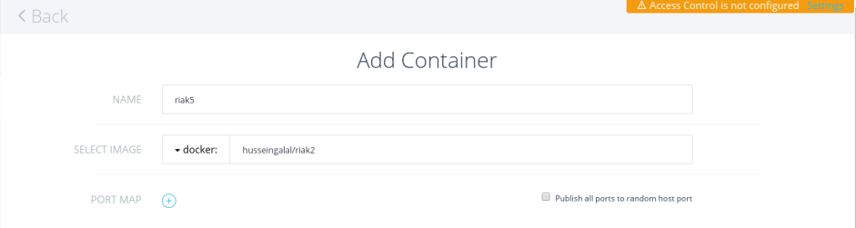](images/rancher_blog_riak_6.png)

On the first node you just need to specify the name of the container

and select the Riak image, but for other Riak nodes you need to specify

two more environment variables which will help the node to connect to

the cluster the **RIAK\_JOINING\_IP** which tells the Riak node to

connect to a node in the cluster and **RIAK\_CLUSTER\_SIZE** which used

to specify the number of nodes joining the cluster:

[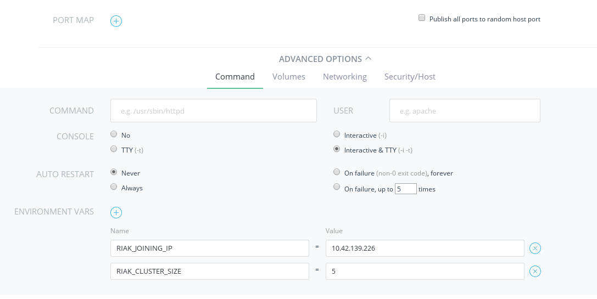](images/rancher_blog_riakn_6.png)

## Testing The Riak Cluster

From Rancher we can view the logs of the running containers, similar to

using docker logs -f container-name. This allows us to see the logs of

the Riak containers and ensure that everything is running as planned:

[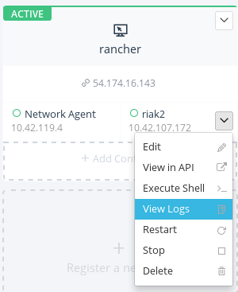](images/rancher_blog_Screenshot-from-2015-03-17-234126.png)

[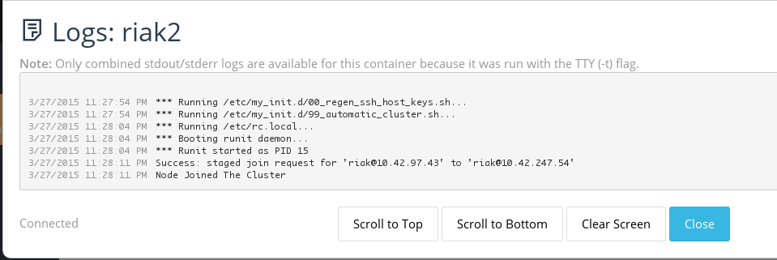](images/rancher_blog_Screenshot-from-2015-03-28-012257.png)

At the last node you will see something different. Since the number of

the node that joined the cluster matches the value of the environment

variable RIAK\_CLUSTER\_SIZE, so the changes will be committed and the

cluster will be up and running: [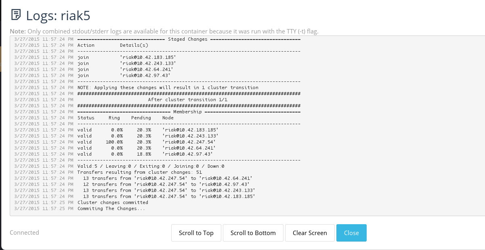](images/rancher_blog_Screenshot-from-2015-03-28-002558.png)

To see that the nodes are connected to the cluster, you can write

the following command inside the shell of any of the Riak containers:

```
# riak-admin member-status
```

And you will get the following output: [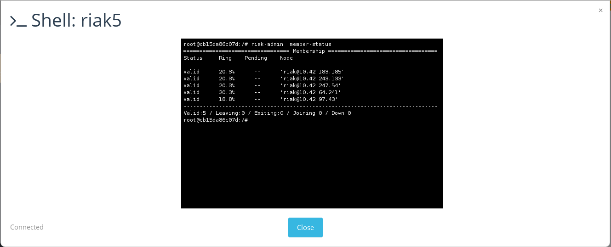](images/rancher_blog_Screenshot-from-2015-03-28-014031.png)

This indicates that each node is a valid member of the cluster and

acquire a roughly equal percentage of the ring. Now to test the cluster

from outside the environment, you should map the ports of the Docker

containers to the host’s ports, this can be achieved dynamically using

Rancher platform:

[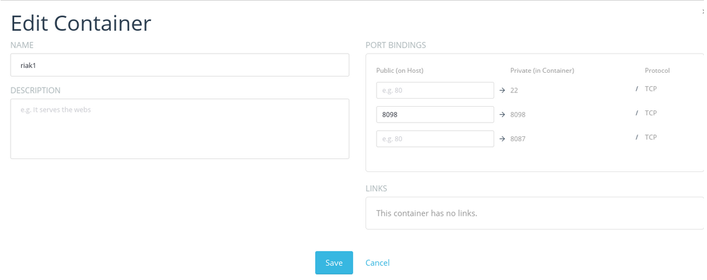](images/rancher_blog_19.png)

I already created and activated a bucket-type called “cluster,” which I

used to test via the Riak HTTP API. You can see from below the

environment is up and running now.

```
$ export RIAK=http://52.0.119.255:8098
$ curl -XPUT "$RIAK/types/cluster/buckets/rancher/keys/hello" 
-H "Content-Type:text/plain" 
-d "World.. Riak"

$ curl -i "$RIAK/types/cluster/buckets/rancher/keys/hello"
HTTP/1.1 200 OK
X-Riak-Vclock: a85hYGBgzGDKBVIcqZfePk3k6vPOYEpkzGNlYAroOseXBQA=
Vary: Accept-Encoding
Server: MochiWeb/1.1 WebMachine/1.10.5 (jokes are better explained)
url: </buckets/rancher>; rel="up"
Last-Modified: Fri, 27 Mar 2015 22:04:50 GMT
ETag: "4flAtEZ59hdYsKhSGVhKpZ"
Date: Fri, 27 Mar 2015 22:11:23 GMT
Content-Type: text/plain
Content-Length: 5

World.. Riak
```

## Conclusion

Riak cluster provides a distributed, high available, and simple

key-value store. Building the Riak cluster using RancherOS and Rancher

platform provide docker management and networking capabilities, making

installation quick and making it simple to upgrade and scale the

environment in the future. You can download Riak

[here](http://docs.basho.com/riak/2.0.2/downloads/). To download Rancher

or RancherOS please visit our [GitHub site](https://github.com/rancher/). You can find a detailed [getting started guide](https://github.com/rancher/os/blob/master/GETTING_STARTED.md) for

RancherOS on GitHub as well. If you would like to learn more, please

join our next online meetup to meet the team and learn about the latest

with Rancher and RancherOS. *Hussein Galal is a Linux System Administrator, with experience in Linux, Unix, Networking, and open source technologies like Nginx, Apache, PHP-FPM, Passenger, MySQL, LXC, and Docker. You can follow Hussein on Twitter [@galal\_hussein](http://twitter.com/galal_hussein).*
