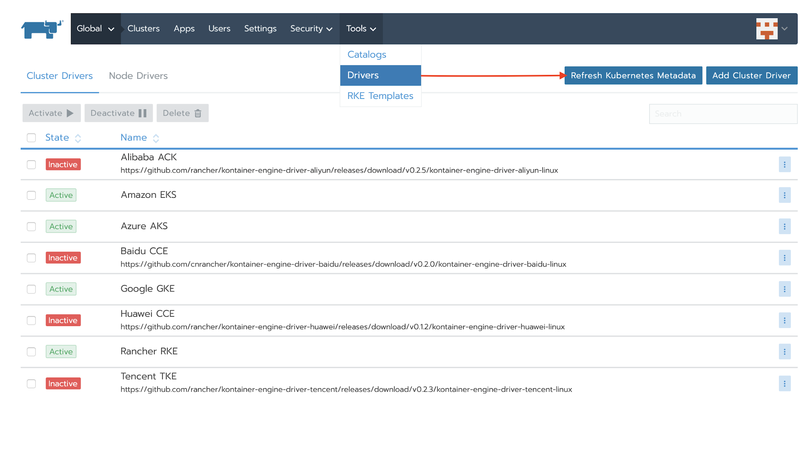
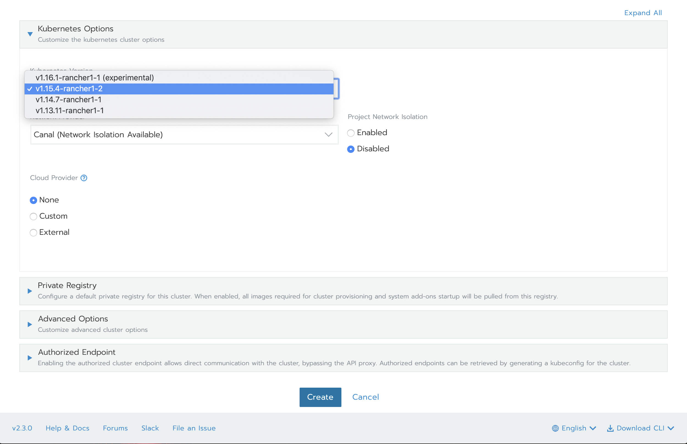

This week at KubeCon in San Diego, Rancher Labs announced the beta of Rio, the application deployment engine for Kubernetes. Originally announced in May of this year, the latest release is version v0.6.0. Rio combines several cloud-native technologies to simplify the process of taking code from the developer’s workstation to the production environment, while ensuring a robust and secure code deployment experience.

## What is Rio?

From the [Rio](https://rio.io) website:



Rio takes technologies such as [Kubernetes](https://kubernetes.io), [Tekton Build](https://github.com/tektoncd/pipeline/), [linkerd](https://linkerd.io/), [cert-manager](https://github.com/jetstack/cert-manager), [buildkit](https://github.com/moby/buildkit) and [gloo](https://www.solo.io/gloo) and combines them to present a holistic application deployment environment.

Rio is capable of:

1. Building code from source and deploying it into a Kubernetes cluster
2. Automatically creating DNS records for applications and securing those endpoints with TLS certificates from Let’s Encrypt
3. Autoscaling of workloads based on QPS and workload metrics
4. Canary, blue/green, and A/B deployments
5. Routing of traffic via service mesh
6. Scale-to-zero serverless workloads
7. Git-triggered deployments

## Rancher Ecosystem


Rio fits into a stack of Rancher products that support application deployment and container operations from the operating system to the application. When combined with products such as Rancher 2.3, K3s, and RKE, Rio completes the story of how organizations can deploy and manage their applications and containers.

Check out these other products at their respective sites: [Rancher 2.3 & RKE](https://rancher.com) and [K3s](https://k3s.io/).

# Rio In Depth

To understand how Rio accomplishes the capabilities listed above, let’s take a look at some of the concepts and inner working of the product.

## Installing Rio

### Pre-requisites

- A Kubernetes cluster running version 1.15+
- `kubeconfig` configued for the cluster (i.e. context is the cluster you wish to install Rio into)
- Rio CLI tool installed in `$PATH` (see [the quick start guide](https://github.com/rancher/rio/blob/master/README.md) for instructions on how to install the CLI utility.)

### Installation

With Rio CLI tool installed, call `rio install`. You may need to consider the following option:

- `--ip-address` - A comma-separated list of IP addresses for your nodes. Use this if:
  - You are not using (or can’t use) a layer-4 load balancer
  - Your node IPs are not the IPs you want traffic to arrive at. (e.g. you are using EC2 instances with public IPs)

## Services

Services are the basic unit of execution within Rio. Instantiated from either a Git repository or a container image, a service is made up of a single container along with associated sidecars for the service mesh (enabled by default). For instance, to run a simple “hello world” application built using Golang:

```
rio run https://github.com/ebauman/rio-demo
```

… or the container image version …

```
rio run ebauman/demo-rio:v1
```

More options can be passed to `rio run` such as any ports to expose (`-p 80:8080/http`) or configuration for autoscaling (`--scale 1-10`). See `rio help run` for all options.

To view your running services, execute `rio ps`:

```
$ rio ps
NAME            IMAGE                               ENDPOINT
demo-service    default-demo-service-4dqdw:61825    https://demo-service...
```

Each time you run a new service, Rio will generate a global endpoint for the service.

```
$ rio endpoints
NAME           ENDPOINTS
demo-service   https://demo-service-default.op0kj0.on-rio.io:30282
```

Note how this endpoint does not include a version - it points to a set of services identified by a common name, and traffic is routed according to the weight of the services.

## Automatic DNS & TLS

By default, all Rio clusters will have an `on-rio.io` hostname created for them, prepended with a random string (e.g. `lkjsdf.on-rio.io`). This domain becomes a wildcard domain whose records resolve to the gateway of the cluster. That gateway is either the layer-4 load balancer or the nodes themselves if using a NodePort service.

In addition to the creation of this wildcard domain, Rio also generates a wildcard certificate for the domain using Let’s Encrypt. This allows for automatic encryption of any HTTP workloads with no configuration required from the user. To enable this, pass a `-p` argument that specifies `http` as the protocol. For example:

```
rio run -p 80:8080/http ...
```

## Autoscaling

Rio can automatically scale services based on queries per second. To enable this feature, pass `--scale 1-10` as an argument to `rio run`. For example:

```
rio run -p 80:8080/http -n demo-service --scale 1-10 ebauman/rio-demo:v1
```

Executing this command will build `ebauman/rio-demo` and deploy it. If we use a tool to add load to the endpoint, we can observe the autoscaling. To demonstrate this we’ll need to use the HTTP endpoint (instead of HTTPS) as the tool we’re using does not support TLS:

```
$ rio inspect demo-service
<snipped>
endpoints:
- https://demo-service-v0-default.op0kj0.on-rio.io:30282
- http://demo-service-v0-default.op0kj0.on-rio.io:31976
<snipped>
```

`rio inspect` shows other information besides the endpoints, but that’s all we need right now. Using the HTTP endpoint, along with the excellent HTTP benchmarking tool `rakyll/hey`, we can add synthetic load:

```
hey -n 10000 http://demo-service-v0-default.op0kj0.on-rio.io:31976
```

This will send 10,000 requests to the HTTP endpoint. Rio will pick up on the increased QPS and scale appropriately. Executing another `rio ps` shows the increased scale:

```
$ rio ps
NAME            ...     SCALE       WEIGHT
demo-service    ...     2/5 (40%)   100%
```

## Staging, Canary Deployments, and Weighting

> **Note**
>
> Recall that for every service, a single global endpoint is created that routes traffic according to weights of the underlying services.

Rio can stage new releases of services before promoting them to production. Staging a new release is simple:

```
rio stage --image ebauman/rio-demo:v2 demo-service v2
```

This command stages a new releasse of `demo-service` with the version `v2`, and uses the container image `ebauman/rio-demo:v2`. We can now see the newly-staged release by executing `rio ps`:

```
$ rio ps
NAME                IMAGE                   ENDPOINT                    WEIGHT
demo-service@v2     ebauman/rio-demo:v2     https://demo-service-v2...  0%
demo-service        ebauman/rio-demo:v1     https://demo-service-v0...  100%
```

Note that the endpoint for the new service features the addition of `v2`. Visiting this endpoint will bring you to v2 of the service, even though the weight is set to 0%. This provides you the ability to verify operation of your service before sending traffic to it.

Speaking of sending traffic..

```
$ rio weight demo-service@v2=5%
$ rio ps
NAME                IMAGE                   ENDPOINT                    WEIGHT
demo-service@v2     ebauman/rio-demo:v2     https://demo-service-v2...  5%
demo-service        ebauman/rio-demo:v1     https://demo-service-v0...  95%
```

Using the `rio weight` command, we are now sending 5% of our traffic (from the global service endpoint) to the new revision. Once we’re happy with the performance of `v2` of `demo-service`, we can promote it to 100%:

```
$ rio promote --duration 60s demo-service@v2
demo-service@v2 promoted
```

Over the next 60 seconds, our `demo-service@v2` service will be slowly promoted to receive 100% traffic. At any point during this process, we can execute `rio ps` and watch the progress:

```
$ rio ps
NAME                IMAGE                   ENDPOINT                    WEIGHT
demo-service@v2     ebauman/rio-demo:v2     https://demo-service-v2...  34%
demo-service        ebauman/rio-demo:v1     https://demo-service-v0...  66%
```

## Routing

Rio can route traffic to endpoints based on any combination of hostname, path, method, header, and cookie. Rio also supports mirroring traffic, injecting faults, configuring retry logic and timeouts.

### Creating a Router

In order to begin making routing decisions, we must first create a router. A router represents a hostname and a set of rules that determine how traffic to the hostname is routed within the Rio cluster. To define a router, execute `rio router add`. For example, to create a router that receives traffic on `testing-default` and sends it to `demo-service`, use the following command:

```
rio route add testing to demo-service
```

This will create the following router:

```
$ rio routers
NAME             URL                            OPTS    ACTION      TARGET
router/testing   https://testing-default.0pjk...        to          demo-service,port=80
```

Traffic sent to `https://testing-default...` will be forwarded to `demo-service` on port 80.

Note that the route created here is `testing-default.<rio domain>`. Rio will always namespace resources, so in this case the hostname `testing` has been namespaced in the `default` namespace. To create a router in a different namespace, pass `-n <namespace>` to the `rio` command:

```
rio -n <namespace> route add ...
```

### Path-Based Routing

To define a path-based route, specify a hostname plus a path when calling `rio route add`. This can be a new router, or an existing one.

```
$ rio route add testing/old to demo-service@v1
```

The above command will create a path-based route that receives traffic on `https://testing-default.<rio-domain>/old`, and forward that traffic to the `demo-service@v1` service.

### Header and Method-Based Routing

Rio supports routing decisions made based on values of HTTP headers, as well as HTTP verbs. To crete a rule that routes based on a particular header, specify the header during the `rio route add` command:

```
$ rio route add --header X-Header=SomeValue testing to demo-service
```

The above command will create a routing rule that forwards traffic with an HTTP header of `X-Header` and value of `SomeValue` to the `demo-service`. Similarly, you can define a rule for HTTP methods:

```
$ rio route add --method POST testing to demo-service
```

### Fault Injection

One of the more interesting capabilities of Rio routing is the ability to inject faults into your responses. By defining a fault routing rule, you can set a percentage of traffic to fail with a specified delay and HTTP code:

```
$ rio route add --fault-httpcode 502 --fault-delay-milli-seconds 1000 --fault-percentage 75 testing to demo-service
```

### Other Routing Options

Rio supports traffic splitting by weight, retry logic for failed requests, redirection to other services, defining timeouts, and adding rewrite rules. To view these options, take a look at the documentation available in the [GitHub repository](https://github.com/rancher/rio) for Rio.

## Automatic Builds

Passing a git repository to `rio run` will instruct Rio to build code following any commit to a watched branch (default: `master`). For GitHub repositories, you can enable this functionality via GitHub webhooks. For any other git repo, or if you don’t wish to use webhooks, Rio has a “gitwatcher” service that periodically checks your repository for changes.

Rio can also build code from pull requests for the watched branch. To configure this, pass `--build-pr` to `rio run`. There are other options for configuring this functionality, including passing the name of the Dockerfile, customizing the name of the image to build, and specifying a registry to which the image should be pushed.

## Stacks and Riofile

Rio defines resources using a `docker-compose`-style manifest called `Riofile`.

```
configs:
  conf:
    index.html: |-
      <!DOCTYPE html>
      <html>
      <body>

      <h1>Hello World</h1>

      </body>
      </html>
services:
  nginx:
    image: nginx
    ports:
    - 80/http
    configs:
    - conf/index.html:/usr/share/nginx/html/index.html
```

This `Riofile` defines all the necessary components for a simple `nginx` Hello World webpage. Deploying this via `rio up` will create a Stack, which is a collection of resources defined by a `Riofile`.

Rio has many features around `Riofiles`, such as watching a Git repository for changes and templating using Golang templates.

## Other Rio Components

Rio has many more features, such as configs, secrets, and role-based access control (RBAC). Documentation and examples for these are available on the [Rio website](https://rio.io) or in the [GitHub repository](https://github.com/rancher/rio).

# Rio Visualizations

## Rio Dashboard

Rio’s beta release includes a brand new dashboard for visualization of Rio components. To access this dashboard, execute `rio dashboard`. On operating systems with a GUI and default browser Rio will automatically open the browser and load the dashboard.


You can use the dashboard to create and edit stacks, services, routers, and more. Additionally, objects for the various component technologies (Linkerd, gloo, etc) can be directly viewed and edited, although this is not recommended. The dashboard is in the early stages of development, so some screens, such as auto scaling and service mesh, are not yet available.

## Linkerd

As the default service mesh for Rio, Linkerd comes with a dashboard as part of the product. This dashboard is available by executing `rio linkerd`, which will proxy localhost traffic to the `linkerd` dashboard (it is not exposed externally). Similar to `rio dashboard`, on operating systems with a GUI and default browser, Rio will open the browser and load the dashboard:



The `linkerd` dashboard shows mesh configuration, traffic flows, and mesh components for the Rio cluster. Some components of Rio’s routing capabilities are provided by `linkerd`, and so those configurations may be displayed in this dashboard. There are also tools available for testing and debugging mesh configuration and traffic.

## Conclusion

Rio is a powerful and robust application deployment engine and offers many capabilities and features. These components empower the developer when deploying applications, making the process robust and secure while also easy and fun. At the peak of the stack of Rancher products, Rio completes the story of how organizations can deploy and manage their applications and containers.

For more information about Rio, visit the Rio website at <https://rio.io> or the GitHub repository at <https://github.com/rancher/rio>.

## Hands-on with K3s GA and Rio Beta Online Meetup

[Join](https://info.rancher.com/hands-on-k3s-ga-rio-beta) the December Online Meetup as Rancher Co-Founder Shannon Williams and Rancher Product Manager Bill Maxwell discuss and demo:

- Key considerations when delivering Kubernetes-as-a-Service to DevOps teams
- Understanding the “Run Kubernetes Everywhere” solution stack from Rancher Labs including RKE, K3s, Rancher 2.3 and Rio
- Getting started with K3s with Rancher 2.3
- Streamlining your application deployment workflows with Rio: build, deploy, and manage containerized applications at scale

[Book your Spot.](https://info.rancher.com/hands-on-k3s-ga-rio-beta)
