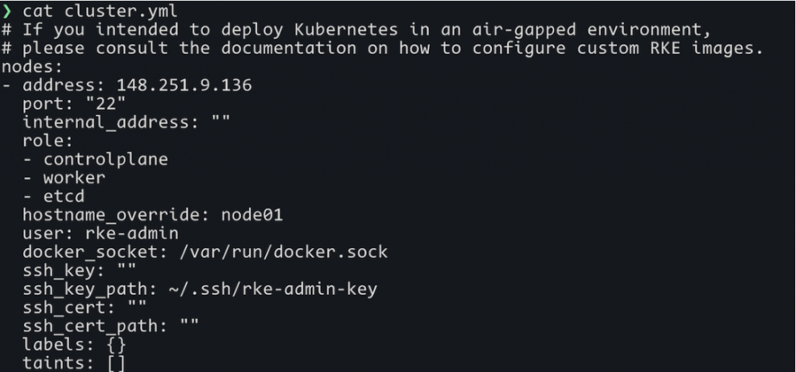

When I joined SUSE I heard about our Kubernetes distributions: Rancher Kubernetes Engine ([RKE](https://rancher.com/products/rke)), [RKE2](https://docs.rke2.io/) and [K3s](https://k3s.io/). However, the differences between RKE and RKE2 were not clear to me. I decided to spend time with them and blog about the differences.

## **RKE and RKE2 installation**

Let’s start with the installation. The RKE installation process takes some preparation. You must provide a yaml file with the basics of the configuration or just run the binary that will ask you some questions and build that yaml file for you. The problem, in my case, was that I wasn’t completely sure of what the questions were asking for. I had to run the installer a couple of times and check the results to understand what was happening. Once solved, this is not a big thing. It is possible to deploy an HA cluster and perform both version and configuration updates from a single manifest.

When it comes to RKE2, the installation process is clearer.  You can just run a script that will install a single node for you. Later you can add more nodes using a token. In addition, you use the binary to configure nodes for the cluster. To keep the process as simple as possible, RKE2 uses sensible defaults for most configurations but you can also use config files to deploy clusters using your own custom values.

Fig1 - RKE cluster config file sample

One of the most important things to consider when evaluating RKE and RKE2 is how they are installed and how they work with Rancher. You are probably testing these distributions because you already use Rancher, or you are thinking about using it. Well, the deployment methods of RKE and RKE2 in Rancher are completely different. For RKE, we use a deployment method that is open source but is not standardized. However, to deploy RKE2 and K3s, we use the open source project [Cluster API](https://github.com/kubernetes-sigs/cluster-api), which is becoming the de facto standard for deploying Kubernetes clusters. This is good -- but there are other benefits. Rancher can already help you deploy RKE and RKE2 clusters in multiple platforms. With the addition of Cluster API as a deployment method for RKE2 and K3s, we’re bringing the game to a new level. You can create your own custom provider inside Rancher’s UI using Cluster API and its [drivers](https://github.com/kubernetes-sigs/cluster-api/blob/c4e90703b1c4dd027d8806a2652898d4b1816bc6/cmd/clusterctl/cmd/config_repositories_test.go#L103), even though Rancher doesn’t support that infrastructure provider out of the box. Then you can take advantage of Rancher’s management and automation features and use Rancher’s API to manage the entire lifecycle of your clusters no matter which infrastructure provider you use.

## **The main differences between RKE and RKE2**

The biggest difference between RKE and RKE2 is the container runtime. RKE needs [Docker](https://www.docker.com/) as container runtime, while RKE2 relies on [Containerd](https://containerd.io/), which has become the industry standard container runtime. CNCF announced in December 2020 that they were dropping Docker as a default runtime in Kubernetes and moving to Containerd as default container runtime. The deprecation of Docker happened in February 2022. Another substantial difference is that RKE2 uses static pods managed by the kubelet as the control plane while in RKE the control plane pods are managed by Docker. Containerd allows RKE2 to mirror container registries. This is not possible in RKE because of Docker.

### **CNI plugins**

Both distributions are fully compliant with CNCF certified distributions but there are a few differences to consider in addition to the container runtime. First, RKE offers different CNI plugin integrations than RKE2: you can use Canal, Flannel, Calico and Weave. In RKE2, you can use Cillium, Calico, Canal and Multus. Cillium and Multus make a significant difference, especially if you are planning to use RKE2 for Telco or multi-nic use cases. In addition, without Multus, you can’t use multiple NICs in a pod. Cillium offers great networking capabilities alongside many security and compliance features, and these are critical for Telco applications.

### **Security**

RKE2 was formerly known as RKE Government because was originally designed to be deployed in US government projects. As you can imagine, security is of utmost importance in these scenarios, so RKE2 focuses on security and compliance out of the box.

RKE2 is configured to pass CIS Kubernetes benchmark scans with minimal effort and configuration, enables FIPS 140-2 compliance for cryptographic modules and uses [trivy](https://github.com/aquasecurity/trivy) to scan regularly for CVEs on the images used in the cluster.

RKE is a standard Kubernetes distribution without the focus on security.

There is another big difference. Since RKE2 uses K3s as a foundation, it has its simplicity, modularity, ease-of-operations and deployment model, mixing the best of both worlds (RKE and K3s). Remember that K3s is a lightweight distribution for resource-constrained environments and designed to ease the operation, since in edge scenarios we can manage thousands or hundreds of thousands of single-node clusters.

## **Conclusion**

RKE2 is considered the next iteration of RKE. With its focus on security, simplified operations, and the integration with more advanced CNI plugins, RKE2 is a solid choice for Telco, apps with bigger networking capabilities, and environments where security and compliance are critical. However, RKE is also a stable CNCF-certified Kubernetes distribution that can be used in any kind of production environment.

If you want to know more about Rancher and Kubernetes, please join the [SUSE-Rancher community](https://community.suse.com/) or join to the [Rancher slack channel](https://slack.rancher.io/) to learn more or to ask questions. In the [Rancher Labs](https://www.youtube.com/c/Rancher) and [SUSE](https://www.youtube.com/c/SUSE) YouTube channels, you can find tons of useful information.
