In the [previous article](https://community.suse.com/posts/run-you-first-secure-and-dns-with-rancher), we looked at how you can ensure the issuance of certificates and the management of DNS. This article will examine how you can perform Canary Deployment of an application on a Rancher cluster.

The historically *poor canary* has been involved in experiments to determine the dangerous levels of methane in coal mines. The cage with the canary was lowered for a while on a rope into the shaft and then raised. If the canary was alive, it was believed that coal mining could be done. In the case of the dead canary, no coal was mined. This approach is not used because it is inhumane towards animals.


The canary cage was always near the miner and if she stopped singing it clearly indicated that it was necessary to leave the mine.

**Canary deployment**is the existence of two versions of an application at the same time, with the newer version being smaller at the beginning and receiving less load. As the new deployment is analyzed, all requests are gradually switched to the new version, and the old version of the application is removed.

There is a widespread belief that a **S****ervice Mesh** is needed to manage the traffic of such deployments, however, to manage incoming traffic, you can do only with an nginx ingress controller and annotations [Canary](https://kubernetes.github.io/ingress-nginx/user-guide/nginx-configuration/annotations/#canary):

```
nginx.ingress.kubernetes.io/canary: "true"
nginx.ingress.kubernetes.io/canary-weight: <num>
```

The disadvantage of this method is that we have to manage it manually. To automate this we can use [Argo Rollouts](https://argoproj.github.io/argo-rollouts/).

# Run Argo Rollouts

Add helm-repo: <https://argoproj.github.io/argo-helm>

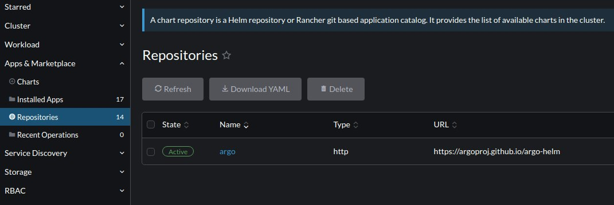

argo-rollouts chart:

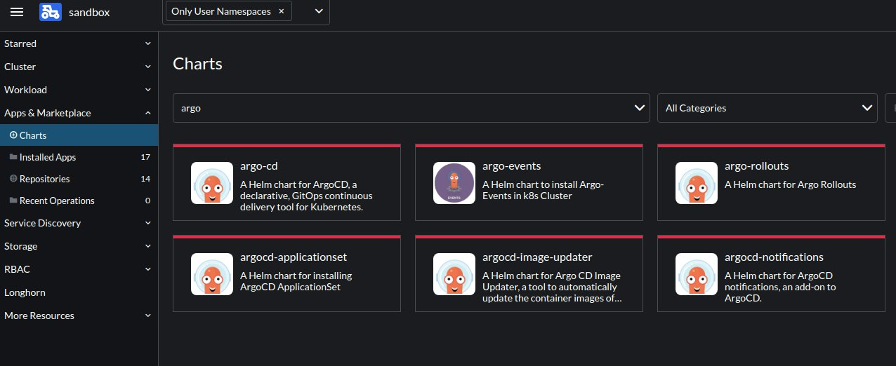

Helm-values:

```
installCRDs: true
```

## Modify Deployment and Run Rollouts CRD

ScaleDown deployment, set Replicas 0:

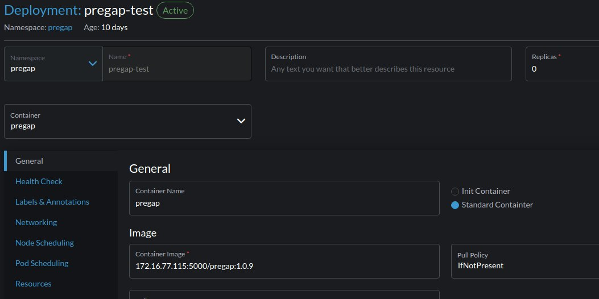

## Run stable and canary services

```
apiVersion: v1
kind: Service
metadata:
  annotations:
    argo-rollouts.argoproj.io/managed-by-rollouts: rollout-pregap
  name: rollouts-pregap-canary
  namespace: pregap
spec:
  clusterIP: 10.43.139.197
  ports:
  - name: http
    port: 8080
    protocol: TCP
    targetPort: 8080
  selector:
    app: test2-pregap
  sessionAffinity: None
  type: ClusterIP
```

```
apiVersion: v1
kind: Service
metadata:
  annotations:
    argo-rollouts.argoproj.io/managed-by-rollouts: rollout-pregap
spec:
  clusterIP: 10.43.61.221
  ports:
  - name: http
    port: 8080
    protocol: TCP
    targetPort: 8080
  selector:
    app: test2-pregap
  sessionAffinity: None
  type: ClusterIP
```

## Run Rollouts CRD

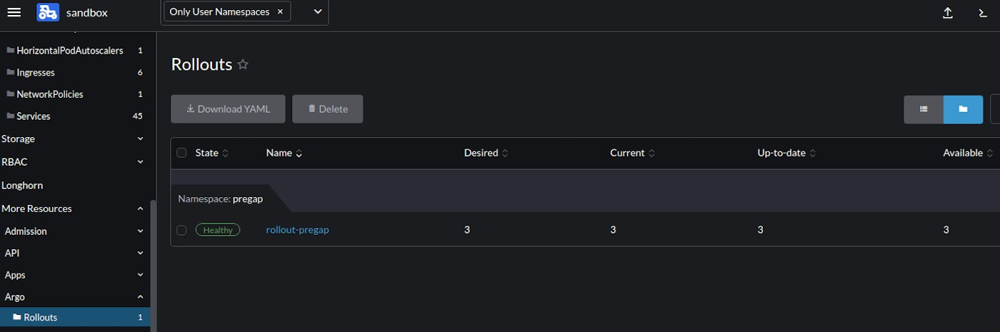

An important point, since we do not want to change the Deployment, we refer to it in the Rollout manifest: **workloadRef.kind: Deployment, workloadRef.name**

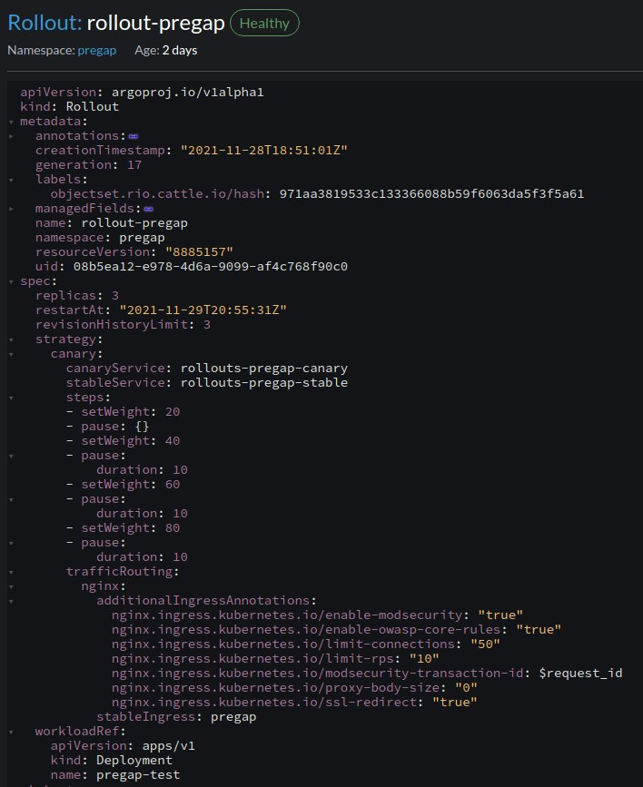

After run manifest additional ingress will be created:

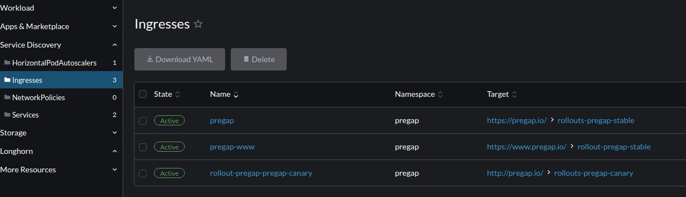

## Argo Rollouts Dashboard

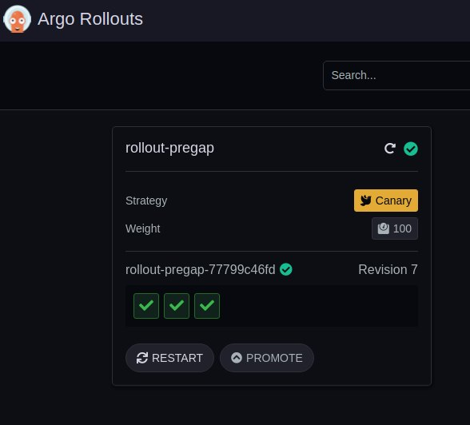

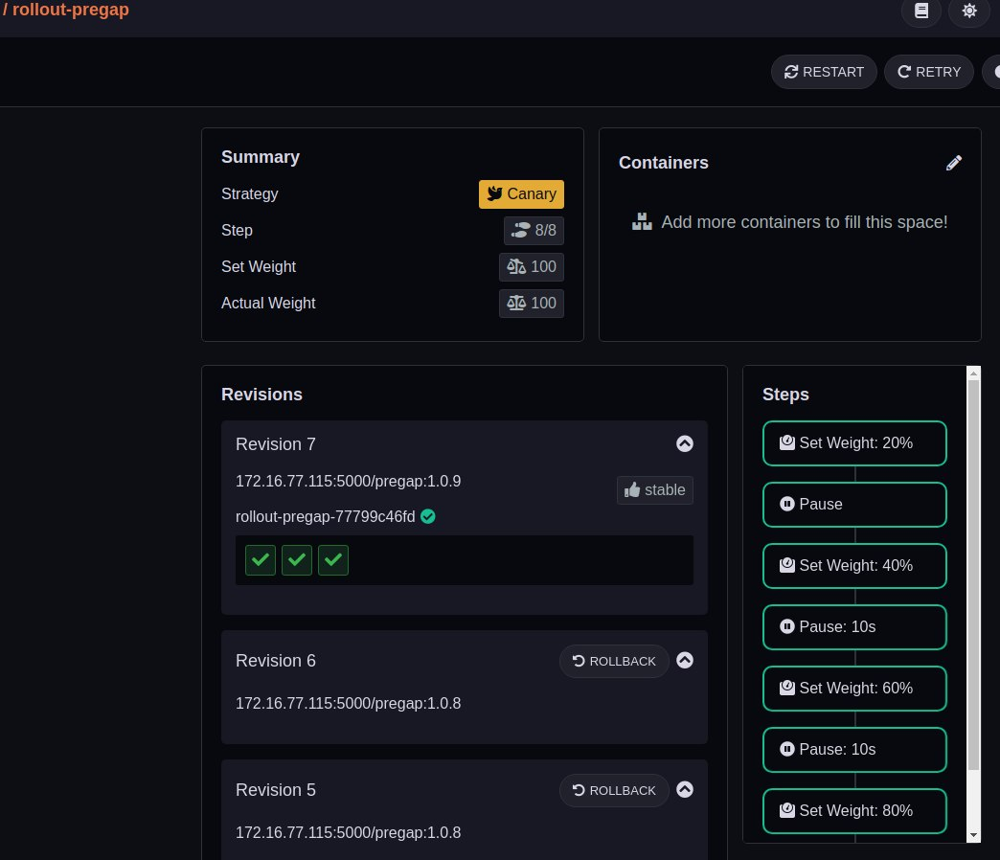

# Additional steps in the CD-pipeline

Add promotion step in .drone.yml:

```
- name: promote-release-dr
  image: plugins/docker
  settings:
    repo: 172.16.77.115:5000/pregap
    registry: 172.16.77.115:5000
    insecure: true
    dockerfile: Dockerfile.multistage
    tags:
    - latest
    - ${DRONE_TAG##v}
  when:
    event:
    - promote
    target:
    - production

- name: promote-release-prod
  image: plugins/webhook
  settings:
    username: admin
    password: admin
    urls: http://172.16.77.118:9300/v1/webhooks/native
    debug: true
    content_type: application/json
    template: |
      {        "name": "172.16.77.115:5000/pregap",
        "tag": "${DRONE_TAG##v}"      }
        when:
    event:
    - promote
    target:
    - production
```

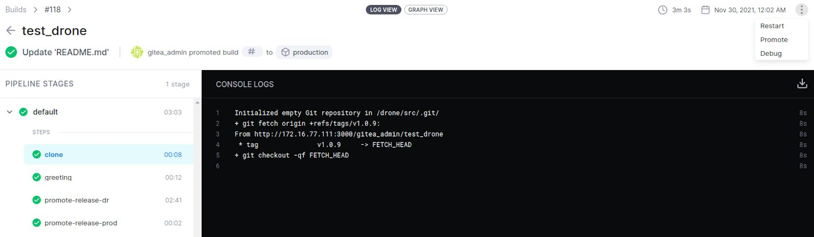

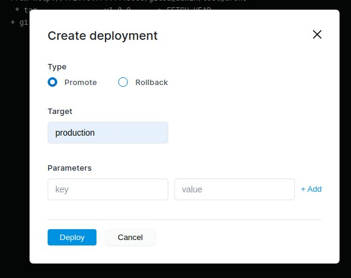

add keel approve:

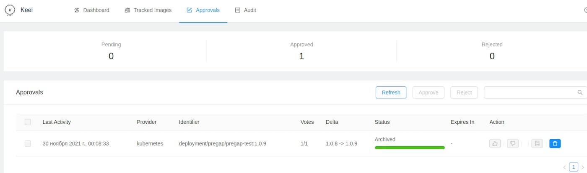

# Conclusion

Thus, making **Canary** or **Green/Blue**deployments is not difficult at all - it will increase the reliability in the production environment and reduce the impact area in the event of any design errors. In the future, I will add RAM to the server, and it will be possible to enable **Prometheus** monitoring and **Istio** and try to carry out the stages of analysis and experiment, which allows Argo Rollouts.
