This article describes how to run a very simple CI/CD toolkit based on the Rancher platform. We will use tools like Gitea, Drone, and Keel to ensure our application's continuous integration and delivery. We will pre-configure one host to run Rancher. We will only do simple manual operations in the Rancher interface.[](https://media1-production-mightynetworks.imgix.net/asset/31249936/Rancher-Logo.png?ixlib=rails-0.3.0&fm=jpg&q=75&auto=format)

# **Prepare Host**

Host specification: 8 Core CPU, 12Gb RAM (the bigger, the better). Your host must support hardware virtualization, search, and enable from BIOS extension: VT-x or VT-d or AMD-V. Install Ubuntu 20.04 Server (I have not had time to get acquainted with SUSE, **but you can do it on SUSE and in the comments, add how to do it there**) on host and update:

```
sudo apt update && sudo apt upgrade && sudo shutdown -r now
```

After reboot (host reboots help make sure you're okay, so it's good to do them sometimes):

```
sudo apt install ubuntu-desktop && sudo shutdown -r now
```

You will be able to work in the GUI and copy-pasting commands with Terminal.
> ***You do not need to disable the swap file, because if you have little RAM, then you will encounter frequent host freezes. Rancher can work with swap enabled. Example VM (Rancher M&C) and host (cluster):***

[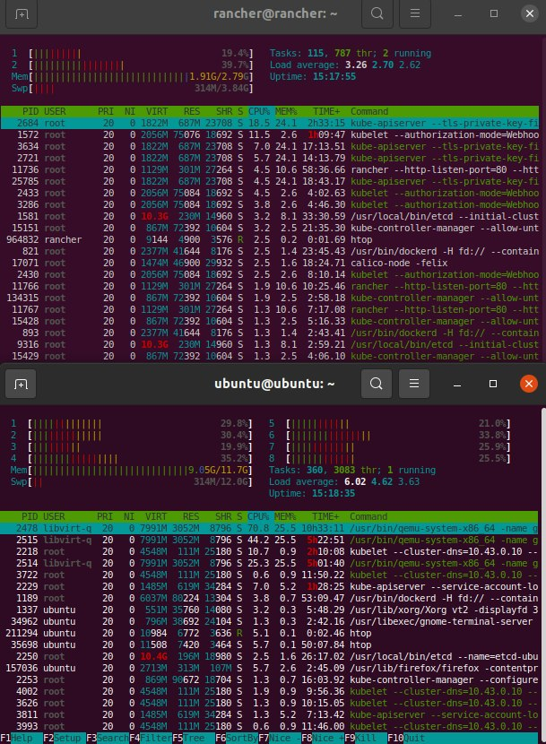](https://media1-production-mightynetworks.imgix.net/asset/31303630/rnacher_swap_on1.png?ixlib=rails-0.3.0&fm=jpg&q=75&auto=format)

To change the network interface configuration, we will use bridge:

```
sudo vi /etc/netplan/00-installer-config.yaml

# This is the network config written by 'subiquity'
network:
  ethernets:
    ens5:
      dhcp4: false
      dhcp6: false
  bridges:
    br0:
          interfaces: [ens5]
          addresses: [172.16.77.28/24]
          gateway4: 172.16.77.1
          mtu: 1500
          nameservers:
                addresses: [172.16.77.1]
          parameters:
                stp: true
                forward-delay: 4
          dhcp4: false
          dhcp6: false
  version: 2
```

To exit the vi editor with saving, use the keyboard shortcut Shift+ZZ.

```
sudo netplan apply
```

## **Install** virt-manager for host and create V**M**

Install virt-manager:

```
sudo apt install qemu qemu-kvm libvirt-daemon libvirt-clients bridge-utils virt-manager
```

```
sudo virt-manager
```

Create VM for Rancher M&C-server, use 3Gb RAM, 2 VCPU, and 25Gb Disk. **For network use shared device br0**. I used the same ISO as when installing the host. **Set auto-start VM in GUI virt-manager.** Prepare VM:

```
sudo apt update && sudo apt upgrade && sudo shutdown -r now
```

Check IP-address in VM:

```
ip a
```

Add record in /etc/hosts on host:

```
sudo vi /etc/hosts
```

```
<remote ip-address VM>         rancher.lan
```

## Create ssh-key on host and connect VM

```
ssh-keygen -t rsa
```

```
ssh-copy-id -i ~/.ssh/id_rsa.pub rancher@rancher.lan
```

```
ssh rancher@rancher.lan
```

## Install docker-ce on host and VM

```
sudo apt install \
    ca-certificates \
    curl \
    gnupg \
    lsb-release
```

```
curl -fsSL https://download.docker.com/linux/ubuntu/gpg | sudo gpg --dearmor -o /usr/share/keyrings/docker-archive-keyring.gpg
```

```
echo \
  "deb [arch=$(dpkg --print-architecture) signed-by=/usr/share/keyrings/docker-archive-keyring.gpg] https://download.docker.com/linux/ubuntu \
  $(lsb_release -cs) stable" | sudo tee /etc/apt/sources.list.d/docker.list > /dev/null
```

```
sudo apt update
```

```
sudo apt install docker-ce docker-ce-cli containerd.io
```

## Install utils: rke, kubectl, and helm on host

### rke

Go to <https://github.com/rancher/rke/releases> and choice last release:

```
wget https://github.com/rancher/rke/releases/download/v1.3.2/rke_linux-amd64
```

```
mkdir rancher mv rke_linux-amd64 rancher/rke cd rancher chmod +x rke
```

```
./rke config --name cluster.yml
[+] Cluster Level SSH Private Key Path [~/.ssh/id_rsa]:
[+] Number of Hosts [1]:
[+] SSH Address of host (1) [none]: 172.16.77.32 <--this is remote ip-addres rancher M&C-server
[+] SSH Port of host (1) [22]:
[+] SSH Private Key Path of host (172.16.77.32) [none]:
[-] You have entered empty SSH key path, trying fetch from SSH key parameter
[+] SSH Private Key of host (172.16.77.32) [none]: ~/.ssh/id_rsa
[+] SSH User of host (172.16.77.32) [ubuntu]: rancher
[+] Is host (172.16.77.32) a Control Plane host (y/n)? [y]:
[+] Is host (172.16.77.32) a Worker host (y/n)? [n]: y
[+] Is host (172.16.77.32) an etcd host (y/n)? [n]: y
[+] Override Hostname of host (172.16.77.32) [none]:
[+] Internal IP of host (172.16.77.32) [none]:
[+] Docker socket path on host (172.16.77.32) [/var/run/docker.sock]:
[+] Network Plugin Type (flannel, calico, weave, canal, aci) [canal]:
[+] Authentication Strategy [x509]:
[+] Authorization Mode (rbac, none) [rbac]:
[+] Kubernetes Docker image [rancher/hyperkube:v1.21.5-rancher1]:
[+] Cluster domain [cluster.local]:
[+] Service Cluster IP Range [10.43.0.0/16]:
[+] Enable PodSecurityPolicy [n]:
[+] Cluster Network CIDR [10.42.0.0/16]:
[+] Cluster DNS Service IP [10.43.0.10]:
[+] Add addon manifest URLs or YAML files [no]:
```

Up RKE-cluster on VM:

```
./rke up
```

### kubectl

```
sudo apt update && sudo apt install -y apt-transport-https
curl -s https://packages.cloud.google.com/apt/doc/apt-key.gpg | sudo apt-key add -
echo "deb https://apt.kubernetes.io/ kubernetes-xenial main" | sudo tee -a /etc/apt/sources.list.d/kubernetes.list
sudo apt update
sudo apt install -y kubectl
```

```
cp kube_config_cluster.yml ~/.kube/config
kubectl get all
```

### helm

```
curl https://baltocdn.com/helm/signing.asc | sudo apt-key add -
sudo apt install apt-transport-https --yes
echo "deb https://baltocdn.com/helm/stable/debian/ all main" | sudo tee /etc/apt/sources.list.d/helm-stable-debian.list
sudo apt update
sudo apt install helm
```

Reboot the host and make sure everything works:

```
kubectl get all
```

It takes time to start the cluster, so it will not be available immediately.

# Run Rancher M&C-server

```
helm repo add jetstack https://charts.jetstack.io
```

```
helm repo update
```

```
helm install cert-manager jetstack/cert-manager \
--namespace cert-manager \
--create-namespace --version v1.6.1 \
--set installCRDs=true --wait --debug
```

Install Rancher:

```
helm repo add rancher-latest https://releases.rancher.com/server-charts/latest
```

```
helm install rancher rancher-latest/rancher \
--wait --debug --namespace cattle-system \
--create-namespace --set hostname=rancher.lan \
--set replicas=1
```

Open browser [https://rancher.lan](https://rancher.lan/) and follow the login instructions on the first screen.

```
kubectl get secret --namespace cattle-system \
bootstrap-secret -o go-template='{{.data.bootstrapPassword|base64decode}}{{"\n"}}'
```

# Run Rancher-cluster

Go to **Menu** and click **Clusters**, click **Create** and select **Custom,**set name cluster: sandbox, click **Next**and set all checkboxes Node role: etcd, ControlPlane and Worker. Copy Registration command.

Run Registration command on host; we will use our host as a cluster node.

```
sudo docker run -d --privileged --restart=unless-stopped \
--net=host -v /etc/kubernetes:/etc/kubernetes -v /var/run:/var/run  rancher/rancher-agent:v2.6.2
--server https://rancher.lan --token <token> \
--ca-checksum <checksum> \
--etcd --controlplane --worker
```

# Run MetalLB

## Prepare host

```
sudo apt install ipvsadm
```

```
sudo vi /etc/modules
```

```
ip_vs
ip_vs_rr
ip_vs_wrr
ip_vs_sh
```

In shell add modules:

```
modprobe ip_vs modprobe ip_vs_rr modprobe ip_vs_wrr modprobe ip_vs_sh
```

Go to Rancher [https://rancher.lan](https://rancher.lan/), **Cluster Management**, **Clusters**, **Edit config** "sandbox" cluster (**not local**), Edit as YAML and add kube-proxy section:

```
    kubeproxy:
      extra_args:
        proxy-mode: ipvs
```

wait for the cluster to update. Check that the ipvs is working:

```
ip a | grep ipvs
ipvsadm -Ln
```

## Install MetalLB from helm chart

Explore cluster sandbox, click **App&Marketplace**, click **Create**, set name metallb, and add repo-url: <https://metallb.github.io/metallb>

Create namespace in System Project: metallb-system

Click **Charts**and click **metallb** helm chart, click **Install**, select **metallb-system** namespace and set **Name** metallb, set checkbox **Customize Helm options before install** (i use default). Create config in Menu -- Storage - ConfigMaps - Create -- Edit as YAML (use namespace metallb-system):

```
apiVersion: v1
kind: ConfigMap
metadata:
  namespace: metallb-system
  name: config
data:
  config: |
    address-pools:
    - name: default
      protocol: layer2
      addresses:
      - 172.16.77.111-172.16.77.222 #<--set your ip LAN subnet
```

Redeploy **Deployment** controller and speaker **DaemonSets**.

# Run Longhorn

Go to **Cluster Tools**, select **Longhorn**, in **Longhorn Storage Class Settings** -- **Set replica count for Longhorn StorageClass** - 1, click **Next** and **Install**.

# Run Docker Registry

Create namespace docker-registry in Default project, **App&Marketplace --****Repositories -- Create -- [https://helm.twun.io](https://helm.twun.io/)**

In values set:

```
persistence:
  accessMode: ReadWriteOnce
  enabled: true
  size: 20Gi
```

and

```
service:
  annotations: {}
  name: registry
  port: 5000
  type: LoadBalancer
```

in host add insecure registry:

```
sudo vi /etc/docker/daemon.json

{
"insecure-registries": ["172.16.77.111:5000"]
}
```

and reboot host.

# Run Gitea

Create namespace gitea in Default project, **App&Marketplace --****Repositories -- Create -- <https://dl.gitea.io/charts/>**

In values set:

```
  config:
    APP_NAME: Git Local
    server:
      DOMAIN: 172.16.77.112:3000
      ROOT_URL: http://172.16.77.112:3000/
      SSH_DOMAIN: 172.16.77.113
```

```
persistence:
  accessModes:
    - ReadWriteOnce
  enabled: true
  size: 20Gi
postgresql:
  persistence:
    size: 20Gi
```

```
service:
  http:
    annotations: null
    clusterIP: None
    loadBalancerSourceRanges: []
    port: 3000
    type: LoadBalancer
  ssh:
    annotations: null
    clusterIP: None
    loadBalancerSourceRanges: []
    port: 22
    type: LoadBalancer
```

Go to <http://172.16.77.112:3000/> and add Applications in Settings, Name drone, copy the Client ID and Client Secret, set Redirect URI <http://172.16.77.114/login>

# Run Drone

## Drone server

Create namespace drone in Default project, **App&Marketplace --****Repositories -- Create -- [https://charts.drone.io](https://charts.drone.io/)**

In values set:

```
env:
  DRONE_SERVER_HOST: 172.16.77.114
  DRONE_SERVER_PROTO: http
  DRONE_GITEA_CLIENT_ID: <> <<-- add from gites
  DRONE_GITEA_CLIENT_SECRET: <> <<-- add from getea
  DRONE_GITEA_SERVER: http://172.16.77.112:3000/
  DRONE_GIT_ALWAYS_AUTH: true
  DRONE_RPC_SECRET: <> <<-- set hex 16
  DRONE_USER_CREATE: username:octocat,machine:false,admin:true,token:<> <<--set hex 16
```

```
persistentVolume:
  accessModes:
    - ReadWriteOnce
  annotations: {}
  enabled: true
  existingClaim: ''
  mountPath: /data
  size: 8Gi
```

```
service:
  port: 80
  type: LoadBalancer
```

## Drone Kubernets runner

Install drone-runner-kube from helm: **App&Marketplace**-- **Charts --**use namespace drone, in values set:

```
env:
  DRONE_NAMESPACE_DEFAULT: drone
  DRONE_RPC_HOST: drone.drone.svc.cluster.local
  DRONE_RPC_PROTO: http
  DRONE_RPC_SECRET: <> <<--from drone
  DRONE_UI_PASSWORD: root
  DRONE_UI_USERNAME: root
```

# Run Keel

Create namespace keel in Default project, **App&Marketplace --****Repositories -- Create -- [https://charts.keel.sh](https://charts.keel.sh/)**

In values set:

```
basicauth:
  enabled: true
  password: admin
  user: admin
```

```
persistence:
  enabled: true
  size: 8Gi
```

```
service:
  clusterIP: ''
  enabled: true
  externalPort: 9300
  type: LoadBalancer
```

<http://172.16.77.115:9000/> - keel dashboard.

# Run SonarQube

Install sonarqube from helm, create namespace sonarqube: **App&Marketplace**-- **R****epositories -- Create --**[https://SonarSource.github.io/helm-chart-sonarqube](https://sonarsource.github.io/helm-chart-sonarqube:)

In values set:

```
service:
  annotations: {}
  externalPort: 9000
  internalPort: 9000
  labels: null
  type: LoadBalancer
```

Go to <http://172.16.77.116:9000/account/security/> (admin:admin), generate and save Token.

# Run Athens

Create namespace Athens in Default project, **App&Marketplace --****Repositories -- Create -- <https://athens.blob.core.windows.net/charts>**

In values set:

```
service:
  annotations: {}
  nodePort:
    port: 30080
  servicePort: 80
  type: LoadBalancer
```

```
storage:
  disk:
    persistence:
      accessMode: ReadWriteOnce
      enabled: true
      size: 20Gi
    storageRoot: /var/lib/athens
```

# Create Your First CI/CD Pipeline for Go App

Dockerfile.multistage:

```
## Build

FROM golang:1.16-buster AS build

WORKDIR /app

COPY go.mod .
COPY go.sum .
RUN GOPROXY=http://172.16.77.117 go mod download

COPY *.go ./

RUN go build -o /my-app

## Deploy

FROM gcr.io/distroless/base-debian10

WORKDIR /

COPY --from=build /my-app /my-app

EXPOSE 8080

USER nonroot:nonroot

ENTRYPOINT ["/my-app"]
```

.drone.yml (change ip-address in steps)

```
kind: pipeline
type: kubernetes
name: default

steps:

- name: greeting
  image: golang:1.16
  commands:
  - go mod download
  - go build -v ./...
  environment:
    GOPROXY: http://172.16.77.117

- name: code-analysis
  image: aosapps/drone-sonar-plugin
  settings:
    sonar_host: http://172.16.77.116:9000
    sonar_token: <sonar_token>
  when:
    branch:
    - master
    event:
    - pull_request

- name: publish-feature
  image: plugins/docker
  settings:
    repo: 172.16.77.111:5000/test2
    registry: 172.16.77.111:5000
    insecure: true
    dockerfile: Dockerfile.multistage
    tags:
    - ${DRONE_BRANCH//\//-}-${DRONE_COMMIT_SHA:0:8}
  when:
    branch:
    - feature/*

- name: deploy-feature
  image: plugins/webhook
  settings:
    username: admin
    password: admin
    urls: http://172.16.77.115:9300/v1/webhooks/native
    debug: true
    content_type: application/json
    template: |
      {
        "name": "172.16.77.111:5000/test2",
        "tag": "${DRONE_BRANCH//\//-}-${DRONE_COMMIT_SHA:0:8}"
      }
  when:
    branch:
    - feature/*

- name: publish-master
  image: plugins/docker
  settings:
    repo: 172.16.77.111:5000/test2
    registry: 172.16.77.111:5000
    insecure: true
    dockerfile: Dockerfile.multistage
    tags:
    - ${DRONE_BRANCH//\//-}-${DRONE_COMMIT_SHA:0:8}
  when:
    branch:
    - master
    event:
    - pull_request

- name: deploy-master
  image: plugins/webhook
  settings:
    username: admin
    password: admin
    urls: http://172.16.77.115:9300/v1/webhooks/native
    debug: true
    content_type: application/json
    template: |
      {
        "name": "172.16.77.111:5000/test2",
        "tag": "${DRONE_BRANCH//\//-}-${DRONE_COMMIT_SHA:0:8}"
      }
  when:
    branch:
    - master
    event:
    - pull_request

- name: publish-release
  image: plugins/docker
  settings:
    repo: 172.16.77.111:5000/test2
    registry: 172.16.77.111:5000
    insecure: true
    dockerfile: Dockerfile.multistage
    tags:
    - latest
    - ${DRONE_TAG##v}
  when:
    event:
    - tag

- name: deploy-release
  image: plugins/webhook
  settings:
    username: admin
    password: admin
    urls: http://172.16.77.115:9300/v1/webhooks/native
    debug: true
    content_type: application/json
    template: |
      {
        "name": "172.16.77.111:5000/test2",
        "tag": "${DRONE_TAG##v}"
      }
  when:
    event:
    - tag
```

Can add a promotions stage to upload the release to the docker hub:

```
- name: promote-release
  image: plugins/docker
  settings:
    repo: myrepo/test2

    dockerfile: Dockerfile.multistage
    tags:
    - latest
    - ${DRONE_TAG##v}
  when:
    event:
    - promote
    target:
    - production
```

Create repo in Gitea and add source code Go app. In Drone interface, activate repo.

```
git branch feature/feature-1
git add .
git commit -m "feature/feature-1"

[master 686fb73] feature/feature-1
 1 file changed, 1 insertion(+)

git push origin feature/feature-1

remote: 
remote: Create a new pull request for 'feature/feature-1':
remote:   http://172.16.77.112:3000/gitea_admin/test_drone/compare/master...feature/feature-1
remote: 
remote: . Processing 1 references
remote: Processed 1 references in total
To 172.16.77.113:gitea_admin/test_drone.git
 * [new branch]      feature/feature-1 -> feature/feature-1
```

In drone interface:

[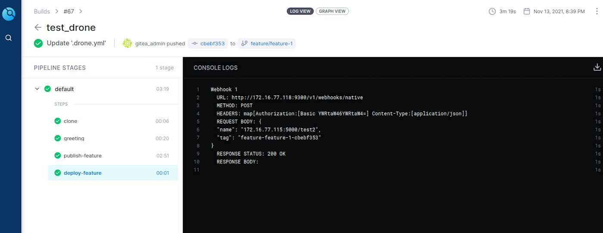](https://media1-production-mightynetworks.imgix.net/asset/31134917/drone1.png?ixlib=rails-0.3.0&fm=jpg&q=75&auto=format)

In gitea interface:

[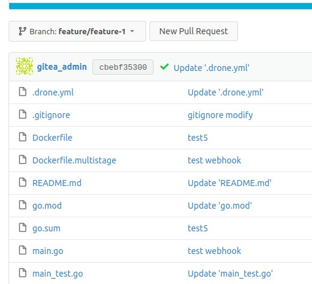](https://media1-production-mightynetworks.imgix.net/asset/31135121/gitea1.png?ixlib=rails-0.3.0&fm=jpg&q=75&auto=format)

In docker-registry an image with tag "feature-feature-1-cbebf353" will be added:

[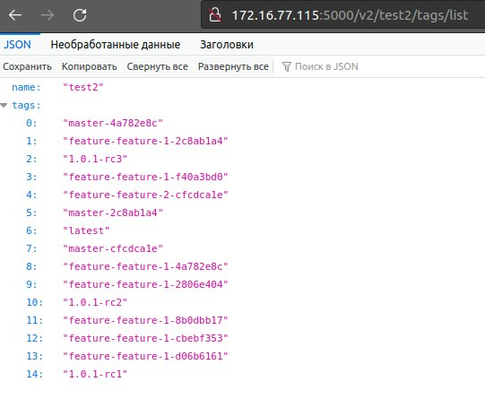](https://media1-production-mightynetworks.imgix.net/asset/31135177/dr1.png?ixlib=rails-0.3.0&fm=jpg&q=75&auto=format)

Create PR in Gitea:

[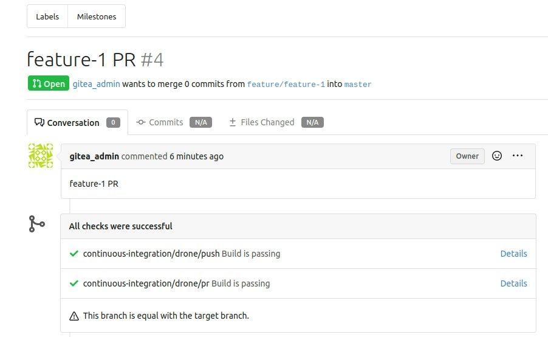](https://media1-production-mightynetworks.imgix.net/asset/31135433/gitea2.png?ixlib=rails-0.3.0&fm=jpg&q=75&auto=format)

Drone PR:

[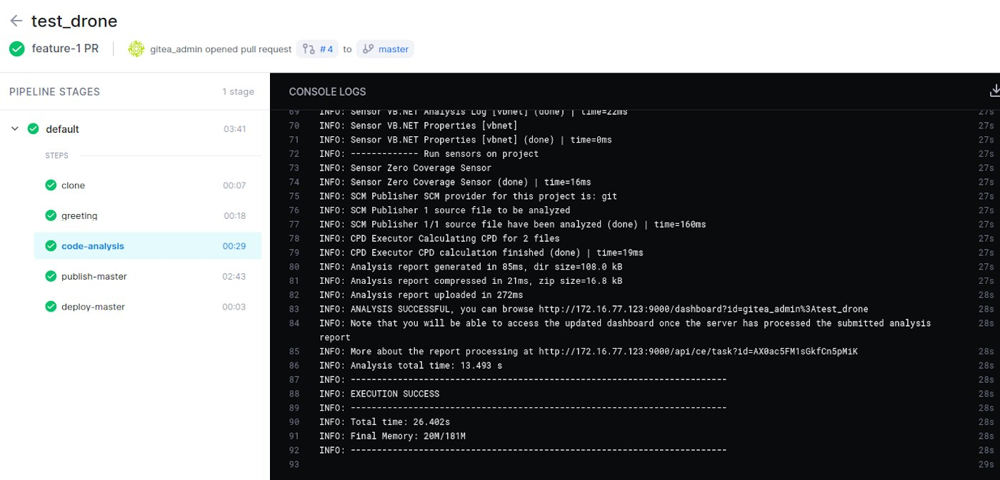](https://media1-production-mightynetworks.imgix.net/asset/31135448/drone2.png?ixlib=rails-0.3.0&fm=jpg&q=75&auto=format)

SonarQube PR:

[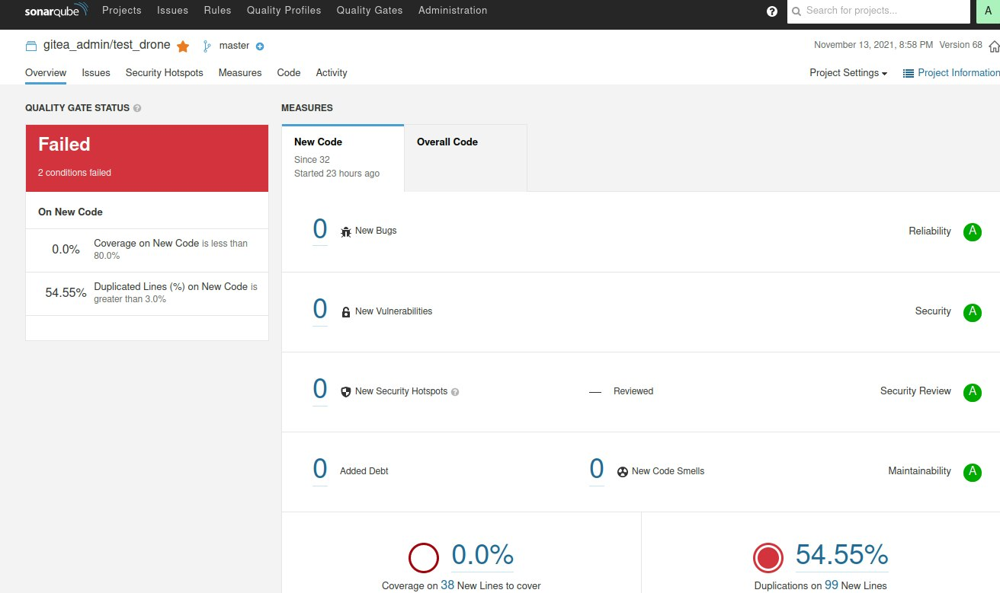](https://media1-production-mightynetworks.imgix.net/asset/31135456/sq1.png?ixlib=rails-0.3.0&fm=jpg&q=75&auto=format)

Release:

[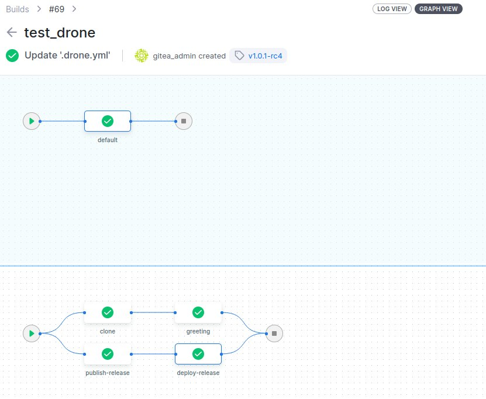](https://media1-production-mightynetworks.imgix.net/asset/31135707/drone3.png?ixlib=rails-0.3.0&fm=jpg&q=75&auto=format)

## Continuous Delivery

Create 3 deployments: test2-dev, test2-stage, test2-release, and use keel annotations for policy (you only need to add annotations to the deployment, on the keel side, you don't need to do anything, everything that you add to annotations will be displayed in the dashboard keel):

[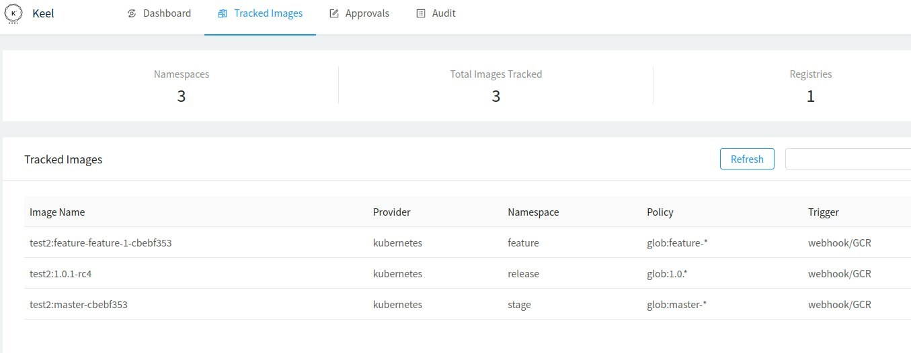](https://media1-production-mightynetworks.imgix.net/asset/31135924/keel1.png?ixlib=rails-0.3.0&fm=jpg&q=75&auto=format)

[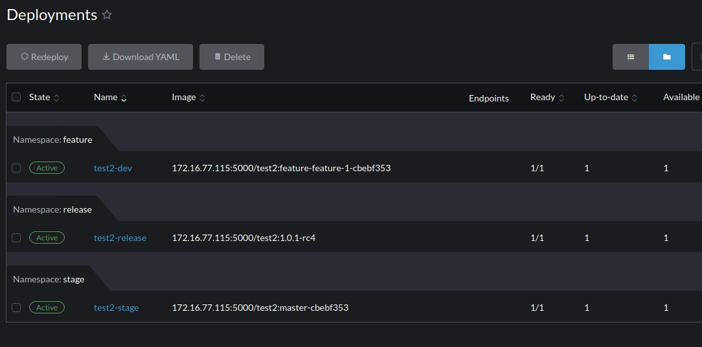](https://media1-production-mightynetworks.imgix.net/asset/31135909/rancher1.png?ixlib=rails-0.3.0&fm=jpg&q=75&auto=format)

[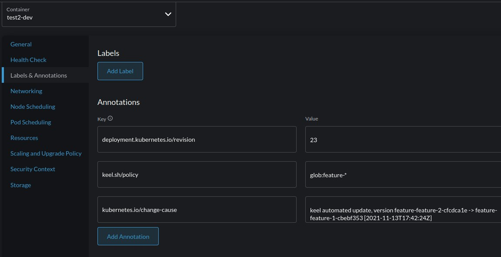](https://media1-production-mightynetworks.imgix.net/asset/31135932/rancher2.png?ixlib=rails-0.3.0&fm=jpg&q=75&auto=format)

[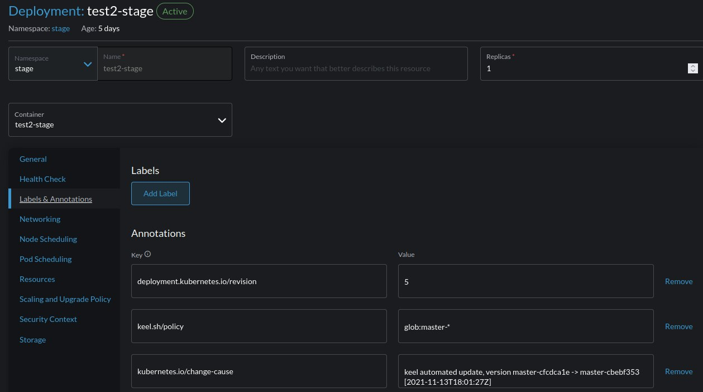](https://media1-production-mightynetworks.imgix.net/asset/31135948/rancher3.png?ixlib=rails-0.3.0&fm=jpg&q=75&auto=format)

[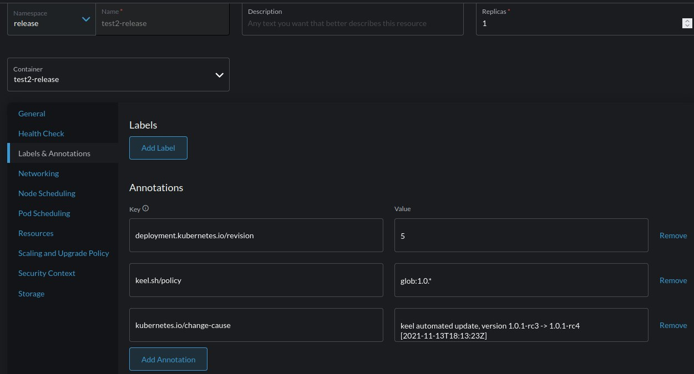](https://media1-production-mightynetworks.imgix.net/asset/31136060/rancher4.png?ixlib=rails-0.3.0&fm=jpg&q=75&auto=format)

# Cleanup

Delete VM from virt-manager. Check docs <https://rancher.com/docs/rancher/v2.5/en/cluster-admin/cleaning-cluster-nodes/> for the cleanup host.

### Learn more about Rancher! Check out our free class replay, [Up and Running: Rancher. Register here](https://www.crowdcast.io/e/up-and-running-rancher-october?utm_campaign=urro&utm_source=MN&utm_medium=post).
