In the [previous article](https://community.suse.com/posts/run-your-first-cicd-pipeline-with-rancher), we installed **Rancher** on the localhost and run the necessary CI/CD tools. This article will look at how to make our environment liveable on the Internet. We will use **Route53** - domain registration and DNS-zones hosting, **cert-manager** - **Let's Encrypt** wildcard certificates and **external-dns**- synchronizing Ingresses with DNS Route53.

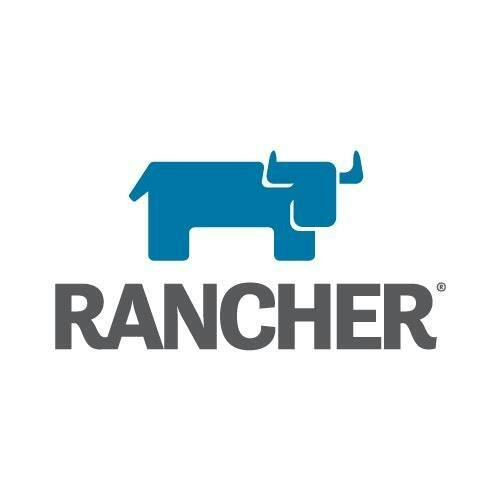

# A little personal experience

Why is **Rancher** good? Because those who do not want to understand the code of manifests and want to run what is required in manual mode can do this through an excellent graphical interface.

# Register domain

I'm using **Route53**, but you can choose another supported provider for **cert-manager** and **external-dns**. The reason is that many applications work well with it and the integration is usually not difficult.

Register a new domain using the input field on the **Dashboard** screen. After completing the registration process in the **Hosted zones** section, you will see a new zone. Since we want to provide public access, we will use this zone for the production.

# Create subdomain Hosted Zones

We will also have three zones: for dev.*domain*, stage.*domain* and release.*domain* as subdomains. Use the **Create hosted zone** button to create subdomains. For the subdomains to work, it is necessary to add records of **NS-servers** to the primary hosted zone, the way they are indicated in the subdomain zones. Create the same **A-records** in the main zone, this is *domain* and [www](http://www/).*domain* and dev.*domain*, stage.*domain*, release.*domain* in subdomains hosted zones. This is needed to issue certificates, since the provider checks for A-record before issuing a certificate.

The provider gives me a static IP-address and on the router, I made a forwarding to the bridge interface server IP address where we deployed everything in the previous article. It is this external address that needs to be specified in the A-records.

# Create IAM for cert-manager and external-dns

In the IAM management console, create two policies with the following content:

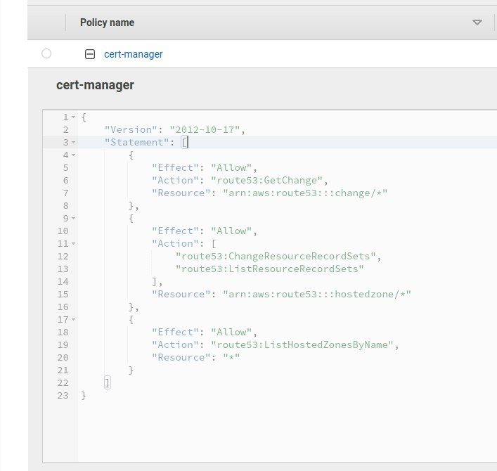

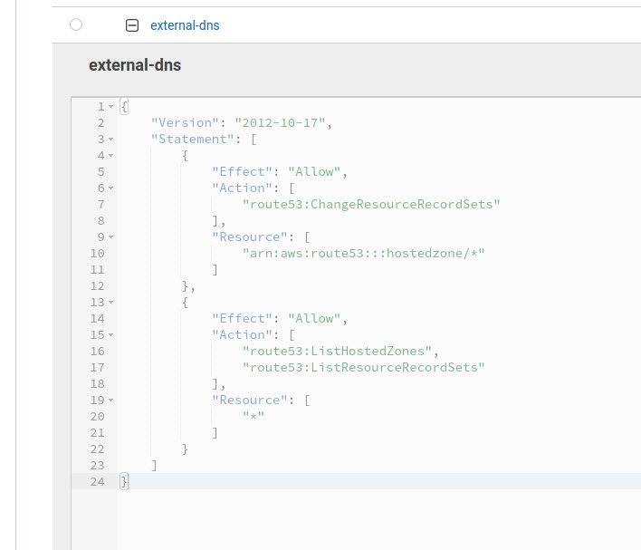

Next, you need to create two users, assign them policies, and copy their credentials. In the documentation on cert-manager and external-dns, this is not an obvious point since they deal with cases with roles and this is misleading, but we will not use roles.

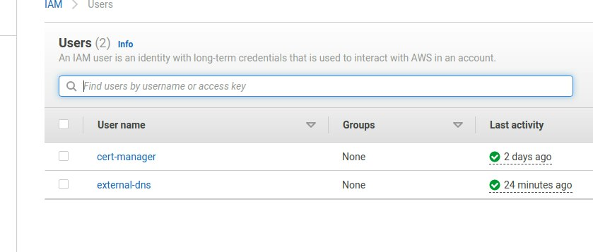

There are many articles on the Internet on how to do this in the cloud in various variations, but if you install on your local server everything is a little different.

# Run cert-manager in Rancher-cluster

Add helm-char repo for cert-manager:

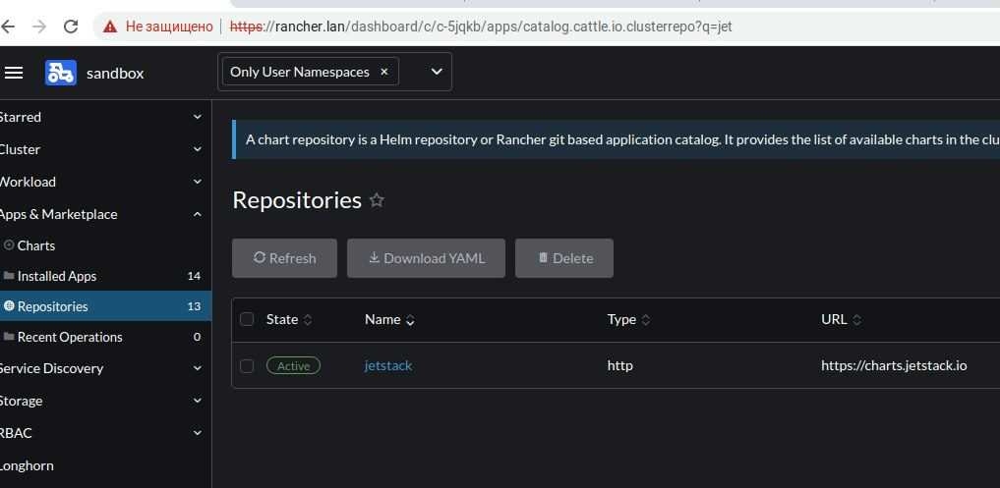

For cert-manager use default values.

```
prometheus:  
  enabled: false
installCRDs: true
```

## Create ClusterIssuers for Hosted Zones

ClusterIssuer:

```
apiVersion: cert-manager.io/v1
kind: ClusterIssuer
metadata:
  name: letsencrypt-prod
spec:
  acme:
    email: certs@domain.io
    server: https://acme-v02.api.letsencrypt.org/directory
    privateKeySecretRef:
      name: domain-io-cluster-issuer-account-key
        solvers:
        - selector:
             dnsZones: 
                 - "domain.io"
      dns01:
        route53:
          region: eu-central-1
          accessKeyID: AKIAXXXXXXXXXXXXX
          secretAccessKeySecretRef:
            name: prod-route53-credentials-secret
            key: secret-access-key
```

And repeat this for dev.domain.io, stage.domain.io, release.domain.io, change ClusterIssuer name, and dnsZone, change privateKeySecretRef:

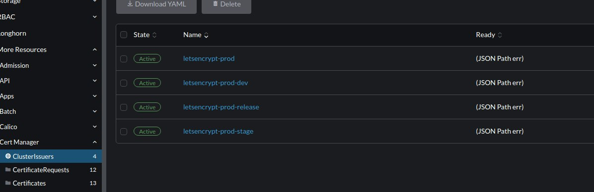

## Request wildcard certificates for you Ingresses

We will use a wildcard certificate with validation through the provider's DNS:

```
apiVersion: cert-manager.io/v1
kind: Certificate
metadata:
  name: domain-io
  namespace: domain
spec:
  secretName: domain-io-tls
  issuerRef:
    name: letsencrypt-prod
    kind: ClusterIssuer
  dnsNames:
  - '*.domain.io' 
  - domain.io
```

And repeat this for \*.dev.domain.io, \*.stage.domain.io, \*.release.domain.io change namespace, secretName, ClusterIssuer Name.

Changes should occur in the section, certificates should appear, the normal status is Active and the color is green:

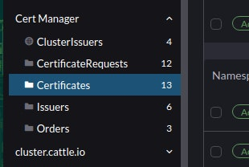

# Run Ingresses for Your App

Since we issued wildcard certificates in advance and they will be updated independently, we can specify this secret for different domains in the settings. To synchronize secrets between namespaces, you can, for example, use a [kubed](https://github.com/kubeops/config-syncer).

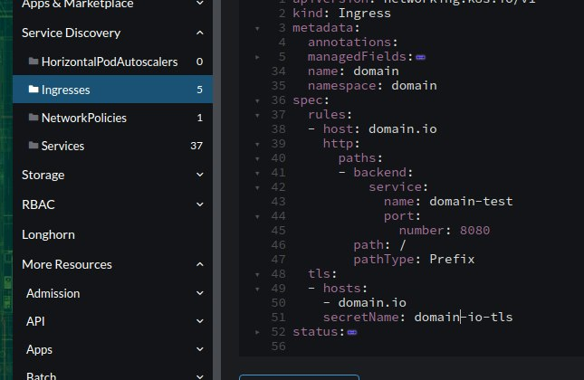

# Secure access for non-production zones

You can use client certificate validation to secure your development and test environments. To do this, you need to issue several self-signed certificates and add annotations to the ingress settings:

```
    nginx.ingress.kubernetes.io/auth-tls-pass-certificate-to-upstream: "true"
    nginx.ingress.kubernetes.io/auth-tls-secret: feature/ingresses-cert-dev <--feature - namespace
    nginx.ingress.kubernetes.io/auth-tls-verify-client: "on"
    nginx.ingress.kubernetes.io/auth-tls-verify-depth: "1"
```

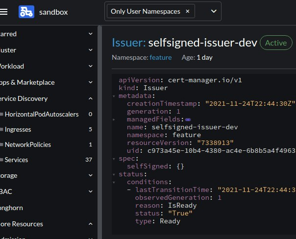

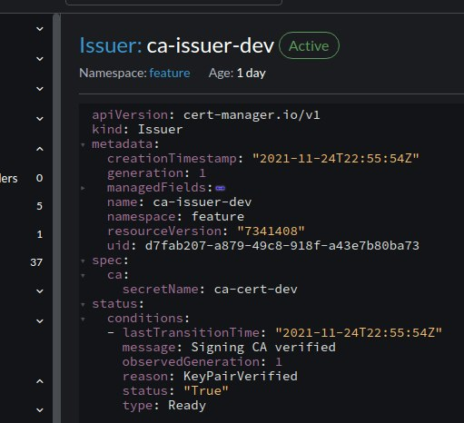

More details can be found [here](https://www.jetstack.io/blog/securing-mysql-with-cert-manager/).

For convert pem and key copy to different files, then give the command:

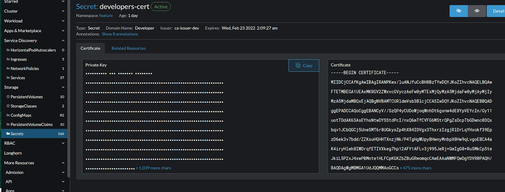

```
openssl pkcs12 -export -out developer.pfx -inkey developer.key -in developer.pem
```

and add pfx to chrome in settings.

# Run external-dns

Add helm-chart repo:

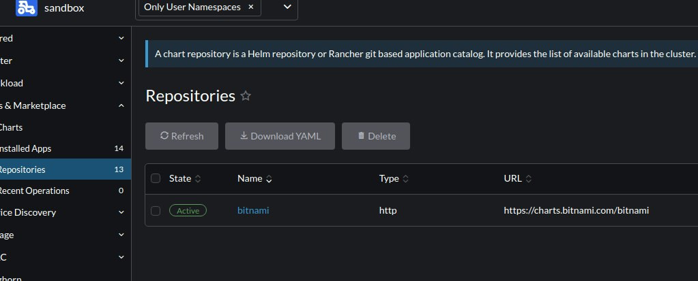

Values:

```
aws:
  apiRetries: 3
  assumeRoleArn: ''
  batchChangeSize: 1000
  credentials:
    accessKey: AKIAXXXXXXXXXXXXX
    mountPath: /.aws
    secretKey: -->secret-from-iam<--
    secretName: ''
  evaluateTargetHealth: ''
  preferCNAME: ''
  region: eu-central-1
  zoneTags: []
  zoneType: ''
```

```
crd:
  apiversion: externaldns.k8s.io/v1alpha1
  create: true
  kind: DNSEndpoint
```

```
sources:
  - service
  - ingress
  - crd
```

```
txtOwnerId: sandbox
policy: sync
```

Create CRD: [CRDmanifest](https://github.com/kubernetes-sigs/external-dns/blob/master/docs/contributing/crd-source/crd-manifest.yaml)

# Create DNSendpoint

DNSendpoint:

```
apiVersion: externaldns.k8s.io/v1alpha1
kind: DNSEndpoint
metadata:
  name: examplednsrecord
  namespace: feature
spec:
  endpoints:
  - dnsName: test1.dev.domain.io
    recordTTL: 180
    recordType: A
    targets:
    - <YOU-EXTERNAL-IP-ADDRESS>
```

In log:

```
time="2021-11-25T23:19:37Z" level=info msg="All records are already up to date"
time="2021-11-25T23:20:38Z" level=info msg="Applying provider record filter for domains: [domain.io. .domain.io. release.domain.io. .release.domain.io. stage.domain.io. .stage.domain.io. dev.domain.io. .dev.domain.io.]"
```

Create:

```
time="2021-11-25T23:54:57Z" level=info msg="Desired change: CREATE test1.dev.domain.io A [Id: /hostedzone/ZXXXXXXXXXXXDN]"
time="2021-11-25T23:54:57Z" level=info msg="Desired change: CREATE test1.dev.domain.io TXT [Id: /hostedzone/ZXXXXXXXXXXXXXXXXDN]"
time="2021-11-25T23:54:57Z" level=info msg="2 record(s) in zone dev.domain.io. [Id: /hostedzone/ZXXXXXXXXXXXXXXXDN] were successfully updated"
```

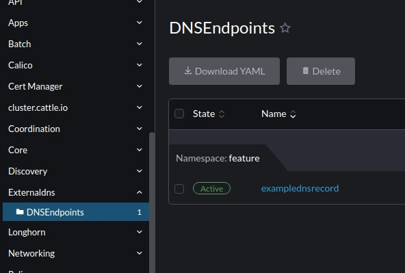

Delete:

```
time="2021-11-25T23:59:59Z" level=info msg="Desired change: DELETE test1.dev.domain.io A [Id: /hostedzone/ZXXXXXXXXXXXXXDN]"
time="2021-11-25T23:59:59Z" level=info msg="Desired change: DELETE test1.dev.domain.io TXT [Id: /hostedzone/ZXXXXXXXXXXXXXDN]"
time="2021-11-25T23:59:59Z" level=info msg="2 record(s) in zone dev.domain.io. [Id: /hostedzone/ZXXXXXXXXXXXXXXXXXXDN] were successfully updated"
```

# Conclusion

As it turns out for your own development, it is quite easy to raise the full stack on a single server and even post it on the Internet.

Test zones:

[https://www.pregap.io](https://www.pregap.io/)

[https://dev.pregap.io](https://dev.pregap.io/) - secure access

[https://stage.pregap.io](https://stage.pregap.io/) - secure access

[https://release.pregap.io](https://release.pregap.io/) - secure access
