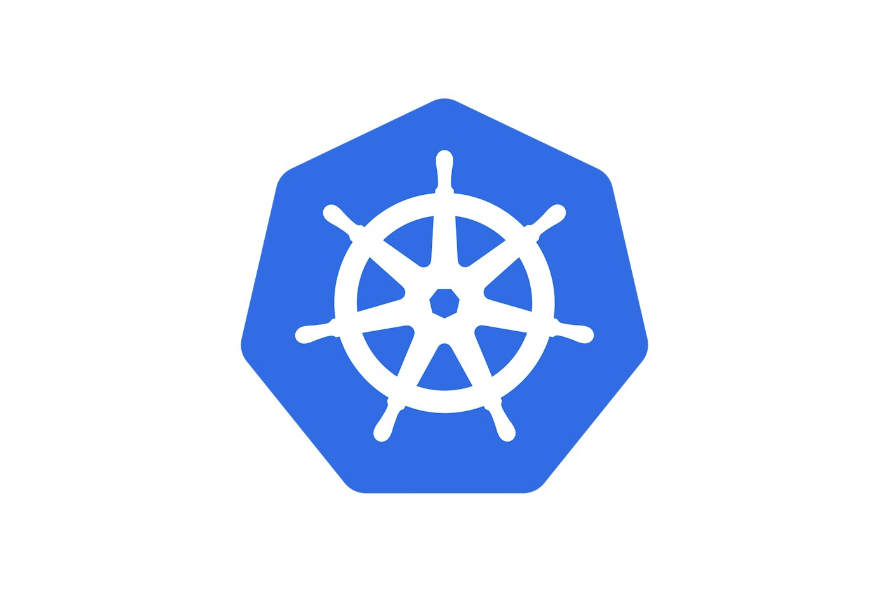
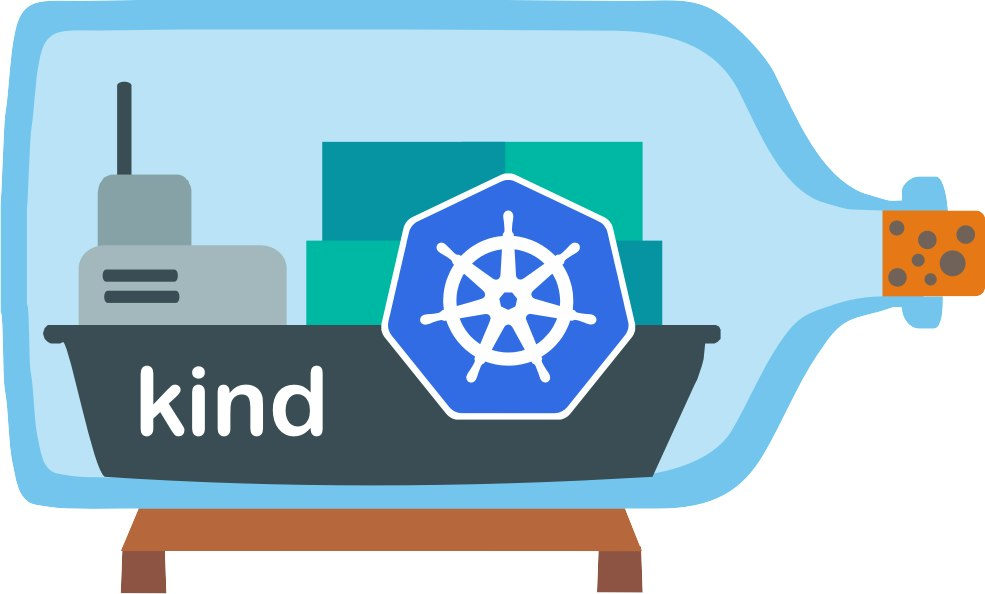
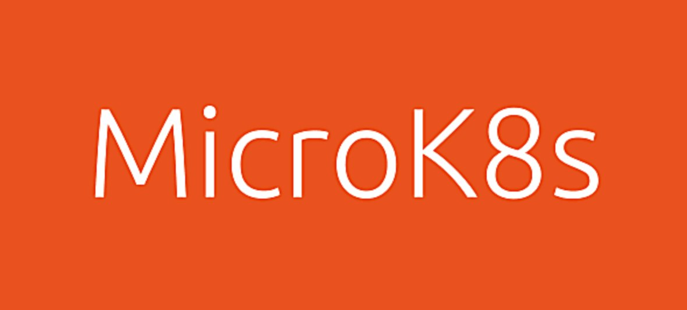
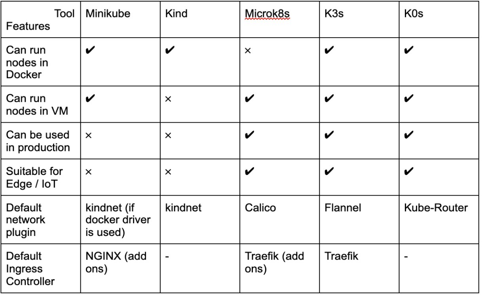

[](https://media1-production-mightynetworks.imgix.net/asset/23685362/Kubernetes-Logo.wine.png?ixlib=rails-4.2.0&fm=jpg&q=75&auto=format)

By now you have probably heard about Kubernetes -- and maybe you’re even using it. But if you and Kubernetes aren’t yet on a first-name basis, this post will help you get there. First off, a quick explanation. [Kubernetes](https://rancher.com/learning-paths/what-is-kubernetes/) is an open source container orchestrator system used to deploy, scale and manage applications running in [containers](https://rancher.com/learning-paths/what-are-containers/). Kubernetes is the first project graduated by the CNCF (Cloud Native Computing Foundation) and is today a de facto standard used in many organizations of any size.

Ramping up with Kubernetes, with its large source code and numerous functionalities, can be quite difficult. One key stepping stone is an easy way to get a Kubernetes cluster deployed with little effort, a small hardware footprint, and little or no running cost. Fortunately, there are many ways to run a cluster on a local machine, which is a great way to familiarize yourself with Kubernetes and with many of the great open source projects of its ecosystem as well.

This article will present some of the more popular tools you can use to set up a local Kubernetes cluster in only a few minutes (sometimes even less than 1 minute). Those tools are:

- Minikube
- Kind
- microk8s
- K3s
- k0s

Note: whereas minikube and kind are dedicated to local clusters, microk8s, k3s and k0s are also used to set up high-availability production clusters.

## Prerequisites

To interact with a Kubernetes cluster, you need the **kubectl** command-line client binary. The download and installation instructions can be found [here](https://kubectl.docs.kubernetes.io/installation/kubectl/binaries). With this binary, you can manage the cluster and its applications. We'll show each tool how to configure kubectl to communicate with your cluster.

For some tools, and depending on the local OS, you might prefer or need to run Kubernetes nodes in local virtual machines (VMs). For that purpose, we'll use [Vagrant](https://www.vagrantup.com/), a great tool from Hashicorp that makes creating Linux VMs a breeze. The [Vagrant binary](https://www.vagrantup.com/) is available for Windows, Linux and Mac. It can launch Linux VMs on VirtualBox, Hyper-V and VMWare out of the box. Creating a VM with Vagrant is as simple as *vagrant up* (very handy !).

## Lightweight Kubernetes Comparison: Minikube, kind, MicroK8s, K3s, K0s

---

[](https://media1-production-mightynetworks.imgix.net/asset/23672625/1620629545324.png?ixlib=rails-4.2.0&fm=jpg&q=75&auto=format)

[Minikube](https://minikube.sigs.k8s.io/) has long been the default way to run a local Kubernetes cluster. Limited in its infancy to run a one-node cluster only, it can now run a multi-node cluster easily on different infrastructures. Several drivers are supported so each node can run:

- in a virtual machine created with VirtualBox, Parallels, VMware Fusion, HyperKit or Hyper-V
- in a container run with docker or podman (podman is still experimental at the time of writing)

Download the Minikube binary can be downloaded [here](https://github.com/kubernetes/minikube/releases). Releases are available for Windows, Linux, macOS and a couple of other architectures.

When starting Minikube, we can provide a driver or leave the automatic selection. For example, on macOS it uses the **docker** driver by default (if Docker is installed of course).

The following command creates a 2 nodes cluster:

```
$ minikube start --nodes 2
😄  minikube v1.17.1 on Darwin 11.0.1
✨  Automatically selected the docker driver. Other choices: hyperkit, virtualbox, ssh
👍  Starting control plane node minikube in cluster minikube
🔥  Creating docker container (CPUs=2, Memory=2200MB) ...
🐳  Preparing Kubernetes v1.20.2 on Docker 20.10.2 ...
   ▪ Generating certificates and keys ...
   ▪ Booting up control plane ...
   ▪ Configuring RBAC rules ...
🔗  Configuring CNI (Container Networking Interface) ...
🔎  Verifying Kubernetes components...
🌟  Enabled addons: storage-provisioner, default-storageclass

👍  Starting node minikube-m02 in cluster minikube
🤷  docker "minikube-m02" container is missing, will recreate.
🔥  Creating docker container (CPUs=2, Memory=2200MB) ...
🌐  Found network options:
   ▪ NO_PROXY=192.168.49.2
🐳  Preparing Kubernetes v1.20.2 on Docker 20.10.2 ...
   ▪ env NO_PROXY=192.168.49.2
🔎  Verifying Kubernetes components...

🏄  Done! kubectl is now configured to use "minikube" cluster and "default" namespace by default
```

The cluster's configuration is automatically injected in *$HOME/.kube/config* file and the default context points towards this newly created cluster:

```
$ kubectl get nodes
NAME           STATUS   ROLES                  AGE     VERSION
minikube       Ready    control-plane,master   2m22s   v1.20.2
minikube-m02   Ready    <none>                 1m19s   v1.20.2
```

---

[](https://media1-production-mightynetworks.imgix.net/asset/23672622/1620629545098.png?ixlib=rails-4.2.0&fm=jpg&q=75&auto=format)

[Kind](https://kind.sigs.k8s.io/) is a binary written in Go that can run multi-node clusters, so each node runs in a container. Having Docker running on the local machine is your only prerequisite.

Once you download the binary for Windows, Linux, or macOS, it needs to be added to the PATH.

The following command runs a single node cluster using kind:

```
$ kind create cluster --name kube
Creating cluster "kube" ...
✓ Ensuring node image (kindest/node:v1.20.2) 🖼
✓ Preparing nodes 📦 
✓ Writing configuration 📜
✓ Starting control-plane 🕹️
✓ Installing CNI 🔌
✓ Installing StorageClass 💾
Set kubectl context to "kind-kube"
You can now use your cluster with:

kubectl cluster-info --context kind-kube

Have a nice day! 👋
```

The cluster's configuration is automatically added to the *$HOME/.kube/config* file and the current context is set against this new cluster:

```
$ kubectl get nodes
NAME                 STATUS   ROLES                  AGE     VERSION
kube-control-plane   Ready    control-plane,master   2m14s   v1.20.2
```

Kind makes it easy to create a multi-node cluster as well. In that case, you need a configuration file. For example, the simple config.yaml below defines a cluster that contains one master and two worker nodes:

```
kind: Cluster
apiVersion: kind.x-k8s.io/v1alpha4
nodes:
- role: control-plane
- role: worker
- role: worker
```

At creation time, the  --config flag provides the cluster configuration to kind.

```
$ kind create cluster --config config.yaml
```

---

[](https://media1-production-mightynetworks.imgix.net/asset/23672623/1620629545254.png?ixlib=rails-4.2.0&fm=jpg&q=75&auto=format)

[Microk8s](https://microk8s.io/) is a Kubernetes distribution from Canonical. It is defined as a zero-ops, CNCF-certified lightweight Kubernetes distribution for workstations, clusters, edge and IoT devices. You can install Microk8s as a snap on a Linux environment. If you’re using Windows or macOS, you’ll need to install it inside a Linux VM. In this example, we will create an Ubuntu VM with Vagrant.

First, we create a default Vagrant configuration file in the current folder. This file, named *Vagrantfile*, defines how the VM should be provisioned and configured. We use hashicorp/bionic64 as the Ubuntu distribution:

```
$ vagrant init hashicorp/bionic64
```

We modify the *Vagrantfile,* so it has the following content. This defines the IP 192.168.33.10 as the IP address of the VM that will be created.

```
Vagrant.configure("2") do |config|
  config.vm.box = "hashicorp/bionic64"
  config.vm.network "private_network", ip: "192.168.33.10"
  config.vm.provider "virtualbox" do |vb|
    vb.memory = "4096"
  end
end
```

Note: 4G of memory is recommended.

The following command starts the VM defined in the *Vagrantfile*:

```
$ vagrant up
```

Next, we run a shell in that VM:

```
$ vagrant ssh
```

From that shell we install microk8s as a snap:

```
vagrant@vagrant:~$ sudo snap install microk8s --classic
microk8s (1.20/stable) v1.20.2 from Canonical✓ installed
```

Once microk8s is installed, we need to add the **vagrant** user in the **microk8s** group and disconnect / reconnect:

```
vagrant@vagrant:~$ sudo usermod -a -G microk8s vagrant
vagrant@vagrant:~$ exit
$ vagrant ssh
```

We then wait a little bit to make sure the cluster is running fine:

```
vagrant@vagrant:~$ microk8s status --wait-ready
```

Once the previous command exits, we use microk8s’ kubectl subcommand to list the nodes:

```
vagrant@vagrant:~$ microk8s kubectl get nodes
NAME      STATUS   ROLES    AGE     VERSION
vagrant     Ready     <none>    3m55s   v1.20.2-34+350770ed07a558
```

The cluster is now up and running.

Microk8s is also a great way to manipulate other projects in the ecosystem as many of them are available as add-ons:

For instance, the following command installs the Kubernetes dashboard, Istio service mesh and the NGINX Ingress controller at the same time:

```
vagrant@vagrant:~$ microk8s enable dashboard istio ingress
```

To access the cluster from the local machine, we need to retrieve the *kubeconfig* file from the config subcommand. As we use Vagrant, we can copy this configuration in the */vagrant* folder within the VM, this makes the file available on the local machine in the same folder as the one containing the *Vagrantfile*:

```
vagrant@vagrant:~$ microk8s config > /vagrant/kubeconfig.microk8s
```

Inside the *kubeconfig* file, we replace the server’s IP with the VM’s IP:

```
$ vagrant@vagrant:~$ sed -i "s/server.*/server: https:\/\/192.168.33.10:16443/" /vagrant/kubeconfig.microk8s
```

We can then exit from the shell and configure our local kubectl:

```
$ vagrant@vagrant:~$ exit
$ export KUBECONFIG=$PWD/kubeconfig.microk8s
```

The cluster can now be accessed from the local machine:

```
$ kubectl get nodes
NAME      STATUS   ROLES    AGE     VERSION
vagrant   Ready    <none>   7m27s   v1.20.2-34+350770ed07a558
```

Microk8s makes it easy to add additional nodes to the cluster. This can be done in a couple of steps:

- get a join token using the command *microk8s add-node*
- launch an additional VM and install microk8s in that one
- run the *microk8s join* command providing the join token

Note: we deliberately run the commands from a shell within the VM, but we could as well have defined all the configuration steps in the *Vagrantfile* as we will see in the following examples.

---

[](https://media1-production-mightynetworks.imgix.net/asset/23672620/1620629545187.png?ixlib=rails-4.2.0&fm=jpg&q=75&auto=format)

[K3s](https://k3s.io/) is a lightweight certified Kubernetes distribution created by Rancher Labs (now part of SUSE), donated to the CNCF in August 2020 and is now a CNCF Sandbox project. Built for IoT and Edge computing, K3s allows you to deploy a Kubernetes cluster on a wide range of infrastructure: from Raspberry PIs to large Linux servers. K3s ships as a Kubernetes distribution in a single binary with a small footprint. K3s is not a fork: it uses the codebase of the official graduated project of the CNCF but is very lightweight as it does not embed all the alpha and beta features of Kubernetes. While K3s is popular for the edge and embedded use cases, its on-prem usage is also upswing, according to a [2020 Rancher Labs survey](https://community.suse.com/posts/12956369?utm_source=manual). And its lightweight footprint also makes it a great choice for development environments.

In this example, we use Vagrant to provision an OpenSuse Leap 15.2 VM and install k3s on it.

First, we create a *Vagrantfile* specifying the official OpenSuse Leap 15.2 distribution:

```
$ vagrant init opensuse/Leap-15.2.x86_64
```

Then we modify the file by adding the following:

- the IP address that will be associated to the VM.
- the commands needed to install k3s and to make the *kubeconfig* file available to the local machine.

```
Vagrant.configure("2") do |config|
  config.vm.box = "opensuse/Leap-15.2.x86_64"
  config.vm.network "private_network", ip: "192.168.33.11"
  config.vm.provision "shell", inline: <<-SHELL
    curl https://get.k3s.io | sh
    sudo cp /etc/rancher/k3s/k3s.yaml /vagrant/kubeconfig.k3s
    sed -i "s/127.0.0.1/192.168.33.11/" /vagrant/kubeconfig.k3s
  SHELL
end
```

The following command creates the VM and installs k3s in that one:

```
$ vagrant up
```

We can then configure our local kubectl using the *kubeconfig* file that has automatically been created and copied over to our local folder (the one containing the *Vagrantfile*) in the config step above:

```
$ export KUBECONFIG=$PWD/kubeconfig.k3s
```

Once everything is set up, we can access the new cluster from the local machine:

```
$ kubectl get nodes
NAME        STATUS   ROLES                        AGE   VERSION
localhost    Ready      control-plane,master   24s      v1.20.6+k3s1
```

If you need additional nodes (referenced as K3s agents), you can add them in a couple of steps:

- get a join token from the server (from */var/lib/rancher/k3s/server/node-token*)
- create a VM and run a K3s agent on that one providing the join token

Below is the skeleton of a simple *Vagrantfile* that could be used to add a worker node:

```
Vagrant.configure("2") do |config|
  config.vm.box = "opensuse/Leap-15.2.x86_64"
  config.vm.network "private_network", ip: WORKER_IP
  config.vm.provision "shell", inline: <<-SHELL
    curl -sfL https://get.k3s.io | K3S_URL=https://MASTER_IP:6443 K3S_TOKEN=TOKEN sh -
  SHELL
end
```

---

[](https://media1-production-mightynetworks.imgix.net/asset/23672619/1620629544679.png?ixlib=rails-4.2.0&fm=jpg&q=75&auto=format)

[K0s](https://k0sproject.io/) is a zero-friction / zero-dependencies / zero-cost Kubernetes distribution that ships Kubernetes as a single binary without any OS dependencies. It provides strong isolation of the control plane component from the application running on the cluster and allows deployment on versatile architectures.

In this example, we use Vagrant to provision an OpenSuse Leap 15.2 VM and install K0s on it.

First, we create a *Vagrantfile* specifying opensuse/Leap-15.2.x86\_64:

```
$ vagrant init opensuse/Leap-15.2.x86_64
```

Then we modify the file adding:

- the IP address that will be associated to the VM
- the configuration steps to install K0s:
- download of the latest K0s release
- creation of a systemd unit file for k0sserver
- launch of the service
- copy the kubeconfig file to a local folder

```
Vagrant.configure("2") do |config|
  config.vm.box = "hashicorp/bionic64"
  config.vm.network "private_network", ip: "192.168.33.12"
  config.vm.provision "shell", inline: <<-SHELL
    curl -sSLf https://get.k0s.sh | sudo sh
    sudo k0s default-config > /tmp/k0s.yaml
    sudo k0s install controller --single -c /tmp/k0s.yaml
    sudo systemctl start k0scontroller && sleep 10
    sudo cp /var/lib/k0s/pki/admin.conf /vagrant/kubeconfig.k0s
    sed -i "s/localhost/192.168.33.12/" /vagrant/kubeconfig.k0s
  SHELL
end
```

The following command creates the new VM and installs K0s on that one:

```
$ vagrant up
```

We can then configure our local kubectl using the *kubeconfig* file that has automatically been created and copied over to our local folder in the config step:

```
$ export KUBECONFIG=$PWD/kubeconfig.k0s
```

Now we can see the single node in our new cluster

```
$ kubectl get nodes
NAME      STATUS   ROLES    AGE    VERSION
vagrant   Ready    <none>   67s    v1.21.0-k0s1
```

Adding additional nodes requires a few easy steps:

- get a join token from the server using the command *k0s token create --role=worker*
- create a VM and download the k0s binary on that one
- run a k0s worker providing the join token with *k0s worker TOKEN*

As we’ve done in the previous example, we could easily define a template of a *Vagrantfile* for creating a worker node.

Development is underway on a new k0s companion named **k0sctl**. This command line tool simplifies the setup and management of K0s clusters. From a simple configuration file, k0sctl can deploy a k0s multi-node cluster on already provisioned VMs.

This tool, still in its infancy, is really promising. [Learn more here](https://github.com/k0sproject/k0sctl).

---

## Key Takeaways: Lightweight Kubernetes Distro Comparison Chart

Kubernetes is a huge and complex system. Fortunately, many tools allow you to easily set up a cluster on your local machine and start playing with Kubernetes. Using a local cluster is a great and safe way to manipulate Kubernetes resources and use most of the available features.

The following table summarizes some of the main information

[](https://media1-production-mightynetworks.imgix.net/asset/23672624/1620629545533.png?ixlib=rails-4.2.0&fm=jpg&q=75&auto=format)
