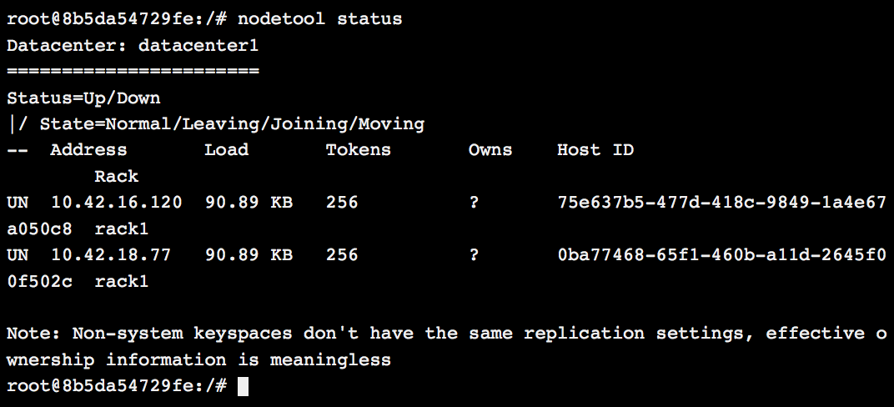

[Apache
Cassandra](http://cassandra.apache.org/) is a popular database
technology which is gaining popularity these days. It provides
adjustable consistency guarantees, is horizontally scalable, is built to
be fault-tolerant and provides very low latency, (sub-millisecond)
writes. This is why Cassandra is used heavily by large companies such as
Facebook and Twitter. Furthermore, Cassandra uses application layer
replication for its data which makes it ideal for a containerized
environment. However, Cassandra, like most databases, assumes that
database nodes are fairly static. This assumption is at odds with a
containerized infrastructure, which caters to more dynamic environments.
In this post, I will cover some of the challenges this poses for
managing Cassandra and other database workloads in containerized
environments.

### Simple Cassandra Cluster Setup

A basic Cassandra deployment on Rancher is fairly straight forward
thanks to the work done by [Patric Boos](https://github.com/pboos) to
create the
[Rancher-Cassandra](https://hub.docker.com/r/pboos/rancher-cassandra/)
container image in the community catalog. The docker-compose.yaml file
to create a service stack with the Cassandra service is shown below.
Note that we are creating a volume at */var/lib/cassandra*. This is
because the union file system containers are very slow and not suitable
for high IO use cases. By using a volume, we defer to the host file
system, which should be much faster.

```
Cassandra:
  environment:
    RANCHER_ENABLE: 'true'
  labels:
    io.rancher.container.pull_image: always
  tty: true
  image: pboos/rancher-cassandra:3.1
  stdin_open: true
  volumes:
    - /var/lib/cassandra
```

In addition, we set the RANCHER\_ENABLE environment variable to true. If
this variable is set, the container will use the Rancher Meta Data
Service to get the IPs of all containers in the service (other than the
current container) and set them up as seeds. Seeds are very important
for Cassandra and this setup has a few very important impacts. First,
seeds help bootstrap the cluster because all new nodes must report to
the seeds so that they can give these new nodes a list of all the
current servers and also tell the older connected servers about the new
servers. If any server in the cluster did not know about any other, you
would not be able to provide consistency guarantees. This is why
Cassandra will refuse to start up if it cannot talk to all the seed
servers. If you had multiple nodes launching at the same time, they
would see each other as seeds. Since the nodes are not ready to accept
connections, they would both fail to start, stating that they cannot
connect to the seed. You can add more containers at a later time (once
the first container is ready to serve traffic) but, you must do so one
at a time and wait for that container to be ready before launching
others.

In our fork of the container image,
(*usman/docker-rancher-cassandra:3.1*) I slightly change the behavior by
marking all nodes in the service as seeds (even the newly launched
node). Seed nodes do not need to wait for other nodes to be ready.
Hence, we can get around the requirement to launch one node at a time.
Note we are only able to get around this requirement when launching
nodes into a newly launched empty cluster. Once we have data in the
cluster, we need to allow nodes to stream data from peers so they can
start serving requests.

### Specifying Cluster Topology

If you *Execute Shell* in one of the containers and run \*nodetool status
y\*ou will see that all your nodes are in the same data center and more
problematically in the same rack. If you are launching nodes across
cloud providers or geographical regions, the latency will be such that
your cluster will not be very performant. In these scenarios, you have
to partition your nodes into data centers. Multi-data center clusters
are able to provide low latency writes (and potentially low latency
reads based on consistency requirements) across high latency network
links because of asynchronous synchronization.

[](images/rancher_blog_Screen-Shot-2016-03-19-at-12.30.58-AM.png)

In addition to single data center, we are also using a single rack,
which is more problematic. We mentioned earlier that Cassandra has
configurable consistency guarantees. Essentially, you can specify how
many copies of your data are written and read to service requests. If
you split your cluster into racks, then copies of your data are spread
out across racks. However, if you have just one rack then copies of the
data are on arbitrary nodes. This means if you need to take nodes
offline it is very difficult to decide which nodes to take offline
without loosing *ALL* copies of *SOME* data. If you had racks, its
always possible to take down N/2 racks without loosing any data. i.e. if
you have 3 racks you can take one offline without data loss.

If you are using a cloud like AWS to run your containers, then it is
important to create a separate rack for each Availability Zone (AZ).
This is because Amazon guarantees that separate AZs have independent
power sources, and network hardware etc. If there is an outage in one AZ
it is likely to impact many nodes in that AZ. If your Cassandra cluster
is not rack aware, you can loose multiple nodes and potentially all
copies of some of your data. However, if you data is laid out in racks
and all nodes in one AZ are not available you are still guaranteed to
have redundant copies of your data.

To specify the Rack and Data Center, add the *CASSANDRA\_RACK* and
*CASSANDRA\_DC* parameters into your environment. We will need to create
separate services for each of the racks so that we can specify the
properties separately. You will also need to set the
*CASSANDRA\_ENDPOINT\_SNITCH* parameter to one of the snitches defined
[here](https://docs.datastax.com/en/cassandra/2.0/cassandra/architecture/architectureSnitchesAbout_c.html).
The default SimpleSnitch is not able to process racks and data centers
but, the others such as the *GossipingPropertyFileSnitch* will be able
to setup clusters which are data center and rack aware. For example, the
docker-config.yaml below sets up a single data center (called
aws-us-east) and three rack cluster. You can copy the CassandraX section
to create more racks and data centers as needed. Note that you can use
scale to increase the number of nodes in each of the racks as needed.

```
Cassandra1:
  environment:
    RANCHER_ENABLE: 'true'
    CASSANDRA_RACK: 'rack1'
    CASSANDRA_DC: aws-us-east
    CASSANDRA_ENDPOINT_SNITCH: GossipingPropertyFileSnitch
  labels:
    io.rancher.container.pull_image: always
  tty: true
  image: usman/docker-rancher-cassandra
  stdin_open: true
  volumes:
    - /var/lib/cassandra
Cassandra2:
  environment:
    RANCHER_ENABLE: 'true'
    CASSANDRA_RACK: 'rack2'
    CASSANDRA_DC: aws-us-east
    CASSANDRA_ENDPOINT_SNITCH: GossipingPropertyFileSnitch
  labels:
    io.rancher.container.pull_image: always
  tty: true
  image: usman/docker-rancher-cassandra
  stdin_open: true
  volumes:
    - /var/lib/cassandra
Cassandra3:
  environment:
    RANCHER_ENABLE: 'true'
    CASSANDRA_RACK: 'rack3'
    CASSANDRA_DC: aws-us-east
    CASSANDRA_ENDPOINT_SNITCH: GossipingPropertyFileSnitch
  labels:
    io.rancher.container.pull_image: always
  tty: true
  image: suman/docker-rancher-cassandra
  stdin_open: true
  volumes:
    - /var/lib/cassandra
```

Note that we still are limited by the requirement that only one node can
be launched per Rancher service (Rack/DC). Also note that since we use
the containers parent, Rancher service to determine seed nodes right now
to each of your racks is disjointed from the others, essentially each
rack is its own Cassandra cluster. In order to unify these into one
cluster, we will need to use a shared set of seed nodes. In the next
section, we will cover how to setup a separate shared seed service.

### Seed Cassandra Service

So far, we have used the default Rancher Cassandra seed behavior, which
means that every node will see all other nodes in its own Rancher
service as seed nodes. If you ran the docker-compose.yaml file in the
previous section, you will notice that your cluster is partitioned (i.e.
none of the racks know about each other). This is because nodes only
knows about seeds in its own Rancher service. Without shared seeds, the
racks do not know about each other. To get around this limitation, we
setup a separate seed service which will be used by all nodes in the
rack. We then use the *RANCHER\_SEED\_SERVICE* property to specify that
all members of this service will be considered seed nodes. A snippet of
the updated docker-compose.yaml file is shown below. The complete file
can be seen
[here](https://gist.github.com/usmanismail/b0a62337294d96d1e024).

```
CassandraSeed:
  environment:
    RANCHER_ENABLE: 'true'
    RANCHER_SEED_SERVICE: CassandraSeed
    CASSANDRA_RACK: 'rack1'
    CASSANDRA_DC: aws-us-east
    CASSANDRA_ENDPOINT_SNITCH: GossipingPropertyFileSnitch
  labels:
    io.rancher.container.pull_image: always
  tty: true
  image: usman/docker-rancher-cassandra
   stdin_open: true
   volumes:
     - /var/lib/cassandra
Cassandra1:
  environment:
    RANCHER_ENABLE: 'true'
    RANCHER_SEED_SERVICE: CassandraSeed
    CASSANDRA_RACK: 'rack1'
    ...

Cassandra2:
  environment:
    RANCHER_ENABLE: 'true'
    RANCHER_SEED_SERVICE: CassandraSeed
    CASSANDRA_RACK: 'rack1'
    ...
```

Note that now that all your Rancher services are in one cluster, you can
only add one node to the entire cluster at a given time. Once you add a
node, you have to wait for it to be bootstrapped by its peers before we
can launch more nodes. This means that we can only launch one of the
non-seed nodes at a given time.

### Conclusion

Today, we have covered how to setup a data center and rack aware
Cassandra cluster on top of Docker using Rancher. We saw that the
Rancher/Docker service model does not fit cleanly with Cassandra’s
seeding model and we had to use multiple services create a workable
solution. In addition, Cassandra only allows us to add one new node at
any given time which means we have to be careful about how we launch
services. We have to launch the seed service before the rack services.
We have to make sure we only scale up each rack service at any given
time. In addition, we can only scale up one rack services at a time.
This requirement would be familiar to anyone who runs Cassandra but is
at odds with most services running on Docker and Rancher.

Furthermore, containers are designed to be disposable and come up and
down often. With our Cassandra setup, we are assuming (and have to
ensure) that our containers are launched, and scaled in a coordinated
controlled fashion. For these reasons, running production database
workloads in Docker and Rancher is still a risky proposition and should
only be attempted if you are able to bring the commit database and
infrastructure expertise to this part of your infrastructure.

To learn more about running other types of applications in Rancher,
download our eBook: Continuous Integration and Deployment with Docker
and Rancher.
