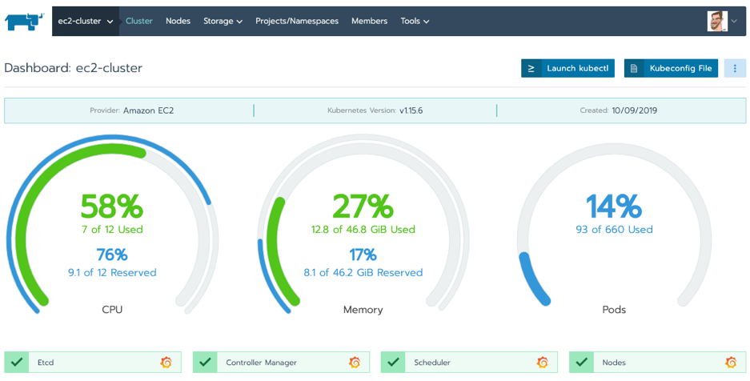
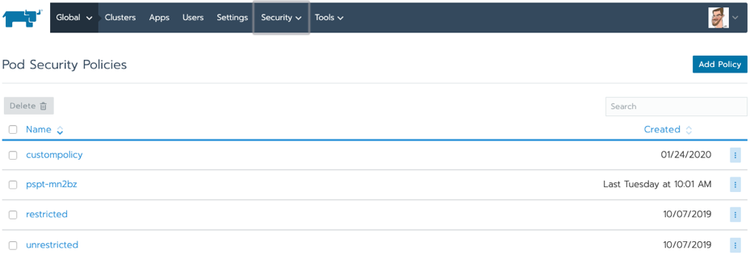
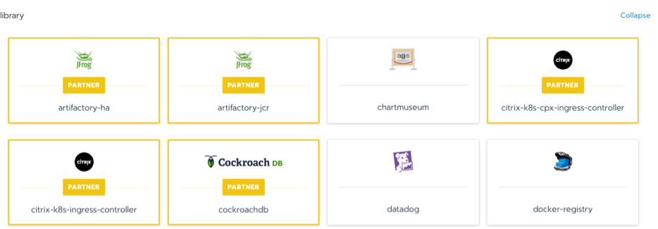

READ OUR FREE WHITE PAPER:How to Build an Enterprise Kubernetes Strategy[DOWNLOAD NOW](https://more.suse.com/fy21-global-web-landing-page-how-to-build-enterprise-kubernetes-strategy)

This blog will examine how Rancher improves the life of DevOps teams already invested in AWS’s Elastic Kubernetes Service (EKS) but looking to run workloads on-prem, with other cloud providers or, increasingly, at the edge. By reading this blog you will also discover how Rancher helps you escape the undeniable attractions of a vendor monoculture while lowering costs and mitigating risk.

## Why is AWS EKS So Popular?

AWS is the world’s largest cloud provider, with over a million customers and [$7.3 billion in 2018 operating income](https://www.zdnet.com/article/in-2018-aws-delivered-most-of-amazons-operating-income/). Our friends at StackRox recently showed that [AWS still commands 78 percent market share](https://www.stackrox.com/post/2020/02/5-surprising-findings-from-stackroxs-latest-kubernetes-security-report/) despite the aggressive growth of rivals Microsoft Azure and Google Cloud Platform.

However, if you choose only AWS services for all your Kubernetes needs, you’re effectively locking yourself into a single vendor ecosystem. For example, by choosing Elastic Load Balancing for load distribution, AWS App Mesh for service mesh or AWS Fargate for serverless compute with EKS, your future is certain but not yours to control. It’s little wonder that many Amazon EKS customers look to Rancher to help them deliver a truly multi-cloud strategy for Kubernetes.

## The Benefits of a Truly Multi-Cloud Strategy for Kubernetes

As discussed previously, multi-cloud has become the “new normal” of enterprise IT. But what does “multi-cloud” mean to you? Does it mean supporting the same vendor-specific Kubernetes distribution on multiple clouds? Wouldn’t that just swap out one vendor monoculture for another? Or does it mean choosing an open source management control plane that treats any CNCF-certified Kubernetes distribution as a first-class citizen, enabling true application portability across multiple providers with zero lock-in?

Don’t get me wrong – there are use cases where a decision-maker will see placing all their Kubernetes business with a single vendor as the path of least resistance. However, the desire for short-term convenience shouldn’t blind you to the inherent risks of locking yourself into a long-term relationship with just one provider. Given how far the Kubernetes ecosystem has come in the past six months, are you sure that you want to put down all your chips on red?

As with any investment, the prudent money should always go on the choice that gives you the most value without losing control. Given this, we enthusiastically encourage you to continue using EKS – it’s a great platform with a vast ecosystem. But remember to keep your options open – particularly if you’re thinking about deploying Kubernetes clusters as close as possible to where they’re delivering the most customer value – at the edge.

## Kubernetes on AWS: Using Rancher to Manage Containers on EKS

If you’re going to manage Kubernetes clusters on multiple substrates – whether on AKS/GKE, on-prem or at the edge – Rancher enhances your container orchestration with EKS. With Rancher’s integrated workload management capabilities, you can allow users to centrally configure policies across their clusters and ensure consistent access. These capabilities include:

**1) Role-based access control and centralized user authentication**  
Rancher enforces consistent role-based access control (RBAC) policies on EKS and any other Kubernetes environment by integrating with Active Directory, LDAP or SAML-based authentication. Centralized RBAC reduces the administrative overhead of maintaining user or group profiles across multiple platforms. RBAC also makes it easier for admins to meet compliance requirements and delegate administration of any Kubernetes cluster or namespace.

RBAC Controls in Rancher

**2) One intuitive user interface for comprehensive control**  
DevOps teams can deploy and troubleshoot workloads consistently across any provider using Rancher’s intuitive web UI. If you’ve got team members new to Kubernetes, they can quickly learn to launch applications and wire them together at production level in EKS and elsewhere with Rancher. Your team members don’t need to know everything about a specific Kubernetes distribution or infrastructure provider to be productive.

Multi-cluster management with Rancher

**3) Enhanced cluster security**  
Rancher admins and their security teams can centrally define how users should interact with Kubernetes and how containerized workloads should operate across all their infrastructures, including EKS. Once defined, these policies can be instantly assigned any Kubernetes cluster.

Adding customer pod security policies

**4) Global application catalog & multi-cluster apps**  
Rancher provides access to a global catalog of applications that work across multiple Kubernetes clusters, whatever their location. For enterprises running in a multi-cloud Kubernetes environment, Rancher reduces the load on operations teams while increasing productivity and reliability.

Selecting multi-cluster apps from Rancher’s catalog

**5) Streamlined day-2 operations for multi-cloud infrastructure**  
[Using Rancher to provision your Kubernetes clusters](https://aws.amazon.com/blogs/opensource/managing-eks-clusters-rancher/) in a multi-cloud environment means your day-2 operations are centralized in a single pane of glass. Benefits to centralizing your operations include one-touch deployment of service mesh ([upstream Istio](https://rancher.com/docs/rancher/v2.x/en/cluster-admin/tools/istio/)), logging ([Fluentd](https://rancher.com/docs/rancher/v2.x/en/cluster-admin/tools/logging/fluentd/)), observability ([Prometheus and Grafana](https://rancher.com/docs/rancher/v2.x/en/cluster-admin/tools/monitoring/)) and highly available persistent storage ([Longhorn](https://github.com/longhorn/longhorn)).

What’s more, if you ever decide to stop using Rancher, we provide a clean uninstall process for [imported EKS clusters](https://rancher.com/docs/rancher/v2.x/en/cluster-provisioning/imported-clusters/) so that you can manage them independently. You’ll never know Rancher was there.

## Next Steps

See how Rancher can help you run containers in AWS and enhance your multi-cloud Kubernetes strategy. Download the free whitepaper, [A Guide to Kubernetes with Rancher](https://more.suse.com/fy21-global-web-landing-page-guide-to-kubernetes).

READ OUR FREE WHITE PAPER:How to Build an Enterprise Kubernetes Strategy[DOWNLOAD NOW](https://more.suse.com/fy21-global-web-landing-page-how-to-build-enterprise-kubernetes-strategy)
