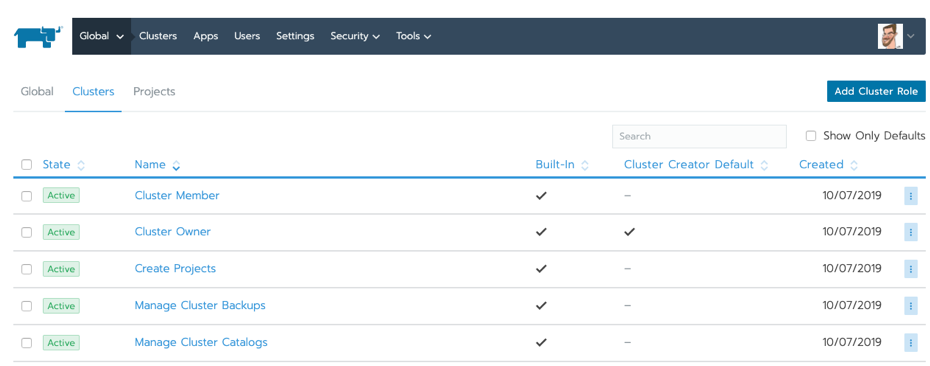
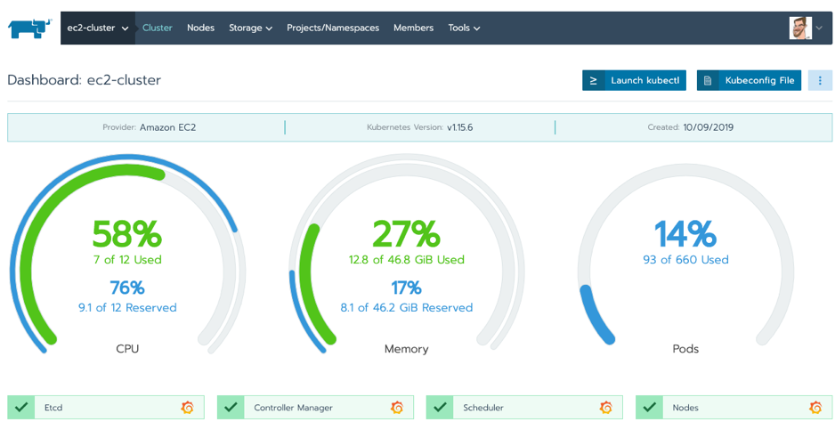
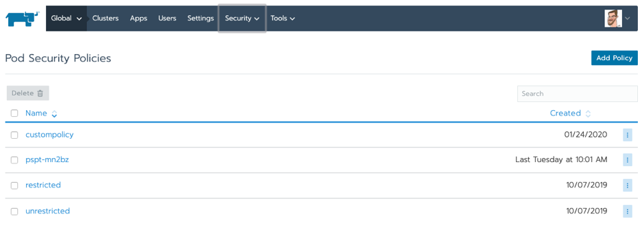
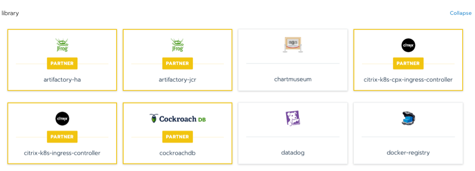

Rancher allows enterprises to adopt container and Kubernetes-related technologies incrementally. It supports many scenarios ranging from, “we are just getting started with containers,” to, “we are running Kubernetes in production but are struggling to scale up operations.”

However, as Microsoft’s hosted Kubernetes service grows in popularity, it is reasonable for our users to ask, “How does Rancher add value to running containers in Azure using Azure Kubernetes Service (AKS)?”

## Why is Azure Infrastructure So Popular?

Azure boasts an enticing combination of IaaS (Infrastructure-as-a-Service) and PaaS (Platform-as-a-Service) offerings. Azure IaaS enables users to outsource their infrastructure and pay for what they use, while Azure PaaS lets them create their web apps and solutions without having to buy and maintain the underlying hardware.

AKS has grown in popularity because it simplifies and streamlines Kubernetes running on the Azure infrastructure, so customers can scale app development with increased speed, agility and security. Above all, running containers in Azure/AKS is considered a safe bet for many companies already invested in Microsoft platforms and services.

Although fully featured and undeniably convenient, AKS isn’t the best fit for every organization or use case. By choosing only to run containers in Azure/AKS for all their Kubernetes needs, enterprises are locked into a single vendor ecosystem and, for most, an unnegotiable cost.

For example, when DevOps teams get comfortable with service mesh and start using services like Azure Service Fabric Mesh with AKS, their technical and commercial options rapidly narrow.

## The Benefits of a Multi-Cloud Strategy

In a recent [Gartner survey of public cloud users](https://www.gartner.com/smarterwithgartner/why-organizations-choose-a-multicloud-strategy/), 81 percent of respondents said they are working with two or more providers. This means that multi-cloud has become the “new normal” of enterprise IT. Consistent with this trend, many Kubernetes users take the strategic decision to abstract the management control plane from a specific infrastructure provider and architect their cloud-native applications to run on any certified Kubernetes distribution.

True application portability across multiple Kubernetes providers means fewer cycles wasted managing platform-specific configurations, network interfaces and management workflows. It also enables you to chase the most competitive prices and the best-performing vendor.

Of course, control plane abstraction risks moving the points of technical and commercial lock-in from the infrastructure provider to an independent software vendor. So how does Rancher improve your container orchestration experience with AKS without locking you into yet another platform?

## Rancher on Azure: Using Rancher to Manage Containers on Azure Kubernetes Service

Rancher enhances container orchestration with AKS if you also manage Kubernetes clusters on other substrates – whether competitive cloud services, on-prem data centers or at the edge. With Rancher, users can centrally configure policies on all their clusters and ensure consistent access to its integrated workload management capabilities, including:

### 1) Centralized user authentication & RBAC

Rancher integrates with Active Directory, LDAP or SAML-based authentication service to enforce consistent role-based access control (RBAC) policies on AKS and any other Kubernetes environment. With centralized RBAC, admins reduce the administrative overhead of maintaining user or group profiles across multiple platforms, find it easier to meet compliance requirements and enable self-service by delegating administration of any Kubernetes cluster or namespace.

RBAC Control in Rancher

### 2) Comprehensive control via one intuitive user interface

Rancher’s intuitive web UI allows DevOps team to deploy and troubleshoot workloads consistently across any provider. New team members can use Rancher to quickly launch applications and wire them together at production level in AKS and elsewhere. They won’t need to know everything there is to know about a specific Kubernetes distribution or infrastructure provider before they can become productive.

Multi-Cluster Management

### 3) Enhanced cluster security

Rancher admins can work with their security teams to centrally define how users should interact with Kubernetes and how containerized workloads should operate across all their infrastructures, including AKS. Once centralized policies are defined, assigning them to any Kubernetes cluster is instantaneous.

Adding custom pod security policies

### 4) Global catalog & multi-cluster apps

Rancher includes global application catalogs that work across multiple Kubernetes clusters, whatever their location. By reducing the load on operations teams, Rancher increases productivity and reliability for enterprises running in a Kubernetes multi-cloud environment.

Selecting multi-cluster apps from Rancher’s catalog

### 5) Streamlined day-2 operations for multi-cloud infrastructure

Once you’ve provisioned Kubernetes clusters in a multi-cloud environment with Rancher, all your day-2 operations are centralized in a single pane of glass. Users gain numerous benefits from this, including the push-button deployment of upstream Istio for service mesh, Fluentd for logging, Prometheus and Grafana for observability, and Longhorn for highly available persistent storage.

Added to these benefits, if you ever decide to stop using Rancher, we provide a clean uninstall process for imported AKS clusters so that you can manage them independently as if we were never there.

## More Resources

For more information about how Rancher can enhance your multi-cloud Kubernetes strategy, [download the free whitepaper - How to Build an Enterprise Kubernetes Strategy](https://more.suse.com/fy21-global-web-landing-page-how-to-build-enterprise-kubernetes-strategy).
