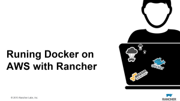

Amazon

Web Services (AWS) is one of the most popular clouds for running Docker

workloads, and we’ve seen more and more users deploy Rancher in

conjunction with multiple AWS services to deliver a resilient production

grade service. In our December online meetup, we discussed best

practices for running applications using Docker on AWS with Rancher.

We’ll demosntrate how to deploy, scale and manage deployments while

using underlying AWS features, such as EBS, ELB, Route53, RDS, and more.

During the meetup Darren Shepherd demonstrated: • Deploying Rancher

using RDS, ELB and Route53 • Deploy capacity in AWS with Docker Machine

• Deploying persistent applications using NFS storage • Using

autoscaling groups with Rancher • Leveraging ELB and Route53 for load

balancing. • Dynamically utilizing spot instances to reduce costs We

also had a demo from Spotinst, on how to automate management of Spot

Instances. You can view a recording of the entire meetup below, or

download the slides

on [Slidshare](http://www.slideshare.net/ShannonWilliams14/running-docker-on-aws-with-rancher-december-meetup).

Please join us for next months meetup, which you can register for below.
