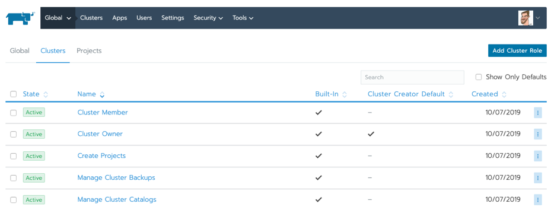

Read our free white paper: How to Build a Kubernetes Strategy [Download Now](https://more.suse.com/fy21-global-web-landing-page-how-to-build-enterprise-kubernetes-strategy) Rancher is the enterprise computing platform to run Kubernetes on-premises, in the cloud and at the edge. It’s an excellent platform to get started with containers or for those who are struggling to scale up their Kubernetes operations in production. However, in a world increasingly dominated by public infrastructure providers like Google Cloud, it’s reasonable to ask how Rancher adds value to services like Google’s Kubernetes Engine (GKE).

This blog provides a comprehensive overview on how Rancher can help your ITOps and DevOps teams who are invested in Google’s Kubernetes Engine (GKE) but also looking to diversify their capabilities through on-prem, additional cloud providers or with edge computing.

## Why is Google Cloud So Popular?

Google Cloud (sometimes referred to as GCP) is a leading provider of computing resources for deploying and operating containerized applications. Google Cloud continues to grow rapidly: they recently launched new cloud regions in India, Qatar, Australia and Canada. That makes a total of 22 cloud regions across 16 countries, in support of their growing number of users.

As the creators of Kubernetes, Google has a rich history in its container offerings, design and community. Google Cloud’s GKE service was the first managed Kubernetes service on the market — and is still one of the most advanced.

GKE has quickly gained popularity with users because it’s designed to eliminate the need to install, manage and operate your Kubernetes clusters. GKE is particularly popular with developers because it’s easy to use and packed with robust container orchestration features including integrated logging, autoscaling, monitoring and private container registries. ITOps teams like running Kubernetes on Google Cloud because GKE includes features like creating or resizing container clusters, upgrading container clusters, creating container pods and resizing application controllers.

Despite its undeniable convenience, if an enterprise chooses only Google Cloud Container services for all their Kubernetes needs, they’re locking themselves into a single vendor ecosystem. For example, by choosing Google Cloud Load Balancer for load distribution, Google Cloud Container Registry to manage your Docker images or Anthos Service Mesh with GKE, a customer’s future deployment options narrow. It’s little wonder that many GKE customers look to Rancher to help them deliver greater consistency when pursuing a multi-cloud strategy for Kubernetes.

## The Benefits of Multi Cloud

As the digital economy grows, cloud adoption has increasingly become the norm across organizations from large-scale enterprise to startups. [In a recent Gartner survey](https://www.gartner.com/smarterwithgartner/why-organizations-choose-a-multicloud-strategy/) of public cloud users, 81 percent of respondents said they were already working with two or more cloud providers.

So, what does this mean for your team? By leveraging a multi-cloud approach, organizations are avoiding vendor lock-in, thus improving their cost savings and creating an environment that fosters agility and performance optimization. You are no longer constrained to the functionalities of GKE only. Instead, multi-cloud enables teams to diversity their organization’s architecture and provide greater access to best-in-class technology vendors.

The shift to multi-cloud has also influenced Kubernetes users. Users are mirroring the same trends by architecting their containers to run on any certified Kubernetes distribution – shifting away from the single vendor strategy. By taking a multi-cloud approach to your Kubernetes environment and using an orchestration tool like Rancher, your team will spend less time managing specific platform workflows and configurations and more time optimizing your applications and containers.

## Google Cloud Containers: Using Rancher to Manage Google Kubernetes Engine

Rancher enhances your container orchestration with GKE as it allows you to easily manage Kubernetes clusters across multiple providers, whether it’s on EKS, AKS or with edge computing. Rancher’s orchestration tool is integrated with workload management capabilities, allowing users to centrally configure policies across all their clusters and ensure consistency across their environment. These capabilities include:

**1) Streamlined administration of your Kubernetes environment**

Compliance requirements and administration of any Kubernetes environment is a key functionality requirement for users. With Rancher, consistent role-based access control (RBAC) is enforced across GKE and any other Kubernetes environments through its integration with Active Directory, LDAP or SAML-based authentication.

By centralizing RBAC, administrators of Kubernetes environments are reducing the overheads required to maintain user or group profiles across multiple cloud platforms. Rancher makes it easier for administrators to manage any compliance requirements as well as enabling the ability for self-administration from users of any Kubernetes cluster or namespace.

RBAC controls in Rancher

**2) Comprehensive control from an intuitive user interface**

Troubleshooting errors and maintaining control of the environment can become a bottleneck as your team matures in its usage of Kubernetes and continually builds more containers while deploying more applications. By using Rancher, teams have access to an intuitive web user interface that allows them to deploy and troubleshoot workloads across any Kubernetes provider’s environment within the Rancher platform.

This means less time required by your teams to figure out the operational nuances of each provider and more time building, all team members using the same features and configurations and ability for new team members to quickly launch applications into production across your Kubernetes distribution.

Multi-cluster management with Rancher

**3) Secure clusters**

With complex technology environments and multiple users, security is a core requirement for any successful enterprise-grade tool. Rancher provides administrators and their security teams with the ability to define and control how users of the tool should interact with the Kubernetes environment they are managing via policies. For example, administrators can customize how containerized workloads operate across each environment and infrastructure provider. Once these policies are defined, they can be assigned across to any cluster within the Kubernetes environment.

Adding custom pod security policies

**4) A global catalog of applications and multi-cluster applications**

Get access to Rancher’s global network of applications to minimize your team’s operational requirements across your Kubernetes environment. Maximize your team’s productivity and improve your architecture’s reliability by integrating these multi-cluster applications into your environment.

Selecting multi-cluster apps from Rancher’s catalog

**5) Streamlined day-2 operations for multi-cloud infrastructure**

Once you’ve  [provisioned Kubernetes clusters](https://rancher.com/docs/rancher/v2.x/en/cluster-provisioning/hosted-kubernetes-clusters/gke/) in a multi-cloud environment with Rancher, your operational requirements moving forward are streamlined through Rancher. From day 2, the operation of your environment is centralized in Rancher’s single pane of glass, providing users with the accessibility to push-button deployments including [upstream Istio](https://rancher.com/docs/rancher/v2.x/en/cluster-admin/tools/istio/) for service mesh, [FluentD logging](https://rancher.com/docs/rancher/v2.x/en/cluster-admin/tools/logging/fluentd/), [Prometheus and Grafana](https://rancher.com/docs/rancher/v2.x/en/cluster-admin/tools/monitoring/) for observability and [Longhorn](https://longhorn.io/) for highly available persistent storage.

Added to these benefits, if you ever decide to stop using Rancher, we provide a clean uninstall process for imported GKE clusters so that you can manage them independently as if we were never there.

Although a single cloud platform like GKE is often sufficient, as your architecture becomes more complex, selecting the right cloud strategy becomes critical to your team’s output and performance. A multi-cloud strategy incorporating an orchestration tool like Rancher can remove technical and commercial limitations seen in single cloud environments.Read our free white paper: How to Build a Kubernetes Strategy [Download Now](https://more.suse.com/fy21-global-web-landing-page-how-to-build-enterprise-kubernetes-strategy)
