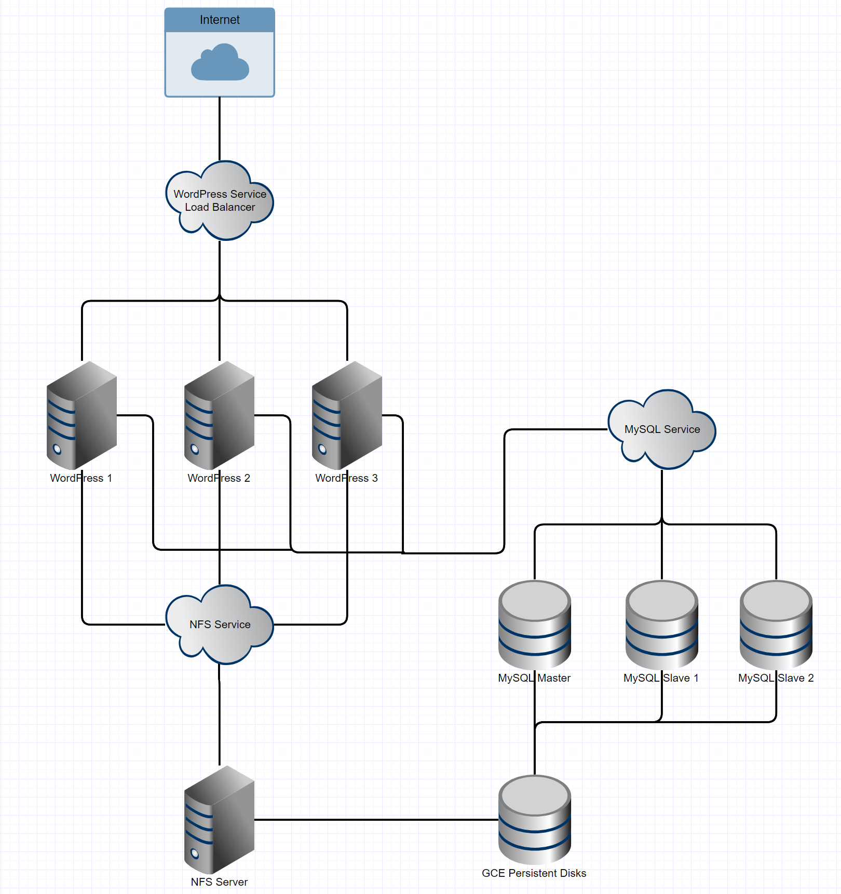

Take a deep dive into Best Practices in Kubernetes NetworkingFrom overlay networking and SSL to ingress controllers and network security policies, we've seen many users get hung up on Kubernetes networking challenges. In this video recording, we dive into Kubernetes networking, and discuss best practices for a wide variety of deployment options. [Watch the video](https://rancher.com/events/2018/kubernetes-networking-masterclass-june-online-meetup/) WordPress is a popular platform for editing and publishing content for

the web. In this tutorial, I’m going to walk you through how to build

out a highly available (HA) WordPress deployment using Kubernetes.

WordPress consists of two major components: the WordPress PHP server,

and a database to store user information, posts, and site data. We need

to make both of these HA for the entire application to be fault

tolerant. Running HA services can be difficult when hardware and

addresses are changing; keeping up is tough. With Kubernetes and its

powerful networking components, we can deploy an HA WordPress site and

MySQL database without typing a single IP address (almost). In this

tutorial, I’ll be showing you how to create storage classes, services,

configuration maps, and sets in Kubernetes; run HA MySQL; and hook up an

HA WordPress cluster to the database service. If you don’t already have

a Kubernetes cluster, you can spin one up easily on Amazon, Google, or

Azure, or by using [Rancher Kubernetes Engine (RKE)](https://rancher.com/an-introduction-to-rke/) on any servers.

## Architecture Overview

I’ll now present an overview of the technologies we’ll use and their

functions:

- Storage for WordPress Application Files: NFS with a GCE Persistent

  Disk Backing
- Database Cluster: MySQL with xtrabackup for parity
- Application Level: A WordPress DockerHub image mounted to NFS

  Storage
- Load Balancing and Networking: Kubernetes-based load balancers and

  service networking

The architecture is organized as shown below:



## Creating Storage Classes, Services, and Configuration Maps in Kubernetes

In Kubernetes, stateful sets offer a way to define the order of pod

initialization. We’ll use a stateful set for MySQL, because it ensures

our data nodes have enough time to replicate records from previous pods

when spinning up. The way we configure this stateful set will allow the

MySQL master to spin up before any of the slaves, so cloning can happen

directly from master to slave when we scale up. To start, we’ll need to

create a persistent volume storage class and a configuration map to

apply master and slave configurations as needed. We’re using persistent

volumes so that the data in our databases aren’t tied to any specific

pods in the cluster. This method protects the database from data loss in

the event of a loss of the MySQL master pod. When a master pod is lost,

it can reconnect to the `xtrabackup` slaves on the slave nodes and

replicate data from slave to master. MySQL’s replication handles

master-to-slave replication but `xtrabackup` handles slave-to-master

backward replication. To dynamically allocate persistent volumes, we

create the following storage class utilizing GCE Persistent Disks.

However, Kubernetes offers a variety of persistent volume storage

providers:

```
# storage-class.yaml
kind: StorageClass
apiVersion: storage.k8s.io/v1
metadata:
  name: slow
provisioner: kubernetes.io/gce-pd
parameters:
  type: pd-standard
  zone: us-central1-a
```

Create the class and deploy with this

command: `$ kubectl create -f storage-class.yaml`. Next, we’ll create

the configmap, which specifies a few variables to set in the MySQL

configuration files. These different configurations are selected by the

pods themselves, but they give us a handy way to manage potential

configuration variables. Create a YAML file named `mysql-configmap.yaml`

to handle this configuration as follows:

```
# mysql-configmap.yaml
apiVersion: v1
kind: ConfigMap
metadata:
  name: mysql
  labels:
    app: mysql
data:
  master.cnf: |
    # Apply this config only on the master.
    [mysqld]
    log-bin
    skip-host-cache
    skip-name-resolve
  slave.cnf: |
    # Apply this config only on slaves.
    [mysqld]
    skip-host-cache
    skip-name-resolve
```

Create the configmap and deploy with this

command: `$ kubectl create -f mysql-configmap.yaml`. Next, we want to

set up the service such that MySQL pods can talk to one another and our

WordPress pods can talk to MySQL, using `mysql-services.yaml`. This also

enables a service load balancer for the MySQL service.

```
# mysql-services.yaml
# Headless service for stable DNS entries of StatefulSet members.
apiVersion: v1
kind: Service
metadata:
  name: mysql
  labels:
    app: mysql
spec:
  ports:
  - name: mysql
    port: 3306
  clusterIP: None
  selector:
    app: mysql
```

With this service declaration, we lay the groundwork to have a multiple

write, multiple read cluster of MySQL instances. This configuration is

necessary because each WordPress instance can potentially write to the

database, so each node must be ready to read and write. To create the

services above, execute the following command:

`$ kubectl create -f mysql-services.yaml` At this point, we’ve created

the volume claim storage class which will hand persistent disks to all

pods that request them, we’ve configured the configmap that sets a few

variables in the MySQL configuration files, and we’ve configured a

network-level service that will load balance requests to the MySQL

servers. This is all just framework for the stateful sets, where the

MySQL servers actually operate, which we’ll explore next.

## Configuring MySQL with Stateful Sets

In this section, we’ll be writing the YAML configuration for a MySQL

instance using a stateful set. Let’s define our stateful set:

- Create three pods and register them to the MySQL service.
- Define the following template for each pod:
- Create an initialization container for the master MySQL server

  named `init-mysql`.
  - Use the `mysql:5.7` image for this container.
  - Run a bash script to set up `xtrabackup`.
  - Mount two new volumes for the configuration and configmap.
- Create an initialization container for the master MySQL server

  named `clone-mysql`.
  - Use the Google Cloud Registry’s `xtrabackup:1.0` image for this

    container.
  - Run a bash script to clone existing `xtrabackups` from the

    previous peer.
  - Mount two new volumes for data and configuration.
  - This container effectively hosts the cloned data so the new

    slave containers can pick it up.
- Create the primary containers for the slave MySQL servers.
  - Create a MySQL slave container and configure it to connect to

    the MySQL master.
  - Create a `xtrabackup` slave container and configure it to

    connect to the xtrabackup master.
- Create a volume claim template to describe each volume to be created

  as a 10GB persistent disk.

The following configuration defines behavior for masters and slaves of

our MySQL cluster, offering a bash configuration that runs the slave

client and ensures proper operation of a master before cloning. Slaves

and masters each get their own 10GB volume which they request from the

persistent volume storage class we defined earlier.

```
apiVersion: apps/v1beta1
kind: StatefulSet
metadata:
  name: mysql
spec:
  selector:
    matchLabels:
      app: mysql
  serviceName: mysql
  replicas: 3
  template:
    metadata:
      labels:
        app: mysql
    spec:
      initContainers:
      - name: init-mysql
        image: mysql:5.7
        command:
        - bash
        - "-c"
        - |
          set -ex
          # Generate mysql server-id from pod ordinal index.
          [[ `hostname` =~ -([0-9]+)$ ]] || exit 1
          ordinal=${BASH_REMATCH[1]}
          echo [mysqld] > /mnt/conf.d/server-id.cnf
          # Add an offset to avoid reserved server-id=0 value.
          echo server-id=$((100 + $ordinal)) >> /mnt/conf.d/server-id.cnf
          # Copy appropriate conf.d files from config-map to emptyDir.
          if [[ $ordinal -eq 0 ]]; then
            cp /mnt/config-map/master.cnf /mnt/conf.d/
          else
            cp /mnt/config-map/slave.cnf /mnt/conf.d/
          fi
        volumeMounts:
        - name: conf
          mountPath: /mnt/conf.d
        - name: config-map
          mountPath: /mnt/config-map
      - name: clone-mysql
        image: gcr.io/google-samples/xtrabackup:1.0
        command:
        - bash
        - "-c"
        - |
          set -ex
          # Skip the clone if data already exists.
          [[ -d /var/lib/mysql/mysql ]] && exit 0
          # Skip the clone on master (ordinal index 0).
          [[ `hostname` =~ -([0-9]+)$ ]] || exit 1
          ordinal=${BASH_REMATCH[1]}
          [[ $ordinal -eq 0 ]] && exit 0
          # Clone data from previous peer.
          ncat --recv-only mysql-$(($ordinal-1)).mysql 3307 | xbstream -x -C /var/lib/mysql
          # Prepare the backup.
          xtrabackup --prepare --target-dir=/var/lib/mysql
        volumeMounts:
        - name: data
          mountPath: /var/lib/mysql
          subPath: mysql
        - name: conf
          mountPath: /etc/mysql/conf.d
      containers:
      - name: mysql
        image: mysql:5.7
        env:
        - name: MYSQL_ALLOW_EMPTY_PASSWORD
          value: "1"
        ports:
        - name: mysql
          containerPort: 3306
        volumeMounts:
        - name: data
          mountPath: /var/lib/mysql
          subPath: mysql
        - name: conf
          mountPath: /etc/mysql/conf.d
        resources:
          requests:
            cpu: 500m
            memory: 1Gi
        livenessProbe:
          exec:
            command: ["mysqladmin", "ping"]
          initialDelaySeconds: 30
          periodSeconds: 10
          timeoutSeconds: 5
        readinessProbe:
          exec:
            # Check we can execute queries over TCP (skip-networking is off).
            command: ["mysql", "-h", "127.0.0.1", "-e", "SELECT 1"]
          initialDelaySeconds: 5
          periodSeconds: 2
          timeoutSeconds: 1
      - name: xtrabackup
        image: gcr.io/google-samples/xtrabackup:1.0
        ports:
        - name: xtrabackup
          containerPort: 3307
        command:
        - bash
        - "-c"
        - |
          set -ex
          cd /var/lib/mysql

          # Determine binlog position of cloned data, if any.
          if [[ -f xtrabackup_slave_info ]]; then
            # XtraBackup already generated a partial "CHANGE MASTER TO" query
            # because we're cloning from an existing slave.
            mv xtrabackup_slave_info change_master_to.sql.in
            # Ignore xtrabackup_binlog_info in this case (it's useless).
            rm -f xtrabackup_binlog_info
          elif [[ -f xtrabackup_binlog_info ]]; then
            # We're cloning directly from master. Parse binlog position.
            [[ `cat xtrabackup_binlog_info` =~ ^(.*?)[[:space:]]+(.*?)$ ]] || exit 1
            rm xtrabackup_binlog_info
            echo "CHANGE MASTER TO MASTER_LOG_FILE='${BASH_REMATCH[1]}',
                  MASTER_LOG_POS=${BASH_REMATCH[2]}" > change_master_to.sql.in
          fi

          # Check if we need to complete a clone by starting replication.
          if [[ -f change_master_to.sql.in ]]; then
            echo "Waiting for mysqld to be ready (accepting connections)"
            until mysql -h 127.0.0.1 -e "SELECT 1"; do sleep 1; done

            echo "Initializing replication from clone position"
            # In case of container restart, attempt this at-most-once.
            mv change_master_to.sql.in change_master_to.sql.orig
            mysql -h 127.0.0.1 <<EOF
          $(<change_master_to.sql.orig),
            MASTER_HOST='mysql-0.mysql',
            MASTER_USER='root',
            MASTER_PASSWORD='',
            MASTER_CONNECT_RETRY=10;
          START SLAVE;
          EOF
          fi

          # Start a server to send backups when requested by peers.
          exec ncat --listen --keep-open --send-only --max-conns=1 3307 -c 
            "xtrabackup --backup --slave-info --stream=xbstream --host=127.0.0.1 --user=root"
        volumeMounts:
        - name: data
          mountPath: /var/lib/mysql
          subPath: mysql
        - name: conf
          mountPath: /etc/mysql/conf.d
        resources:
          requests:
            cpu: 100m
            memory: 100Mi
      volumes:
      - name: conf
        emptyDir: {}
      - name: config-map
        configMap:
          name: mysql
  volumeClaimTemplates:
  - metadata:
      name: data
    spec:
      accessModes: ["ReadWriteOnce"]
      resources:
        requests:
          storage: 10Gi
```

Save this file as `mysql-statefulset.yaml`.

Type `kubectl create -f mysql-statefulset.yaml` and let Kubernetes

deploy your database. Now, when you call `$ kubectl get pods`, you

should see three pods spinning up or ready that each have two containers

on them. The master pod is denoted as `mysql-0` and the slaves follow

as `mysql-1` and `mysql-2`. Give the pods a few minutes to make sure

the `xtrabackup` service is synced properly between pods, then move on

to the WordPress deployment. You can check the logs of the individual

containers to confirm that there are no error messages being thrown. To

do this, run `$ kubectl logs -f -c <container_name>` The master

`xtrabackup` container should show the two connections from the slaves

and no errors should be visible in the logs.

## Deploying Highly Available WordPress

The final step in this procedure is to deploy our WordPress pods onto

the cluster. To do this, we want to define a service for WordPress and a

deployment. For WordPress to be HA, we want every container running the

server to be fully replaceable, meaning we can terminate one and spin up

another with no change to data or service availability. We also want to

tolerate at least one failed container, having a redundant container

there to pick up the slack. WordPress stores important site-relevant

data in the application directory `/var/www/html`. For two instances of

WordPress to serve the same site, that folder has to contain identical

data. When running WordPress in HA, we need to share

the `/var/www/html` folders between instances, so we’ll define an NFS

service that will be the mount point for these volumes. The following

configuration sets up the NFS services. I’ve provided the plain English

version below:

- Define a persistent volume claim to create our shared NFS disk as a

  GCE persistent disk at size 200GB.
- Define a replication controller for the NFS server which will ensure

  at least one instance of the NFS server is running at all times.
- Open ports 2049, 20048, and 111 in the container to make the NFS

  share accessible.
- Use the Google Cloud Registry’s `volume-nfs:0.8` image for the NFS

  server.
- Define a service for the NFS server to handle IP address routing.
- Allow necessary ports through that service firewall.

```
# nfs.yaml
# Define the persistent volume claim
apiVersion: v1
kind: PersistentVolumeClaim
metadata:
  name: nfs
  labels:
    demo: nfs
  annotations:
    volume.alpha.kubernetes.io/storage-class: any
spec:
  accessModes: [ "ReadWriteOnce" ]
  resources:
    requests:
      storage: 200Gi

---
# Define the Replication Controller
apiVersion: v1
kind: ReplicationController
metadata:
  name: nfs-server
spec:
  replicas: 1
  selector:
    role: nfs-server
  template:
    metadata:
      labels:
        role: nfs-server
    spec:
      containers:
      - name: nfs-server
        image: gcr.io/google_containers/volume-nfs:0.8
        ports:
          - name: nfs
            containerPort: 2049
          - name: mountd
            containerPort: 20048
          - name: rpcbind
            containerPort: 111
        securityContext:
          privileged: true
        volumeMounts:
          - mountPath: /exports
            name: nfs-pvc
      volumes:
        - name: nfs-pvc
          persistentVolumeClaim:
            claimName: nfs

---
# Define the Service
kind: Service
apiVersion: v1
metadata:
  name: nfs-server
spec:
  ports:
    - name: nfs
      port: 2049
    - name: mountd
      port: 20048
    - name: rpcbind
      port: 111
  selector:
    role: nfs-server
```

Deploy the NFS server using `$ kubectl create -f nfs.yaml`. Now, we need

to run `$ kubectl describe services nfs-server` to gain the IP address

to use below. **Note:** In the future, we’ll be able to tie these

together using the service names, but for now, you have to hardcode the

IP address.

```
# wordpress.yaml
apiVersion: v1
kind: Service
metadata:
  name: wordpress
  labels:
    app: wordpress
spec:
  ports:
    - port: 80
  selector:
    app: wordpress
    tier: frontend
  type: LoadBalancer

---

apiVersion: v1
kind: PersistentVolume
metadata:
  name: nfs
spec:
  capacity:
    storage: 20G
  accessModes:
    - ReadWriteMany
  nfs:
    # FIXME: use the right IP
    server: <IP of the NFS Service>
    path: "/"

---

apiVersion: v1
kind: PersistentVolumeClaim
metadata:
  name: nfs
spec:
  accessModes:
    - ReadWriteMany
  storageClassName: ""
  resources:
    requests:
      storage: 20G

---

apiVersion: apps/v1beta1 # for versions before 1.8.0 use apps/v1beta1
kind: Deployment
metadata:
  name: wordpress
  labels:
    app: wordpress
spec:
  selector:
    matchLabels:
      app: wordpress
      tier: frontend
  strategy:
    type: Recreate
  template:
    metadata:
      labels:
        app: wordpress
        tier: frontend
    spec:
      containers:
      - image: wordpress:4.9-apache
        name: wordpress
        env:
        - name: WORDPRESS_DB_HOST
          value: mysql
        - name: WORDPRESS_DB_PASSWORD
          value: ""
        ports:
        - containerPort: 80
          name: wordpress
        volumeMounts:
        - name: wordpress-persistent-storage
          mountPath: /var/www/html
      volumes:
      - name: wordpress-persistent-storage
        persistentVolumeClaim:
            claimName: nfs
```

We’ve now created a persistent volume claim that maps to the NFS

service we created earlier. It then attaches the volume to the WordPress

pod at the `/var/www/html` root, where WordPress is installed. This

preserves all installation and environments across WordPress pods in the

cluster. With this configuration, we can spin up and tear down any

WordPress node and the data will remain. Because the NFS service is

constantly using the physical volume, it will retain the volume and

won’t recycle or misallocate it. Deploy the WordPress instances

using `$ kubectl create -f wordpress.yaml`. The default deployment only

runs a single instance of WordPress, so feel free to scale up the number

of WordPress instances

using `$ kubectl scale --replicas=<number of replicas> deployment/wordpress`.

To obtain the address of the WordPress service load balancer,

type `$ kubectl get services wordpress` and grab the `EXTERNAL-IP` field

from the result to navigate to WordPress.

## Resilience Testing

OK, now that we’ve deployed our services, let’s start tearing them

down to see how well our HA architecture handles some chaos. In this

approach, the only single point of failure left is the NFS service (for

reasons explained in the Conclusion). You should be able to demonstrate

testing the failure of any other services to see how the application

responds. I’ve started with three replicas of the WordPress service and

the one master and two slaves on the MySQL service. First, let’s kill

all but one WordPress node and see how the application reacts:

`$ kubectl scale --replicas=1 deployment/wordpress` Now, we should see a

drop in pod count for the WordPress deployment. `$ kubectl get pods` We

should see that the WordPress pods are running only `1/1` now. When

hitting the WordPress service IP, we’ll see the same site and same

database as before. To scale back up, we can

use `$ kubectl scale --replicas=3 deployment/wordpress`. We’ll again

see that data is preserved across all three instances. To test the MySQL

StatefulSet, we can scale down the number of replicas using the

following: `$ kubectl scale statefulsets mysql --replicas=1` We’ll see

a loss of both slaves in this instance and, in the event of a loss of

the master in this moment, the data it has will be preserved on the GCE

Persistent Disk. However, we’ll have to manually recover the data from

the disk. If all three MySQL nodes go down, you’ll not be able to

replicate when new nodes come up. However, if a master node goes down, a

new master will be spun up and via `xtrabackup`, it will repopulate with

the data from a slave. Therefore, I don’t recommend ever running with a

replication factor of less than three when running production databases.

To conclude, let’s talk about some better solutions for your stateful

data, as Kubernetes isn’t really designed for state.

## Conclusions and Caveats

You’ve now built and deployed an HA WordPress and MySQL installation on

Kubernetes! Despite this great achievement, your journey may be far from

over. If you haven’t noticed, our installation still has a single point

of failure: the NFS server sharing the `/var/www/html` directory between

WordPress pods. This service represents a single point of failure

because without it running, the `html` folder disappears on the pods

using it. The image I’ve selected for the server is incredibly stable

and production ready, but for a true production deployment, you may

consider

using [GlusterFS](https://github.com/gluster/gluster-kubernetes) to

enable multi-read multi-write to the directory shared by WordPress

instances. This process involves running a distributed storage cluster

on Kubernetes, which isn’t really what Kubernetes is built for, so

despite it *working*, it isn’t a great option for long-term

deployments. For the database, I’d personally recommend using a managed

Relational Database service to host the MySQL instance, be it Google’s

CloudSQL or AWS’s RDS, as they provide HA and redundancy at a more

sensible price and keep you from worrying about data integrity.

Kubernetes isn’t really designed around stateful applications and any

state built into it is more of an afterthought. Plenty of solutions

exist that offer much more of the assurances one would look for when

picking a database service. That being said, the configuration presented

above is a labor of love, a hodgepodge of Kubernetes tutorials and

examples found across the web to create a cohesive, realistic use case

for Kubernetes and all the new features in Kubernetes 1.8.x. I hope your

experiences deploying WordPress and MySQL using the guide I’ve prepared

for you are a bit less exciting than the ones I had ironing out bugs in

the configurations, and of course, I wish you eternal uptime. That’s

all for now. Tune in next time when I teach you to drive a boat using

only a Myo gesture band and a cluster of Linode instances running Tails

Linux.

### About the Author

 Eric Volpert is a

student at the University of Chicago and works as an evangelist, growth

hacker, and writer for Rancher Labs. He enjoys any engineering

challenge. He’s spent the last three summers as an internal tools

engineer at Bloomberg and a year building DNS services for the Secure

Domain Foundation with CrowdStrike. Eric enjoys many forms of music

ranging from EDM to High Baroque, playing MOBAs and other action-packed

games on his PC, and late-night hacking sessions, duct taping APIs

together so he can make coffee with a voice command.Take a deep dive into Best Practices in Kubernetes NetworkingFrom overlay networking and SSL to ingress controllers and network security policies, we've seen many users get hung up on Kubernetes networking challenges. In this video recording, we dive into Kubernetes networking, and discuss best practices for a wide variety of deployment options. [Watch the video](https://rancher.com/events/2018/kubernetes-networking-masterclass-june-online-meetup/)
