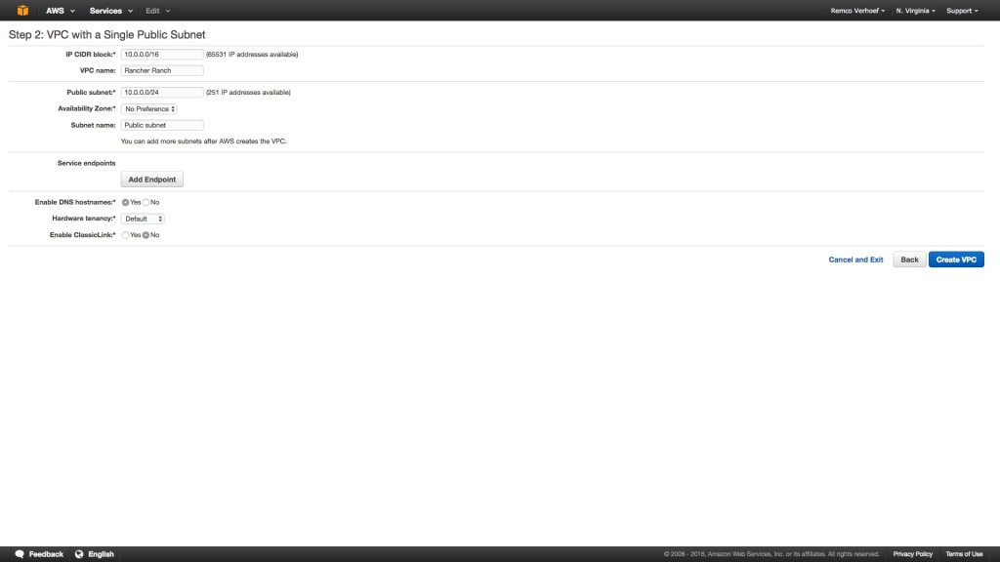
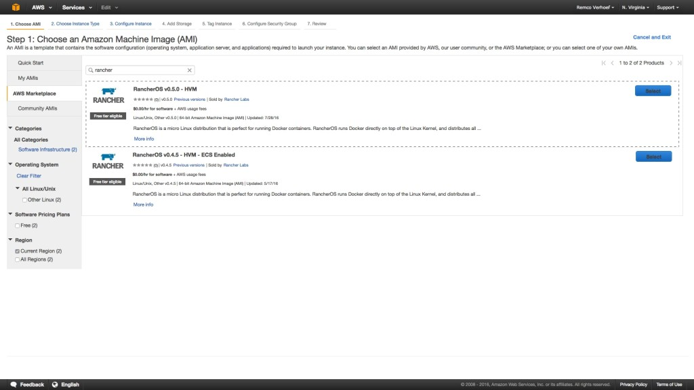
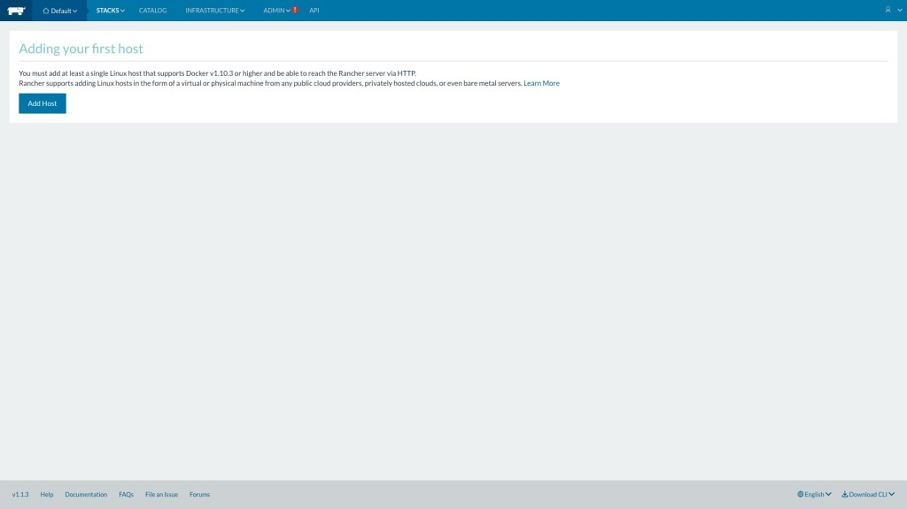
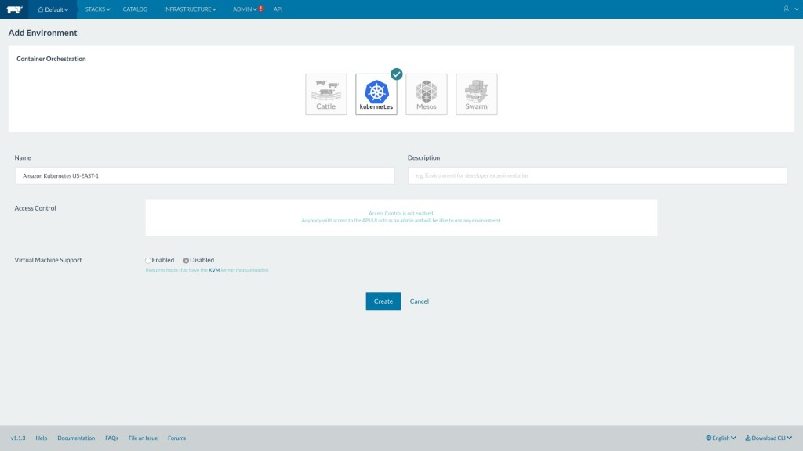
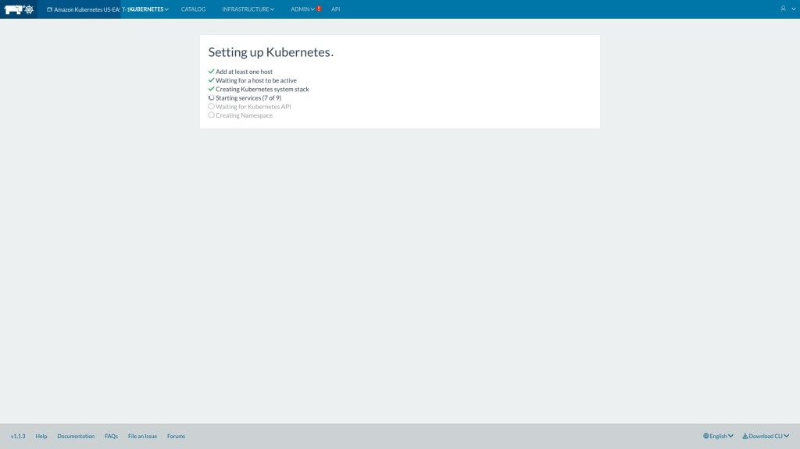
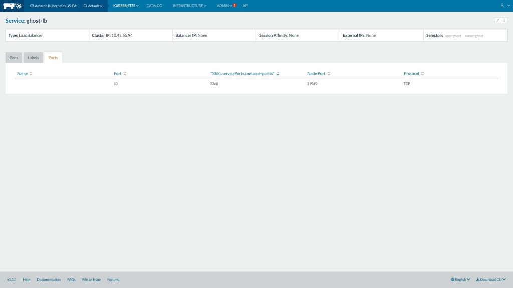

As everyone is aware, Amazon has EC2 Container Services, the Amazon
solution for running Docker containers. I haven’t had much luck with
this, so now I’m testing Rancher and Kubernetes on Amazon Web Services.
[Kubernetes](https://rancher.com/kubernetes) is an open-source system
for automating deployment, scaling, and management of containerized
applications, and [Rancher](https://rancher.com/rancher) is a
complete platform running containers within enterprises, providing
enterprise-level access control and container orchestration. I started
first by creating a new Virtual Private Cloud, using the default wizard.
This VPC is being used for the complete Rancher farm. Next thing is to
create one or more new hosts; where the Rancher documentation says to
install Docker manually, I’ve chosen the RancherOS AMI itself.
That AMI is specially built for this purposes, and very minimal (even
curl isn’t installed):
[](https://cdn.rancher.com/wp-content/uploads/2016/09/06113103/1.jpg)
The security group enables traffic to TCP port 8080 for my IP only. This
is important, as there is no authorization enabled by default. It is
also a good idea to add traffic between several hosts itself; this can
be done by saving the security group (then it well get an sg-
identifier), and add All Traffic permissions to that security group.
[](https://cdn.rancher.com/wp-content/uploads/2016/09/06113107/2.jpg)
When the new instance is ready, just connect using ssh and start the
Rancher server Docker image using
`sudo docker run -d --restart=always -p 8080:8080 rancher/server`. The
Rancher applications will run within the Docker images themselves.

```
$ sudo docker run -d --restart=always -p 8080:8080 rancher/server
Unable to find image 'rancher/server:latest' locally latest: Pulling from rancher/server
...
Status: Downloaded newer image for rancher/server:latest 3baee4a975200c3eb4b18fd1351b07393cdd09455cf7917d46879a278399c02e
```

You can tail the logs using the `docker logs -f {containerid}` command:

```
[rancher@ip-10-0-0-29 ~]$ sudo docker logs -f 3baee4a975200c3eb4b18fd1351b07393cdd09455cf7917d46879a278399c02e 160901 8:40:30
[Note] /usr/sbin/mysqld (mysqld 5.5.49-0ubuntu0.14.04.1) starting as process 25
...
Uptime: 8 Threads: 1 Questions: 2 Slow queries: 0 Opens: 33 Flush tables: 1 Open tables: 26 Queries per second avg: 0.250
Setting up database
Importing schema
```

Perfect. Rancher server is starting, and will be finished soon. You can
browse to the IP of the instance, and by default, Rancher server will
run on port 8080. The public IP will be reachable for all hosts, which
is an issue when having the hosts in a VPC, so you can use the private
IP instead. This can be changed within Admin and Settings.
[](https://cdn.rancher.com/wp-content/uploads/2016/09/06113111/3.jpg)
When Rancher server is up and running, we need to add some Docker hosts.
You can launch a new host (the **More Like This** option is awesome - it
just starts another instance of the same configuration), or add the same
host as server (but that’s not a best practice). Next, add a new host
within Rancher Server, click on Infrastructure, and next on Add Host.
When the host(s) have been added, you can add the Kubernetes
environment. Kubernetes will then be deployed automatically to the new
host(s).
[](https://cdn.rancher.com/wp-content/uploads/2016/09/06113048/4.jpg)
This will take a few minutes, and you can monitor its current status by
selecting the environment:
[](https://cdn.rancher.com/wp-content/uploads/2016/09/06113052/5.jpg)
As the Kubernetes environment finishes, you navigate to Catalog and
deploy a container. For example, select the K8S Example Ghost container
- this will be up and running in no time:
[](https://cdn.rancher.com/wp-content/uploads/2016/09/06113056/6.jpg)
During the deployment Kubernetes, the stack is created with the
following instances:

- **Rancher Ingress Controller 1 (rancher/ingress-controller)**: The
  Rancher Ingress Controller will leverage the existing load balancing
  functionality within Rancher and convert what is in Kubernetes
  ingress to a load balancer in Rancher (read more about this
  [here](https://rancher.com/rancher-controller-for-the-kubernetes-ingress-feature/))
- \*\*Rancher Server (rancher/server): \*\*The Rancher management server,
  this will run the web frontend and API.
- **Rancher Agent (rancher/agent)**: Each node will get an individual
  agent, which manages the node
- **Rancher Kubernetes Agent 1** **(rancher/kubernetes-agent)**: Agent
  responsible for handling communications between Rancher and
  Kubernetes
- **Rancher Agent Instance (rancher/agent-instance)**: Agent instance
  image for Rancher
- **Kubernetes ETCD 1 (rancher/etc):** etcd is the highly-available
  key value store used for persistent, safe, and distributed storage
  of objects and metadata
- **Kubernetes Proxy 1 (rancher/k8s)**: The Kubernetes network proxy
  runs on each node
- **Kubernetes Scheduler 1 (rancher/k8s)**: The Kubernetes controller
  manager is a daemon that embeds the core control loops shipped with
  Kubernetes
- **Kubelet 1 (rancher/k8s)**: The kubelet is the primary “node
  agent” that runs on each node.

When adding an extra host the following will be added as well:

- Kubernetes Proxy 2
- Kubernetes Etcd 2
- Kubelet 2

Because I don’t want to maintain my own registry, I’ve created an
Amazon Container Registry, and used the registry within Rancher. You can
just copy the address, username AWS (note, this is case sensitive), and
password (the long base64 encoded string). You can get the credentials
using

```
aws ecr get-login --region us-east-1
```

Then build the Docker image:

```
docker build -t dutchcoders .
```

Tag the image and register it:

```
docker tag dutchcoders:latest {url}/dutchoders:latest
```

Push the image to the registry:

```
docker push {url}/dutchcoders:latest
```

If you want to read more about running Kubernetes with Rancher, check
[this](https://rancher.com/kubernetes), join the [Kubernetes LinkedIn
group](https://www.linkedin.com/groups/6821178), or check out **the free
eBook on [deploying and scaling Kubernetes with
Rancher](https://info.rancher.com/deploying-scaling-kubernetes-ebook)**.
Let me know if you’ve got any questions running Rancher with Kubernetes
on Amazon Web Services. You can reach Rancher Labs on Twitter,
[@Rancher\_Labs](https://twitter.com/Rancher_Labs), and me
[@remco\_verhoef](https://twitter.com/remco_verhoef). *About the
Author*: *Remco Verhoef is a tech enthusiast experimenting with
Kubernetes and developing in Golang and Rust.*
