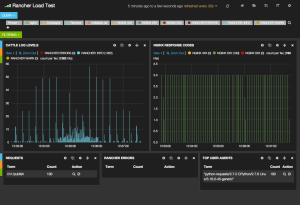

A Detailed Overview of Rancher's ArchitectureThis newly-updated, in-depth guidebook provides a detailed overview of the features and functionality of the new Rancher: an open-source enterprise Kubernetes platform.[Get the eBook](https://more.suse.com/fy21-global-web-landing-page-rancher2-technical-architecture)

At
Rancher Labs we generate a lot of logs in our internal environments. As
we conduct more and more testing on these environments we have found the
need to centrally aggregate the logs from each environment. We decided
to use [Rancher](https://rancher.com/rancher/)to build and run a scalable
ELK stack to manage all of these logs. For those that are unfamiliar
with the ELK stack, it is made up of Elasticsearch, Logstash and Kibana.
Logstash provides a pipeline for shipping logs from various sources and
input types, combining, massaging and moving them into Elasticsearch, or
several other stores. It is a really powerful tool in the logging
arsenal. Elasticsearch is a document database that is really good at
search. It can take our processed output from Logstash, analyze and
provides an interface to query all of our logging data. Together with
Kibana, a powerful visualization tool that consumes Elasticsearch data,
you have amazing ability to gain insights from your logging. Previously,
we have been using Elastic’s Found product and have been very impressed.
One of the interesting things we realized while using Found for
Elasticsearch is that the ELK stack really is made up of discrete parts.
Each part of the stack has its own needs and considerations. Found
provided us Elasticsearch and Kibana. There was no Logstash end point
provided, though it was sufficiently documented how to use Found with
Logstash. So, we have always had to run our own Logstash pipeline.
**Logstash** Our Logstash implementation includes three tiers, one each
for collection, queueing and processing. Collection- responsible for
providing remote endpoints for logging inputs. Like Syslog, Gelf,
Logstash. Once it receives these logs it places them quickly onto a
Redis Queue. Queuing tier - provided by Redis, a very fast in memory
database. It acts as a buffer between the collection and processing
tier. Processing tier - removes messages from the queue, and applies
filter plugins to the logs that manipulate the data to a desired format.
This tier does the heavy lifting and is often a bottleneck in a log
pipeline. Once it processes the data it forwards it along to the final
destination, which is Elasticsearch. 
*Each Logstash container has a configuration sidekick that provides
configuration through a shared volume.* By breaking the stack into these
tiers, you can scale and adapt each part without major impact to the
other parts of the stack. As a user, you can also scale and adjust each
tier to suit your needs. A good read on how to scale Logstash can be
found on Elastic’s web page here: [Deploying and Scaling
Logstash](https://www.elastic.co/guide/en/logstash/current/deploying-and-scaling.html).
To build the Logstash stack we stared as we usually do. In general, we
try to reuse as much as possible from the community. Looking at the
DockerHub registry, we found there is already an official Logstash image
maintained by Docker. The real magic is in configuration of Logstash at
each of the tiers. To achieve maximum flexibility with configuration, we
built a confd container that consumes KV, or Key Value, data for its
configuration values. The logstash configurations are the most volatile,
and unique to an organization as they provide the interfaces for the
collection, indexing, and shipping of the logs. Each organization is
going to have different processing needs, formatting, tagging etc. To
achieve maximum flexibility we leveraged the confd tool and Rancher
sidekick containers. The sidekick creates an atomic scheduling unit
within Rancher. In this case, our configuration container exposes the
configuration files to our Logstash container through volume sharing. In
doing this, there is no modification needed to the default Docker
Logstash image. How is that for reuse! **Elasticsearch** Elasticsearch
is built out in three tiers as well. When reading the production
deployment recommendations, it discusses having nodes that are dedicated
masters, data nodes and client nodes. We followed the same deployment
paradigm with this application as the logstash implementation. We deploy
each role as a service. Each service is composed of an official image
and paired with a Confd sidekick container to provide configuration. It
ends up looking like this: 
*Each tier in the Elasticsearch stack has a confd container providing
configurations through a shared volume. These containers are scheduled
together inside of Rancher.* In the current configuration, we use the
master service to provide node discovery. When using the Rancher private
network, we disable multicast and enable unicast. Since every node in
the cluster points to the master they can talk to one another. The
Rancher network also allows the nodes to talk to one another. As a part
of our stack, we also use the Kopf tool to quickly visualize our
clusters health and perform other maintenance tasks. Once you bring up
the stack you will see that you can use Kopf to see that all the nodes
came up in the cluster. **Kibana 4** Finally, in order to view all of
these logs and make sense of the data, we bring up Kibana to complete
our ELK stack. We have chosen to go with Kibana 4 in this stack. Kibana
4 is launched with an Nginx container to provide basic auth behind a
Rancher load balancer. The Kibana 4 instance is the Official image which
is hosted on DockerHub. The Kibana 4 image talks to the Elasticsearch
client nodes. So now we have a full ELK stack for taking logs and
shipping them to Elasticsearch for visualization in Kibana. The next
step is getting the logs from the hosts running your application.
**Bringing up the Stack on Rancher** So now you have the backstory on
how we came up with our ELK stack configuration. Here are instructions
to run the ELK stack on Rancher. This assumes that you already have a
Rancher environment running with at least one compute node. We will also
be using the Rancher compose CLI tool. Rancher-compose can be found on
GitHub here
[rancher/rancher-compose](https://github.com/rancher/rancher-compose).
You will need API keys from your Rancher deployment. In the instructions
below, we will bring up each component of the ELK stack, as its own
stack in Rancher. A stack in Rancher is a collection of services that
make up an application, and are defined by a Docker Compose file. In
this example, we will build the stacks in the same environment and use
cross stack linking to connect services. Cross stack linking allows
services in different stacks to discover each other through a DNS name.

1. Clone our compose template repository: git clone
   https://github.com/rancher/compose-templates.git
2. First lets bring up the Elasticsearch cluster.
   a. cd compose-templates/elasticsearch
   b. rancher-compose -p es up (Other services assume es as the
   elasticsearch stack name) This will bring up four services.
   - elasticsearch-masters
   - elasticsearch-datanodes
   - elasticsearch-clients
   - kopf
   c. Once Kopf is up, click on the container in the Rancher UI, and
   get the IP of the node it is running on.
   d. Open a new tab in your browser and go to the IP. You should see
   one datanode on the page.
3. Now lets bring up our Logstash tier.
   a. cd ../logstash
   b. rancher-compose -p logstash up
   c. This will bring up the following services
   - Redis
   - logstash-collector
   - logstash-indexer
   d. At this point, you can point your applications at
   logtstash://host:5000.
4. (**Optional**) Install logspout on your nodes
   a. cd ../logspout
   b. rancher-compose -p logspout up
   c. This will bring up a logspout container on every node in your
   Rancher environment. Logs will start moving through the pipeline
   into Elasticsearch.
5. Finally, lets bring up Kibana 4
   a. cd ../kibana
   b. rancher-compose -p kibana up
   c. This will bring up the following services
   - kibana-vip
   - nginx-proxy
   - kibana4
   d. Click the container in the kibana-vip service in the Rancher UI.
   Visit the host ip in a separate browser tab. You will be
   directed to the Kibana 4 landing page to select your index.

Now that you have a fully functioning ELK stack on Rancher, you can
start sending your logs through the Logstash collector. By default the
collector is listening for Logstash inputs on UDP port 5000. If you are
running applications outside of Rancher, you can simply point them to
your Logstash endpoint. If your application runs on Rancher you can use
the optional Logspout-logstash service above. If your services run
outside of Rancher, you can configure your Logstash to use Gelf, and use
the Docker log driver. Alternatively, you could setup a Syslog listener,
or any number of supported Logstash input plugins. **Conclusion**
Running the ELK stack on Rancher in this way provides a lot of
flexibility to build and scale to meet any organization’s needs. It
also creates a simple way to introduce Rancher into your environment
piece by piece. As an operations team, you could quickly spin up
pipelines from existing applications to existing Elasticsearch clusters.
Using Rancher you can deploy applications following container best
practices by using sidekick containers to customize standard containers.
By scheduling these containers as a single unit, you can separate your
application out into separate concerns. On Wednesday, September 16th,
we hosted an online meetup focused on container logging, where I
demonstrated how to build and deploy your own ELK stack. If you’d like
to view a recording of this you can view it
[here](https://rancher.com/container-logging-with-docker-and-elk-september-2015-recorded-online-meetup/).
If you’d like to learn more about using Rancher, please join us for an
[upcoming online meetup](https://rancher.com/events/), or join our [beta
program](https://info.rancher.com/beta) or request a discussion with one
of our engineers.

A Detailed Overview of Rancher's ArchitectureThis newly-updated, in-depth guidebook provides a detailed overview of the features and functionality of the new Rancher: an open-source enterprise Kubernetes platform.[Get the eBook](https://more.suse.com/fy21-global-web-landing-page-rancher2-technical-architecture)
