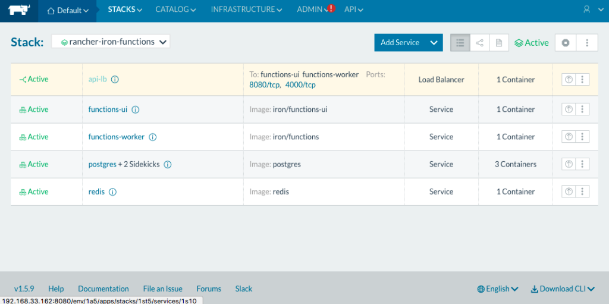
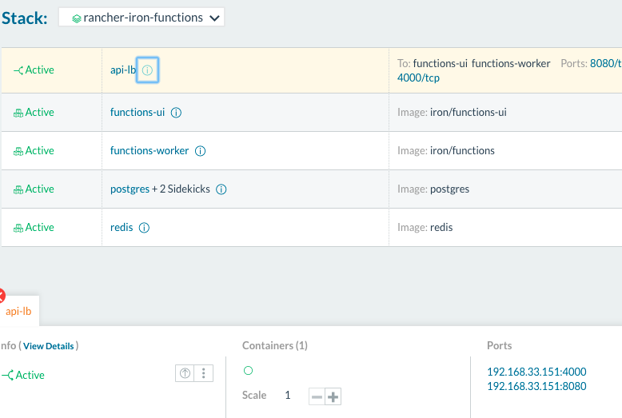
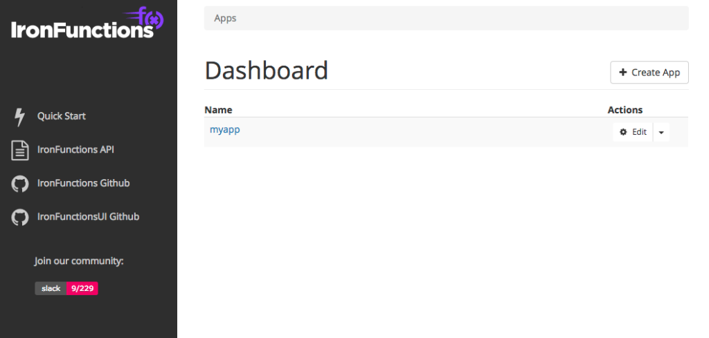
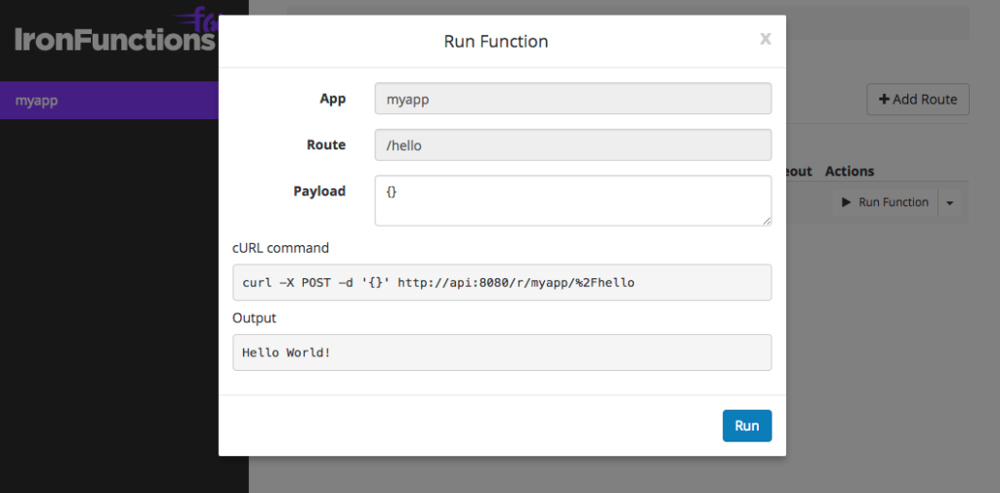

One of the more novel concepts in systems design lately has been the
notion of serverless architectures. It is no doubt a bit of hyperbole as
there are certainly servers involved, but it does mean we get to think
about servers differently.

### The potential upside of serverless

Imagine a simple web based application that handles requests from HTTP
clients. Instead of having some number of program runtimes waiting for a
request to arrive, then invoking a function to handle them, what if we
could start the runtime on-demand for each function as a needed and
throw it away afterwards? We wouldn’t need to worry about the number of
servers running that can accept connections, or deal with complex
configuration management systems to build new instances of your
application when you scale. Additionally, we’d reduce the chances of
common issues with state management such as memory leaks, segmentation
faults, etc. Perhaps most importantly, this on-demand approach to
function calls would allow us to scale every function to match the
number of requests and process them in parallel. Every “customer” would
get a dedicated process to handle their request, and the number of
processes would only be limited by the compute capacity at your
disposal. When coupled with a large cloud provider whose available,
on-demand compute sufficiently exceeds your usage, serverless has the
potential to remove a lot of the complexity around scaling your
application.

##### Take a deep dive into Best Practices in Kubernetes Networking


From overlay networking and SSL to ingress controllers and network security policies, we've seen many users get hung up on Kubernetes networking challenges. In this video recording, we dive into Kubernetes networking, and discuss best practices for a wide variety of deployment options.

[Watch the video](https://rancher.com/events/2018/kubernetes-networking-masterclass-june-online-meetup/)

### ...and the potential downside

Granted, there is still the challenge
of the increased latency associated with constructing a process for
every request. Serverless will never be as fast as having a process and
memory allocated in advance; however, the question here is not whether
it’s faster, but whether it’s fast enough. Theoretically, we’d accept
latency of serverless because the benefits we’d get in return. However,
this trade-off needs to be carefully evaluated for the situation at
hand.

### Implementing serverless with Rancher and open source tools

Docker gives us a lot of tools to implement this concept of serverless,
and gave [an excellent
demo](https://blog.docker.com/2016/06/building-serverless-apps-with-docker/)
of it at a recent Dockercon. Rancher only accentuates these
capabilities. Because our platform handles managing your container
infrastructure, you can add and remove compute capacity just by
manipulating an API. The ability to define this part of your stack
through software supports users achieving full application automation.
The next layer up in the stack is where a framework for writing code for
a serverless system is useful. You could certainly write your own, or
extend some middleware to handle this, but there are many open source
projects that provide tooling to make this experience easier. One of
those projects is[Iron.io](https://www.iron.io/)’s Iron Functions. I did
a quick POC of it on Rancher and found it was easy to work with. The
setup can be quickly launched in Rancher by using the compose files
[here](https://github.com/wjimenez5271/rancher-iron-functions). To use
these files, copy and paste the `docker-compose.yml` and
`rancher-compose.yml` files in the repo into the “Add Stack” section of
the Rancher UI. Or from the Rancher CLI, simply run “rancher up” (be
sure to set the following environment vars: `RANCHER_URL`,
`RANCHER_ACCESS_KEY`, `RANCHER_SECRET_KEY`). When the stack launches,
you should be able to see it in the Rancher UI. Additionally you can
find the URL for the Iron Functions API endpoint and UI by clicking the
“i” icon next to the first item in the stack (“api-lb“). [](https://cdn.rancher.com/wp-content/uploads/2017/05/09151005/rancher-iron-func-stack.png)
Running serverless stack after deploying [](images/rancher_blog_rancher-iron-func-show-lb.png)
Finding the URL for your IronFunctions endpoints Once you
have the stack running, follow the “Write a Function” instructions on
Iron.io’s Github repo
[here](https://github.com/iron-io/functions#write-a-function). This will
take some getting used to, as it requires you to think a little
differently about how to write your application. There won’t be any
shared state for your functions to reference, and things like libraries
can be difficult or expensive to leverage. For my example, I chose a
simple golang function from Iron.io:

> ```
> package main
>
> import (
>  "encoding/json"
>  "fmt"
>  "os"
>  )
>
> type Person struct {
>  Name string
>  }
>
> func main() {
>  p := &Person{Name: "World"}
>  json.NewDecoder(os.Stdin).Decode(p)
>  fmt.Printf("Hello %v!", p.Name)
>  }
> ```

The next step is to deploy the function to the instance of Iron
Functions we’ve setup in Rancher. To make this easier to try out, I
wrote a script that does all the steps for you. Just follow the README
on this [repo](https://github.com/wjimenez5271/iron-func-demo). Once
you’ve deployed the function, you should be able to see it in the UI,
and try it out: [](https://cdn.rancher.com/wp-content/uploads/2017/05/09151359/rancher-iron-func-dashboard.png)
IronFunctions Dashboard [](https://cdn.rancher.com/wp-content/uploads/2017/05/09151245/rancher-iron-func-results.png)
The results of your function being executed From within
Rancher, you can scale the number of workers to meet the needs of your
demand. Rancher will take care of placing them on a host and connecting
them to a load balancer. Per the [best practices
guide](https://github.com/iron-io/functions/blob/master/docs/operating/production.md),
you can simply scale based on the “wait\_time” metric, making the
scaling actions relatively simple. I found this to be a very informative
taste of what it could be like to build applications in this way, and I
hope you did as well. If you have any ideas or feedback regarding this,
don’t hesitate to reach out on the [forums](https://forums.rancher.com)
or send pull requests on GitHub. As always, you can talk to us on
Twitter [@Rancher\_Labs](https://twitter.com/rancher_labs).
