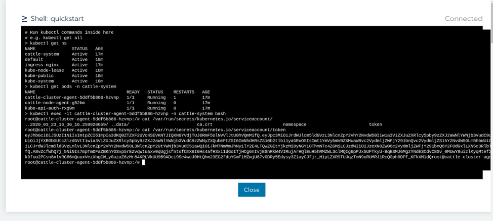
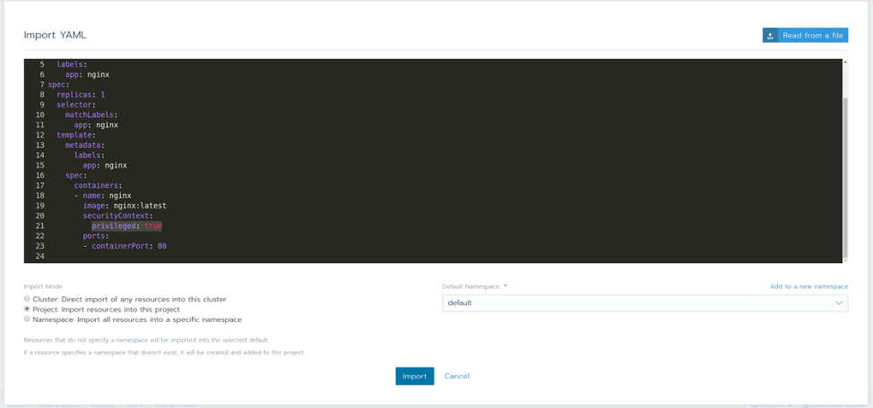
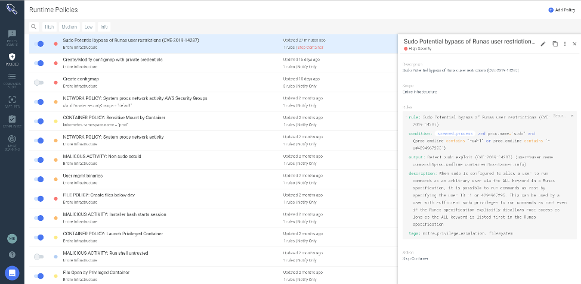

Runtime security for Rancher environments requires putting controls in place to detect unexpected behavior that could be malicious or anomalous. Examples include:

- Exploits of unpatched and new vulnerabilities
- Insecure configurations
- Leaked or weak credentials
- Insider threats

Even with processes in place for vulnerability scanning and implementing [pod security policies](https://rancher.com/blog/2020/pod-security-policies-part-1) and network policies in Rancher, not every risk will be addressed. You still need mechanisms to confirm these security barriers are effective and provide a last line of defense when they fail.

## Why Runtime Security?

Container security is often initially thought of as container image scanning and vulnerability management. The idea is if I scan my images for vulnerabilities, misconfigurations and compliance violations early in the CI/CD pipeline, I have successfully prevented threats in my container and Kubernetes environments. Although image scanning is the first step in managing security risk, runtime security and incident response are also key components of a secure DevOps workflow.

Poor runtime security controls or DevOps misconfigurations increase configuration drift, diverging from the original image approved during CI/CD. Several security threats, by their very nature, only manifest during runtime:

- Zero-day vulnerabilities
- Software bugs causing erratic behavior or resource leaking
- Internal privilege escalation attempts

In this article, we’ll look at how an open-source based approach using Falco can help you detect and alert on threats at runtime in Rancher environments. We’ll also see how Sysdig Secure extends Falco.

## Falco: Open-Source Kubernetes Runtime Detection

[Falco](http://www.falco.org), the open-source cloud-native runtime security project, is the de facto Kubernetes threat detection engine. Falco detects unexpected application behavior and alerts on threats at runtime. Falco uses Extended Berkeley Packet Filter (eBPF), a secure mechanism, to capture system calls and gain deep visibility. By adding Kubernetes application context and Kubernetes API audit events, teams can understand exactly who did what. Falco was created by [Sysdig](http://www.sysdig.com) in 2016 and is the first runtime security project to join CNCF as an incubation-level project.

## Why Falco?

Signature-based approaches, which must list each possible exploit, vulnerability or attack in some way (malware signatures), are engaged in a never-ending game of catch up with the constant stream of new threats. Behavioral approaches, in contrast, look at what is happening on a system. In other words, they “only” need to detect the things that an attacker does once they have access to a system, rather than all the ways an attacker can gain access.

With Falco, you can create security rules driven by a context-rich and flexible engine to define unexpected application behavior. Your teams can detect policy violations using community-sourced detections of malicious activity and CVE exploits. They can then alert by plugging Falco into your current security response workflows and processes.

## Falco for Threat Detection in Rancher

Runtime threat detection, built on open-source Falco, helps you identify and block suspicious activity and anomalies in your container environment. Here are a few examples:

### Terminal shell in a container

Sysdig Secure detects command-Line Interface execution (terminal shell) in a running container in violation of a configured policy. This event represents risk in that it might indicate an attacker attempting to manipulate the system, download malware, or initiate other malicious activity. This capability helps organizations better meet compliance, auditing and intrusion detection requirements.

```
- rule: Terminal shell in container

  desc: >[Text Wrapping Break]    A shell was used as the entrypoint/exec point into a container with an[Text Wrapping Break]    attached terminal.

  condition: >

    spawned_process and container

    and shell_procs and proc.tty != 0

    and container_entrypoint

  output: >

    A shell was spawned in a container with an attached terminal [Text Wrapping Break]    (user=%user.name %container.info shell=%proc.name parent=%proc.pname[Text Wrapping Break]    cmdline=%proc.cmdline terminal=%proc.tty container_id=%container.id     [Text Wrapping Break]    image=%container.image.repository)

  priority: NOTICE

  tags: [container, shell, mitre_execution]
```


Executing a terminal shell in a container using the Rancher embedded console to retrieve sensitive data.

### Attempt to make an unusual outbound network connection

If a standard system binary like ls or ps makes an outbound TCP connection, something is wrong – a likely explanation being that the host has been rootkit’ed. While you’d ideally want to detect a rootkit installation when it occurs (possibly using the kinds of rules described above), it remains important to defend in depth and detect behaviors that can happen after an attack is underway.

In this case, here is the Falco rule that will help us capture suspicious connections in Rancher environments:

```
- rule: Unexpected outbound connection destination

  desc: >[Text Wrapping Break]    Detect any outbound connection to a destination outside of an allowed set[Text Wrapping Break]    of ips, networks, or domain names

  condition: >

    consider_all_outbound_conns and outbound and not

    ((fd.sip in (allowed_outbound_destination_ipaddrs)) or

     (fd.snet in (allowed_outbound_destination_networks)) or

     (fd.sip.name in (allowed_outbound_destination_domains)))

  output: >

    Disallowed outbound connection destination [Text Wrapping Break]    (command=%proc.cmdline connection=%fd.name user=%user.name[Text Wrapping Break]    container_id=%container.id image=%container.image.repository)

  priority: NOTICE

  tags: [network]
```

### MITRE ATT&CK framework detections

Sysdig Secure detects system events that seem abnormal based on the adversary tactics and techniques defined by the [MITRE ATT&CK framework](https://sysdig.com/blog/mitre-attck-framework-for-container-runtime-security-with-sysdig-falco/). From this information, activities deemed to be a threat or anomalous can be remediated by isolating the involved pods and containers. Below example is for privilege escalation detection in Rancher:

```
- rule: Launch Privileged Container

  desc: >[Text Wrapping Break]    Detect the initial process started in a privileged container. Exceptions are[Text Wrapping Break]    made for known trusted images.

  condition: >

    container_started and container

    and container.privileged=true

    and not falco_privileged_containers

    and not user_privileged_containers

  output: >

    Privileged container started [Text Wrapping Break]    (user=%user.name command=%proc.cmdline %container.info [Text Wrapping Break]    image=%container.image.repository:%container.image.tag)

  priority: INFO

  tags: [container, cis, mitre_privilege_escalation, mitre_lateral_movement]
```


Creating a privileged container from the Rancher UI

## How Sysdig Secure Extends Runtime Security in Rancher

[Sysdig Secure](https://sysdig.com/products/secure/) extends the open-source Falco detection engine to provide comprehensive security across the Kubernetes workloads lifecycle. The very same rule applies within Sysdig:



In addition, Sysdig Secure allows you to:

- Block threats by extending Falco’s detection capabilities with prevention and response
- Ease the burden of creating and updating runtime Falco policies with automated profiling, a flexible policy editor and centralized management
- Embed security across the DevOps process with image scanning, forensics/incident response and audit, in additional to security monitoring
- Validate compliance using out-of-the-box checks and runtime policies that map to compliance standards

## Conclusion

Falco allows users to filter and detect malicious activity by writing a custom rule to match the exploit behavior pattern, then alert about the malicious activity across hosts and containers. Sysdig Secure takes this functionality a step further by reacting to these attacks, blocking them and reporting on any affected running containers in Rancher environments.

If you want to learn more about runtime security, sign up for the free [Kubernetes Security Master Class: Detecting Anomalous Activity in Rancher with Falco](https://info.rancher.com/kubernetes-security-master-class-detecting-anomalous-activity-in-rancher-with-falco-sysdig) on April 20. We’ll explore Falco, show live demos and discuss advanced use cases.
