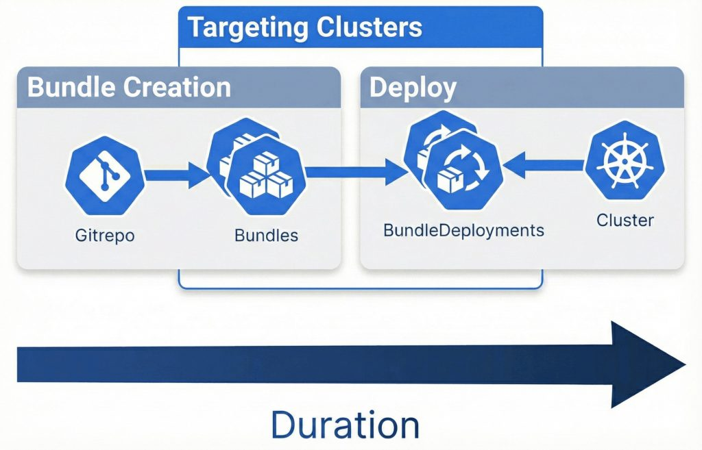
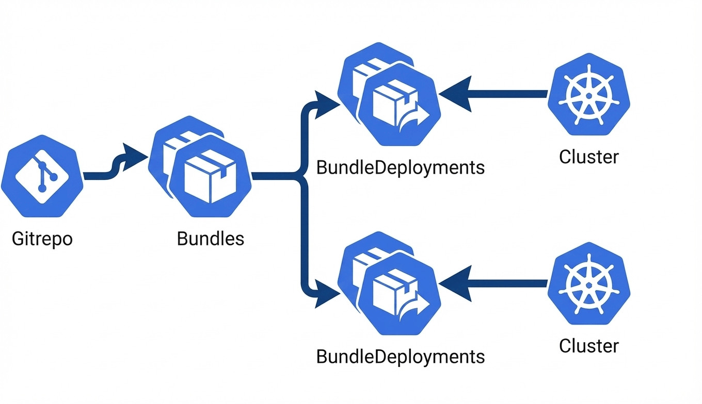
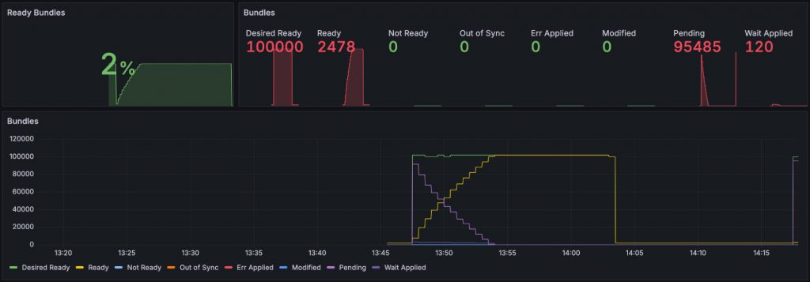
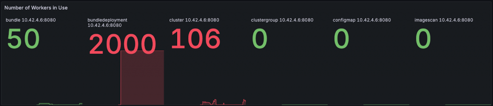

Fleet, Rancher’s built-in GitOps engine, is designed to scale up to thousands of clusters. However, “how far” can it scale in a real world scenario, you might ask?

Earlier this year, we [wrote about the Fleet benchmark tool](https://www.suse.com/c/rancher_blog/optimizing-rancher-continuous-delivery-with-benchmarks/) and we made a few discoveries that were very instructive, especially concerning resource consumption and its impact on deployments’ performances.

To come up with some limits and a set of best practices to run the operators safely, I deployed Fleet on a four node RKE2 cluster on AWS.

Our focus is on scaling the number of clusters, so all tests will use up to 50 bundles. **A Fleet ‘bundle’ represents deployable content, e.g. a single folder from the Git repository.** While perhaps not representative of typical Fleet usage, deploying all bundles to all clusters simultaneously offers an excellent stress test.

The scaling experiments did not cover polling large numbers of Git repositories, large bundles with huge manifests or lots of resources. It did not cover the latency and agility aspects of resource updates  and all the other possible dimensions of scaling. Instead, I focused on deploying workloads from Git to a large fleet of clusters.       

The experiments tested Fleet in “standalone” mode, without a Rancher manager to eliminate noise while testing. Furthermore, I aimed to exceed the 500 clusters covered in Rancher’s [official documentation](https://ranchermanager.docs.rancher.com/getting-started/installation-and-upgrade/installation-requirements).

*Fleet deployments at scale*

The requirements say that to deploy 50 applications to 500 clusters, one needs 16vCPU and 64GB of RAM. However, I wanted to use an identical setup for all experiments. So, I chose the `c5d.12xlarge` instance type. With 48 vCPUs and 96 GB of RAM, that instance type is larger than the requirement. The Fleet controllers ran on a dedicated RKE2 agent node. The other three nodes of my RKE2 setup ran etcd and the k8s API server.

Setting up the downstream clusters was the most complicated part of the test setup. Finally, I was able to create and register 500 virtual k3k clusters in 35 minutes. The 500 virtual clusters ran in a separate cluster, on six r6gd.8xlarge agent nodes. Each node ran about 330 pods. This number of pods is not officially supported, but the virtual clusters only ran the Fleet agent.

Running such small, virtual downstream clusters made the test environment easier to set up. However, a key limitation of sharing a node across multiple virtual clusters is the restricted complexity of deployable bundles. Should one virtual cluster over-utilize resources, it risks destabilizing several other clusters on the same node. Especially with so many pods per cluster and little head room. Using bigger, preferably real, downstream clusters would have made the experiment too costly and the setup more complicated. The experiments used a bundle that contains a single config map only. This works nicely, as I did not intend to measure downstream’s deployment speed, but **how well the Fleet control-plane can produce inputs for the agents**.

With a fleet agent running on each cluster, I could start measuring.

*Fleet bundles deployment workflow*

## Medium Sized Experiment

Fleet was able to consistently deploy 50 bundles to 500 clusters in 90 seconds. Updating all bundles in Git and waiting for the change to be applied to all clusters took the same time. 

Running the full benchmark suite against 500 clusters took 8 minutes, as opposed to 1 minute for two clusters. The individual experiments showed:

- initial bundle creation, git cloning: 3 seconds for one repo, 8 seconds for 50
- targeting: 40s
- deployment phase: 4 minutes

This worked well, but the setup required some special attention, like an increase to the reconcile worker number and using a node selector to ensure enough CPU is available. More on that in the “lessons learnt” section.

## Large Experiment

Building on the success of the medium-sized experiment, I wanted to push the limits further.

I tried 2000 downstream clusters. The setup remained the same, but I used 23 nodes to run virtual clusters, instead of 7.

It took 7 minutes, instead of 90 seconds, to roll out 50 bundles to 2000 clusters. CPU usage for the controllers, the API server and etcd was very high.

At this scale, the number of resources stored in etcd clearly became a limiting factor. Fleet creates a `BundleDeployment` resource for each bundle-cluster combination. That’s 100k resources. Listing that many resources with kubectl can take up to 20s.

*Fleet resources relationship*

Additionally, sensitive information, like Helm values, is stored in secrets. So, the number of objects stored in etcd doubles when using Helm-style bundles. The actual **number of resources in etcd** is:

- Manifest- or kustomize-style bundles: **clusters \* bundles**
- Helm-style bundles: **clusters \* bundles \* 2**

*Waiting for 100k resources*

The performance impact was surprisingly high. Both resources, secret and `BundleDeployment`, are normally very small. The actual bundle content is stored in another resource, which Fleet deduplicates. In theory it could happen that 100k bundle deployments re-use the same content resource. **It’s the sheer number of resources, reading them, updating them, that overwhelms the k8s API.** While the size of a resource makes etcd grow bigger, the number of resources makes the API server slower.

Additionally, etcd keeps copies for every update to a resource. At this scale the etcd blob store size had to be increased from 2GB to 8GB.

## Too Big Experiment

Creating 50 bundles on 4000 clusters is where the experiment broke. The API servers and etcd need much more tuning to be able to handle that many resources. Fleet reached its limits, too. 

For example, Fleet stores the deployment results in the resources status. But it doesn’t always truncate the status correctly to match the maximum resource size of Kubernetes. At this scale features like “report resource state” per cluster, would need to be toggled off or the resource status itself would become too large.

Fleet could scale much higher, if bundledeployments and their secrets were not stored natively in Kubernetes. CPU and RAM don’t seem to be a problem. 

When the experiment failed, the failures were often not easy to diagnose. The OOM killer was removing random processes, the etcd database reached its limit and needed to be compacted manually while taking the nodes offline. I also observed the k8s API server taking 20 seconds to return a list of resources. Controllers got stuck as the reconcilers increased the exponential backoff due to conflicts. The event queue could not be completed as there were too many events and not enough workers.

These problems remind me of my dev setup: One of the best things about Kubernetes is that you can run most setups on your laptop. I can use Rancher Desktop and run k3d inside. With just 4GB of RAM, that works for most tasks, but add too many clusters in k3d, create too many resources in k8s and it quickly hits limits and starts crashing. Very much like a bare metal linux server, when you create a million small files or run out of swap…

## Lessons Learnt

| **Scale Description** | **Number of Bundles** | **Number of Clusters** | **Total BundleDeployments** | **Control Plane Hardware** |
| --- | --- | --- | --- | --- |
| Medium | 50 | 500 | **25,000** | 16 vCPUs |
| Large | 50 | 2,000 | **100,000** | dedicated node, 3GHz CPU |
| Too Large | 50 | 4,000 | **200,000** |  |

The **number of created resources is key**. That means, deploying 25 bundles to 4000 clusters should work well (25\*4000=100k). Deploying a hundred bundles to 2000 clusters breaks the limits.

Of course, managing that amount of clusters becomes **possible when not all bundles are deployed to all clusters**. Having 4000 clusters and targeting 10 different bundles at a thousand each, is still 40 bundles total, but only 40k resources. That’s closer to a medium setup than a large one. 

### Tuning the Control Plane

- Using **SSD disks** for the management Kubernetes cluster is recommended for optimal speed.
- In larger clusters, consider **dedicated storage devices for etcd data and WAL directories**, and **increase the etcd size above 4GB**:
  - [Configure quota-backend-bytes to extend etcd keyspace limit in RKE2 | Support | SUSE](https://www.suse.com/support/kb/doc/?id=000021764)
  - [Tuning etcd for Large Installations :: Rancher product documentation](https://documentation.suse.com/cloudnative/rancher-manager/latest/en/installation-and-upgrade/best-practices/tuning-etcd-for-large-installs.html)
  - The filesystem also influences etcd performance. Prefer ext4/xfs to btrfs, or tune btrfs for the database.
- **Dedicated Nodes:** For optimal performance, consider using a **dedicated node for the Fleet controller** to ensure adequate CPU resources for Fleet and the Kubernetes API server. It used 12GB RAM when working with 100k bundledeployments.

### Fleet Installation Settings

*Fleet deployments workers count*

- **Worker Count**: Can be changed when installing Fleet, they allow Fleet to process more events in parallel:

- - - `controller.reconciler.workers.bundle`:  Needed to create bundle deployments from bundles, for 50 bundles, **50** workers are sufficient.
    - `controller.reconciler.workers.bundledeployment`: Needed for status updates, and cleanup, with 100k bundle deployments, this can be set to  **5000**.
    - `controller.reconciler.workers.gitrepo`: If polling more than 50 Git repositories, this can be safely set to **200**.
    - `controller.reconciler.workers.cluster`: Needed to update and delete bundles. For 500 clusters, this can be set to **500**.
- **Sharding:** Fleet supports **static sharding** to distribute the workload of controllers, where each shard can be assigned to a node. This is helpful if the nodes running fleet controllers  do not have enough CPU.

Additionally, a bundle’s rollout settings influence deployment speed, the default are batches of 50 clusters. For more information, refer to <https://fleet.rancher.io/rollout>.

A larger partition size will drastically reduce the number of bundle controller reconciliations and create bundledeployments faster. Agents only react to bundledeployments, so they would have to do more work in parallel.

Finally, if this is not enough and you need 5000 or 10000 clusters, one could run **multiple Fleets,** which poll the same Git repositories for bundles. That way one can scale beyond the limits of the k8s control plane. However, the fleets would be  independent of each other. Which could be advantageous, each fleet could represent a geographical region, for example.

## The discussion continues

Fleet v0.14.0 is now available and addresses several issues identified during the experiment, including better management of Fleet's internal resources. You can review the release details [on GitHub](https://github.com/rancher/fleet/releases/tag/v0.14.0). What are your experiences with scaling GitOps, we would like to know. Join us on [Rancher’s Slack](https://slack.rancher.io/) in the `#fleet` channel.
