Read our free white paper: How to Build a Kubernetes Strategy[Download Now](https://more.suse.com/fy21-global-web-landing-page-how-to-build-enterprise-kubernetes-strategy)

Rancher 2.4, the latest release of Rancher’s Kubernetes management platform, includes a [new CIS security scanning feature](https://ranchermanager.docs.rancher.com/).

[The Center for Internet Security](https://www.cisecurity.org) publishes more than 100 benchmarks for Kubernetes, which are considered the default standard benchmark for defining security of Kubernetes clusters. With Rancher 2.4, CIS scanning is an integrated part of the Rancher UI itself for RKE clusters. If you create or import any RKE cluster via Rancher, CIS Scan will work flawlessly. In this tutorial, we will walk through how to schedule CIS scanning for an RKE cluster and then set up alerting.

Rancher Kubernetes Engine (RKE) is a CNCF-certified Kubernetes distribution that runs entirely within Docker containers. It works on bare-metal and virtualized servers. RKE solves the problem of installation complexity, a common issue in the Kubernetes community. With RKE, the installation and operation of Kubernetes is both simplified and easily automated, and it’s entirely independent of the operating system and platform you’re running. As long as you can run a supported version of Docker, you can deploy and run Kubernetes with RKE.

## Scheduling CIS Scan for Rancher Kubernetes Engine Clusters

**Prerequisites:** CentOS VM (2 core min) with Docker Installed.

**Step 1: Run Rancher Server**

```
[root@rke ~]# **sudo docker run -d --restart=unless-stopped -p 80:80 -p 443:443 rancher/rancher**
Unable to find image 'rancher/rancher:latest' locally
Trying to pull repository docker.io/rancher/rancher ...

latest: Pulling from docker.io/rancher/rancher
5bed26d33875: Pull complete
f11b29a9c730: Pull complete
930bda195c84: Pull complete
78bf9a5ad49e: Pull complete
fdb587a45dfe: Pull complete
0c3f7647a659: Pull complete
02c5407ca821: Pull complete
ebc009758b56: Pull complete
57a6e40f0f6e: Pull complete
30a88d01aca6: Pull complete
76505b705d6f: Pull complete
e585ea16af8d: Pull complete
6b069694034e: Pull complete
8c5d309f94d1: Pull complete
8ec56f5fa6c2: Pull complete
75872eb736b7: Pull complete
e774fd043162: Pull complete
c76d81e7a658: Pull complete
49bf6b83af1c: Pull complete
Digest: sha256:248ddca1169e8a4e06babd50e8105cbba0a326f86ec4de3e38d61e8909ffdb4e
Status: Downloaded newer image for docker.io/rancher/rancher:latest
af5812a83958191cd9c7b459aaf11169049a1e75b54d1718f399545de3110d01

**[root@rke ~]# docker ps
**CONTAINER ID        IMAGE               COMMAND             CREATED             STATUS              PORTS                                      NAMES
af5812a83958        rancher/rancher     "entrypoint.sh"     42 seconds ago      Up 41 seconds       0.0.0.0:80->80/tcp, 0.0.0.0:443->443/tcp   kickass_archimedes
```

The above will install the latest version of Rancher (at the time of writing its 2.4.2)

**Step 2: RKE install with CIS scheduling**

- Go to the Rancher UI via `http://{hostIP}`
- Enter the password and choose the URL

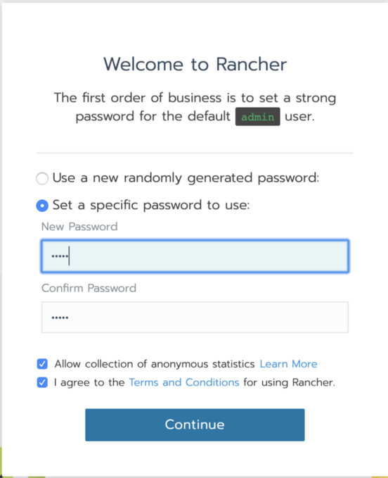

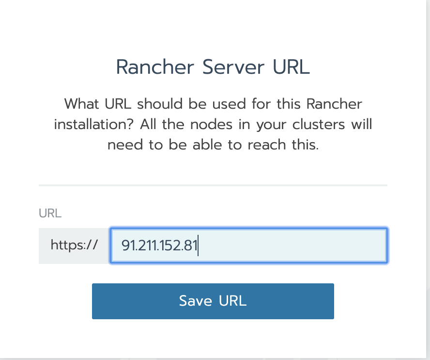

Click on Add Cluster
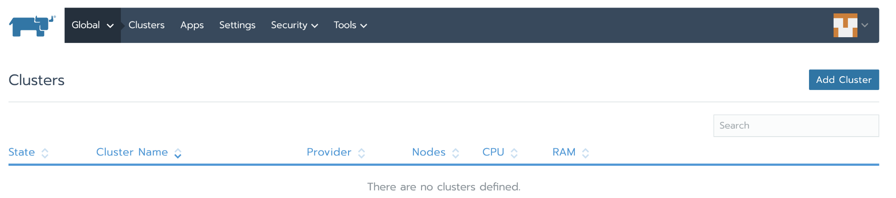

Select from existing nodes(Customs)
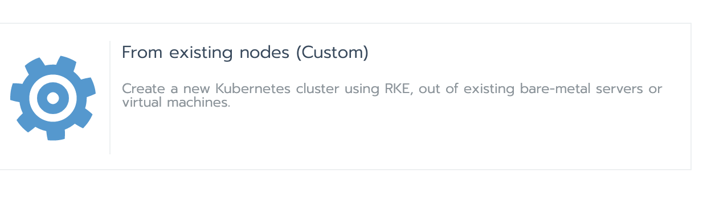

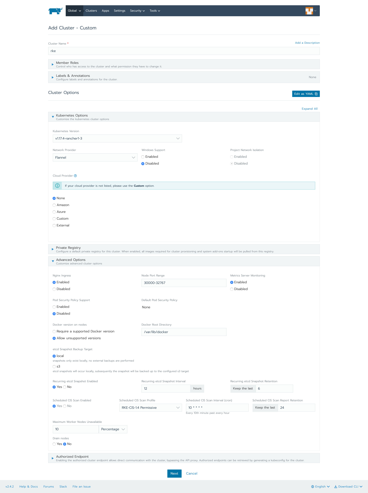

As you can see, everything is kept as default. Only the CIS Scan has been enabled. Let’s have a look at that section in more detail. When you enable CIS Scan you can choose a Permissive or Hardened scan.

**Permissive Scan** means it will skip certain scans for an RKE cluster bare minimum configuration.

**Hardened Scan** means it won’t skip any scans.

Next is the **cron** time section: you can try various combinations and the run time will appear below the box (in the above case, it’s every 10th minute past every hour).

The last part is the retention for CIS Scan reports.

Note that scheduling of CIS Scan is important to keep your cluster secure. Consider a scenario where a new developer comes in and makes a change that does not comply with the CIS specification. The CIS Scan will fail and you would be alerted – thereby keeping your Kubernetes cluster secure.

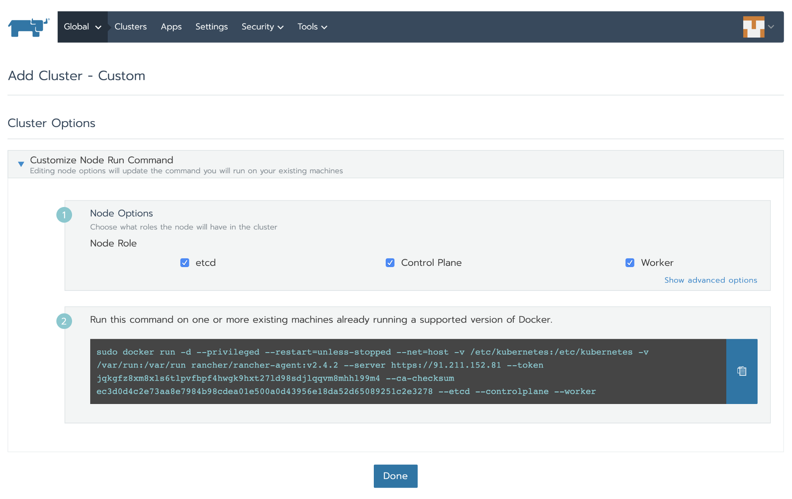

Select Node Role (let’s select etcd, control plane and worker for this tutorial), copy the command and run it on the machine (VM) where you want to install RKE and click Done. Sit back and wait for the RKE cluster to be active.

```
**[root@rke ~]# sudo docker run -d --privileged --restart=unless-stopped --net=host -v /etc/kubernetes:/etc/kubernetes -v /var/run:/var/run rancher/rancher-agent:v2.4.2 --server [https://91.211.152.81](https://91.211.152.81) --token jqkgfz8xm8xls6tlpvfbpf4hwgk9hxt27ld98sdjlqqvm8mhhl99m4 --ca-checksum ec3d0d4c2e73aa8e7984b98cdea01e500a0d43956e18da52d65089251c2e3278 --etcd --controlplane --worker**
Unable to find image 'rancher/rancher-agent:v2.4.2' locally
Trying to pull repository docker.io/rancher/rancher-agent ...
v2.4.2: Pulling from docker.io/rancher/rancher-agent
5bed26d33875: Already exists
f11b29a9c730: Already exists
930bda195c84: Already exists
78bf9a5ad49e: Already exists
bef4ccb8b1a3: Pull complete
b575bb103fdd: Pull complete
8dea950d086a: Pull complete
a8f2fe2f2e86: Pull complete
a55771365b7a: Pull complete
291f1645d2f6: Pull complete
Digest: sha256:ea135d2b1e7edf7b4cde736344e5b02d25c10fc51c7feab047bee320d15fa472
Status: Downloaded newer image for docker.io/rancher/rancher-agent:v2.4.2
6a5780430b32bc6b06005a81492c163346dcfd3cf9fea93e71a99f81cd274174
```

You can also `watch "docker ps"` to see what all containers are getting created.

Once everything is complete, you will see an active cluster in Rancher UI.

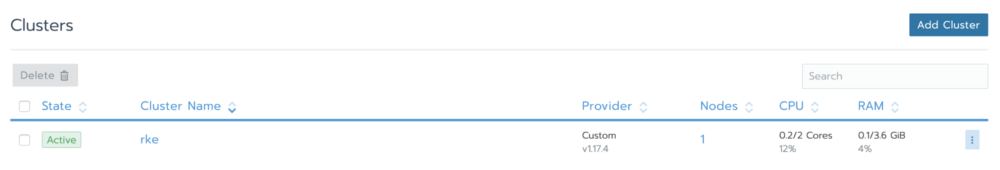

Under the Tools section in the cluster, select CIS Scans.

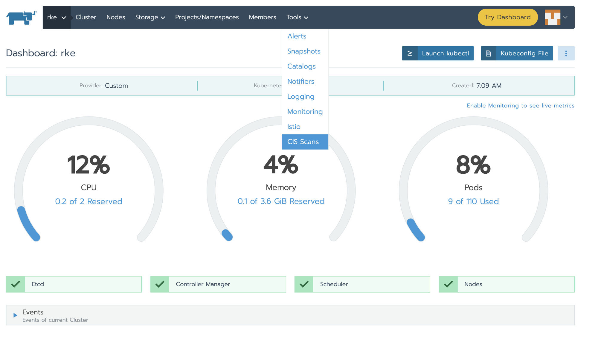

You will see all of the scans performed manually or scheduled here:

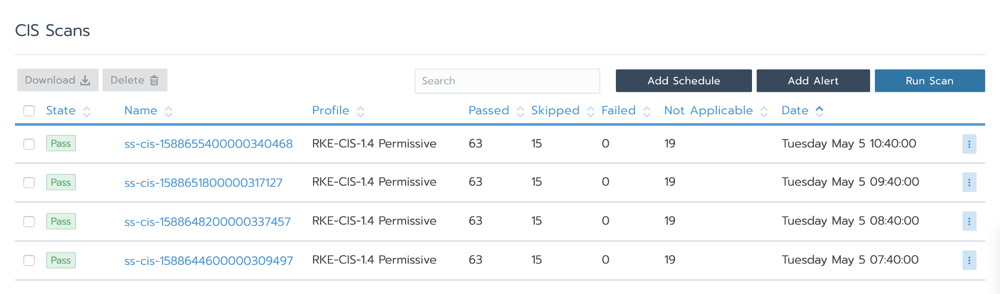

If you do not have CIS Scan scheduling enabled, you can go to Add Schedule and it will take you to the same place where you enabled CIS Scan during cluster creation.

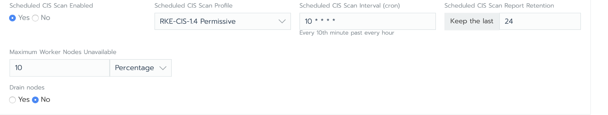

When you click on the scan, you can see the number of tests performed/passed/failed/skipped and you can also download the results.

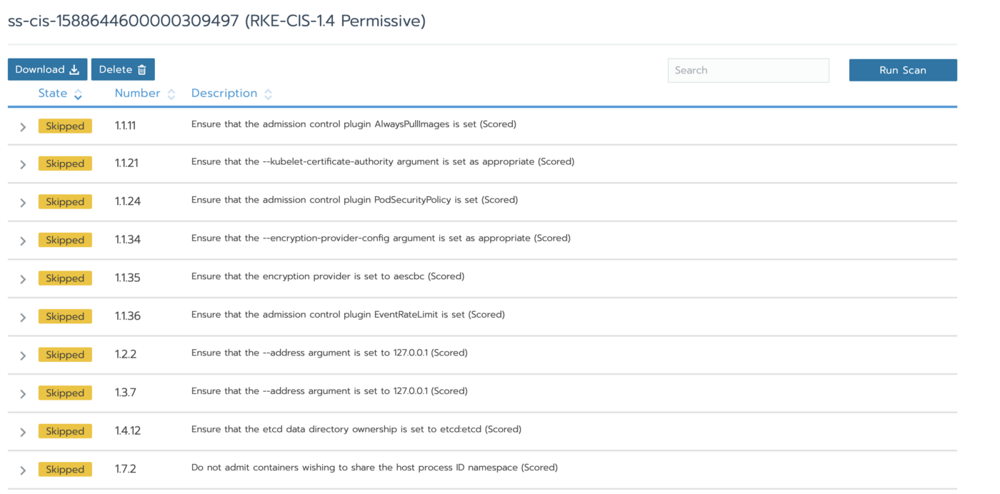

**Step3: Setting Up Alerts**

Before setting up an Alert, you need to set up Notifiers (where the notification will go).

From the Tools menu, select Notifiers.

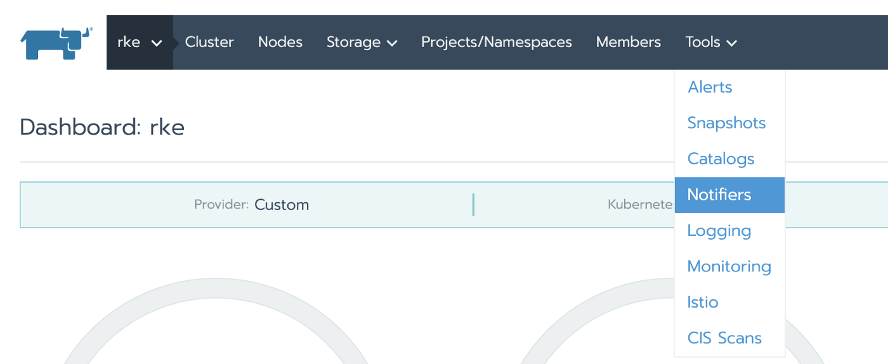

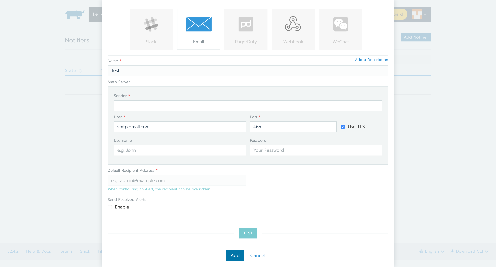

You can select your Notifier of choice. For this tutorial, I selected Gmail.

Click on Add Alert on the CIS Scan page.

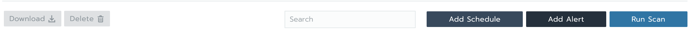

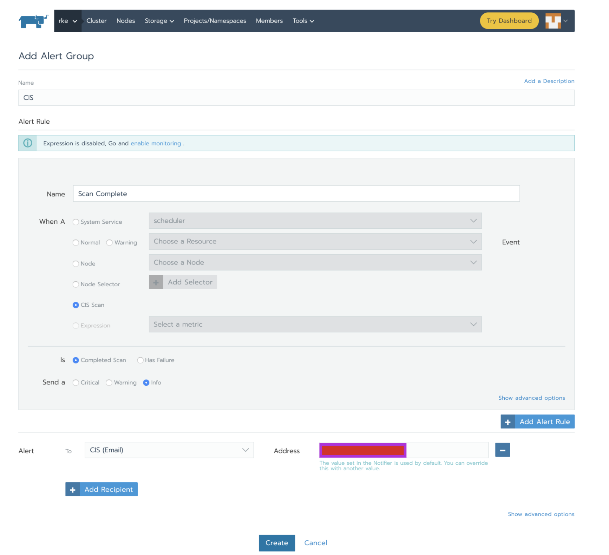

Rancher has CIS alert by default. You can choose the category of the notification :

- Notify alert on completed scan
- Notify alert when the scan has some failure

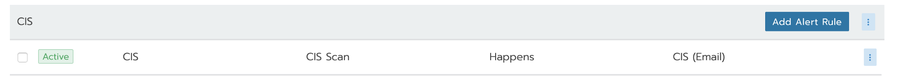

Now, whenever a CIS completes it will send me an Alert (email in this case) with the text below in the body of an email.

```
Alert Name: CIS
Severity: info
Cluster Name: rke (ID: c-sjp9g)
Logs: Cluster Scan Results: 66/97 pass, 12/97 fail, 0/97 skip, 19/97 not applicable
Alert Name: CISs
Severity: critical
Cluster Name: rke (ID: c-sjp9g)
Logs: Cluster Scan Results: 66/97 pass, 12/97 fail, 0/97 skip, 19/97 not applicable
```

## Conclusion

Rancher 2.4 CIS Scan scheduling and alerting helps keep the security of an RKE cluster up to date. Once you’ve scheduled your scans and set up your alerts, you can forget about running the scans manually.

Read our free white paper: How to Build a Kubernetes Strategy[Download Now](https://more.suse.com/fy21-global-web-landing-page-how-to-build-enterprise-kubernetes-strategy)
