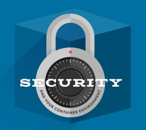

As
one of the most disruptive technologies in recent years, container-based
applications are rapidly gaining traction as a platform on which to
launch applications. But as with any new technology, the security of
containers in all stages of the software lifecycle must be our highest
priority. This post seeks to identify some of the inherent security
challenges you’ll encounter with a container environment, and suggests
base elements for a docker security plan to mitigate those vulnerabilities.

### Benefits of a Container Environment and the Vulnerabilities They Expose

Before we investigate what aspects of your container infrastructure will
need to be covered by your security plan, it would be wise to identify
what potential security problems running applications in such an
environment will present. The easiest way to do this is to contrast a
typical virtual machine (VM) environment with that in use for a typical
container-based architecture. In a traditional VM environment, each
instance functions as an isolated unit. One of the downsides to this
approach is that each unit needs to have its own operating system
installed, and there is a cost both in terms of resources and initiation
time that needs to be incurred when starting a new instance.
Additionally, resources are dedicated to each VM, and might not be
available for use by other VMs running on the same base machine.

Free eBook: Compare architecture, usability, and feature sets for
Kubernetes, Mesos/Marathon, and Docker Swarm In a
container-based environment, each container comprises a bare minimum of
supporting functionality. There is no need to virtualize an
entireoperating system within each container and resource use is shared
between all containers on a device. The overwhelming benefit to this
approach is that initiation time is minimized, and resource usage is
generally more efficient. The downside is a significant loss in
isolation between containers, relative to the isolation that exists in a
VM environment, and this brings with it a number of security
vulnerabilities.

### Identifying Vulnerabilities

Let’s identify some of the vulnerabilities that we inherit by virtue of
the container environment, and then explore ways to mitigate these, and
thus create a more secure environment in which to deploy and maintain
your containers.

- Shared resources on the underlying infrastructure expose the risk of
  attack if the integrity of the container is compromised.
  - Access to the shared kernel key ring means that the user running
    the container has the same access within the kernel across all
    containers.
  - Denial of Service is possible if a container is able to access
    all resources in the underlying infrastructure.
  - Kernel modules are accessible by all containers and the kernel.
- Exposing a port on a container opens it to all traffic by default.
- Docker Hub and other public facing image repositories are “public.”
- Compromised container secrets

### Addressing the Problems of Shared Resources

Earlier versions of the Docker machine, especially those prior to
version 1.0, contained a vulnerability that allowed a user breakout of
the container and into the kernel of the host machine. Exploiting this
vulnerability when the container was running as the root user exposed
all kernel functionality to the person exploiting it. While this
vulnerability has been patched since version 1.0, it is still
inadvisable to run a container with a user who has anything more than
the minimum required privileges. If you are running containers with
access to sensitive information, it is also recommended that you
segregate different containers onto different virtual machines, with
additional security measures applied to the virtual machines as
well—although at this point, it may be worth considering whether using
containers to serve your application is the best approach. An additional
precaution you may want to consider is to install additional security
measure on the virtual machine, such as
[SecComp](https://www.kernel.org/doc/Documentation/prctl/seccomp_filter.txt)
or other kernel security features. Finally, tuning the capabilities
available to containers using the \*cap-add\*and *cap-drop* flags when the
container is created can further protect your host machine from
unauthorized access.

### Limiting Port Access Through Custom IPTables Rules

When configuring a Docker image, your Dockerfile might include a line
similar to “EXPOSE 80”—which opens port 80 for traffic into the
container by default. Depending on the access you are expecting or
allowing into your container, it may be advantageous to add rules to the
iptables on the image to restrict access on this port. The exact
commands may vary depending on the base container and rules you would
like to enforce, so it would be best to work with operations personnel
in implementing these rules.

### Avoiding the Dangers Inherent with a Public Image Repository

As a repository for images, Docker Hub is an extremely valuable
resource. Docker Hub is also publically accessible, and harnesses the
power of the global community in the development and maintenance of
images. But it’s also publicly accessible, which introduces additional
risks alongside the benefits. If your container strategy involves usage
of images from Docker Hub or another public repository, it’s imperative
that you and your developers:

- Know where the images came from and verify that you’re getting the
  image you expect.
- Always specify a tag in your FROM statement; make it specific to a
  stable version of the image, and not “:latest”
- Use the official version of an image, which is supported, maintained
  and verified by a dedicated team, sponsored by Docker, Inc.,
  wherever possible.
- Secure and harden host machines through a rigorous QA process.
- Scan container images for vulnerabilities.

When dealing with intellectual property, or applications which handle
sensitive information, it may be wise to investigate using a private
repository for your images instead of a public repository like Docker
Hub, or similar. Amazon Web Services provides information on setting up
an Amazon EC2 Container Registry (Amazon ECR)
[here](http://docs.aws.amazon.com/AmazonECR/latest/userguide/ECR_GetStarted.html),
and DigitalOcean provides the instructions (albeit a few years old) for
creating a private repository on Ubuntu
[here](https://www.digitalocean.com/community/tutorials/how-to-set-up-a-private-docker-registry-on-ubuntu-14-04).

### Securing Container Secrets

For the Docker community recently, the subject of securing credentials,
such as database passwords, SSH keys, and API tokens has been at the
forefront. One solution to the issue is the implementation of a secure
store, such as HashiCorp Vault or Square Keywhiz. These stores all
provide a virtual file system to the application, which maintain the
integrity of secure keys and passwords.

- [[Installing and Configuring Vault by
  HashiCorp]](https://learn.hashicorp.com/vault/getting-started/install)
- [Installing and Configuring Keywhiz by
  Square](https://github.com/square/keywhiz)

### Security Requires an Upfront Plan, and Constant Vigilance

Any security plan worth implementing needs to have two parts. The first
involves the comprehensive identification and mitigation of potential
threats and vulnerabilities to the system. The second is a commitment to
constant evaluation of the environment, including regular testing and
vulnerability scans, and monitoring of production systems. Together with
your security plan, you need to identify the methods by which you will
monitor your system, including the automation of alerts to be triggered
when system resources exceed predetermined limits and when non-standard
behavior is being exhibited by the containers and their underlying
hosts. *Mike Mackrory is a Global citizen who has settled down in the
Pacific Northwest - for now. By day he works as a Senior Engineer on a
Quality Engineering team and by night he writes, consults on several web
based projects and runs a marginally successful eBay sticker business.
When he’s not tapping on the keys, he can be found hiking, fishing and
exploring both the urban and the rural landscape with his kids.*
