The certified Kubernetes distribution built for IoT & Edge computing[Download K3S](https://k3s.io/)

Have you ever wanted to try K3s high availability cluster “mode,” and you either did not have the minimum three “spare nodes” or the time required to set up the same amount of VMs? Then you are in for a good treat: meet k3d!

If you’re not familiar with k3d, its name gives you a hint to what it’s all about: K3s in Docker. [k3d](https://k3d.io/) is a lightweight wrapper to run [K3s](https://github.com/rancher/k3s) (a lightweight, single <40MB binary, certified Kubernetes distribution developed by Rancher Labs and now a CNCF sandbox project) in Docker. With k3d, it’s easy to create single- and multi-node [K3s](https://github.com/rancher/k3s) clusters in Docker, for local development on Kubernetes.

k3d allows you to start a K3s cluster in literally no time. Plus, you can learn its few, but powerful, commands very quickly. k3d runs in Docker, which allows you to scale up and scale down nodes without further setup. In this blog, we’ll cover setting up a single-node K3s cluster using k3d and then walk through the steps for setting up K3s in high availability mode using k3d.

The two main objectives of this blog are to provide an introduction to k3d as a tool for deploying K3s clusters and to show how K3s high availability resists “nodes degradation.” As a bonus, we’ll look at which components K3s deploys in a cluster by default.

## Prerequisites

All of you have a preference when it comes to OS (Linux, MacOS, Windows). So, before we check the setup used for this blog post, there are only two mandatory requirements: Docker and a Linux shell.

If you are on MacOS or Windows, Docker Desktop is the preferred solution for Docker. For Linux, you can get the Docker engine and CLIs as described [here](https://www.docker.com/products/docker-desktop).

Concerning the Linux shell, MacOS and Linux are covered. For Windows, the easiest and fastest solution is WSL2, which we’ll use in this demo.

Here is the setup that we’ll use:

OS: Windows 10 version 2004 (build: 19041)

- OS components: Virtual Machine Platform and Windows Subsystem for Linux
  - [Installation steps](https://docs.microsoft.com/en-us/windows/wsl/install-win10)
- WSL2 distro: Ubuntu
  - [Windows store link](https://www.microsoft.com/en-us/p/ubuntu/9nblggh4msv6)
- [Optional] Console used: Windows Terminal
  - [Windows store link](https://www.microsoft.com/en-us/p/windows-terminal/9n0dx20hk701)

### Step 1: Start with Installation

The k3d installation process is well documented [here](https://k3d.io/#installation).

For this blog post, we’ll use the “curl” installation.

**Attention:** *running scripts directly from a URL is a big security no-no. So before running any script, ensure that the source is the project’s website and/or git online repository. And even if you trust the source, reviewing the script is never too much.*

Here are the installation steps:

Go to <https://k3d.io/#installation>

- Copy the “curl” installation command and run it inside your terminal
  `curl -s https://raw.githubusercontent.com/rancher/k3d/main/install.sh | bash`
  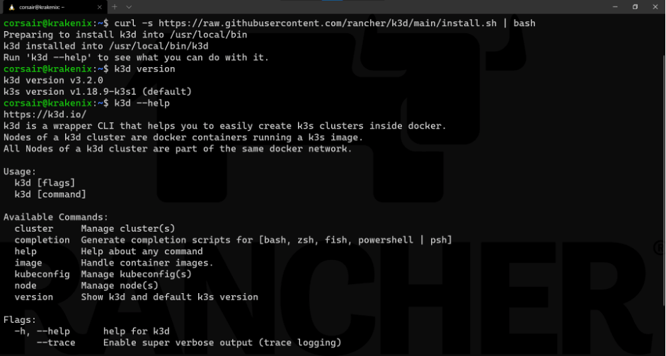

**Note**: this screenshot shows two more commands:
`k3d version`: *provides which version of k3d has been installed*
`k3d --help`: *lists the commands that can be used with k3d*

Now k3d is installed and ready to use.

## Step 2: Start Small with a Single-Node Cluster

Before we create an HA cluster, let’s start with a one-node cluster in order to understand the commands (“grammar”) and see what k3d deploys by default.

First, the grammar. In v3, k3d made a big switch in how to use commands. We won’t delve into how commands were done before; we’ll use the syntax of v3.

The k3s commands follows a “noun + verb” syntax. First specify *what* we want to use (cluster or node) and then which *action* we want to apply (create, delete, start, stop).

### Create a one-node cluster

To create our first cluster with k3d, we’ll create one with no options, using only the defaults:

`k3d cluster create`
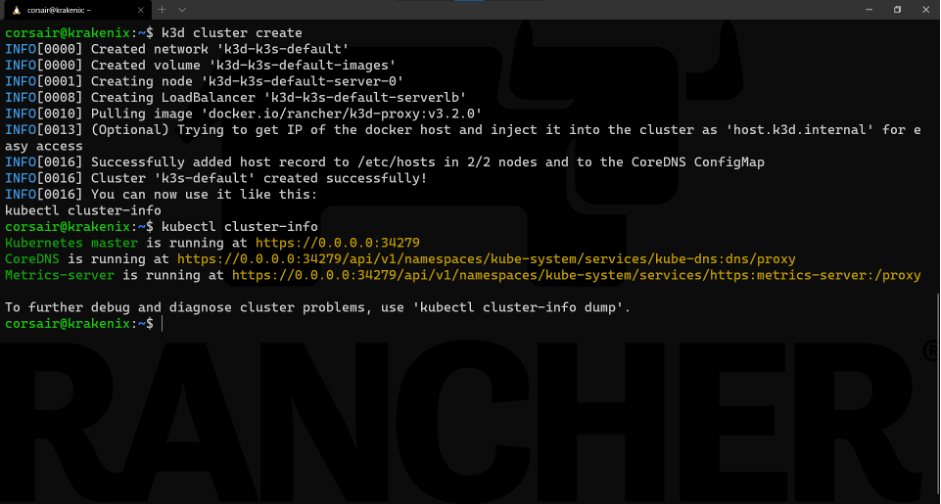

**Note:** the output of the *k3d cluster create command suggests running another command to check that the cluster is running and accessible:*
kubectl cluster-info

Now the cluster is up and running! That was fast, right?

### Sneak peek at internals

One optional task that we can do is to see what exactly is deployed from *various* points of view.

Let’s start from the top and look at what’s inside the K3s cluster (pods, services, deployments, etc.):
`kubectl get all --all-namespaces`
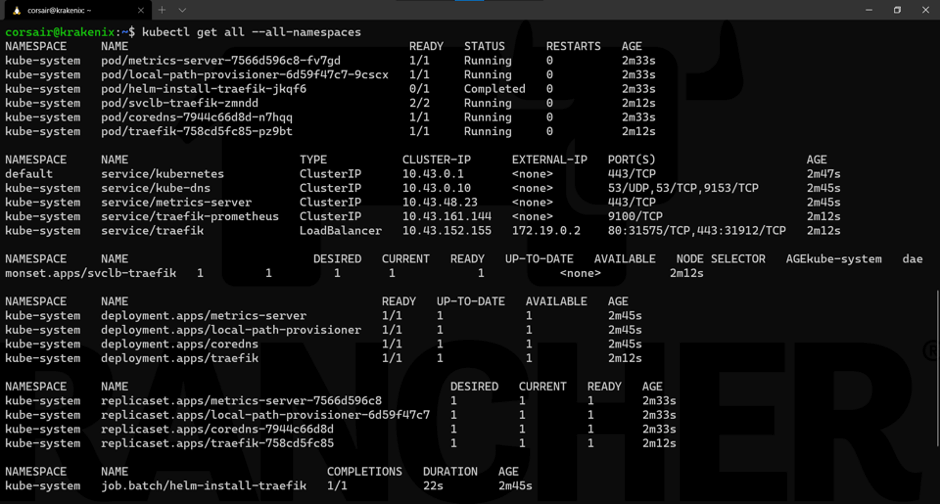

We can see that, in addition of the **Kubernetes** service, K3s deploys DNS, metrics and ingress (traefik) services when we use the defaults.

Now let’s look at the nodes from different points of view.

First, we’ll check it from a cluster perspective:

`kubectl get nodes --output wide`

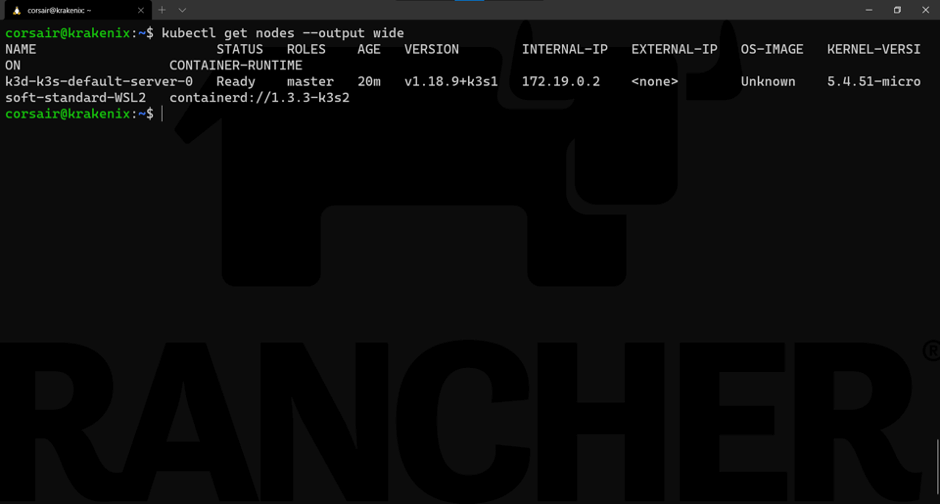

As expected, we only see one node. Now let’s see it from k3d’s perspective:

`k3d node list`

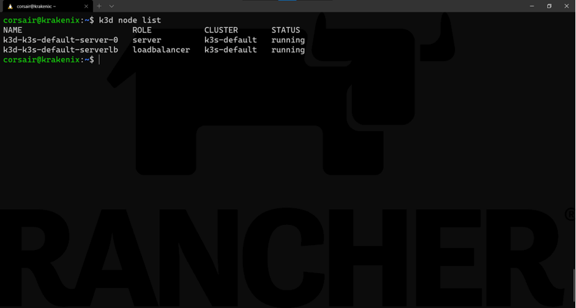

Now we have two nodes. The (very) smart implementation here is that while the cluster is running on its node **k3d-k3s-default-server-0** , there is another “node” that acts as the load balancer. While this might not be useful for a single-node cluster, it will save us a lot of effort in our HA cluster.

Finally, we can see the two nodes from Docker:
`docker ps`
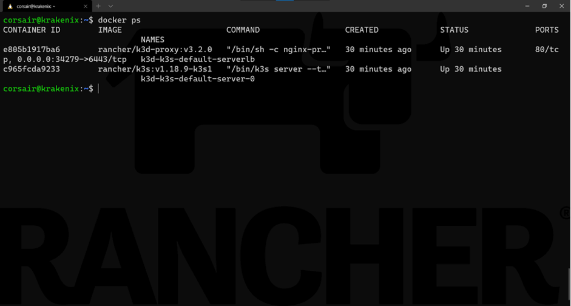

### Cleaning the resources

Our one-node cluster helped us understand the mechanics and commands of k3d. Let’s clean up the resource before deploying our HA cluster.
`k3d cluster delete`
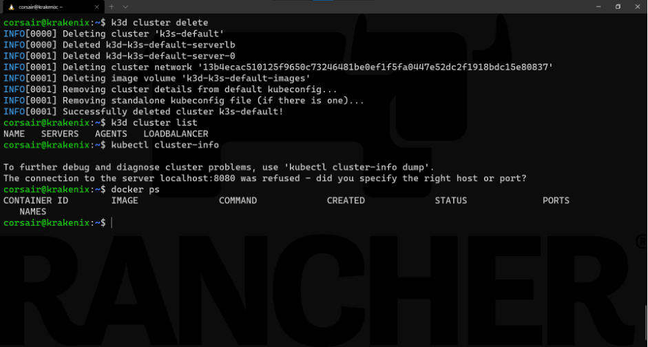

**Note:** for demo purposes, we added the following commands to the screenshot above:

`k3d cluster list`: List the active k3d clusters
`kubectl cluster-info`: Check the cluster connectivity

`docker ps`: Check the active containers

Now we’ve created, checked and deleted a single-node cluster with k3d. In the next step, we’ll have fun with HA.

## Step 3: Welcome to the HA World

Before we jump into the command line, let’s get a basic understanding of what we’ll launch and mention a few additional requirements.

First, Kubernetes HA has [two possible setups](https://kubernetes.io/docs/setup/production-environment/tools/kubeadm/high-availability/): embedded or external database (DB). We’ll use the **embedded DB** setup.

Second, K3s has two different technologies for [HA with an embedded DB](https://rancher.com/docs/k3s/latest/en/installation/ha-embedded/): one based on **dqlite** (K3s v1.18) and another on **etcd** (K3S v1.19+).

This means **etcd** is the default in the current K3s stable release and is the one which will be used in this blog. **dqlite** has been deprecated.

At the time of this writing, k3d was using K3s version v1.18.9-k3s1 by default. You can check this by running `k3d version`:
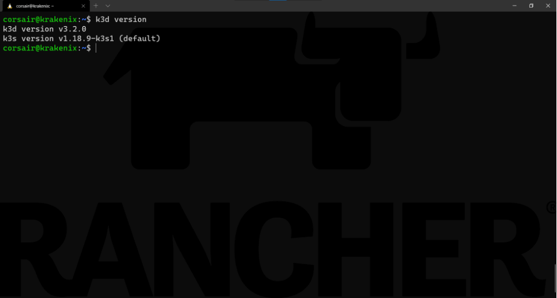

Does this mean we need to reinstall k3d with a version that supports K3s v1.19? The answer is no!

We can use our current installed version of k3d and still have K3s v1.19 support, thanks to the following reasons:

- k3d has an option where we can specify a particular K3s docker image to be used.
- All K3s versions are published as container images, too.

Based on the two reasons above, we can assume a K3s v1.19 exists as a container image stored in Docker Hub.

As a helper, [here is the search link](https://hub.docker.com/r/rancher/k3s/tags?page=1&name=v1.19).

Enough with the theory. Let’s create our first K3s HA cluster with k3d.

### The triumvirate control planes

As Kubernetes HA best practices [strongly recommend](https://kubernetes.io/docs/tasks/administer-cluster/highly-available-master/#best-practices-for-replicating-masters-for-ha-clusters), we should create an HA cluster with at least three control plane nodes.

We can achieve that with k3d in one command:

`k3d cluster create --servers 3 --image rancher/k3s:v1.19.3-k3s2`
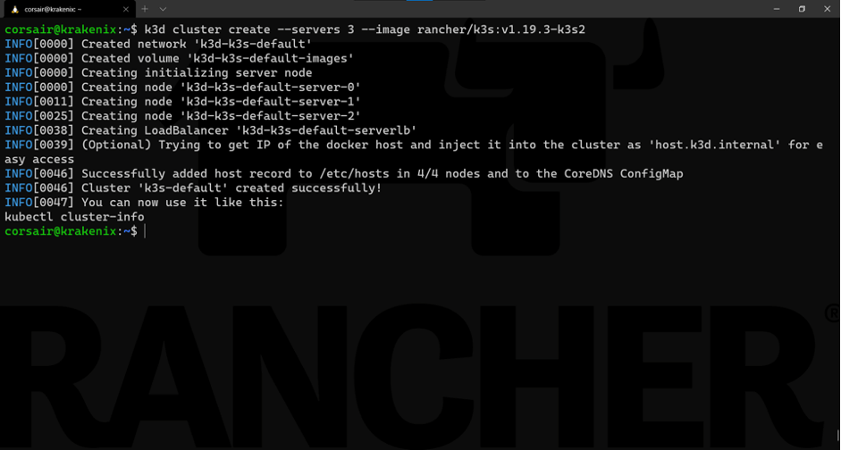

**Learning the command:**
*Base command:* `k3d cluster create`
Options:

–`server 3`: *requests three nodes to be created with the role server*

–`image rancher/k3s:v1.19.3-k3s2`: *specifies the K3S image to be used*

We can now check what has been created from the different points of view:

`kubectl get nodes --output wide`

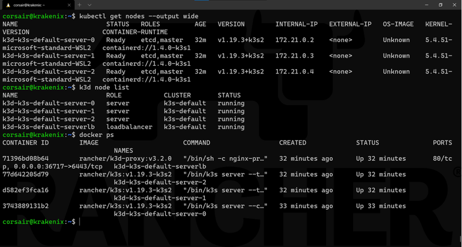

As seen here, we checked from the different points of view to ensure our nodes are correctly running.

If we look at the components deployed, our **daemonset** now has three replicas instead of one:

`kubectl get all --all-namespaces`

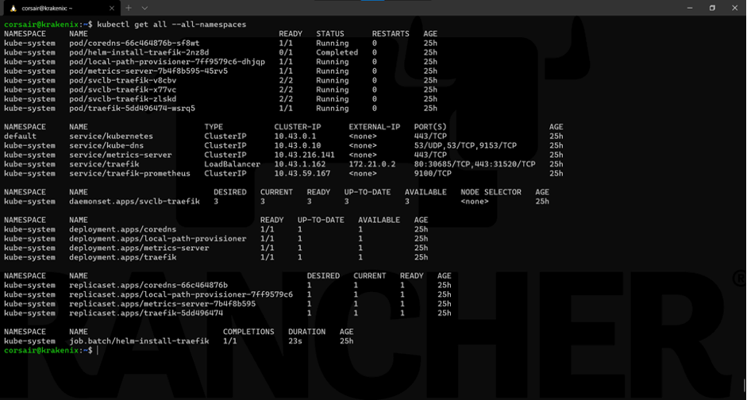

One last check is to see on which node the **pods** are running:

`kubectl get podes --all-namespaces --output wide`

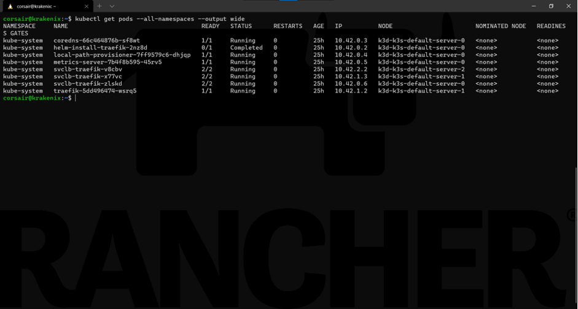

Now we have the base of our HA cluster. Let’s add an additional control plane node, bring some “destruction” and see how the cluster behaves.

### Scale up the cluster

Thanks to k3d and the fact our cluster runs on top of containers, we can quickly simulate the addition of another control plane node to the HA cluster:

`k3d node create extraCPnode --role=server --image=rancher/k3s:v1.19.3-k3s2`

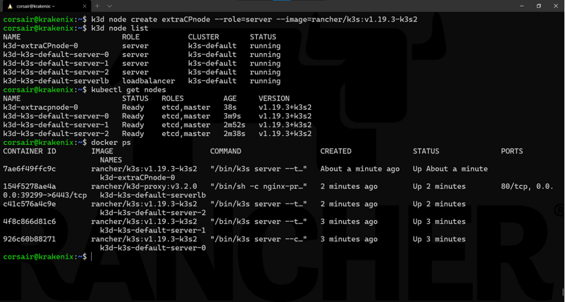

**Learning the command:**
*Base command:* `k3d node create`
*Options:*

`extraCPnode`: *base name that k3d will use to create the final node name*

`role=server`: *sets the role for the node to be a control plane*

`image rancher/k3s:v1.19.3-k3s2`: *specifies the K3s image to be used*

As seen here, we checked from the different points of view to ensure our new control plane node is running correctly.

With this additional node added, we can perform our final test: bring down the **node0**!

### HA: Heavy Armored against crashes

There are various reasons that this test is one of the most sensible. The **node0** is normally the one that our *KUBECONFIG* refers to (in terms of IP or hostname), and therefore our kubectl application tries to connect to for running the different commands.

As we are working with containers, the best way to “crash” a node is to literally stop the container:

`docker stop k3d-k3s-default-server-0`

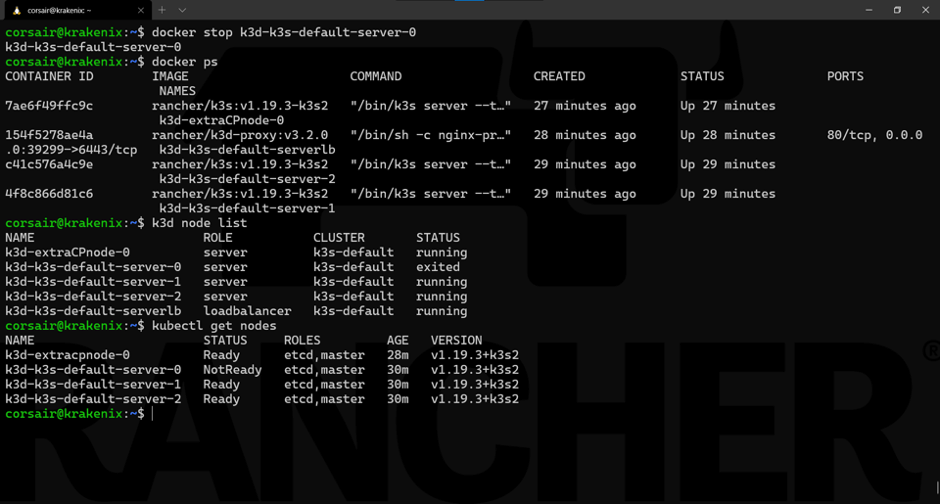

**Note:** *The Docker and k3d commands will show the state change immediately. However, the Kubernetes (read: K8s or K3s) cluster needs a short time to see the state change to NotReady.*

And like magic, our cluster still responds to our commands using kubectl.

Now it is a good time to reference again the **load balancer** k3d uses and how it is critical in allowing us to continue accessing the K3s cluster.

While the load balancer internally switched to the next available node, from an external connectivity point of view, we still use the same IP/host. This abstraction saves us quite some efforts and it’s one of the most useful features of k3d.

Let’s look at the state of the cluster:

`kubectl get all --all-namespaces`

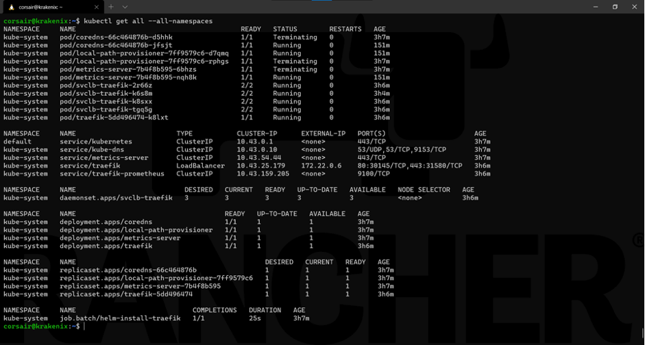

Everything looks right. If we look at the pods more specifically, then we will see that K3s automatically self-healed by recreating pods running on the failed node on other nodes:

`kubectl get pods --all-namespaces --output wide`

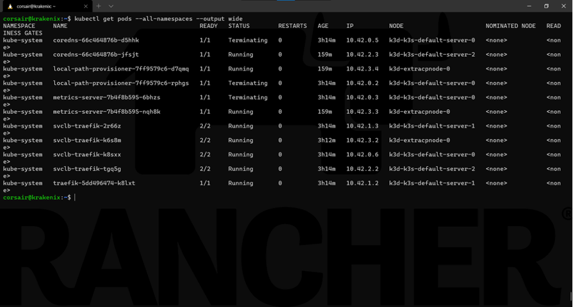

Finally, to show the power of HA and how K3s manages it, let’s restart the **node0** and see it being re-included into the cluster as if nothing happened:

`docker start k3d-k3s-default-server-0`

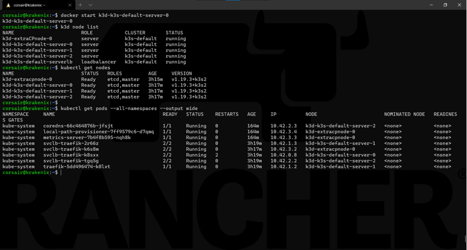

Our cluster is stable, and all the nodes are fully operational again.

### Cleaning the resources, once again

Now we can delete our local HA cluster, as it has served its purpose. Plus, we know that we can create a new one just like that.

Let’s clean up the resource our HA cluster used :
`k3d cluster delete`

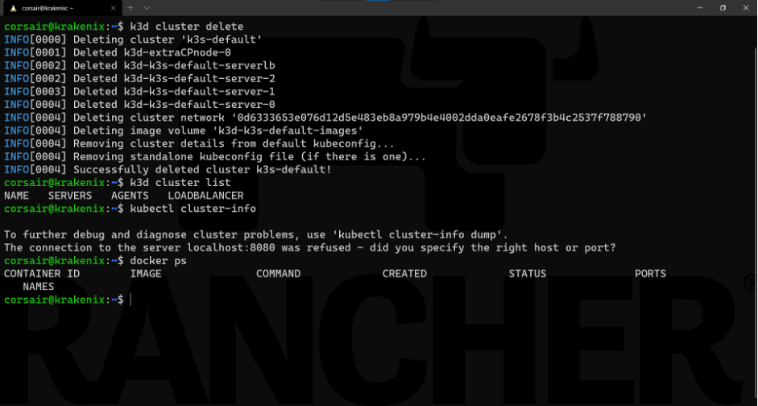

## Conclusion

While we created a single node and an HA cluster locally, inside containers, we can still see how K3s behaves with the new etcd embedded DB. If we deployed K3s on bare metal or virtual machines, it would act the same way.

That being said, k3d helped a lot in terms of management. It created a load balancer by default that allowed permanent connectivity to the K3s cluster while abstracting all the tasks that we would have done manually if it was [deployed outside containers](/blog/set-up-your-k3s-cluster-for-high-availability-on-digitalocean/).

In this post, we’ve seen how easy it is to set up high availability K3s clusters using k3d. If you haven’t tried K3s or k3d, what are you waiting for? They are both free and easy to use.

Thanks for reading!

The certified Kubernetes distribution built for IoT & Edge computing[Download K3S](https://k3s.io/)
