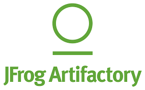
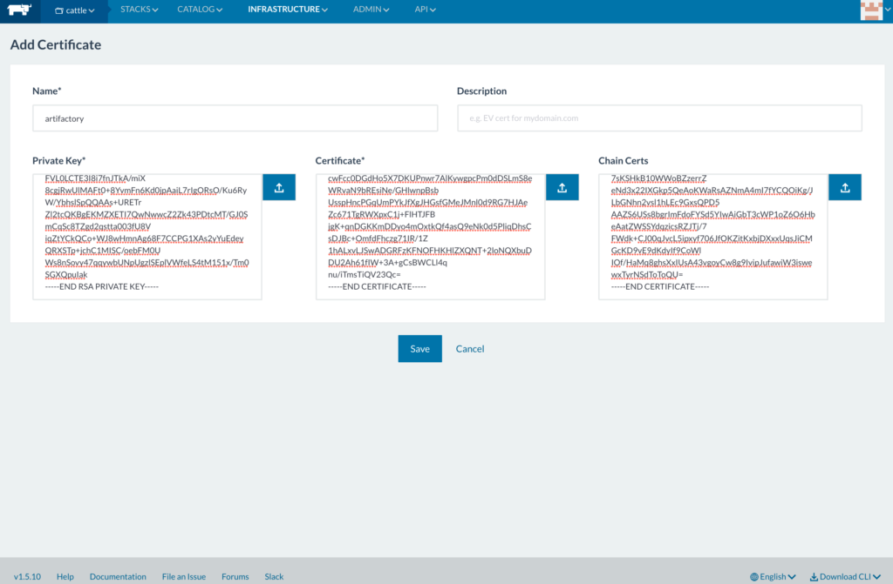
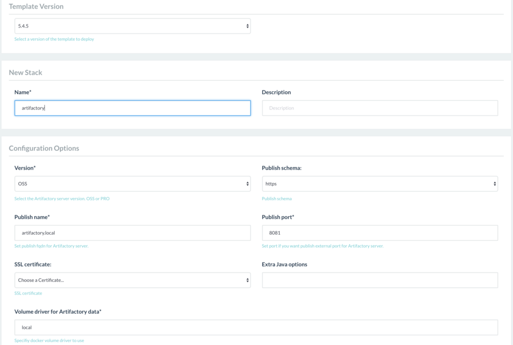
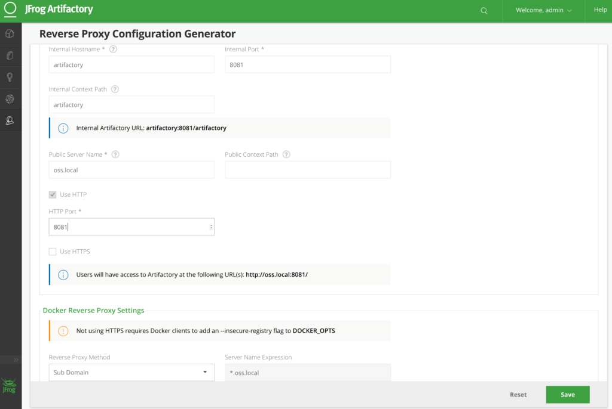
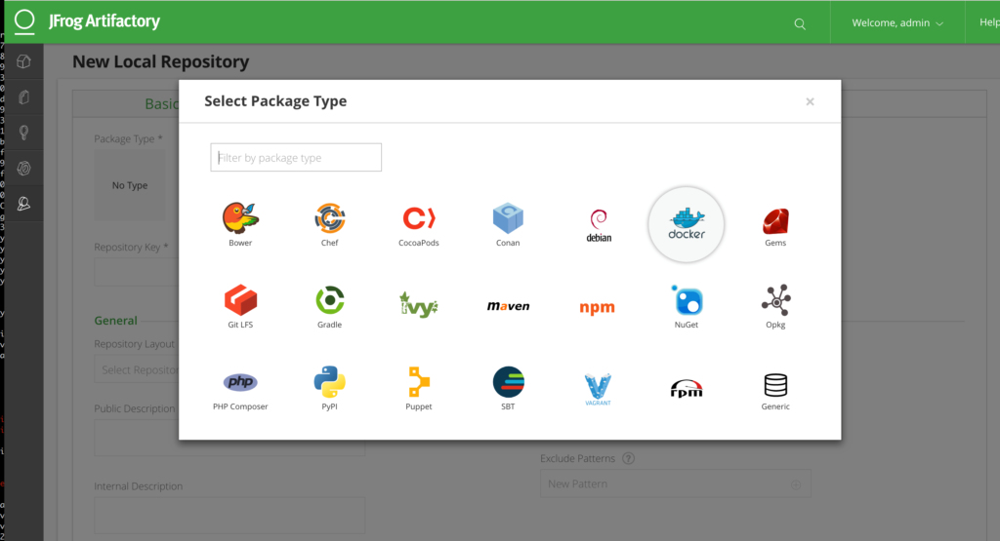
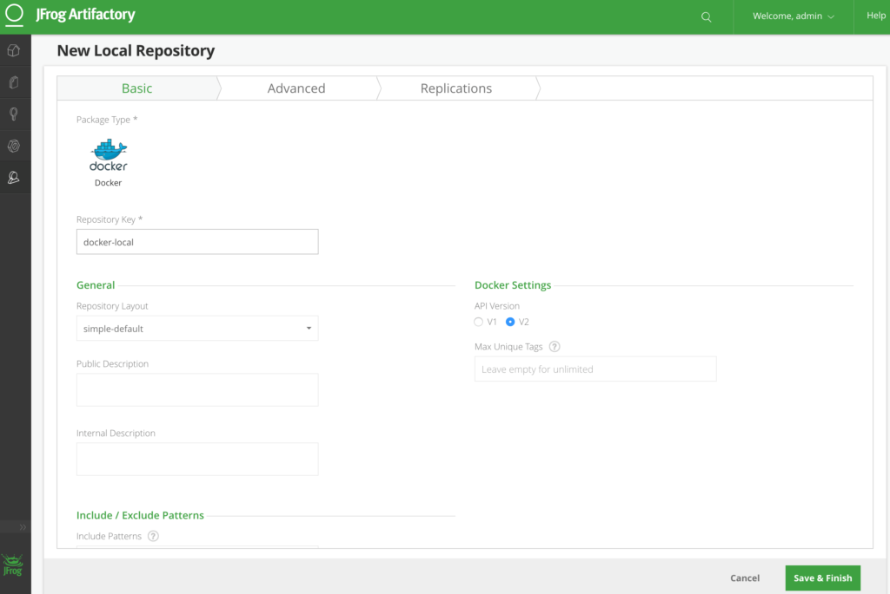
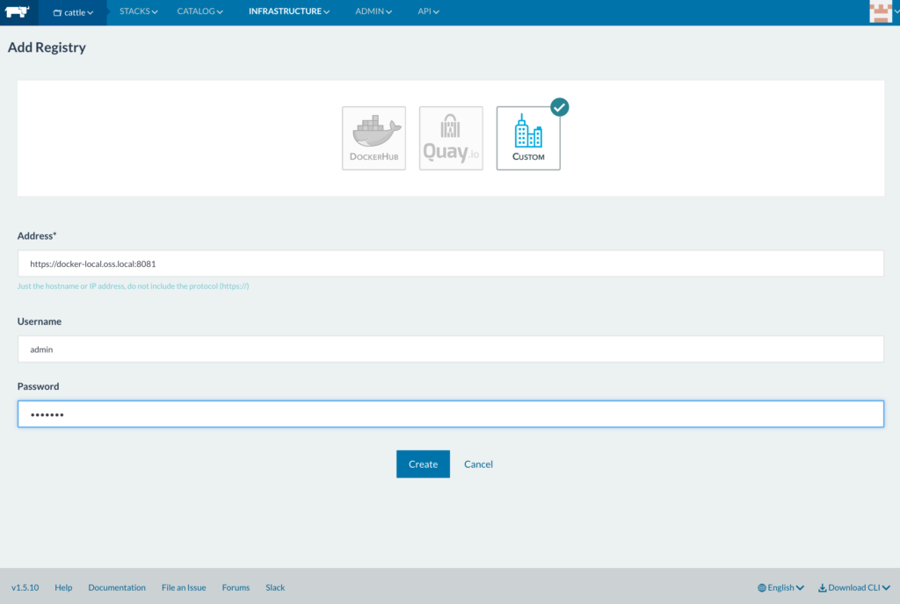

For any team using
containers – whether in development, test, or production – an
enterprise-grade registry is a non-negotiable requirement. [JFrog
Artifactory](https://www.jfrog.com/artifactory/) is much beloved by Java
developers, and it’s easy to use as a Docker registry as well. To make
it even easier, we’ve put together a short walkthrough to setting things
up Artifactory in Rancher.

### Before you start

For this article, we’ve assumed that you already have a Rancher
installation up and running (if not, check out our [Quick Start
guide](https://rancher.com/docs/rancher/v1.6/en/quick-start-guide/)), and
will be working with either Artifactory Pro or Artifactory Enterprise.
Choosing the right version of Artifactory depends on your development
needs. If your main development needs include building with Maven
package types, then Artifactory open source may be suitable. However,
if you build using Docker, Chef Cookbooks, NuGet, PyPI, RubyGems, and
other package formats then you’ll want to consider Artifactory Pro.
Moreover, if you have a globally distributed development team with HA
and DR needs, you’ll want to consider Artifactory Enterprise. JFrog
provides a detailed
[matrix](https://www.jfrog.com/confluence/display/RTF/Artifactory+Comparison+Matrix)
with the differences between the versions of Artifactory. There’s
several values you’ll need to select in order to set Artifactory up as
a Docker registry, such as a public name, or public port. In this
article, we refer to them as variables; just substitute the values you
choose in for the variables throughout this post. To deploy Artifactory,
you’ll first need to create (or already) have a wildcard imported into
Rancher for “`*.$public_name`”. You’ll also need to create DNS entries
to the IP address for artifactory-lb, the load balancer for the
Artifactory high availability architecture. Artifactory will be reached
via `$publish_schema://$public_name:$public_port`, while the Docker
registry will be reachable at
`$publish_schema://$docker_repo_name.$public_name:$public_port`


### Installing Artifactory

While you can choose to install Artifactory on your own with the
[documented
instructions](https://www.jfrog.com/confluence/display/RTF/Installing+Artifactory),
you also have the option of using Rancher catalog. The Rancher community
has recently contributed a template for Artifactory, which deploys the
package, the Artifactory server, its reverse proxy, and a Rancher load
balancher.

\*\*A note on reverse proxies: \*\*to use Artifactory as a Docker registry,
a reverse proxy is required. This reverse proxy is automatically
configured using the Rancher catalog item. However, if you need to apply
a custom nginx configuration, you can do so by upgrading the
artifactory-rp container in Rancher.

Note that installing Artifactory is a separate task from setting up
Artifactory to serve as a Docker registry, and from connecting that
Docker registry to Rancher (we’ll cover how to do these things as
well). To launch the Artifactory template, navigate to the community
catalog in Rancher. Choose “Pro” as the Artifactory version to launch,
and set parameters for schema, name, and port:


Once the package is deployed, the service is accessible through
[$publish\_schema://$publish\_name:$publish\_port]

### Configure Artifactory

At this point, we’ll need to do a bit more configuration with
Artifactory to complete the setup. Access the Artifactory server using
the path above. The next step will be to configure the reverse proxy and
to enable Docker image registry integration. To configure the reverse
proxy, set the following parameters:

- Internal hostname: artifactory
- Internal port: 8081
- Internal context: artifactory
- Public server name: $public\_name
- Public context path: [leave blank]
- http port: $public\_port
- Docker reverse proxy settings: Sub Domain

 Next, create a
local Docker repository. Make sure to select Docker as the package type:
 Verify that the
registry name is correct; it should be formatted as
`$docker_rep_name.$public_name`
 Test that the
registry is working by logging into it:

```
# docker login $publish_schema://$docker_repo_name.$public_name
```

### Add Artifactory into Rancher

Now that Artifactory is all set up, it’s time to add the registry to
Rancher itself, so any application built and managed in Rancher can pull
images from it. On the top navigation bar, visit Infrastructure, then
select Registries from the drop down menu. On the resulting screen,
choose “Add Registry”, then select the “Custom” option. All you’ll need
to do is enter the address for your Artifactory Docker registry, along
with the relevant credentials:
 Once it’s been
added, you should see it show up your list of recognized registries
(which shows up after visiting Infrastructure -> Registries on the top
navigation bar). With that, you should be all set to use Artifactory as
a Docker registry within Rancher! *Raul is a DevOps Lead at Rancher
Labs.*
