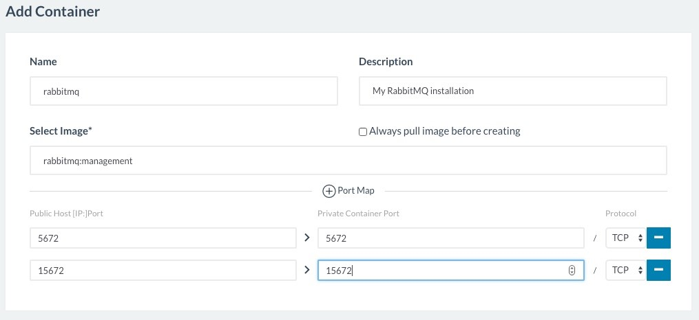
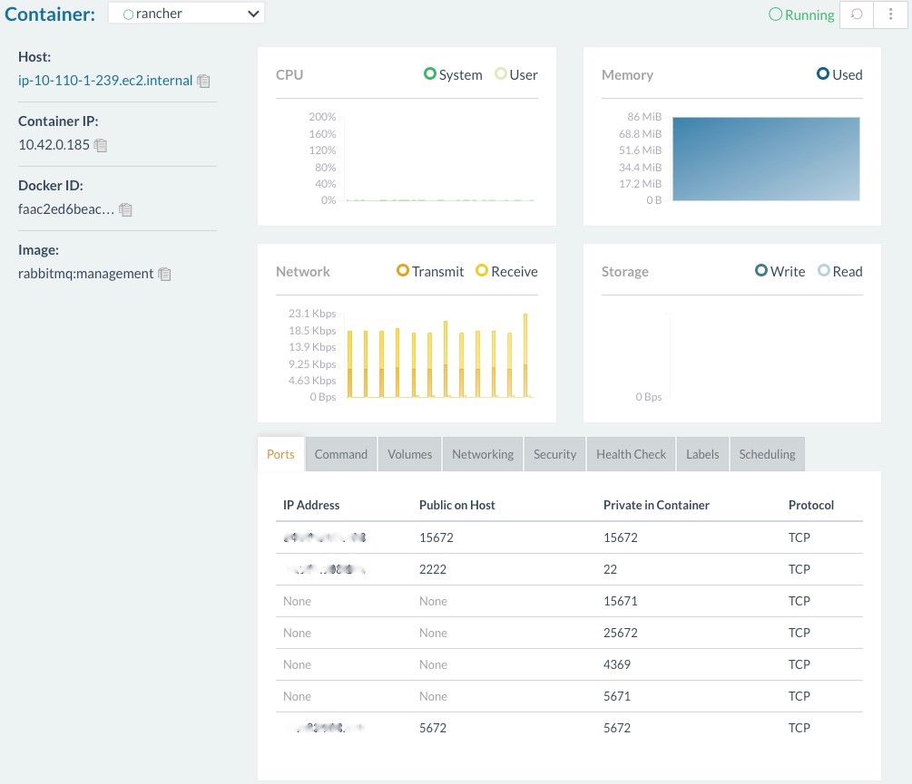

[](https://cdn.rancher.com/wp-content/uploads/2016/12/20170833/RabbitMQ.png)
[RabbitMQ ]
[RabbitMQ](https://www.rabbitmq.com/) is a messaging broker that
transports messages between data producers and data consumers. Data
producers can be just about any application, host, or device that emits
data that needs to be consumed by other applications for aggregation,
processing, or analysis. RabbitMQ is easy to set up, use, and maintain.
It can be scaled to handle large numbers of messages between many
different data producers and consumers in a variety of application use
cases. [Rancher](https://rancher.com/rancher) provides a container
platform that eases managing clusters of container-based applications.
It works natively with [Kubernetes](https://rancher.com/kubernetes),
[Mesos](https://rancher.com/mesos), and [Docker
Swarm](https://rancher.com/swarm), as well as its own container
orchestration and scheduling tool, which is called
[Cattle](https://github.com/rancher/cattle). In this article, we are
going to discuss setting up a simple RabbitMQ installation in a
container using Rancher Server. Connecting to the RabbitMQ management
interface, as well as sending and receiving your first message, will be
covered.

### Prerequisites

For the purposes of this tutorial, I assume you already have a Rancher Server
instance set up, and that you have added at least one host to it where
you can deploy containers. If you haven’t already done this, Rancher
provides excellent documentation in their [Quick Start
Guide](https://docs.rancher.com/rancher/v1.2/en/quick-start-guide/) that
explains how to set up Rancher Server. If you’re not familiar with
Rancher Server at all, consider watching the latest [Rancher Overview
Training](https://www.youtube.com/watch?v=FyiSQzD0Iak) on YouTube before
proceeding with the Rancher installation. This will help you to
understand certain key concepts about Rancher. It’s all right if the
only host you have added to Rancher Server is that which has the Rancher
Server container running on it. [Rancher normally recommends [adding
containers in the context of a new
service](https://docs.rancher.com/rancher/v1.2/en/cattle/adding-services/)
or ][[via Rancher catalog (which includes
scaling
capabilities)]](https://github.com/rancher/community-catalog/tree/master/templates/rabbitmq-3/1)[,
in which case launching RabbitMQ is as simple as selecting its entry
from the community catalog within Rancher. However, in some cases it is
useful to launch just a single container for RabbitMQ, without
clustering. ]Only one RabbitMQ container will
be deployed during this demonstration. For this article, I used a host
with 2 vCPU, 4GB of RAM, and 20GB of disk space to ensure enough system
level resources to host both the Rancher Server and RabbitMQ containers.
The Rancher Server and RabbitMQ containers are both instantiated on the
same host. You will also need a Linux workstation or other host with a
web browser to connect to the Rancher Server UI, as well as to the
RabbitMQ web management interface. In addition, your workstation host
will need Python 2.6 or later, but not Python 3. [](https://info.rancher.com/comparing-kubernetes-mesos-swarm)
Free eBook: Comparing Kubernetes, Mesos, and Docker Swarm
For the workstation, I used a Macbook running OS X El Capitan, with
Chrome as the browser and Python 2.6 installed to connect to Rancher
Server and RabbitMQ. While performing the steps described in this
article, a network or Internet connection with TCP ports 5672, 8080, and
15672 will need to be accessible from your workstation to the host
running Rancher and RabbitMQ. Ideally this would be running on a private
network, but it could be done over the Internet if you restrict access
to only trusted hosts such as your workstation. Note that it is not
recommended to leave the above ports open to the Internet. When
initially configuring Rancher Server and RabbitMQ, they start up in an
insecure manner, and they must be locked down before exposing these
services to the Internet.

### RabbitMQ Setup

If you have all of the prerequisites in place, you should have a host
with a running Rancher Server container to which you can connect from
your workstation using the management URL on port 8080, as well as TCP
ports 5672, 15672. Now you’re ready to set up your first RabbitMQ
container using Rancher via the following steps:

1. Using your browser, connect to the Rancher Server management URL at
   `http://<SERVER_IP>:8080`, where `<SERVER_IP>`; is the IP address
   that is accessible by your workstation.
2. Select **INFRASTRUCTURE;** then **Containers**
3. Click the **Add Container** button
4. Set the following parameters on the **Add Container** page [(note
   that by default, Rancher pulls container images from Docker Hub,
   which is what we’re doing here)]:
   - \*\*Name: \*\*rabbitmq
   - **Description**: My RabbitMQ installation
   - **Select image**: rabbitmq:management
5. Click **+Port Map**, and add the following port mapping:
   - **Public Host** **[IP:]Port** 5672
   - **Private Container Port**: 5672
   - **Protocol**: TCP
6. Click **+Port Map** again, and add the following port mapping:
   - **Public Host** **[IP:]Port** 15672
   - **Private Container Port**: 15672
   - **Protocol**: TC
7. You should have settings like those illustrated in the image below:
   [](images/rancher_blog_Add-container-1.jpg)
   RabbitMQ container settings
8. Leave all the other settings at default:
9. Scroll down to the bottom of the page and click **Create**
10. You will now be taken to the container monitoring page for the
    container you just created. It should look something like the
    following: [](images/rancher_blog_RabbitMQ-Container-running-on-Rancher.jpg)
    RabbitMQ Container running on Rancher

Your RabbitMQ container is now up and running. The next step is to
configure and test it.

### RabbitMQ Configuration

Now that your container is running, you’ll want to take a moment to
create a secure login that you can use to connect to RabbitMQ. To do
this, follow these steps:

1. Open a new table in your browser and connect to the RabbitMQ
   management URL at `http://<SERVER_IP>:15672`, where `<SERVER_IP&gt`;
   is the IP address that is accessible by your workstation.
2. You should be greeted by a login page. The credentials to log in are
   as follows:
   - \*\*Username: \*\*guest
   - \*\*Username: \*\*guest
3. The first thing that you’ll want to do is to create a user other
   than the guest user, and set a secure password.
   - Click the \*\*Admin \*\*tab, then **Add a user**
   - Enter a username and *secure* password in their respective
     fields
   - Click **Add User**
   - You should now see your user added on the Users page.
   - On the Users page, click the username you just added. You will
     see that your user has not yet been granted any permissions to
     access virtual hosts.
   - Under **Permissions**, leave the default parameters set, and
     click **Set permission**
   - [Click the ]**Admin**[ tab again, and
     verify that your newly added user has been granted permission to
     access the “ ]**/** [” virtual
     host.]
   - Log out of the management interface, then log in with your new
     username.
   - Navigate back to the **Admin** tab.
   - Click the **guest** user, and then **Delete this user** at the
     bottom of the page.
   - **Delete** the guest user and confirm.

### Testing RabbitMQ

The next step will be to test connecting to the RabbitMQ container to
verify that everything is working as expected. First, be sure you have
Python 2.6 or later (not Python 3) installed on your workstation.

1. Open a new tab in your browser, and connect to the RabbitMQ
   management URL at `http://<SERVER_IP>:15672/cli.`
2. Download `rabbitmqadmin` from the link provided on the page, place
   it in your path if you haven’t already done so, and make it
   executable.
3. Open a terminal window, and from the command line, input the
   following:

   ```
   rabbitmqadmin -H  -u  -p  list vhosts
   ```

   Replace `SERVER_IP`, `USERNAME` and `PASSWORD` with the correct
   parameters you’ve already set prior to this. You should see output
   similar to the following:

   ```
    +------+----------+
    | name | messages |
    +------+----------+
    | /    |          |
    +------+----------+
   ```
4. Now, you’ll create a queue into which you can put your first
   message:

   ```
   rabbitmqadmin -H  -u  -p  declare queue name=test durable=false
   ```

   You should see:

   ```
   queue declared
   ```
5. Send a message with this command:

   ```
   rabbitmqadm in -H  -u  -p  publish exchange=amq.default routing_key=test payload="hello, world"
   ```

   You should see:

   ```
   Message published
   ```
6. Retrieve your message:

   ```
   rabbitmqadmin -H  -u  -p  get queue=test requeue=false
   ```

   You should see output similar to the following:

   ```
   +-------------+----------+---------------+--------------+---------------+------------------+-----------+-------------+
   | routing_key | exchange | message_count | payload      | payload_bytes | payload_encoding | properties | redelivered |
   +-------------+----------+---------------+--------------+---------------+------------------+------------+-------------+
   | test        |          | 0             | hello, world | 12            | string           |            | False       |
   +-------------+----------+---------------+--------------+---------------+------------------+------------+-------------+
   ```
7. You’ve now sent and retrieved your first message using RabbitMQ.

For help using rabbitmqadmin, see the RabbitMQ Management CLI
documentation, or you can type rabbitmqadmin --help from the CLI.

### **Conclusion**

In this article, we’ve learned how to set up a simple RabbitMQ
installation in a container using Rancher Server, as well as how to
connect to the RabbitMQ management interface and send and receive
messages using rabbitmqadmin. If you’re interested in proceeding
further with your new RabbitMQ installation, or trying out RabbitMQ in
general, you might consider trying out the new [RabbitMQ
Tutorials](http://www.rabbitmq.com/getstarted.html). *Steve Tidwell has
been working in the tech industry for over two decades, and has done
everything from end-user support to scaling a global data ingestion and
analysis platform to handle data analysis for some of the largest
streaming events on the Web. He is currently Lead Architect for a
well-known tech news site, where he plots to take over the world with
cloud based technologies from his corner of the office.*
