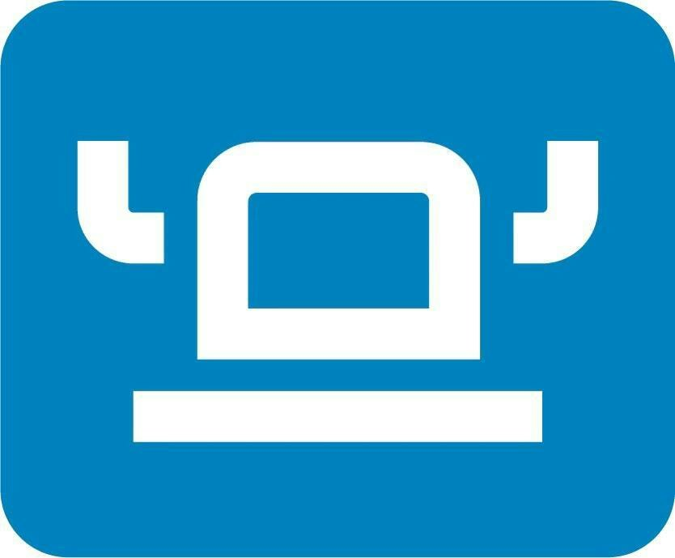
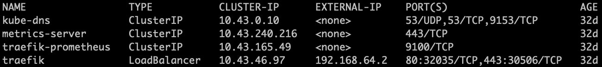
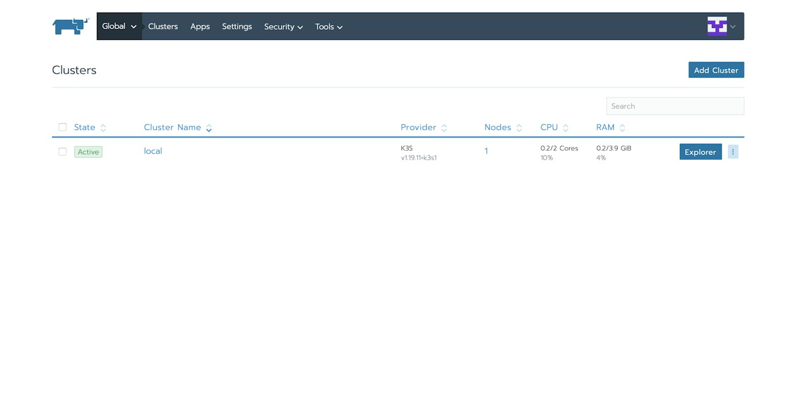

In a [previous article](https://community.suse.com/posts/setting-up-rancher-on-your-local-machine-with-an-rke-provisioned-cluster), I demonstrated how to install Rancher on an RKE provisioned cluster made up of at least 3 VMs on your local machine. The main reason for doing this was to mimic (as much as possible) the recommended HA configuration you would have in a production-ready cloud environment. Furthermore, making use of RKE, which containerizes the Kubernetes cluster components (etcd, kube-apiserver, kube-controller-manager, kubelet, kube-scheduler, and kube-proxy), simplifies the process of taking your K8s environment from local to remote because of the portability that this model offers. 

However, this solution can be quite verbose depending on the specifications of your physical hardware. You may want to run a more lightweight cluster solution locally for your K8s cluster management either due to hardware constraints or for use case purposes. [Rancher Desktop](https://rancherdesktop.io/) is a fitting example to accomplish this. Rancher Desktop is an electron-based application, available for macOS and Windows, that uses [k3s](https://k3s.io/) and [containerd](https://containerd.io/) under the hood to provide a simpler and lighter experience for container management. If you want to know more about Rancher Desktop, check out [this article](https://community.suse.com/posts/rancher-desktop-an-open-source-app-for-desktop-kubernetes-and-container-management) by [Matt Farina](https://community.suse.com/members/7279345). 
In this article, I will show you how to install Rancher on Rancher Desktop.


## **Prerequisites**

In order for you to carry out this setup, you will have to ensure that you have the following tools installed:

- [Rancher Desktop](https://rancherdesktop.io/) - Rancher Desktop is an open source desktop application for Mac and Windows that provides Kubernetes and container management.
- [kubectl](https://kubernetes.io/docs/tasks/tools/) - kubectl is a CLI tool used to interact with Kubernetes clusters.
- [Helm](https://helm.sh/docs/intro/install/) - Helm is a package manager for K8s that allows for easy packaging, configuration, and deployment of applications and services onto clusters.

## **Startup Rancher Desktop**

Once you’ve installed Rancher Desktop, you can start it up and ensure that it’s running by checking the Rancher Desktop icon in the menu bar for macOS and the taskbar for Windows. When you select the icon, you should see the status ‘Kubernetes is running.’ Run the following command to verify the kube config context:

```
kubectl config current-context
```

## **Install Rancher on Rancher Desktop**

Once you have confirmed that your cluster is up and running, you can install Rancher. 

#### **Install Cert Manager**

Rancher relies on [cert-manager](https://cert-manager.io/docs/) to issue certificates from Rancher’s own generated CA or to request Let’s Encrypt certificates.

```
kubectl apply -f https://github.com/jetstack/cert-manager/releases/download/v1.4.0/cert-manager.yaml
```

#### Create `cattle-system` Namespace

Create the namespace where the Rancher Kubernetes application resources will be deployed.

```
kubectl create namespace cattle-system
```

#### Add Rancher Helm Repository & Install Rancher

```
helm repo add rancher-stable https://releases.rancher.com/server-charts/stable helm install rancher rancher-stable/rancher \
  --namespace cattle-system \
  --set hostname=<hostname>
```

#### Update Local Host Resolution Configuration

Once Rancher has been installed, you can verify the external IP of the single node instance by getting the External IP or LoadBalancer Ingress of the `traefik` LoadBalancer either by running `*kubectl get svc -n kube-system*` or `*kubectl describe svc traefik -n kube-system*.`


You will then need to update the hosts on your local machine to resolve the address of the Rancher Desktop node. To do this, update the configuration in **/etc/hosts** (**C:\Windows\System32\Drivers\etc\hosts**in Windows) by adding an entry for your hostname like this:

```
ip-address   hostname
```

Lastly, go to your web browser and enter your selected hostname.



## In Closing

You can now use Rancher for centralized K8s cluster management using a lighter local cluster set up with Rancher Desktop. For example, Rancher can make installing observability into your Rancher Desktop cluster really easy. Also, if you have more than one local cluster (maybe you’re using k3d and/or k3s in VMs for other use cases), you can use the Rancher instance you just created to easily manage them as well.
