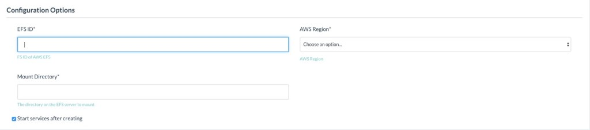
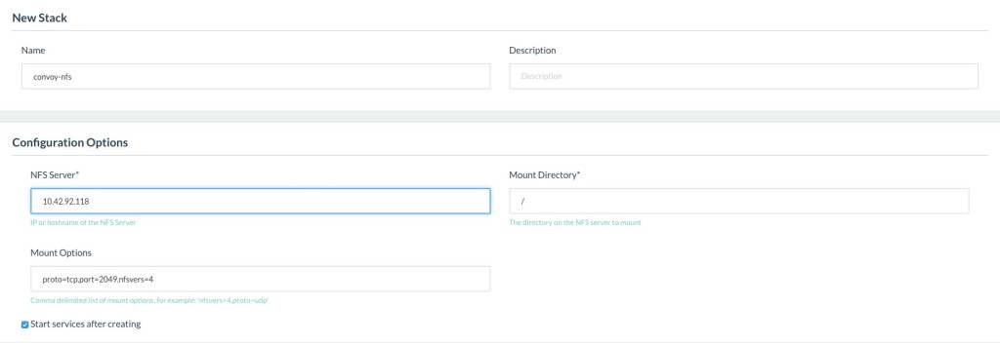
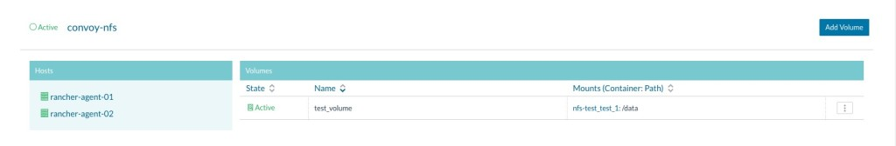
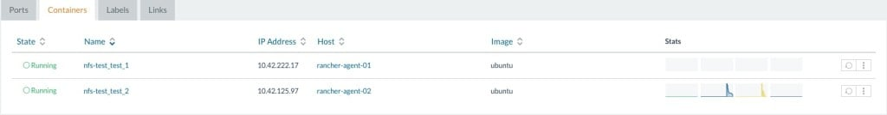
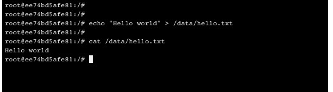

### Introduction

If you have been working with Docker for any length of time, you

probably already know that shared volumes and data access across hosts

is a tough problem. While the Docker ecosystem is maturing,

implementing persistent storage across environments still seems to be a

problem for most folks. Luckily, Rancher has been working on this

problem and come up with a unique solution that addresses most of these

issues. Running a database with shared storage still isn’t widely

recommended, but for many other use cases, sharing volumes across hosts

is good practice. Much of the guide was inspired by one of the [Rancher Online meetups](https://www.youtube.com/watch?v=up0s-J-Qi3s). Additionally,

[here is a little reference](https://github.com/rancher/rancher/wiki/Setup:-convoy-nfs) to

go from that includes some of the NFS configuration information if you

want to build something like this yourself from scratch.

### Rancher Convoy

If you haven’t heard of it yet, the [Convoy project](https://github.com/rancher/convoy) by Rancher is aimed at

making persistent volume storage easy. Convoy is a very appealing volume

plugin because it offers a variety of different options. For example,

there is EBS volume and S3 support, along with VFS/NFS support, giving

users some great and flexible options for provisioning shared storage.

### Dockerized-NFS

This is a little recipe for standing up a Dockerized NFS server for the

convoy-nfs service to connect to. Docker-NFS is basically a poor man’s

EFS, and you should only run this if you are confident that the server

won’t get destroyed or the data simply isn’t important enough to

matter if it is lost. You can find more information about the Docker NFS

server I used

[here](https://github.com/cpuguy83/blog/blob/master/_posts/2014-03-29-docker-quicktip-4-remote-volumes.md).

To beef things up, I would suggest looking at the AWS implementation of

NFS called Elastic File Storage or EFS. This solution is a much more

robust and production-ready NFS server that you can use as the backend

for Convoy-NFS. Setting up EFS is pretty simple, but out of scope for

this article. Please check out [the EFS docs on how to set up and configure EFS](https://aws.amazon.com/blogs/aws/amazon-elastic-file-system-production-ready-in-three-regions/).

One caveat: since EFS is a newer service to AWS, it is only available in

a few locations (but there are more on the way soon) Here is what your

docker-compose.yml might look like, for the docker-nfs server:

```
docker-nfs:
 image: cpuguy83/nfs-server
 privileged: true
 volumes:
 - /exports
 command:
 - /exports
 - /etc/services:/etc/services
```

One gotcha that you might encounter with this containerized NFS server

method is the host either does not have the NFS kernel module installed,

or doesn’t have the accompanying services turned on. On Ubuntu it is

easy to install the kernel module. SSH to the host that will run the NFS

server container and run the following command:

```
sudo apt-get install nfs-kernel-server
```

On CoreOS the module is installed, just not turned on. To enable NFS,

you will need to SSH to the host that will run the NFS server container

and run the following command:

```
sudo systemctl start rpc-mountd
```

### Configuring EFS

Configuring EFS is really easy. Using the [link posted above](https://aws.amazon.com/blogs/aws/amazon-elastic-file-system-production-ready-in-three-regions/), you

can go through the steps for creating an EFS volume for Convoy to

connect to. When creating EFS volumes, either take note of the IP

address of the EFS share, or if you drill into the configuration after

creating the volume, the DNS name provided by AWS for the share. There

is also a new catalog entry in the Rancher community catalog for using

EFS volumes directly through Convoy, which can potentially simplify

certain configurations. Using the catalog entry will still require you

to create the EFS share first, but makes configuring Convoy to connect

to it easier. Just copy the EFS ID out of AWS, choose the region in

which you’ve created your share, and then specify where to mount the

EFS share to locally. “/efs” is a good example to test things out

initially: [](https://cdn.rancher.com/wp-content/uploads/2016/08/17105031/Configuration-Options.jpg)

### Convoy-NFS

Currently, Rancher offers another catalog item called “Convoy-NFS” to

connect containers to an NFS server:

[](https://cdn.rancher.com/wp-content/uploads/2016/08/17105038/Convoy-NFS.jpg)

The setup is pretty straightforward, but there are a few things to note.

First, the stack **must** be named “convoy-nfs“, which is the name of

the plugin. Next, the NFS server should match the hostname on which you

set up your NFS server; if you created the docker-nfs container instead,

use the IP of the container (I used a test environment for this post,

and thus just used the Rancher container internal IP address for the

deployed NFS server). With EFS, use the DNS name configured when you

created your NFS shares. The last thing to be aware of are the mount

options and mount point. Match the port here with the port that the NFS

server was configured with (2049 for docker-nfs) and make sure to turn

on nfsver=4. Also be sure to use “/” for the MountDirectory if using

the nfsvers=4 option; otherwise use “/exports“. The final

configuration should look similar to the following.

```
proto=tcp,port=2049,nfsvers=4
```

You can add other options to tune the shares, but these are the

necessary components for a bare minimum setup. Give Rancher a few

minutes to provision the convoy-nfs containers. After everything turns

green you should be able to create and attack NFS volumes. The fastest

way to check if things are working is to click on the Infrastructure ->

Storage Pools option. If you see hosts in that view, then you should be

ready to start creating and sharing volumes. [](https://cdn.rancher.com/wp-content/uploads/2016/08/17105028/Storage-Pools.jpg)

At this point you can either manually create a volume from the Storage

Pools view, or simply create a service that uses the convoy-nfs driver

and the volume name. I will create a testing container that spans across

two hosts, that shares the same “test\_volume” to share the data

across hosts, which looks like the following (I used rancher-compose

locally to spin up this test stack. Feel free to use the GUI if it is

easier):

```
test:
 image: ubuntu
 volume_driver: convoy-nfs
 tty: true
 volumes:
 - test_volume:/data
 command:
 - bash
```

A new volume should pop up in the Storage Pools page: [](https://cdn.rancher.com/wp-content/uploads/2016/08/17105028/Storage-Pools.jpg)

You can verify things are working by scaling up the number of containers

to two or more. Then exec into one container, create a file in it and

see if you can read the file from another container, preferably on a

different host. If that all works, you should be all set: [](https://cdn.rancher.com/wp-content/uploads/2016/08/17105034/Convoy-containers.jpg)

From the first container, we can write out a file:

[](images/rancher_blog_HelloWorld_2.jpg)

And from the second container, we can read it back to verify the shared

storage is working:

[](images/rancher_blog_HelloWorld_1.jpg)

### Conclusion

As Convoy continues to evolve and grow, we should see a lot more options

for deployments. For now, NFS is stable and just works; using EFS makes

things even easier if you are already on AWS. I’m looking forward to

seeing what is next for Convoy and for shared volumes in Rancher. *Josh Reichardt is a DevOps engineer at [about.me](http://about.me), where he builds and maintains their infrastructure, among other things. You can visit his blog at [thepracticalsysadmin.com](http://thepracticalsysadmin.com) to find more interesting DevOps-related content and on Twitter ([@Practical\_SA](http://twitter.com/practical_SA)).*
