When deploying applications in the container world, one of the less
obvious points is how to make the application available to the external
world, outside of the container cluster. One option is to use the host
port, which basically maps one port of the host to the container port
where the application is exposed. While this option is fine for local
development, it is not viable in a real cluster with many applications
deployed. One solution is to use an HTTP proxy/load balancer. This
container will be exposed using standard HTTP/HTTPS ports on the host,
and will route traffic to the application running as a container. In
this post, we will setup [Traefik](http://traefik.io) as an HTTP proxy /
load balancer for web services running in a Rancher Cattle setup.
Traefik will dynamically update its configuration using the Rancher API.
An SSL wildcard cert will be used. The (nice) Let’s Encrypt ACME feature
Traefik is offering will not be used here. We will make use of Rancher
secret feature. If you plan to use Traefik with Let’s Encrypt SSL certs,
I encourage you to use the Traefik stack available in Rancher Community
Catalog.

##### Take a deep dive into Best Practices in Kubernetes Networking

From overlay networking and SSL to ingress controllers and network security policies, we've seen many users get hung up on Kubernetes networking challenges. In this video recording, we dive into Kubernetes networking, and discuss best practices for a wide variety of deployment options.

[Watch the video](https://rancher.com/events/2018/kubernetes-networking-masterclass-june-online-meetup/)

### Context

In this demo, we already have a running Rancher environment, using the
Cattle orchestrator with three nodes and one web application to be
published so that it can be accessed outside of the Cattle cluster. Our
application will be the simple
“[whoamI](https://github.com/emilevauge/whoamI)” application, basically
showing the IP address of the node it is running on. We will use a
wildcard SSL domain, as the Rancher install is not available from
outside the LAN (on-premises platform). We will also leverage Rancher’s
experimental secrets to store the SSL certs, as well as the Rancher API
key and secret.

### Rancher Setup

We have three nodes running on our Cattle cluster:
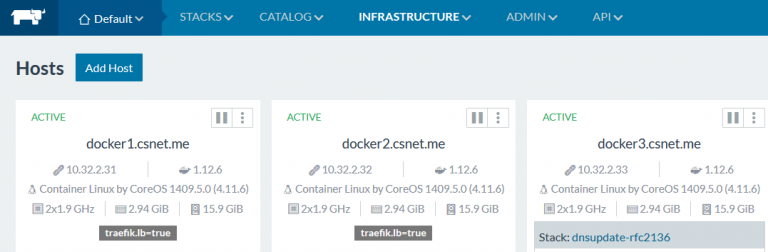 *Notice the
`traefik.lb=true` label on some hosts. We will use them later.*

### Deploy Web Application

We will create a new stack for our test app. Create a blank stack, we
will call it *iamfoo*. Then add a service using the
[emilevauge/whoami](https://github.com/emilevauge/whoamI) image. Add an
HTTP health check as follows:
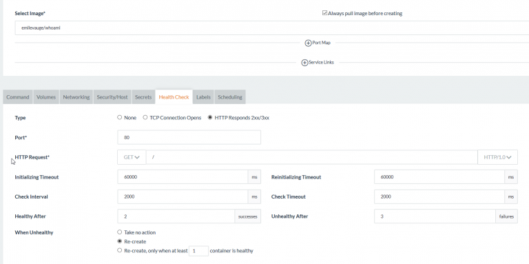

### Prepare API Key

Let’s create a Rancher API key: in the UI, go to APIkey, click on
“Advanced” and create a new key by hitting the “Add environment API key”
button:
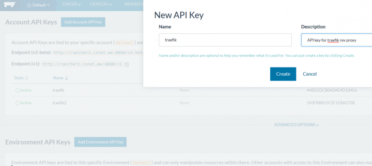
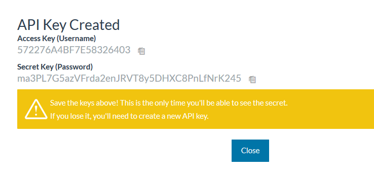

**Note:** As warned by the UI, write down the secret key as you won’t
be able to see it again

Repeat same operation for the API password, SSL cert and SSL key.

### Deploying Traefik

We will use the
[mch1307/rancher-traefik:1.3.1.2](https://github.com/mch1307/rancher-traefik).
It is an alpine based image, inspired from
[rawmind0](https://github.com/rawmind0/rancher-traefik). The image will
read the SSL certs and Rancher API key/secret from Rancher secret
through environment variables that we will define when creating the
service.Create new stack, we will call it prx. Then add a service to it.
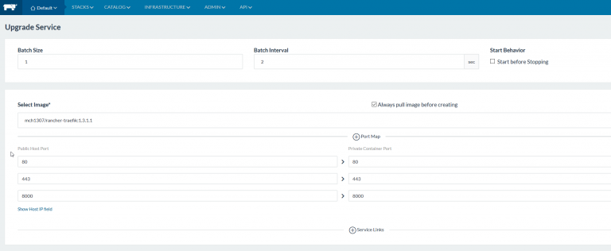**Ports**We will use
the following ports:

- 80 -> http
- 443 -> https
- 8000 -> Traefik UI

Those ports will be exposed on the host(s) that will run the Traefik
container(s). Make sure they are not yet in use, or choose other ones.
**Secrets** In the Secrets tab, set up your secrets:
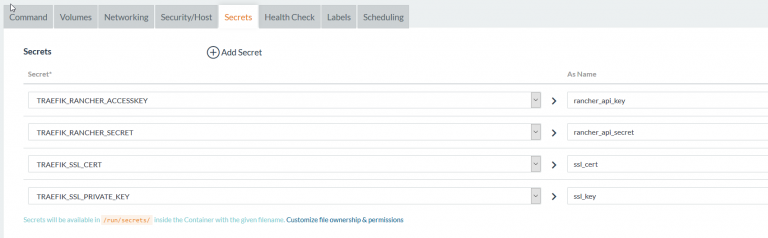 **Container
environment variables** To add secrets as environment variables, go to
the “Command” tab and define environment variable as follows. The name
of the env vars should be:

- TRAEFIK\_RANCHER\_ACCESSKEY = Rancher API key
- TRAEFIK\_RANCHER\_SECRET = Rancher API secret
- TRAEFIK\_SSL\_CERT= Wildcard SSL cert (bundle ii with intermediate
  CA if applicable)
- TRAEFIK\_SSL\_PRIVATE\_KEY = SSL private key (without password
  protection)
- TRAEFIK\_RANCHER\_ENDPOINT = URL to Rancher API
- TRAEFIK\_RANCHER\_DOMAIN = domain to be used in Traefik

The secrets are available at /run/secrets/alias. Alias is defined in the
secrets in the previous step.

**Hint:** Copy the table above and paste it to the first
environment variable. Rancher UI will create all the variables so that
you only need to put appropriate value in the right column

**Scheduling**

Go to the “scheduling” tab and create a new scheduling rule. We will
create a rule based on host label. It means we will ask Rancher to run
the container on host having a given label. Remember the labels we saw
in the Rancher infrastructure (`traefik_lb=true`), this is where they
will enter into action:
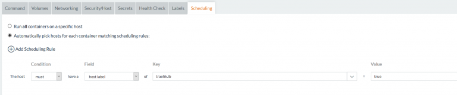

Once done, click on “Create” to trigger container deployment. Rancher
will download the image from Docker Hub and them schedule the container.
You should have a running Traefik stack within a few minutes.
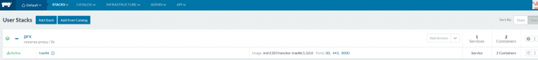

### Setup the Web Application

Traefik needs a few labels at the web app level in order to
automatically create the config for the service. These are the different
labels we will use:

- traefik.enable = true
- traefik.port = 80
- traefik.frontend.rule = Host:whoami.domain.com

Go to the whoami stack, choose upgrade and add the labels.
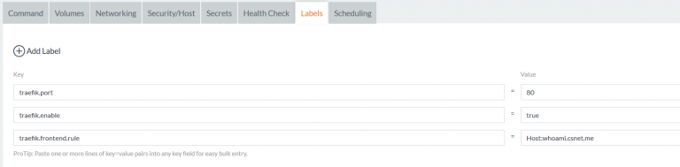

**Hint:** Copy the table above and paste it to the first label. Rancher
UI will create all the labels and values. The adapt the values to suit
your setup. Additional ones can be used, refer to the
[Traefik documentation](https://docs.traefik.io/providers/rancher/).

Once the whoami stack is upgraded, you should be able to access the
traefik UI on port 8000:
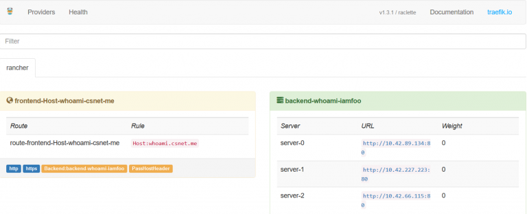

### Testing Traefik

You should now define a DNS alias for the whoami that points to the
rancher host(s) that runs the traefik container. Once done open your
favorite web browser and go to the whoami URL.
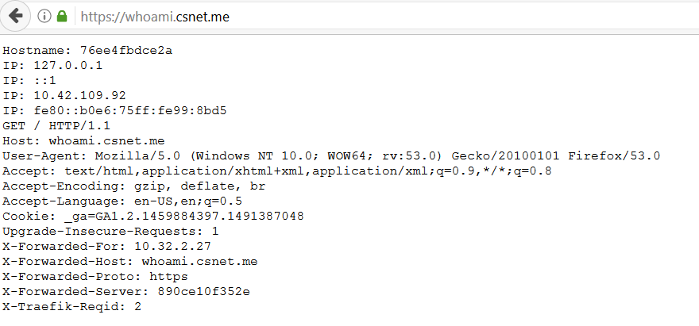 Traefik will
redirect the HTTP traffic to HTTPS using the wildcard cert we configured
earlier. Hit F5 several times, you will see different IPs which shows
the load balancing feature of Traefik. You can run further test by
scaling up or down the number of whoami containers. Check the traefik UI
to see the number of whoami backends is updated.
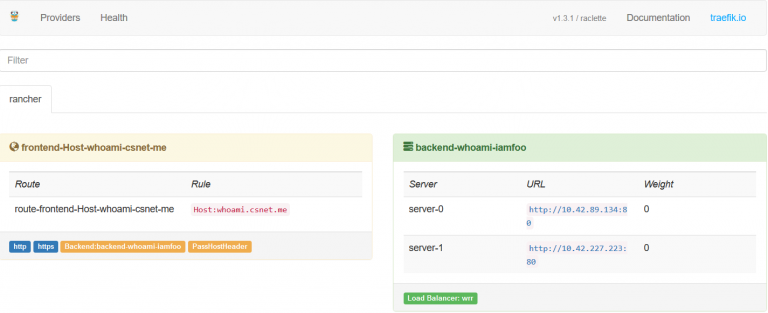

### Conclusion

We have seen how traefik can be deployed as proxy / load balancer in a
rancher cattle cluster, using basic setup. Traefik offers many other
options, consult the [documentation](https://docs.traefik.io/) for
further information

*Michael Champagne is a containers and OSS enthusiast / fan.*
