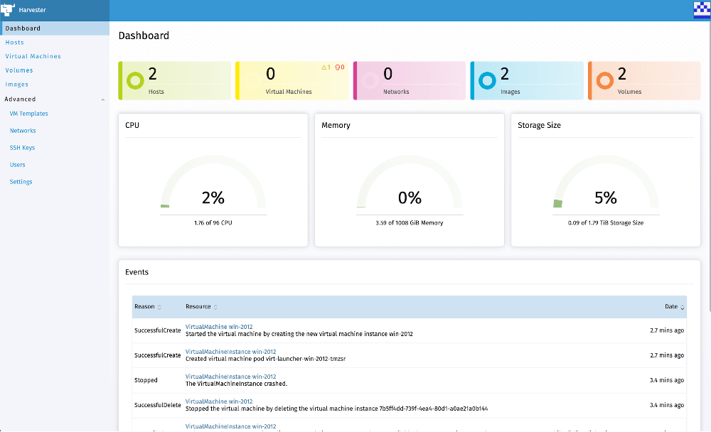
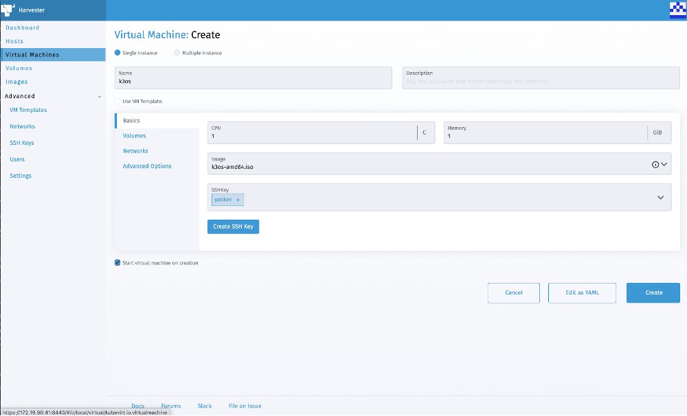

Discover what’s new in Rancher 2.5 [Learn More](/products/rancher/2.5) Are you or your team currently looking for your next-generation architecture? Or perhaps are you already there, but looking for the best way to automate and manage it. In this blog, we’re going to talk about deploying Rancher environments using the power of env0.

## Rancher: Kubernetes Management Platform

[Rancher](https://rancher.com/) is a complete software stack for teams adopting containers. It addresses the operational and security challenges of managing multiple Kubernetes clusters while providing DevOps teams with integrated tools for running containerized workloads. For the purpose of this demo, we’re going to be using the Rancher quickstart found [here](https://github.com/rancher/quickstart).

## env0: Infrastructure Automation Platform

[env0](https://www.env0.com/) is an infrastructure automation platform that centralizes your deployments of Terraform and other frameworks in a collaborative workspace for your entire team. You can sign in and start using the product for free today [here](https://app.env0.com/login).

## Why Rancher + env0?

Automating the deploy and destroy of your environments can be a key to speeding up development. Even if you are just using static environments for things like prod and dev, sometimes you need to redeploy to upgrade or other tasks. For example, maybe you’re relocating the deployment to another region or availability zone, or there is the bigger use case of dynamic environments for things such as [environments per pull request](https://www.env0.com/blog/why-per-pull-request-environments-and-how). Using Kubernetes for your application infrastructure makes this kind of development much easier, since you already have your application configuration deployment files ready to redeploy as soon as the new clusters are up and running. Once the task of redeploying your application to new infrastructure isn’t such a huge undertaking, you’re free to recreate that infrastructure whenever you see fit. And we’ll then use env0 to automate that infrastructure tear down and redeploy to make that even easier. Sign up for free [here](https://app.env0.com/login) to continue with the setup in the next section.

## Setup

First things first. We need some code. Remember that [repository](https://github.com/rancher/quickstart) I told you about earlier? For the purpose of this example, we’re going to use the AWS folder from that, with a tiny adjustment due to our Identity and Access Management (IAM) setup in AWS. Our team uses 12-hour programmatic keys in AWS for our lab account. And this account also requires the “AWS Session Token” credential. So the standard key pair isn’t going to work for me. The edited code I’m using for this is found [here](https://github.com/vtimd/quickstart/tree/master/aws).

I have gone ahead and placed these AWS credentials as **Global Variables** in env0, in case I want to use them in any other projects later. If you assign different credential sets per project or environment, you can simply set them as **Project-level** or **Environment-Level** Variables.

Global Variables

Once that is set up, we want to configure the template that we will use in the Project. This is a pretty easy process of giving it a name and pointing it at the GitHub repo we want to use. Or, if you use another Version Control System (VCS) provider, just provide the URL and git token for auth, and you’re good to go. To set up this template, click **Create New Template** under the **Organization Templates** section.

Template Settings

If we go to **Projects**, we’ll find the **Create New Project** button to click. The project creation is as simple as giving it a name and description. So once we do that, we’ll go into **Project Templates** for the newly created project.

Once we have the template assigned to the Project, we’re ready to start deploying our Rancher environments.

### Deploying Environments

We’re now on to the fun part. We’re ready to deploy our Rancher environments. This is a straightforward process in the env0 platform. We’ll start with the new project we just created, and then go to Project Environments. This is where we can see all the current environments, and launch new ones. On this page, we’ll click **Create New Environment**.

Project Environments Screen

Once we do this, we’ll see the Project Templates screen and all the templates available. Since we only enabled the Rancher-Quickstart template, that is the only one we should see here. We’ll go ahead and click **Run Now**.

Run Now Window

We’re almost there! On the **Create New Environment** page, we’ll fill in the **Environment Name**, **Workspace Name** (Optional, as env0 will generate one if you don’t use a specific one), and **Revision**. I’ve opted to select **Redeploy on every push to the git branch**. This essentially enables continuous deployment (CD) for the environment, as it will rerun the deployment in env0 on every push. I have also set a custom Time-To-Live (TTL) in the **Destroy Environment** section. As this is just for a demo, I don’t want it to stay around forever. This is a great feature for managing short-lived demo, sandbox or dev instances that you don’t want to forget and pay for forever. We already set the **Variables** section up previously, and these are inherited from the Organization level, down to the Project and then to the Environment level. The lowest scoped variable wins in a conflict, so if you want to override any Organization or Project variables, you can inject them right here for this specific environment. All that’s left to do is to click **Run**.

And just like that, we’re off to the races!

Deployment 1

Deployment 2

While that runs, tell the boss your code is compiling, and take a break. You earned it. env0 will shoot you an email as soon as the deployment is complete.

Success Email

### Active Environment Information

When you go back into the environment after it is deployed, check out the **Resources** tab. Here, we’ll find all the Outputs specified in the Terraform files, as well as the Resources created by the deployment. This is where we will obtain the **rancher\_server\_url** to access our new environment.

Environment Information

From here, when we click the URL, it is copied to the clipboard. We can throw that in another tab, and here we are.

Rancher Login

That’s all it takes!

## Conclusion

All done! We’ve gone over what Rancher and env0 are, why they are great together and how to set up env0 to deploy Rancher Kubernetes environments with Terraform in an automated fashion. If you followed along with this piece, you should have a great working Kubernetes lab to start deploying apps into. So grab your YAML manifests, and have fun!

For more information about env0, you can find us on [Twitter](https://twitter.com/envZero), [LinkedIn](https://www.linkedin.com/company/env0), and on our [Website](https://www.env0.com/). Feel free to reach out for a personal intro or demo [here](https://www.env0.com/more-info).Discover what’s new in Rancher 2.5 [Learn More](/products/rancher/2.5)
