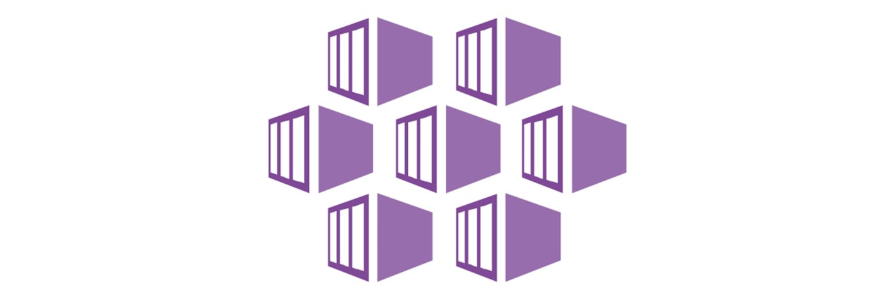
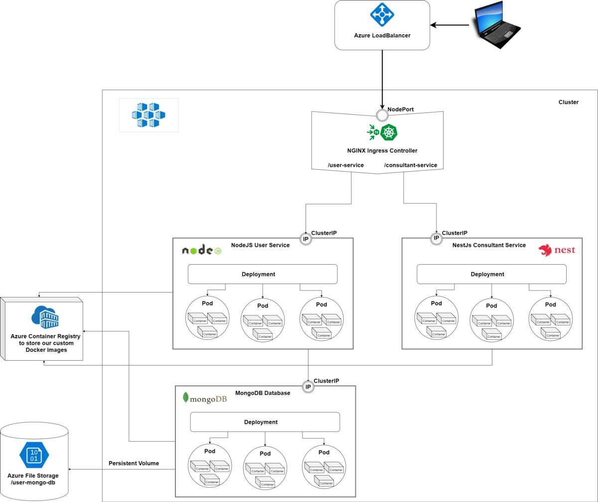
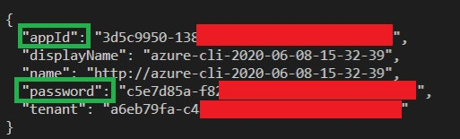
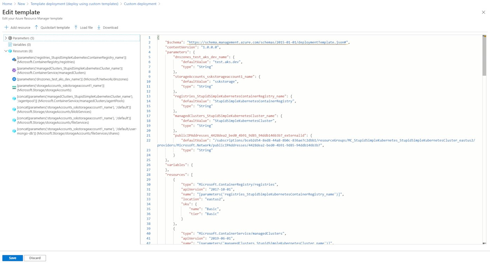
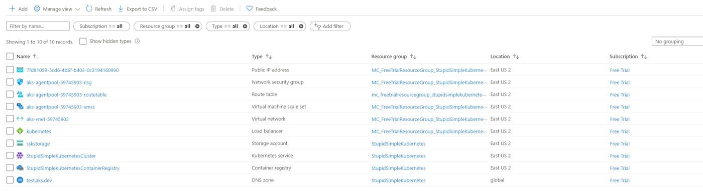
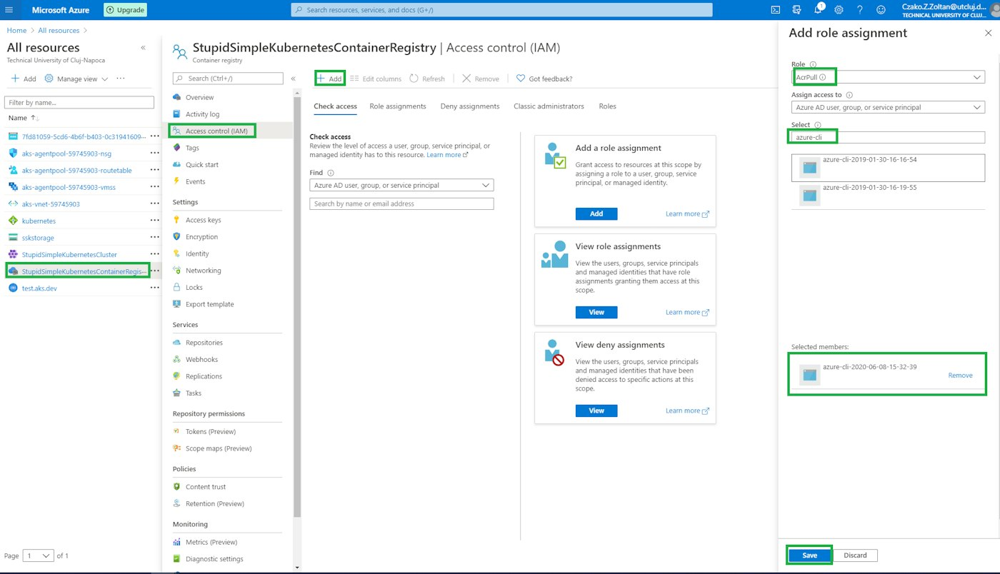
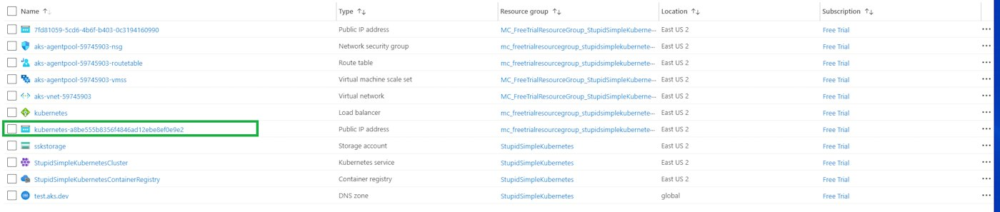
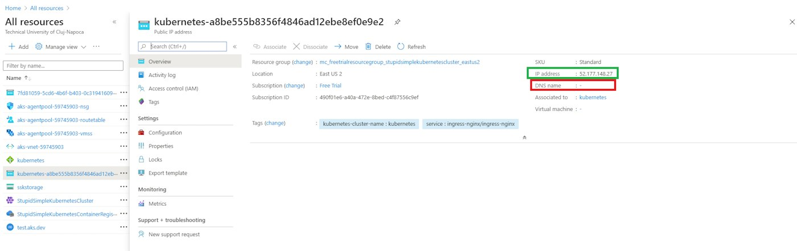

[](https://media1-production-mightynetworks.imgix.net/asset/24404668/AKS.png?ixlib=rails-4.2.0&fm=jpg&q=75&auto=format)

Welcome to the fourth post in our Stupid Simple Kubernetes series. In the [first article](https://community.suse.com/posts/13950530?utm_source=manual), we learned about the basic concepts used in Kubernetes and its hardware structure. We talked about the different software components, including Pods, Deployments, StatefulSets, and Services, and how to communicate between services and with the outside world.

In this blog, we're getting practical. We will create all the necessary configuration files to deploy multiple microservices in different languages using MongoDB as data storage. We will also learn about Azure Kubernetes Service (AKS) and will present the infrastructure used to deploy our services.

The code used in this article can be found in my [StupidSimpleKubernetes-AKS](https://github.com/CzakoZoltan08/StupidSimpleKubernetes-AKS) git repository. If you like it, please leave a star!

[](https://media1-production-mightynetworks.imgix.net/asset/23566663/1.png?ixlib=rails-4.2.0&fm=jpg&q=75&auto=format)

**NOTE:** the scripts provided are **platform agnostic**, so you can follow the tutorial using other types of cloud providers or a local cluster with [**K3s**](https://k3s.io/)**.**I suggest using **K3s** because it is very lightweight, packed in a single binary with a size of less than 40MB. Furthermore, it is a highly available, certified Kubernetes distribution designed for production workloads in resource-constrained environments. For more information, you can review its well-written and easy-to-follow [**documentation**](https://rancher.com/docs/k3s/latest/en/).

## Requirements

Before starting this tutorial, please make sure that you have installed [Docker](https://docs.docker.com/get-docker/)and [Azure CLI](https://docs.microsoft.com/en-us/cli/azure/install-azure-cli?view=azure-cli-latest). Kubectl will be installed with Docker (if not, please install it from [here](https://kubernetes.io/docs/tasks/tools/install-kubectl/#install-kubectl-on-windows)).

You will also need an [Azure Account](https://azure.microsoft.com/en-us/free/search/?&ef_id=Cj0KCQjww_f2BRC-ARIsAP3zarGseFIIABDKpjhQDML2qAg1qF8p3BdfWCfE403EPHJ3dz-pTIXX_vYaAugfEALw_wcB:G:s&OCID=AID2000602_SEM_Cj0KCQjww_f2BRC-ARIsAP3zarGseFIIABDKpjhQDML2qAg1qF8p3BdfWCfE403EPHJ3dz-pTIXX_vYaAugfEALw_wcB:G:s&dclid=CjgKEAjww_f2BRCcv_LMmqjmsloSJABCWkiPJs5LFfh1HF3_LoyEAXfixk_-gt65qWO68aF4tKn4cfD_BwE). Azure offers a 30-day free trial that gives you $200 in credit, which will be more than enough for our tutorial.

Through this tutorial, we will use [Visual Studio Code](https://code.visualstudio.com/), but this is not mandatory.

## Creating a Production Ready Azure Infrastructure for Microservices

To have a fast setup, I’ve created an [ARM Template](https://github.com/CzakoZoltan08/StupidSimpleKubernetes-AKS/tree/master/manifest/arm-templates), which will automatically spin up all the Azure resources needed for this tutorial. You can read more about *ARM Templates* [here](https://www.red-gate.com/simple-talk/cloud/infrastructure-as-a-service/azure-resource-manager-arm-templates/#:~:text=ARM%20Templates%20are%20a%20way,Azure%20%E2%80%9CInfrastructure%20as%20code%E2%80%9D.).

We will run all the scripts in the VS Code Terminal.

The first step is to log in to your Azure account from the VS Code Terminal. For this, run the *az login.*This will open a new tab in your default browser, where you can enter your credentials.

For the Azure Kubernetes Service, we need to set up a [Service Principal](https://docs.microsoft.com/en-us/azure/active-directory/develop/app-objects-and-service-principals). For this, I’ve created a PowerShell script called [create-service-principal.ps1](https://github.com/CzakoZoltan08/StupidSimpleKubernetes-AKS/tree/master/manifest/azure-scripts). Just run this script in the VS Code Terminal or PowerShell.

After running the code, it will return a JSON response with the following structure:

[](https://media1-production-mightynetworks.imgix.net/asset/23566684/2.png?ixlib=rails-4.2.0&fm=jpg&q=75&auto=format)

Based on this information, you will have to update the ARM Template to use your Service Principal. For this, please copy the appId from the returned JSON to the clientId in the ARM Template. Also, copy the password and paste it into the ARM Template’s secret field.

In the next step, you should create a new Resource Group called “StupidSimpleKubernetes” in your Azure Portal and import the ARM template to it.

To import the ARM template, click on the Create a resource button in the Azure Portal, search for Template Deployment, and select Build your own template in the editor. Copy and paste the [template code](https://github.com/CzakoZoltan08/StupidSimpleKubernetes-AKS/tree/master/manifest/arm-templates) from our Git repository to the Azure template editor. Now you should see something like this in the following picture:

[](https://media1-production-mightynetworks.imgix.net/asset/23566686/3.png?ixlib=rails-4.2.0&fm=jpg&q=75&auto=format)

Hit the save button, select the StupidSimpleKubernetes resource group, and hit Purchase. This will take a while, and it will create all the necessary Azure resources for a production-ready microservices infrastructure.

You can also apply the ARM Template using the Azure CLI, by running the following command in the root folder of our git repository:

```
az deployment group create --name testtemplate --resource-group StupidSimpleKubernetes --template-file .\manifest\arm-templates\template.json
```

After the ARM Template Deployment is done, we should have the following Azure resources:

[](https://media1-production-mightynetworks.imgix.net/asset/23566689/4.png?ixlib=rails-4.2.0&fm=jpg&q=75&auto=format)

The next step is to authorize our Kubernetes service to pull images from the Container Registry. For this, select the container registry, select the Access Control (IAM) menu option from the left menu, click on the Add button and select Role Assignment.

[](https://media1-production-mightynetworks.imgix.net/asset/23566691/5.png?ixlib=rails-4.2.0&fm=jpg&q=75&auto=format)

In the right menu, search for the correct Service Principal (use the *display name* from the returned JSON object — see the Service Principal image above).

After this step, our Kubernetes Service can pull the right Docker images from the Azure Container Registry. We will store all our custom Docker images in this Azure Container Registry.

We are almost ready! In the last step, we will set up the NGNIX Ingress Controller and add a RecordSet to our DNS. This assigns a human-readable hostname to our services instead of using the IP:PORT of the Load Balancer.

To set up the NGINX Ingress Controller, run the following two commands in the root folder of the repository one by one:

```
kubectl apply -f .\manifest\ingress-controller\nginx-ingress-controller-deployment.yml
kubectl apply -f .\manifest\ingress-controller\ngnix-load-balancer-setup.yml
```

This will create a new public IP, which you can see in the Azure Portal:

[](https://media1-production-mightynetworks.imgix.net/asset/23566696/6.png?ixlib=rails-4.2.0&fm=jpg&q=75&auto=format)

If we take a look over the details of this new Public IP resource, we can see that it does NOT have a DNS name.

[](https://media1-production-mightynetworks.imgix.net/asset/23566697/7.png?ixlib=rails-4.2.0&fm=jpg&q=75&auto=format)

To assign a human-readable DNS name to this Public IP, please run the following PowerShell script (replace the IP address with the correct IP address from your Public IP resource):

This assigns a DNS name to the public IP of your NGINX Ingress Controller.

Now we are ready to deploy our Microservices to the Azure Kubernetes Cluster.

## Conclusion

This tutorial taught us how to create a production-ready Azure infrastructure to deploy our microservices. We used an ARM Template to automatically set up the Azure Kubernetes Service, the Azure Container Registry, the Azure Load Balancer, Azure File Storage (which will be used for persistent data storage) and to add a DNS Zone. We applied some configuration files to authorize Kubernetes to pull Docker images from the Azure Container Registry, configure the NGINX Ingress Controller and set up a DNS Hostname for our Ingress Controller.

You can learn more about the basic concepts used in Kubernetes in [part one of this series](https://community.suse.com/posts/13950530?utm_source=manual). Then [in part two](https://community.suse.com/posts/stupid-simple-kubernetes-deployments-services-and-ingresses-explained), we wrote the necessary scripts to dockerize our NodeJS, NestJs, and MongoDB services, created pods using Kubernetes Deployment scripts and set up the necessary Kubernetes Services to communicate between the pods and with the external world. We learned how to set up data persistence in part three and wrote Kubernetes scripts to connect our Pods to a Persistent Volume.

There is another ongoing “Stupid Simple AI” series. You can find the first two articles here: [**SVM and Kernel SVM**](https://towardsdatascience.com/svm-and-kernel-svm-fed02bef1200) and [**KNN in Python**](https://towardsdatascience.com/knn-in-python-835643e2fb53).

Thank you for reading this article!
