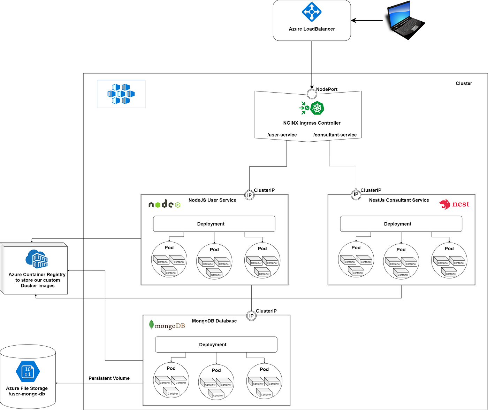

## Everything you need to know to set up production-ready Microservices using Kubernetes



In the [**first part**](https://levelup.gitconnected.com/stupid-simple-kubernetes-e509355fba3d)of this series, we learned about the basic concepts used in Kubernetes, its hardware structure, about the different software components like **Pods, Deployments, StatefulSets, Services, Ingresses, and Persistent Volumes**and we saw how to communicate between services and with the outside world.

In the [**previous article**](https://levelup.gitconnected.com/stupid-simple-kubernetes-deploying-microservices-on-azure-part-1-9ee230bdbb6f)**,** we prepared our system infrastructure to deploy our microservices using **Azure Cloud**.

In this article we will create a **NodeJS backend with a MongoDB database**, we will write the **Dockerfile** to containerize our application, will create the **Kubernetes Deployment scripts** **to spin up the Pods**, create the **Kubernetes Service scripts** **to define the communication interface between the containers and the outside world**, we will deploy an **Ingress Controller for request routing** and write the **Kubernetes Ingress scripts to define the communication with the outside world**.

Because our code can be relocated from one node to another (for example a node doesn’t have enough memory so that the work will be rescheduled on a different node with enough memory), **data saved on a node is volatile (so also our MongoDB data will be volatile)**. In the next article, we will talk about the problem of data persistence and how to use **Kubernetes Persistent Volumes** to safely store our persistent data.

In this tutorial, as [**Ingress Controller**](https://www.nginx.com/products/nginx/kubernetes-ingress-controller/) we will use [**NGINX**](https://www.nginx.com/),and our custom Docker images will be stored in the **Azure**[**Container Registry**](https://azure.microsoft.com/en-us/services/container-registry/). All the scripts written in this article can be found in my [**StupidSimpleKubernetes**](https://github.com/CzakoZoltan08/StupidSimpleKubernetes-AKS)git repository. If you like it, **please leave a star!**

**NOTE:** the scripts provided are **platform agnostic**, so the tutorial can be followed using other cloud providers or a local cluster with [**K3s**](https://k3s.io/)**.**I suggest using **K3s** because it is very lightweight, packed in a single binary with a size less than 40MB; furthermore, it is a highly available, certified Kubernetes distribution designed for production workloads in resource-constrained environments. For more information, you can review its well-written and easy-to-follow [**documentation**](https://rancher.com/docs/k3s/latest/en/).

Before starting, I would like to recommend another great article about basic Kubernetes concepts called [*Explain By Example: Kubernetes*](https://medium.com/swlh/explain-by-example-kubernetes-ea34c60d22ce).

# Requirements

Before starting this tutorial, please make sure that you have installed [**Docker**](https://docs.docker.com/get-docker/). [**Kubectl**](https://kubernetes.io/docs/reference/kubectl/kubectl/)will be installed with Docker. (if not, please install it from [here](https://kubernetes.io/docs/tasks/tools/install-kubectl/#install-kubectl-on-windows)).

The Kubectl commands used throughout this tutorial can be found in the [**Kubectl Cheat Sheet**](https://kubernetes.io/docs/reference/kubectl/cheatsheet/).

Through this tutorial, we will use [**Visual Studio Code**](https://code.visualstudio.com/), but this is not mandatory.

# Creating a Production-Ready Microservices Architecture

## Containerize the app

The first step is to **create the Docker image of our NodeJS backend**. After creating the image, we will **push it into the container registry**, from where it will be accessible and can be **pulled by the Kubernetes service** (in this case by the **Azure Kubernetes Service** or **AKS**).

The Docker file for NodeJS:

```
FROM node:13.10.1

WORKDIR /usr/src/app

COPY package*.json ./
RUN npm install

# Bundle app source
COPY . .

EXPOSE 3000

CMD [ "node", "index.js" ]
```

In the *first line,* we need to define from what image we want to build our backend service. We will use the official node image with version 13.10.1 from Docker Hub in this case.

In *line 3* we create a directory to hold the application code inside the image; this will be the working directory for your application.

This image comes with **Node.js and NPM already installed, so we next need** to install your app dependencies using the *npm*command.

Note that, to install the required dependencies, we **don’t have to copy the whole directory**, **only the package.json**, which allows us to take advantage of **cached Docker layers** (more info about efficient Dockerfiles [**here**](http://bitjudo.com/blog/2014/03/13/building-efficient-dockerfiles-node-dot-js/)).

In *line 9* we copy our source code into the working directory, and on*line 11* we expose it on port 3000 (you can choose another port if you want, but make sure that later on, this port will be used in the Kubernetes Service script).

Finally, on *line 13* we define the command to run the application (inside the Docker container). Note that there should **only be one *CMD* instruction** in each Dockerfile. If you include more than one, **only the last will take effect**.

Now that we have defined the Dockerfile, we will build an image from it using the following Docker command (using the Terminal of the Visual Studio Code or for example using the CMD on Windows):

> docker build -t node-user-service:dev .

Note the little *dot*from the end of the Docker command, it means that we are building our image from the current directory, so please make sure that you are in the same folder where the Dockerfile is located (in this case the root folder of the repository).

To run the image locally, we can use the following command:

> docker run -p 3000:3000 node-user-service:dev

To push this image to our Azure Container Registry, we have to tag it using the following format *<container\_registry\_login\_service>/<image\_name>:<tag>*, so in our case:

> docker tag node-user-service:dev stupidsimplekubernetescontainerregistry.azurecr.io/node-user-service:dev

The*last step* is to push it to our container registry using the following Docker command:

> docker push stupidsimplekubernetescontainerregistry.azurecr.io/node-user-service:dev

## Create Pods using Deployment scripts

**NodeJs backend**

The next step is to define the **Kubernetes Deployment script**, which automatically manages the Pods for us. (see more in [**this article**](https://levelup.gitconnected.com/stupid-simple-kubernetes-e509355fba3d))

```
apiVersion: apps/v1
kind: Deployment
metadata:
name: node-user-service-deployment
spec:
selector:
matchLabels:
app: node-user-service-pod
replicas: 3
template:
metadata:
labels:
app: node-user-service-pod
spec:
containers:
- name: node-user-service-container
image: stupidsimplekubernetescontainerregistry.azurecr.io/node-user-service:dev
resources:
limits:
memory: "256Mi"
cpu: "500m"
imagePullPolicy: Always
ports:
- containerPort: 3000
```

The **Kubernetes API** lets you query and manipulates the state of objects in the Kubernetes Cluster (for example Pods, Namespaces, ConfigMaps, etc.). The current stable version of this API is 1, as we specified in the *first line*.

In each Kubernetes .yml script we have to define the Kubernetes resource type (Pods, Deployments, Services, etc.) using the *kind*keyword. In this case, in *line 2*we defined that we would like to use the *Deployment*resource.

Kubernetes lets you add some *metadata* to your resources; this way it’s easier to identify, filter and in general refer to your resources.

From *line 5* we define the **specifications**of this resource. In *line 8* we specified that this Deployment should be applied only to the resources with the label *app:node-user-service-pod*and in *line 9*we said that we want to create *three replicas* of the **same pod**.

The template (starting from *line 10*) defines the Pods. Here we add the label *app:node-user-service-pod* to each Pod, this way they will be identified by the Deployment, in *lines 16 and 17* we define what kind of Docker Container should be run inside the pod. As you can see in *line 17*, we will use the Docker Image from our *Azure Container Registry* which was built and pushed in the previous section.

We can also define the **resource limits** for the Pods, this way avoiding **Pod starvation** (when a Pod uses all the resources and other Pods won’t get a chance to use them). Furthermore, when you specify the resource *request* for Containers in a Pod, the scheduler uses this information to decide **which node to place the Pod on**. When you specify a resource *limit* for a Container, the [kubelet](https://kubernetes.io/docs/reference/command-line-tools-reference/kubelet/)enforces those limits so that the running container **cannot use more of that resource than the limit you set**. The kubelet also **reserves at least the *required amount of that system resource specifically for that container***. Be aware that the Pod won't always be scheduled if you don’t have enough hardware resources (like CPU or Memory).

The last step is to define the port used for communication. In this case, we used port 3000. **This port number should be the same as the port number exposed in the Dockerfile**.

**MongoDB**

The Deployment script for the MongoDB database is quite similar, the only difference is that we have to specify the **volume mounts**(the folder on the node where the data will be saved).

```
apiVersion: apps/v1
kind: Deployment
metadata:
name: user-db-deployment
spec:
selector:
matchLabels:
app: user-db-app
replicas: 1
template:
metadata:
labels:
app: user-db-app
spec:
containers:
- name: mongo
image: mongo:3.6.4
command:
- mongod
- "--bind_ip_all"
- "--directoryperdb"
ports:
- containerPort: 27017
volumeMounts:
- name: data
mountPath: /data/db
resources:
limits:
memory: "256Mi"
cpu: "500m"
volumes:
- name: data
persistentVolumeClaim:
claimName: static-persistence-volume-claim-mongo
```

In this case, we used the official MongoDB image directly from the DockerHub (*line 17*). The volume mounts are defined in *line 24*. The next article will explain the last four lines when we talk about **Kubernetes Persistent Volumes**.

## Create the Services for network access

Now that we have the Pods up and running, we should define the communication between the containers and later with the outside world. For this, we need to define a **Service**. The relation between a Service and a Deployment is 1-to-1, so for each Deployment, we should have a Service. The Deployment is managing the life-cycle of the Pods, and it is also responsible for monitoring them, while the **Service is responsible for enabling network access to a set of Pods** (see [**this article**](https://levelup.gitconnected.com/stupid-simple-kubernetes-e509355fba3d)).

```
apiVersion: v1
kind: Service
metadata:
name: node-user-service
spec:
type: ClusterIP
selector:
app: node-user-service-pod
ports:
- port: 3000
targetPort: 3000
```

The **important part of this .yml script is the selector**, which defines how to identify the Pods (created by the Deployment) to which we want to refer from this Service. As you can see in *line 8*, the selector is an *app:node-user-service-pod* because the Pods from the previously defined Deployment are labeled like this. Another important thing is to define the **mapping between the container and Service ports**. In this case, the incoming request will use the 3000 port, defined on *line 10* and they will be routed to the port defined in *line 11*.

The Kubernetes Service script for the MongoDB pods is very similar, we have to update the selector and the ports.

```
apiVersion: v1
kind: Service
metadata:
name: user-db-service
spec:
clusterIP: None
selector:
app: user-db-app
ports:
- port: 27017
targetPort: 27017
```

## Configure the External Traffic

To communicate with the outside world, we need to define an **Ingress Controller** and **specify the routing rules using an Ingress Kubernetes Resource**.

To configure an **NGINX Ingress Controller,** we will use the following script:

```
apiVersion: v1
kind: Namespace
metadata:
name: ingress-nginx
labels:
app.kubernetes.io/name: ingress-nginx
app.kubernetes.io/part-of: ingress-nginx
---
kind: ConfigMap
apiVersion: v1
metadata:
name: nginx-configuration
namespace: ingress-nginx
labels:
app.kubernetes.io/name: ingress-nginx
app.kubernetes.io/part-of: ingress-nginx
---
kind: ConfigMap
apiVersion: v1
metadata:
name: tcp-services
namespace: ingress-nginx
labels:
app.kubernetes.io/name: ingress-nginx
app.kubernetes.io/part-of: ingress-nginx
---
kind: ConfigMap
apiVersion: v1
metadata:
name: udp-services
namespace: ingress-nginx
labels:
app.kubernetes.io/name: ingress-nginx
app.kubernetes.io/part-of: ingress-nginx
---
apiVersion: v1
kind: ServiceAccount
metadata:
name: nginx-ingress-serviceaccount
namespace: ingress-nginx
labels:
app.kubernetes.io/name: ingress-nginx
app.kubernetes.io/part-of: ingress-nginx
---
apiVersion: rbac.authorization.k8s.io/v1beta1
kind: ClusterRole
metadata:
name: nginx-ingress-clusterrole
labels:
app.kubernetes.io/name: ingress-nginx
app.kubernetes.io/part-of: ingress-nginx
rules:
- apiGroups:
- ""
resources:
- configmaps
- endpoints
- nodes
- pods
- secrets
verbs:
- list
- watch
- apiGroups:
- ""
resources:
- nodes
verbs:
- get
- apiGroups:
- ""
resources:
- services
verbs:
- get
- list
- watch
- apiGroups:
- "extensions"
resources:
- ingresses
verbs:
- get
- list
- watch
- apiGroups:
- ""
resources:
- events
verbs:
- create
- patch
- apiGroups:
- "extensions"
resources:
- ingresses/status
verbs:
- update
---
apiVersion: rbac.authorization.k8s.io/v1beta1
kind: Role
metadata:
name: nginx-ingress-role
namespace: ingress-nginx
labels:
app.kubernetes.io/name: ingress-nginx
app.kubernetes.io/part-of: ingress-nginx
rules:
- apiGroups:
- ""
resources:
- configmaps
- pods
- secrets
- namespaces
verbs:
- get
- apiGroups:
- ""
resources:
- configmaps
resourceNames:
# Defaults to "<election-id>-<ingress-class>"
# Here: "<ingress-controller-leader>-<nginx>"
# This has to be adapted if you change either parameter
# when launching the nginx-ingress-controller.
- "ingress-controller-leader-nginx"
verbs:
- get
- update
- apiGroups:
- ""
resources:
- configmaps
verbs:
- create
- apiGroups:
- ""
resources:
- endpoints
verbs:
- get
---
apiVersion: rbac.authorization.k8s.io/v1beta1
kind: RoleBinding
metadata:
name: nginx-ingress-role-nisa-binding
namespace: ingress-nginx
labels:
app.kubernetes.io/name: ingress-nginx
app.kubernetes.io/part-of: ingress-nginx
roleRef:
apiGroup: rbac.authorization.k8s.io
kind: Role
name: nginx-ingress-role
subjects:
- kind: ServiceAccount
name: nginx-ingress-serviceaccount
namespace: ingress-nginx
---
apiVersion: rbac.authorization.k8s.io/v1beta1
kind: ClusterRoleBinding
metadata:
name: nginx-ingress-clusterrole-nisa-binding
labels:
app.kubernetes.io/name: ingress-nginx
app.kubernetes.io/part-of: ingress-nginx
roleRef:
apiGroup: rbac.authorization.k8s.io
kind: ClusterRole
name: nginx-ingress-clusterrole
subjects:
- kind: ServiceAccount
name: nginx-ingress-serviceaccount
namespace: ingress-nginx
---
apiVersion: apps/v1
kind: Deployment
metadata:
name: nginx-ingress-controller
namespace: ingress-nginx
labels:
app.kubernetes.io/name: ingress-nginx
app.kubernetes.io/part-of: ingress-nginx
spec:
replicas: 1
selector:
matchLabels:
app.kubernetes.io/name: ingress-nginx
app.kubernetes.io/part-of: ingress-nginx
template:
metadata:
labels:
app.kubernetes.io/name: ingress-nginx
app.kubernetes.io/part-of: ingress-nginx
annotations:
prometheus.io/port: "10254"
prometheus.io/scrape: "true"
spec:
serviceAccountName: nginx-ingress-serviceaccount
containers:
- name: nginx-ingress-controller
image: quay.io/kubernetes-ingress-controller/nginx-ingress-controller:0.24.1
args:
- /nginx-ingress-controller
- --configmap=$(POD_NAMESPACE)/nginx-configuration
- --tcp-services-configmap=$(POD_NAMESPACE)/tcp-services
- --udp-services-configmap=$(POD_NAMESPACE)/udp-services
- --publish-service=$(POD_NAMESPACE)/ingress-nginx
- --annotations-prefix=nginx.ingress.kubernetes.io
securityContext:
allowPrivilegeEscalation: true
capabilities:
drop:
- ALL
add:
- NET_BIND_SERVICE
# www-data -> 33
runAsUser: 33
env:
- name: POD_NAME
valueFrom:
fieldRef:
fieldPath: metadata.name
- name: POD_NAMESPACE
valueFrom:
fieldRef:
fieldPath: metadata.namespace
ports:
- name: http
containerPort: 80
- name: https
containerPort: 443
livenessProbe:
failureThreshold: 3
httpGet:
path: /healthz
port: 10254
scheme: HTTP
initialDelaySeconds: 10
periodSeconds: 10
successThreshold: 1
timeoutSeconds: 10
readinessProbe:
failureThreshold: 3
httpGet:
path: /healthz
port: 10254
scheme: HTTP
periodSeconds: 10
successThreshold: 1
timeoutSeconds: 10
```

This generic script can be applied without modifications (explaining the NGINX Ingress Controller is out of scope for this article).

The next step is to define the**Load Balancer**, which will be used to route external traffic using a public IP address (the cloud provider provides the load balancer).

```
kind: Service
apiVersion: v1
metadata:
name: ingress-nginx
namespace: ingress-nginx
labels:
app.kubernetes.io/name: ingress-nginx
app.kubernetes.io/part-of: ingress-nginx
spec:
externalTrafficPolicy: Local
type: LoadBalancer
selector:
app.kubernetes.io/name: ingress-nginx
app.kubernetes.io/part-of: ingress-nginx
ports:
- name: http
port: 80
targetPort: http
- name: https
port: 443
targetPort: https
```

Now that we have the Ingress Controller and the Load Balancer up and running, we can define the **Ingress Kubernetes Resource** **for specifying the routing rules**.

```
apiVersion: extensions/v1beta1
kind: Ingress
metadata:
name: node-user-service-ingress
annotations:
kubernetes.io/ingress.class: "nginx"
nginx.ingress.kubernetes.io/rewrite-target: /$2
spec:
rules:
- host: stupid-simple-kubernetes.eastus2.cloudapp.azure.com
http:
paths:
- backend:
serviceName: node-user-service
servicePort: 3000
path: /user-api(/|$)(.*)
# - backend:
# serviceName: nestjs-i-consultant-service
# servicePort: 3001
# path: /i-consultant-api(/|$)(.*)
```

In *line 6* we define the Ingress Controller type (it’s a Kubernetes predefined value, Kubernetes as a project currently supports and maintains [GCE](https://git.k8s.io/ingress-gce/README.md) and [nginx](https://git.k8s.io/ingress-nginx/README.md) controllers).

In *line 7* we define the rewrite target rules (more information [here](https://github.com/kubernetes/ingress-nginx/tree/master/docs/examples/rewrite)), and in *line 10* we define the hostname, which was defined in the [**previous article**](https://levelup.gitconnected.com/stupid-simple-kubernetes-deploying-microservices-on-azure-part-1-9ee230bdbb6f).

**For each service that should be accessible from the outside world, we should add an entry in the** **paths list** (starting from*line 13*). In this example, we added only one entry for the NodeJS user service backend, which will be accessible using port 3000. The */user-api* uniquely identifies our service, so any request which starts with *stupid-simple-kubernetes.eastus2.cloudapp.azure.com/user-api*will be routed to this NodeJS backend. If you want to add other services, then you have to update this script (as an example see the commented-out code).

## Apply the .yml scripts

To apply these scripts, we will use the **kubectl**. The kubectl command to apply files is the following:

> kubectl apply -f <file\_name>

So in our case, if you are in the *root folder* of the [**StupidSimpleKubernetes**](https://github.com/CzakoZoltan08/StupidSimpleKubernetes-AKS/tree/master/manifest/kubernetes)repository, you will write the following commands:

> kubectl apply -f .\manifest\kubernetes\deployment.yml
>
> kubectl apply -f .\manifest\kubernetes\service.yml
>
> kubectl apply -f .\manifest\kubernetes\ingress.yml
>
> kubectl apply -f .\manifest\ingress-controller\nginx-ingress-controller-deployment.yml
>
> kubectl apply -f .\manifest\ingress-controller\ngnix-load-balancer-setup.yml

After applying these scripts we will have everything in place, so we can call our backend from the outside world (for example by using Postman).

# Conclusions

In this tutorial, we learned how to create different kinds of resources in Kubernetes, like **Pods, Deployments, Services, Ingresses,** and**Ingress Controller**. We created a **NodeJS backend with a MongoDB database**, we **containerized and deployed** them using the **replication of 3 pods**.

In the [***next article***](https://medium.com/swlh/stupid-simple-kubernetes-persistent-volumes-explained-by-examples-29f8fec08c4)***,***we will approach the problem of saving data persistently and we will learn about **Persistent Volumes in Kubernetes**.

You can learn more about the **basic concepts** used in Kubernetes in [***this article***](https://levelup.gitconnected.com/stupid-simple-kubernetes-e509355fba3d). You can read my previous article to learn how to create an Azure Infrastructure for Microservices.

If you want more **“Stupid Simple” explanations**, please **follow me on Medium**!

There is another ongoing **“Stupid Simple AI” series**. The first two articles can be found here: [**SVM**](https://towardsdatascience.com/svm-and-kernel-svm-fed02bef1200)**, Kernel SVM,** and [**KNN in Python**](https://towardsdatascience.com/knn-in-python-835643e2fb53).

Thank you for reading this article!
