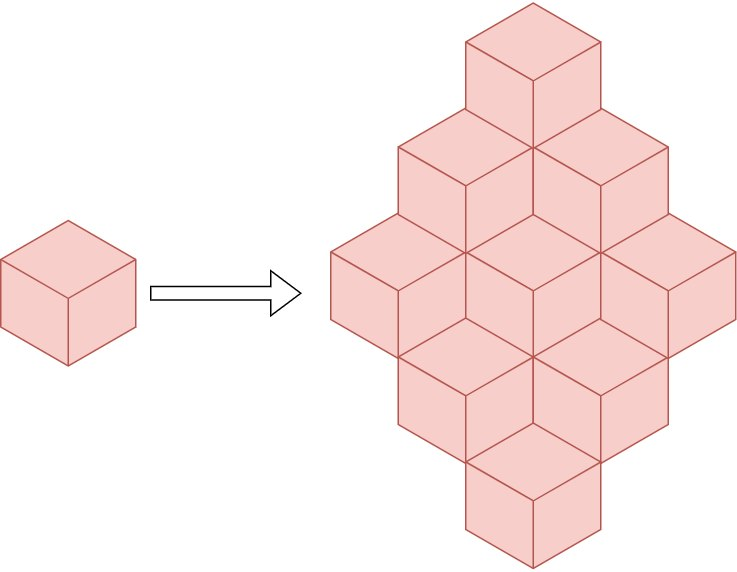
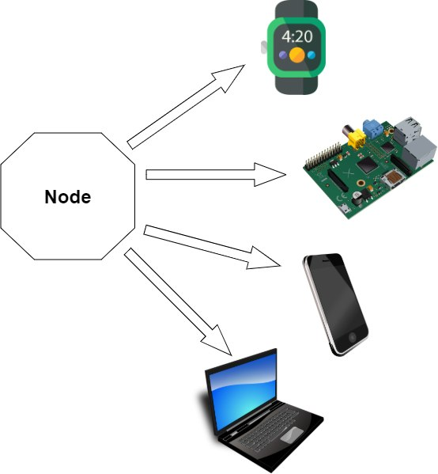
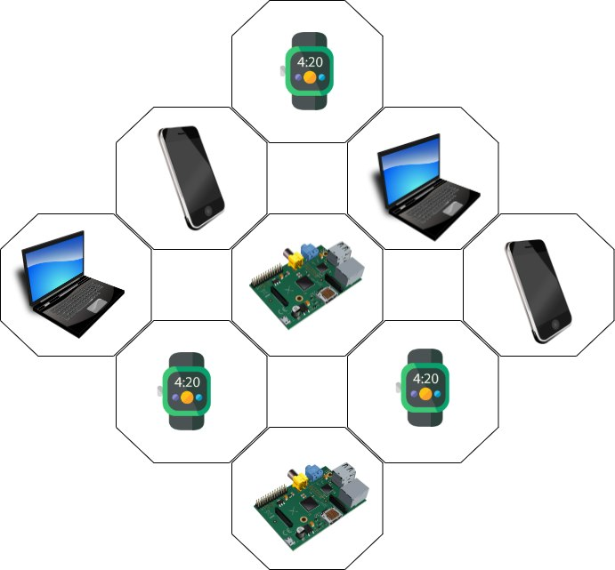
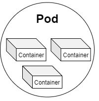
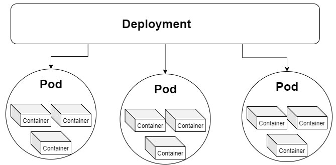
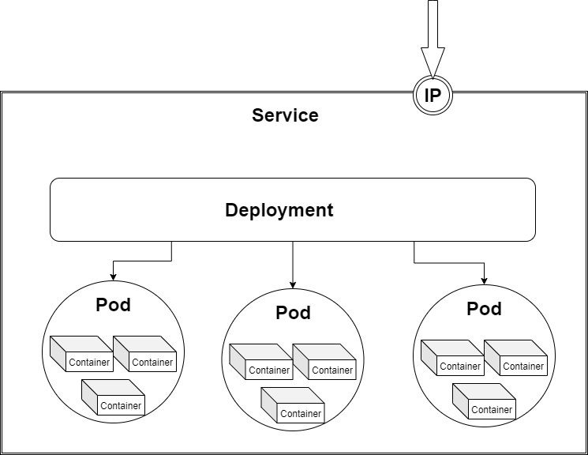
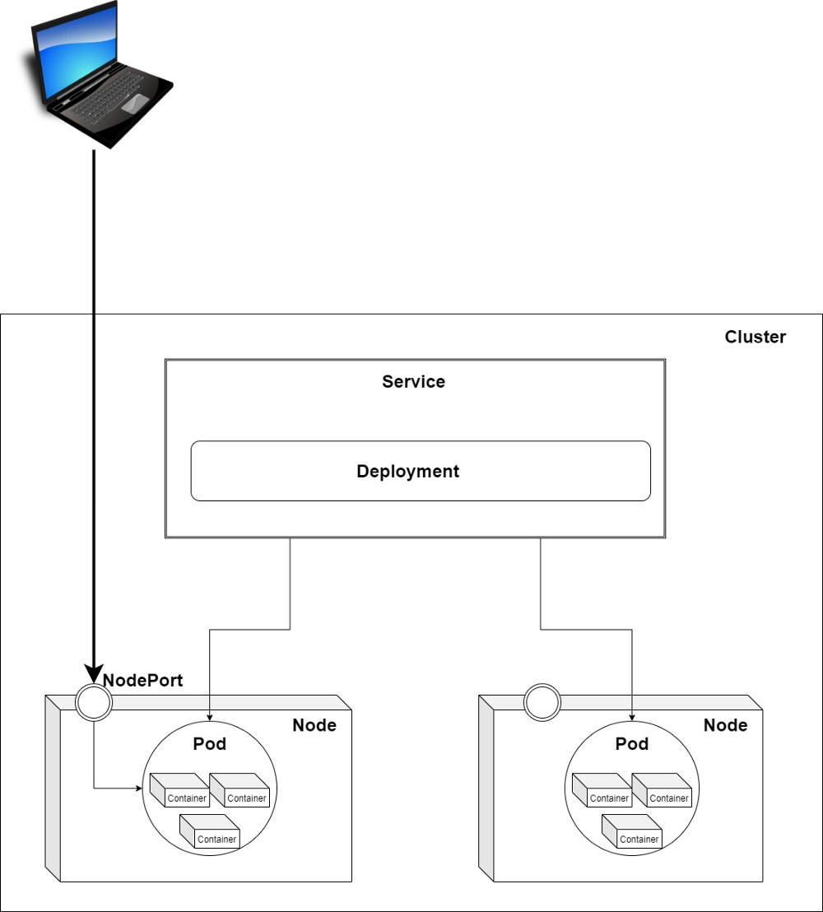
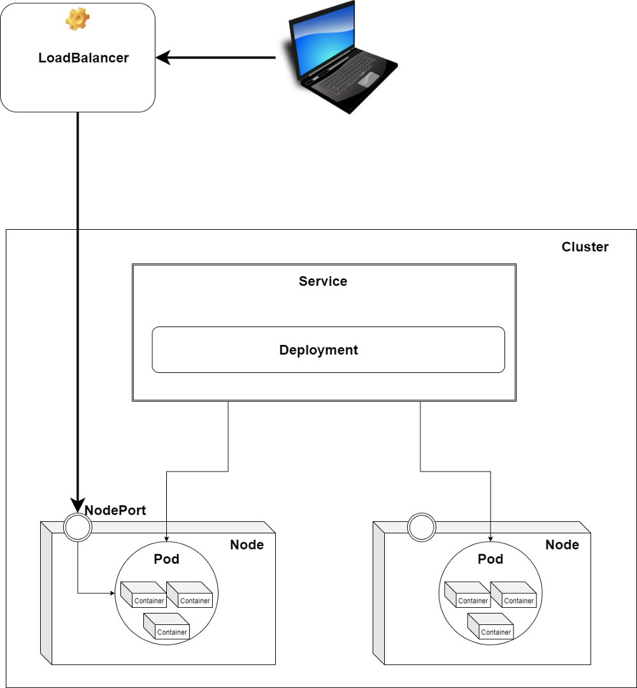
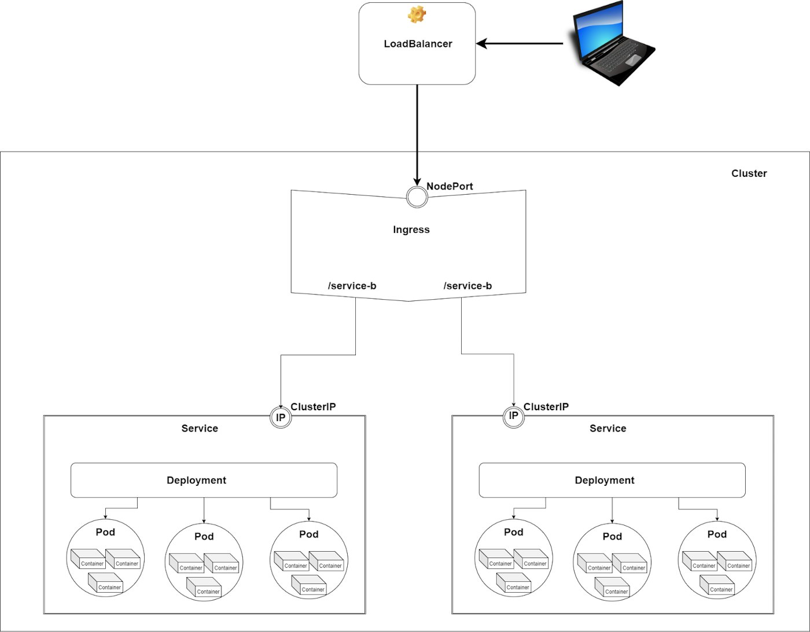

In the era of **Microservices**, **Cloud Computing**and **Serverless**architecture, it's useful to understand **Kubernetes**and learn how to use it. However, the official Kubernetes documentation can be hard to decipher, especially for newcomers. In this blog series, I will present a **simplified view of Kubernetes** and give examples of how to use it for deploying microservices using different cloud providers, including **Azure**, **Amazon**, **Google Cloud** and even **IBM**.
In this first article, we’ll talk about the most important concepts used in Kubernetes. Later in the series, we’ll learn how to **write configuration files**, use [**Helm**](https://helm.sh/docs/topics/charts/)as a package manager, **create a cloud infrastructure,** easily **orchestrate our services** using Kubernetes and create a **CI/CD pipeline**to automate the whole workflow. With this information, you can spin up any kind of project and create a solid infrastructure/architecture.
First, I'd like to mention that containers have multiple benefits, from **increased deployment velocity** to delivery consistency with a **greater horizontal scale**. Even so, you should not use containers for everything because just putting any part of your application in a container comes with **overhead, like maintaining a container orchestration layer**. So, don’t jump to conclusions. Instead, create a cost/benefit analysis at the start of the project.
Now, let's start our journey in the world of Kubernetes.

## Kubernetes Hardware Structure

### Nodes

[**Nodes**](https://kubernetes.io/docs/concepts/architecture/nodes/)are worker machines in Kubernetes, which can be any device with CPU and RAM. For example, a node can be anything, from a smartwatch, smartphone, or laptop to a Raspberry Pi. A node is a virtual machine (VM) when we work with cloud providers. So, a node is an abstraction over a single device.
As you will see in the next articles, the beauty of this abstraction is that we don’t need to know the underlying hardware structure. We will use nodes; this way, our infrastructure is platform-independent.

#### Cluster

A [**cluster**](https://www.redhat.com/en/topics/containers/what-is-a-kubernetes-cluster)is **a group of nodes**. When you deploy programs onto the cluster, it automatically handles the distribution of work to the individual nodes. If more resources are required (for example, we need more memory), new nodes can be added to the cluster, and the work will be redistributed automatically.
We run our code on a cluster and shouldn't care about which node. The distribution of the work is automatic.

#### Persistent Volumes

Because our code can be relocated from one node to another (for example, a node doesn’t have enough memory, so the work is rescheduled on a different node with enough memory), **data saved on a node is volatile**. But there are cases when we want to save our data persistently. In this case, we should use [**Persistent Volumes**](https://kubernetes.io/docs/concepts/storage/persistent-volumes/). A persistent volume is like an **external hard drive**; you can plug it in and save your data on it.
Google developed Kubernetes as a **platform for stateless applications** with persistent data stored elsewhere. As the project matured, many organizations wanted to leverage it for their stateful applications, so the developers added persistent volume management. Much like the early days of virtualization, database servers are not typically the first group of servers to move into this new architecture. That's because the database is the core of many applications and may contain valuable information, so on-premises database systems still largely run in VMs or physical servers.
So, the question is, *when should we use Persistent Volumes?* First, we should understand the different types of database applications to answer that question.
We can classify the data management solutions into two classes:

1. **Vertically scalable** — includes traditional RDMS solutions such as MySQL, PostgreSQL and SQL Server
2. **Horizontally scalable** — includes “NoSQL” solutions such as ElasticSearch or Hadoop-based solutions

**Vertical scalable** solutions like MySQL, Postgres and Microsoft SQL **should not go in containers**. These database platforms require high I/O, shared disks, block storage, etc., and do not (by design) handle the loss of a node in a cluster gracefully, which often happens in a container-based ecosystem.
Use containers for horizontally scalable applications (Elastic, Cassandra, Kafka, etc.)**.** They can withstand the loss of a node in the database cluster, and the database application can independently rebalance.
Usually, **you can and should containerize distributed databases that use redundant storage techniques and can withstand a node's loss** in the database cluster ([*ElasticSearch*](https://www.elastic.co/elasticsearch/) is a good example).

## Kubernetes Software Components

### Container

One of the goals of modern software development is to keep applications on the same host or cluster **isolated**. *Virtual machines* are one solution to this problem*.*But virtual machines require their own OS, so they are typically gigabytes in size.
[**Containers**](https://www.docker.com/resources/what-container), by contrast, isolate application execution environments from one another but share the underlying OS kernel. So, a container is like a box where we store everything needed to run an application: code, runtime, system tools, system libraries, settings, etc. They’re typically measured in megabytes, use far fewer resources than VMs and start up almost immediately.

### Pods

A [**pod**](https://kubernetes.io/docs/concepts/workloads/pods/pod/)is **a group of containers**. In Kubernetes, the **smallest unit of work** is a pod. A pod can contain multiple containers, but usually, we use one container per pod because the **replication unit in Kubernetes is the pod**. If we want to scale each container independently, we add one container in a pod.

### Deployments

The primary role of [**deployment**](https://kubernetes.io/docs/concepts/workloads/controllers/deployment/) is to provide declarative updates to both the pod and the ReplicaSet (a set in which the same pod is replicated multiple times). Using the deployment, we can specify **how many replicas of the same pod should be running at any time**. The deployment is like a manager for the pods; it automatically spins up the number of pods requested, monitors the pods and recreates them in case of failure. Deployments are helpful because you don’t have to create and manage each pod separately.

We usually use deployments for stateless applications. However, you can save the deployment state by attaching a Persistent Volume to it and make it stateful.

### Stateful Sets

[**StatefulSet**](https://kubernetes.io/docs/concepts/workloads/controllers/statefulset/)is a new concept in Kubernetes, and it is a resource used to manage stateful applications. It manages the deployment and scaling of a set of pods and guarantees these pods' ordering and uniqueness. It is similar to deployment; the only difference is that the deployment creates a set of pods with random pod names and the order of the pods is not important, while the StatefulSet creates pods with a unique naming convention and order. So, if you want to create three replicas of a pod called *example*, the StatefulSet will create pods with the following names: *example-0, example-1, example-2.*In this case, the most important benefit is that you can rely on the name of the pods.

### DaemonSets

A [**DaemonSet**](https://kubernetes.io/docs/concepts/workloads/controllers/daemonset/)ensures that the pod runs on all the cluster nodes. If a node is added/removed from a cluster, DaemonSet automatically adds/deletes the pod. This is useful for **monitoring**and **logging** because you can monitor every node without having to manually monitor the cluster.

### Services

While deployment is responsible for keeping a set of pods running, the [**service**](https://kubernetes.io/docs/concepts/services-networking/service/)is **responsible for enabling network access to a set of pods**. Services provide standardized features across the cluster: load balancing, service discovery between applications and zero-downtime application deployments. Each service has a unique IP address and a DNS hostname. Applications that consume a service can be manually configured to use either the IP address or the hostname and the traffic will be load balanced to the correct pods. In the ***External Traffic*** section, we will learn more about the service types and how we can communicate between our internal services and the external world.

### ConfigMaps

If you want to **deploy to multiple environments**, like staging, dev and prod, it’s a bad practice to bake the configs into the application because of environmental differences. Ideally, you’ll want to **separate configurations**to match the deploy environment. This is where [**ConfigMap**](https://kubernetes.io/docs/concepts/configuration/configmap/)comes into play. **ConfigMaps allow you to decouple configuration artifacts from image content** to keep containerized applications portable.

## External Traffic

Now that you’ve got the services running in your cluster, *how do you get external traffic into your cluster?* There are three different service types for handling external traffic: **ClusterIP**, **NodePort**and **LoadBalancer**. The 4th solution is adding another abstraction layer, called **Ingress Controller**.

### ClusterIP

ClusterIP is the default service type in Kubernetes and lets you **communicate with other services inside your cluster**. While ClusterIP is **not meant for external access**, with a little hack using a proxy, external traffic can hit our service. Don’t use this solution in production, but only for debugging. **Services declared as**[**ClusterIP**](https://kubernetes.io/docs/concepts/services-networking/service/)**should NOT be directly visible from the outside.**

### NodePort

As we saw in the first part of this article, pods are running on nodes. Nodes can be different devices, like laptops or virtual machines (when working in the cloud). Each node has a fixed IP address. By declaring a service as [**NodePort**](https://kubernetes.io/docs/concepts/services-networking/service/), the service will expose the **node’s IP address** so that you can access it from the outside. You can use NodePort in production, but for large applications, where you have many services, manually managing all the different IP addresses can be cumbersome.

### LoadBalancer

Declaring a service of type [**LoadBalancer**](https://kubernetes.io/docs/concepts/services-networking/)exposes it externally **using a cloud provider’s load balancer**. How the external load balancer routes traffic to the Service pods depends on the cluster provider. With this solution, you don’t have to manage all the IP addresses of every cluster node, but you will have one load balancer per service. The downside is that every service has a separate load balancer and you will be billed per load balancer instance.

This solution is good for production but can be a bit expensive. Let's look at a less expensive solution.

### Ingress

[**Ingress**](https://matthewpalmer.net/kubernetes-app-developer/articles/kubernetes-ingress-guide-nginx-example.html)is not a service but an API object that manages external access to a cluster's services. It **acts as a**[**reverse proxy**](https://www.youtube.com/watch?v=ozhe__GdWC8)**and single entry-point to your cluster that routes the request to different services**. I usually use [**NGINX Ingress Controller**](https://www.digitalocean.com/community/tutorials/how-to-set-up-an-nginx-ingress-on-digitalocean-kubernetes-using-helm), which takes on reverse proxy while also functioning as SSL. The best production-ready solution to expose the ingress is to use a load balancer.
With this solution, you can expose any number of services using a single load balancer to keep your bills as low as possible.

## Next Steps

In this article, we learned about the **basic concepts used in Kubernetes** and its **hardware structure.** We also discussed the different software components including **Pods**, **Deployments**, **StatefulSets** and **Services,** and saw how to **communicate between services and with the outside world**.
In the**next article,**we’ll set up**a cluster on Azure** and create an infrastructure with **a LoadBalancer**, **an** **Ingress Controller and** **two Services** and use **two Deployments** to spin up **three Pods** per Service.
There is another ongoing **“Stupid Simple AI”** series. Find the first two articles here: [**SVM and Kernel SVM**](https://towardsdatascience.com/svm-and-kernel-svm-fed02bef1200)**and**[**KNN in Python**](https://towardsdatascience.com/knn-in-python-835643e2fb53).
Thank you for reading this article!
