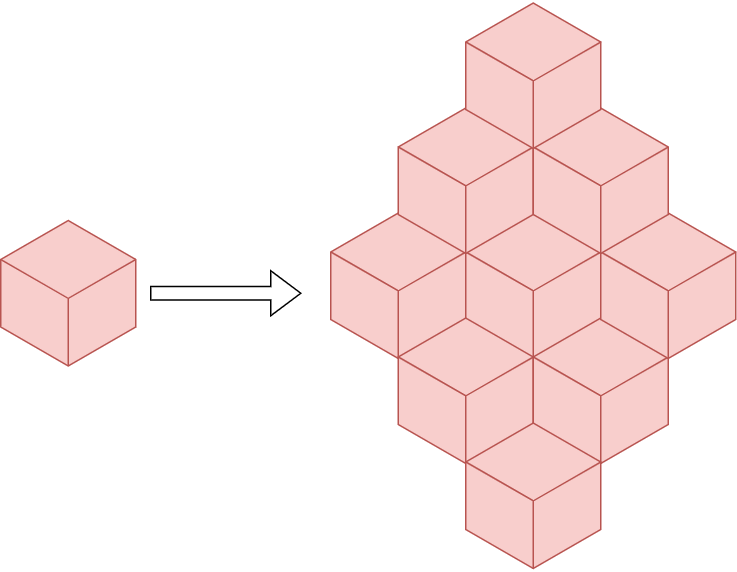
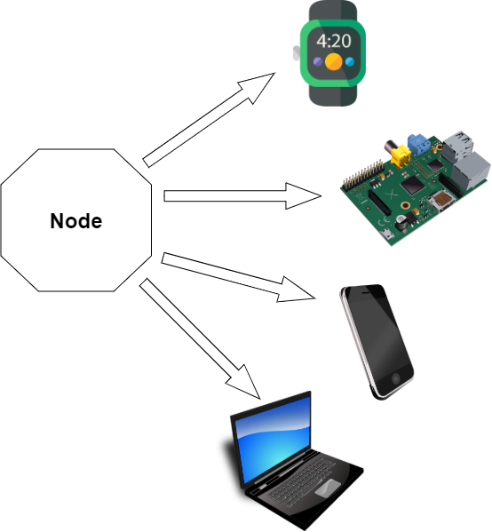
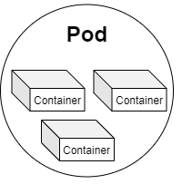
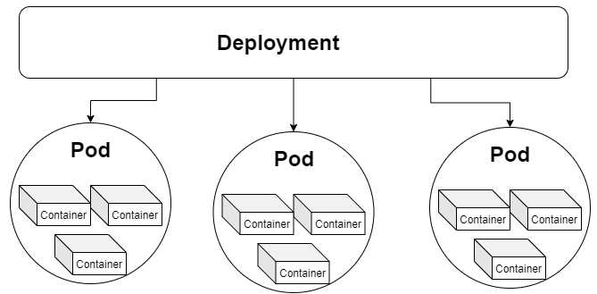
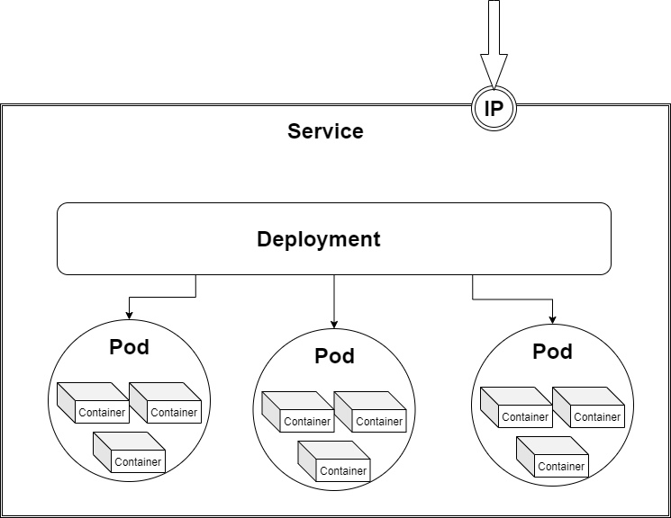
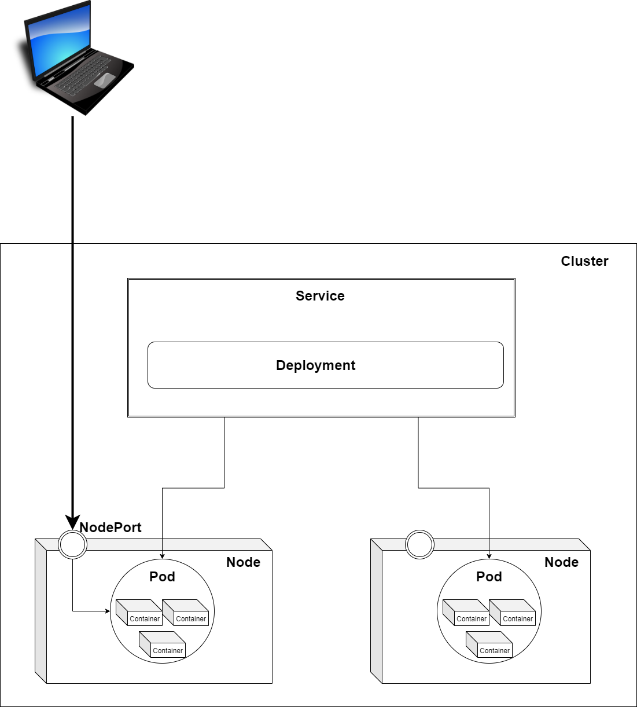
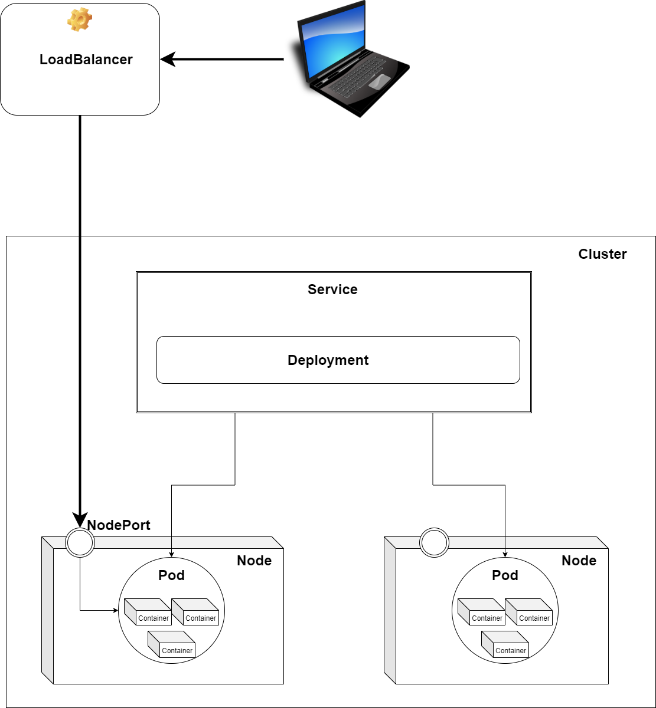
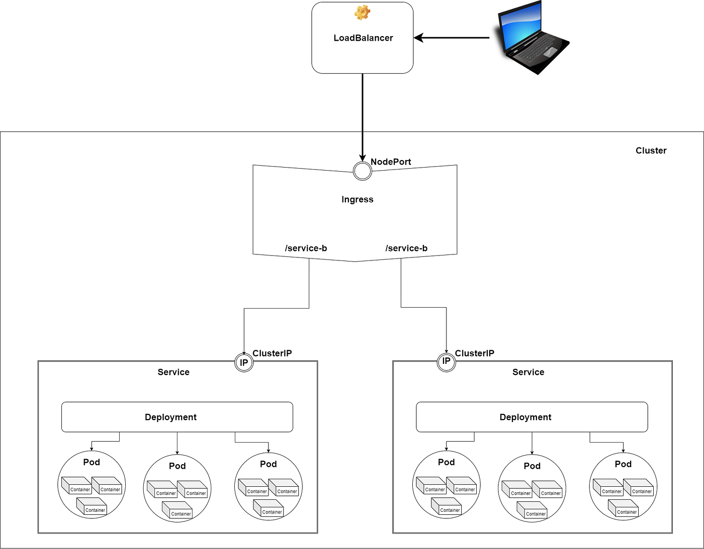

## Everything you need to know for starting a project using Kubernetes

In the era of **Microservices**, **Cloud Computing,**and **Serverless**architecture, it is very useful to understand **Kubernetes**and learn how to use it. However, the official documentation of Kubernetes can be hard to decipher, especially for newcomers. In the following series of articles, I will try to present a **simplified view of Kubernetes** and give examples of how to use it for deploying microservices using different cloud providers like **Azure**, **Amazon**, **Google Cloud,** and even **IBM**.

In this first article of the series, we will talk about the most important concepts used in Kubernetes. In the following article, we will learn how to **write configuration files**, use Helm as a package manager, **create a cloud infrastructure,** and easily **orchestrate our services** using Kubernetes. In the last article, we will create a **CI/CD pipeline**to automate the whole workflow. You can spin up any project and create a solid infrastructure/architecture with this information.

Before starting, I would like to mention that containers have multiple benefits, from increased deployment velocity to the **consistency of delivery** with a **greater horizontal scale**. Even so, you should not use containers for everything because just putting any part of your application in a container comes with **overhead like maintaining a container orchestration layer**. So don’t jump to conclusions; instead, at the start of the project, please create a cost/benefit analysis.

Now, let's start our journey in the world of Kubernetes!

# Hardware

## Nodes

[**Nodes**](https://kubernetes.io/docs/concepts/architecture/nodes/)are worker machines in Kubernetes, which can be any device with CPU and RAM. For example, a node can be anything, from smartwatches to smartphones, laptops, or even a RaspberryPi. When we work with cloud providers, a node is a *virtual machine*. So a node is an abstraction over a single device.

As you will see in the next articles, the beauty of this abstraction is that we don’t need to know the underlying hardware structure; we will use nodes, so our infrastructure will be platform-independent.

Node

## Cluster

A [**cluster**](https://www.redhat.com/en/topics/containers/what-is-a-kubernetes-cluster)is **a group of nodes**. When you deploy programs onto the cluster, it automatically handles the distribution of work to the individual nodes. If more resources are required (for example we need more memory), new nodes can be added to the cluster, and the work will be redistributed automatically.

We run our code on a cluster, and we shouldn't care about which node; the work distribution will be automatically handled.

Cluster

## Persistent Volumes

Because our code can be relocated from one node to another (for example a node doesn’t have enough memory so that the work will be rescheduled on a different node with enough memory), **data saved on a node is volatile**. But there are cases when we want to save our data persistently. In this case, we should use [**Persistent Volumes**](https://kubernetes.io/docs/concepts/storage/persistent-volumes/). A persistent volume is like an **external hard drive**, you can plug it in and save your data on it.

Kubernetes was originally developed as a **platform for stateless applications** with persistent data stored elsewhere. As the project matured, many organizations also wanted to begin leveraging it for their stateful applications, so persistent volume management was added. Much like the early days of virtualization, database servers are not typically the first group of servers to move into this new architecture. The reason is that the database is the core of many applications and may contain valuable information so on-premises database systems still largely run in VMs or physical servers.

So the question is, *when should we use Persistent Volumes?* First, we should understand the different types of database applications to answer that question.

We can classify the data management solutions into two classes:

1. **Vertically scalable** — includes traditional RDMS solutions such as MySQL, PostgreSQL, and SQL Server.
2. **Horizontally scalable** — includes “NoSQL” solutions such as ElasticSearch or Hadoop-based solutions.

**Vertical scalable** solutions like MySQL, Postgres, Microsoft SQL, etc., **should not go in containers**. These database platforms require high I/O, shared disks, block storage, etc., and were not designed to handle the loss of a node in a cluster gracefully, which often happens in a container-based ecosystem.

For **horizontally scalable** applications (Elastic, Cassandra, Kafka, etc.), **containers should be used** because they can withstand the loss of a node in the database cluster and the database application can independently re-balance.

Usually, **you can and should containerize distributed databases that use redundant storage techniques and withstand the loss of a node** in the database cluster ([*ElasticSearch*](https://www.elastic.co/elasticsearch/) is a really good example).

# Software

## Container

One of the goals of modern software development is to keep applications on the same host or cluster **isolated**from one another. One solution to this problem has been *virtual machines.*But virtual machines require their own OS, so they are typically gigabytes in size.

[**Containers**](https://www.docker.com/resources/what-container), by contrast, isolate applications’ execution environments from one another but share the underlying OS kernel. So a container is like a box in which we store everything needed to run an application, like code, runtime, system tools, system libraries, and settings. They’re typically measured in megabytes, use far fewer resources than VMs, and start up almost immediately.

## Pods

A [**pod**](https://kubernetes.io/docs/concepts/workloads/pods/pod/)is **a group of containers**. In Kubernetes, the **smallest unit of work** is a pod. A pod can contain multiple containers, but usually, we use one container per pod because the **replication unit in Kubernetes is the pod**. So if we want to scale each container independently, we add one container in a pod.

## Deployments

The main role of [**deployment**](https://kubernetes.io/docs/concepts/workloads/controllers/deployment/) is to provide declarative updates to both the pod and the Replica Set (a set in which the same pod is replicated multiple times). Using the deployment, we can specify **how many replicas of the same pod should be running at any time**. The deployment is like a manager for the pods, it will automatically spin up the number of pods requested, it will monitor the pods, and re-create the pods in case of failure. Deployments are really helpful because you don’t have to create and manage each pod separately.

Deployments are usually used for stateless applications. However, you can save the deployment state by attaching a Persistent Volume to it and making it stateful.

## Stateful Sets

[**StatefulSet**](https://kubernetes.io/docs/concepts/workloads/controllers/statefulset/)is a new concept in Kubernetes, and it is a resource used to manage stateful applications. It manages the deployment and scaling of pods and guarantees these pods' ordering and uniqueness. It is similar to Deployment, the only difference is that the Deployment creates a set of pods with random pod names and the order of the pods is not important, while the StatefulSet creates pods with a unique naming convention and order. So if you want to create three replicas of a pod called *example*, the StatefulSet will create pods with the following names: *example-0, example-1, example-2.*In this case, the most important benefit is that you can rely on the name of the pods.

## Daemon Sets

A [**DaemonSet**](https://kubernetes.io/docs/concepts/workloads/controllers/daemonset/)ensures that the pod runs on all the node clusters. If a node is added/removed from a cluster, DaemonSet automatically adds/deletes the pod. This is useful for **monitoring**and **logging** because this way you can be sure that all the time you are monitoring every node and don’t have to manually manage the monitoring of the cluster.

## Services

While deployment is responsible for keeping a set of pods running, the [**service**](https://kubernetes.io/docs/concepts/services-networking/service/)enables**network access to a set of pods**. Services provide important features that are standardized across the cluster: load-balancing, service discovery between applications, and features to support zero-downtime application deployments. Each service has a unique IP address and a DNS hostname. Applications that consume a service can be manually configured to use either the IP address or the hostname, and the traffic will be load-balanced to the correct pods. In the ***External Traffic*** section, we will learn more about the service types and how we can use them to communicate between our internal services and with the external world.

## ConfigMaps

If you want to **deploy to multiple environments**, like staging, dev, and prod, it’s a bad practice to bake the configs into the application because of environmental differences. Ideally, you’ll want to **separate configurations**to match the deploy environment. This is where [**ConfigMap**](https://kubernetes.io/docs/concepts/configuration/configmap/)comes into play. **ConfigMaps allow you to decouple configuration artifacts from image content** to keep containerized applications portable.

# External Traffic

So you have all the services running in your cluster, but now the question is *how to get external traffic into your cluster?* Three different service types can be used for handling external traffic: ClusterIP, **NodePort,**and **LoadBalancer**. The 4th solution is adding another abstraction layer called **Ingress Controller**.

## ClusterIP

This is the default service type in Kubernetes and allows you to **communicate with other services inside your cluster**. This is **not meant for external access**, but with a little hack, by using a proxy, external traffic can hit our service. Don’t use this solution in production, but only for debugging. **Services declared as**[**ClusterIP**](https://kubernetes.io/docs/concepts/services-networking/service/)**should NOT be directly visible from the outside.**

## NodePort

As we saw in the first part of this article, pods are running on nodes. Nodes can be different devices, like a laptop, or can be a virtual machine (when working in the cloud). Each node has a fixed IP address. By declaring a service as [**NodePort**](https://kubernetes.io/docs/concepts/services-networking/service/), the service will expose the **node’s IP address so that** you can access it from the outside. This can be used in production, but manually managing all the different IP addresses can be cumbersome for large applications where you have many services.

## LoadBalancer

Declaring a service of type [**LoadBalancer**](https://kubernetes.io/docs/concepts/services-networking/)exposes it externally **using a cloud provider’s load balancer**. How the traffic from that external load balancer is routed to the Service pods depends on the cluster provider. This is a really good solution, you don’t have to manage all the IP addresses of every node of the cluster, but you will have one load balancer per service. The downside is that every service will have a separate load balancer and you will be billed per load balancer instance.

This solution is good for production, but it can be a bit expensive. So let's see a cheaper solution.

## Ingress

[**Ingress**](https://matthewpalmer.net/kubernetes-app-developer/articles/kubernetes-ingress-guide-nginx-example.html)is not a service but an API object that manages external access to the services in a cluster. It **acts as a**[**reverse proxy**](https://www.youtube.com/watch?v=ozhe__GdWC8) **and single entry point to your cluster that routes requests to different services**. I usually use [**NGINX Ingress Controller**](https://www.digitalocean.com/community/tutorials/how-to-set-up-an-nginx-ingress-on-digitalocean-kubernetes-using-helm), which takes on the role of reverse proxy while also functioning as SSL. The best production-ready solution is to expose the ingress by using a load balancer.

With this solution you can expose any number of services using a single load balancer, keeping your bills as low as possible.

# Next Steps

In this article, we learned about the **basic concepts used in Kubernetes**, its hardware structure, and the different software components like **Pods**, **Deployments**, **StatefulSets**, and **Services** and saw how to **communicate between services and with the outside world**.

In the[**next article**](https://levelup.gitconnected.com/stupid-simple-kubernetes-deploying-microservices-on-azure-part-1-9ee230bdbb6f)**,**we will set up **a Azure cluster, create an infrastructure with a LoadBalancer, an Ingress Controller, and two Services,** and use **two Deployments** to spin up **three Pods** per Service.

If you want more **“Stupid Simple”** explanations, please **follow me on Medium**!

There is another ongoing **“Stupid Simple AI”** series. The first two articles can be found here: [**SVM and Kernel SVM**](https://towardsdatascience.com/svm-and-kernel-svm-fed02bef1200)**and**[**KNN in Python**](https://towardsdatascience.com/knn-in-python-835643e2fb53).
