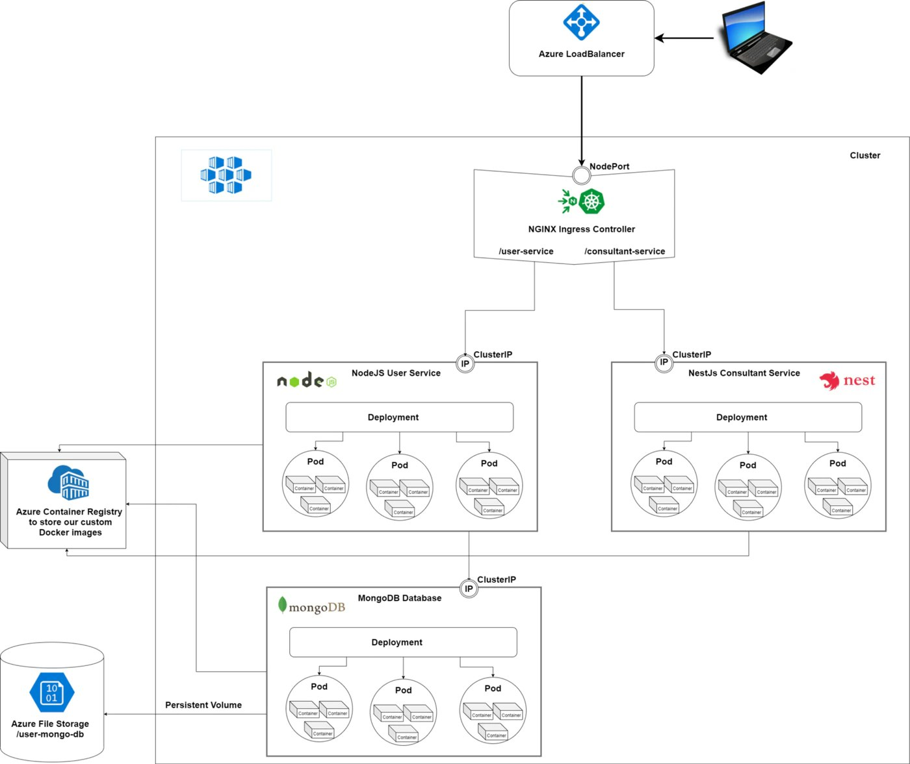
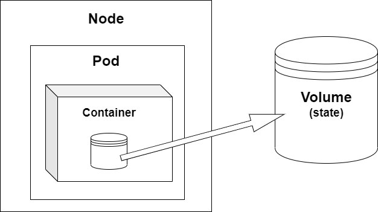
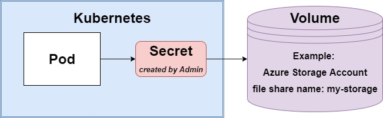
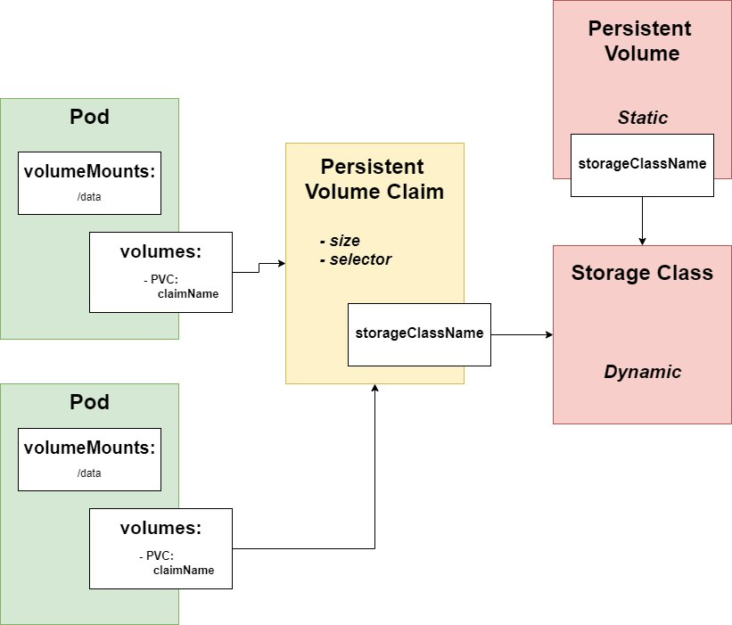
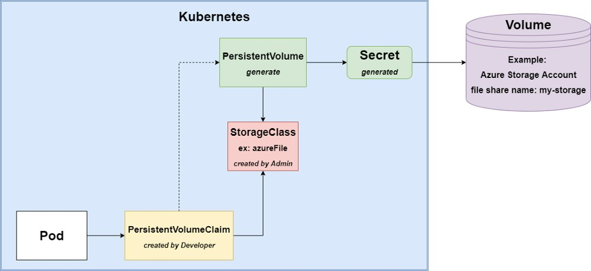
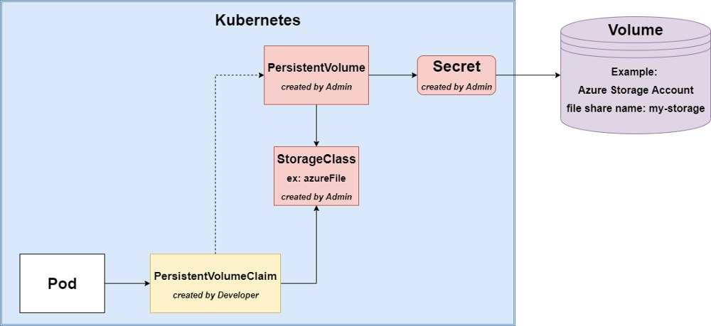

Welcome back to our series, where we introduce you to the basic concepts of Kubernetes. In the [**first article**](https://community.suse.com/posts/13950530?utm_source=manual),we provided a brief introduction to **Persistent Volumes.** Today we will learn how to set up data persistence and will write Kubernetes scripts to connect our Pods to a Persistent Volume. In this example, we will use **Azure File Storage** to store the data from our **MongoDB**database, but you can use any volume to achieve to same results (such as [Azure Disk](https://kubernetes.io/docs/concepts/storage/volumes/#azuredisk), [GCE Persistent Disk](https://kubernetes.io/docs/concepts/storage/volumes/#gcepersistentdisk), [AWS Elastic Block Store](https://kubernetes.io/docs/concepts/storage/volumes/#awselasticblockstore), etc.).

If you want to follow along, it is a good idea to read my [**previous article**](https://community.suse.com/posts/stupid-simple-kubernetes-deployments-services-and-ingresses-explained) first.

[](https://community.suse.com/posts/stupid-simple-kubernetes-deployments-services-and-ingresses-explained)

**NOTE:** the scripts provided are **platform agnostic**, so you can follow the tutorial using other cloud providers or a local cluster with [**K3s**](https://k3s.io/)**.**I suggest using **K3s** because it is very lightweight, packed in a single binary with a size less than 40MB. It is also a highly available, certified Kubernetes distribution designed for production workloads in resource-constrained environments. For more information, please take a look at its well-written and easy-to-follow [**documentation**](https://rancher.com/docs/k3s/latest/en/).

## Requirements

Before starting this tutorial, please make sure that you have installed [**Docker**](https://docs.docker.com/get-docker/). [**Kubectl**](https://kubernetes.io/docs/reference/kubectl/kubectl/)will install with Docker (if not, please install it from [here](https://kubernetes.io/docs/tasks/tools/install-kubectl/#install-kubectl-on-windows)).

The Kubectl commands used throughout this tutorial can be found in the [**Kubectl Cheat Sheet**](https://kubernetes.io/docs/reference/kubectl/cheatsheet/).

Through this tutorial, we will use [**Visual Studio Code**](https://code.visualstudio.com/), but this is not mandatory.

## What Problem Does Kubernetes Volume Solve?



Remember that we have a **Node**(an actual hardware device or a virtual machine); inside**the Nodes, we have a Pod**(or multiple Pods) and **inside the Pod, we have the Container.** **Pods are ephemeral**, so they can often come and go (they can be deleted, rescheduled, etc.). In this case, if you have data that you must keep even if the Pod goes down you have to **move it outside the Pod**. This way it can exist independently of any Pod. This external place is called **Volume** and it is an **abstraction of a storage system**. Using the Volume, you can persist state across multiple Pods.

## When to Use Persistent Volumes

When containers became popular, they were designed to support stateless workloads with persistent data stored elsewhere. Since then, much effort has been made to support stateful applications in the container ecosystem.

Every project needs data persistency, so you usually need a database to store the data. But **in a clean design, you don’t want to depend on concrete implementations;** you want to write an application as reusable and platform-independent as possible.

There has always been a need to hide the details of storage implementation from the applications. But now, in the era of cloud-native applications, cloud providers create environments where applications or users who want to access the data need to integrate with a specific storage system. For example, many applications directly use specific storage systems like Amazon S3, Azure File or Blog storage, etc., creating an unhealthy dependency. Kubernetes is trying to change this by creating an **abstraction called Persistent Volume,** which allows cloud-native applications to connect to many cloud storage systems without creating an explicit dependency on those systems. This can make cloud storage consumption much more seamless and eliminate integration costs. It can also make migrating between clouds and adopting multi-cloud strategies much easier.

Even if sometimes, because of material constraints like money, time or manpower (which are closely related) you have to make some compromises and directly couple your app with a specific platform or provider, you should try to avoid as many direct dependencies as possible. One way of decoupling your application from the actual database implementation (there are other solutions, but those solutions require more effort) is by **using containers**(and Persistent Volumes to prevent data loss). This way, **your app will rely on abstraction instead of a specific implementation**.

Now the real question is, *should we always use a containerized database with Persistent Volume,* or *what storage system types should NOT be used in containers*?

There is no golden rule of when you should and shouldn't use Persistent Volumes, but as a starting point, you should **have in mind scalability and the handling of the loss of node in the cluster**.

Based on scalability, we can have two types of storage systems:

1. **Vertically scalable** — includes traditional RDMS solutions such as MySQL, PostgreSQL and SQL Server
2. **Horizontally scalable** — includes “NoSQL” solutions such as ElasticSearch or Hadoop-based solution

**Vertically scalable** solutions like MySQL, Postgres, Microsoft SQL, etc. **should NOT go in containers**. These database platforms require high I/O, shared disks, block storage, etc., and were not designed to handle the loss of a node in a cluster gracefully, which often happens in a container-based ecosystem.

For **horizontally scalable** applications (Elastic, Cassandra, Kafka, etc.), you **should use****containers** because they can withstand the loss of a node in the database cluster and the database application can independently re-balance.

Usually, **you can and should containerize distributed databases that use redundant storage techniques and withstand the loss of a node** in the database cluster ([*ElasticSearch*](https://www.elastic.co/elasticsearch/) is a really good example).

## Types of Kubernetes Volumes

We can categorize the Kubernetes Volumes based on their **lifecycle** and **the way they are provisioned**.

Considering the **lifecycle** of the volumes, we can have the following:

1. **Ephemeral Volumes**, which are tightly coupled with the lifetime of the Node (for example [emptyDir](https://kubernetes.io/docs/concepts/storage/volumes/#emptydir), or [hostPath](https://kubernetes.io/docs/concepts/storage/volumes/#hostpath)) and they are deleted if the Node goes down.
2. **Persistent Volumes**, which are meant for long-term storage and are independent of the Pods or Nodes lifecycle. These can be cloud volumes (like [gcePersistentDisk](https://kubernetes.io/docs/concepts/storage/volumes/#gcepersistentdisk), [awsElasticBlockStore](https://kubernetes.io/docs/concepts/storage/volumes/#awselasticblockstore), [azureFile](https://kubernetes.io/docs/concepts/storage/volumes/#azurefile) or [azureDisk](https://kubernetes.io/docs/concepts/storage/volumes/#azuredisk)), [NFS](https://kubernetes.io/docs/concepts/storage/volumes/#nfs) (Network File Systems) or Persistent Volume Claims (a series of abstractions to connect to the underlying cloud-provided storage volumes).

Based on the **way the volumes are provisioned**, we can have:

1. **Direct access**
2. **Static provisioning**
3. **Dynamic provisioning**

### Direct Access Persistent Volumes



In this case, the pod will be **directly coupled with the volume**, so it will know the storage system (for example, the Pod will be coupled with the Azure Storage Account). This solution is **not cloud-agnostic** and depends on a concrete implementation, not**an abstraction.** So if possible, please avoid this solution. The only advantage is that it is easy and fast. Create the Secret in the Pod and specify the Secret and the exact storage type that should be used.

The script for creating a **Secret**is as follows:

```
apiVersion: v1
kind: Secret
metadata:
  name: static-persistence-secret
type: Opaque
data:
  azurestorageaccountname: "base64StorageAccountName"
  azurestorageaccountkey: "base64StorageAccountKey"
```

As in any Kubernetes script, on *line 2* we specify the type of the resource -- in this case, Secret. On *line 4,* we give it a name (we called it static because it is manually created by the Admin and not automatically generated). The *Opaque*type, from Kubernetes’ point of view, means that the content (data) of this Secret is unstructured (it can contain arbitrary key-value pairs). To learn more about Kubernetes Secrets, see the [Secrets design document](https://github.com/kubernetes/community/blob/master/contributors/design-proposals/auth/secrets.md) and [Configure Kubernetes Secrets](https://kubernetes.io/docs/concepts/configuration/secret/).

In the data section, we have to specify the account name (in Azure, it is the name of the Storage Account) and the access key (in Azure, select the Storage Account under Settings, Access key). Don’t forget that both should be **encoded using Base64**.

The next step is to modify our **Deployment**script to use the Volume (in this case the volume is the Azure File Storage).

```
apiVersion: apps/v1
kind: Deployment
metadata:
  name: user-db-deployment
spec:
  selector:
    matchLabels:
      app: user-db-app
  replicas: 1
  template:
    metadata:
      labels:
        app: user-db-app
    spec:
      containers:
        - name: mongo
          image: mongo:3.6.4
          command:
            - mongod
            - "--bind_ip_all"
            - "--directoryperdb"
          ports:
            - containerPort: 27017
          volumeMounts:
            - name: data
              mountPath: /data/db
          resources:
            limits:
              memory: "256Mi"
              cpu: "500m"
      volumes:
        - name: data
          azureFile:
            secretName: static-persistence-secret
            shareName: user-mongo-db
            readOnly: false
```

As you can see, the only difference is that *from line 32* we specify the used volume, give it a name and specify the exact details of the underlying storage system. The secretName must be the name of the previously created Secret.

### Kubernetes Storage Class

To understand the **Static**or **Dynamic provisioning**, first we have to understand the **Kubernetes Storage Class**.

With **StorageClass**, administrators can offer **Profiles**or “**classes**” regarding the available storage. Different classes might map to quality-of-service levels, or backup policies or arbitrary policies determined by the cluster administrators.

For example, you could have a profile to store data on an HDD named slow-storage or a profile to store data on an SSD named fast-storage. The Provisioner determines the kind of storage. For Azure, there are two kinds of provisioners: **AzureFile**and **AzureDisk**(the difference is that AzureFile can be used with ReadWriteMany access mode, while AzureDisk supports only ReadWriteOnce access, which can be a disadvantage when you want to use multiple pods simultaneously). You can learn more about the different types of StorageClasses [here](https://kubernetes.io/docs/concepts/storage/storage-classes/).

The script for our **StorageClass**:

```
kind: StorageClass
apiVersion: storage.k8s.io/v1
metadata:
  name: azurefilestorage
provisioner: kubernetes.io/azure-file
parameters:
  storageAccount: storageaccountname
reclaimPolicy: Retain
allowVolumeExpansion: true
```

Kubernetes predefines the value for the provisioner property (see [Kubernetes Storage Classes](https://kubernetes.io/docs/concepts/storage/storage-classes/)). The ***Retain***reclaim policy means that after we delete the *PVC*and *PV*, **the actual storage medium is NOT purged**. We can set it to ***Delete***and with this setting, **as soon as a PVC is deleted**, **it also triggers the removal of the corresponding PV along with the actual storage medium** (here the actual storage is the Azure File Storage).

### Persistent Volume and Persistent Volume Claim



Kubernetes has a matching primitive for each of the traditional storage operational activities (provisioning/configuring/attaching). **Persistent Volume is Provisioning**, **Storage Class is Configuring** and **Persistent Volume Claim is Attaching**.

From the original documentation:

A *PersistentVolume* (PV) is a piece of storage in the cluster that has been provisioned by an administrator or dynamically provisioned using [Storage Classes](https://kubernetes.io/docs/concepts/storage/storage-classes/).

A *PersistentVolumeClaim* (PVC) is a request for storage by a user. It is similar to a Pod. Pods consume node resources and PVCs consume PV resources. Pods can request specific levels of resources (CPU and memory). Claims can request specific sizes and access modes (e.g., they can be mounted once read/write or many times read-only).

This means that the **Admin**will create the **Persistent Volume** to specify the type of storage that can be used by the Pods, the size of the storage, and the access mode. The **Developer**will create a **Persistent Volume Claim** asking for a piece of volume, access permission and the type of storage. This way there is a clear separation between “Dev” and “Ops.” **Devs**are responsible for **asking for the necessary volume (PVC),** and **Ops** is **responsible for preparing and provisioning the requested volume (PV)**.

The **difference between Static and Dynamic provisioning** is that if **there isn’t a PersistentVolume** and a Secret created manually by the Admin, Kubernetes will try to automatically create these resources.

#### **Dynamic Provisioning**



In this case, **there is NO PersistentVolume and Secret created manually**, so Kubernetes will try to **generate**them. The StorageClass is mandatory, and we will use the one created earlier.

The script for the **PersistentVolumeClaim**can be found below:

```
apiVersion: v1
kind: PersistentVolumeClaim
metadata:
  name: persistent-volume-claim-mongo
spec:
  accessModes:
    - ReadWriteMany
  resources:
    requests:
      storage: 1Gi
  storageClassName: azurefilestorage
```

And our **updated Deployment**script:

```
apiVersion: apps/v1
kind: Deployment
metadata:
  name: user-db-deployment
spec:
  selector:
    matchLabels:
      app: user-db-app
  replicas: 1
  template:
    metadata:
      labels:
        app: user-db-app
    spec:
      containers:
        - name: mongo
          image: mongo:3.6.4
          command:
            - mongod
            - "--bind_ip_all"
            - "--directoryperdb"
          ports:
            - containerPort: 27017
          volumeMounts:
            - name: data
              mountPath: /data/db
          resources:
            limits:
              memory: "256Mi"
              cpu: "500m"
      volumes:
        - name: data
          persistentVolumeClaim:
            claimName: persistent-volume-claim-mongo
```

As you can see, in *line 34*we referenced the previously created PVC by name. In this case, we didn’t create a PersistenVolume or a Secret for it, so it will be created automatically.

The most important **advantage**of this approach is that you **don’t have to manually create the PV and the Secret, and** the Deployment **is cloud agnostic.** The underlying detail of the storage is not present in the Pod’s specs. But there are also some **disadvantages:** you **cannot configure the Storage Account or the File Share** because they are auto-generated and you **cannot reuse the PV or the Secret**-- they will be **regenerated for each new Claim**.

#### Static Provisioning



The only difference between Static and Dynamic provisioning is that **we manually create the PersistentVolume and the Secret**in Static Provisioning. This way we have full control over the resource that will be created in our cluster.

The **PersistentVolume**script is below:

```
apiVersion: v1
kind: PersistentVolume
metadata:
  name: static-persistent-volume-mongo
  labels:
    storage: azurefile
spec:
  capacity:
    storage: 1Gi
  accessModes:
    - ReadWriteMany
  storageClassName: azurefilestorage
  azureFile:
    secretName: static-persistence-secret
    shareName: user-mongo-db
    readOnly: false
```

It is important that in *line 12* we reference the StorageClass by name. Also, in *line 14* we reference the Secret, which is used to access the underlying storage system.

I recommend this solution, even if it requires more work because it is **cloud-agnostic.** It also lets you apply **separation of concerns regarding roles** (Cluster Administrator vs. Developers) and gives you control of **naming and resource creation**.

## Conclusion

In this tutorial, we learned how to **persist data and state using Volumes**. We presented three different ways of setting up your system, **Direct Access**, **Dynamic Provisioning, and Static Provisioning** and discussed the **advantages**and **disadvantages**of each.

In the *next article,* we will talk about **CI/CD pipelines** to automate the deployment of Microservices.

You can learn more about the **basic concepts** used in Kubernetes in [**part one of our series**](https://community.suse.com/posts/13950530?utm_source=manual).

There is another ongoing **“Stupid Simple AI” series**. The first two articles can be found here: [**SVM**](https://towardsdatascience.com/svm-and-kernel-svm-fed02bef1200)**, Kernel SVM,** and [**KNN in Python**](https://towardsdatascience.com/knn-in-python-835643e2fb53).

Thank you for reading this article! Let us know what you think!
