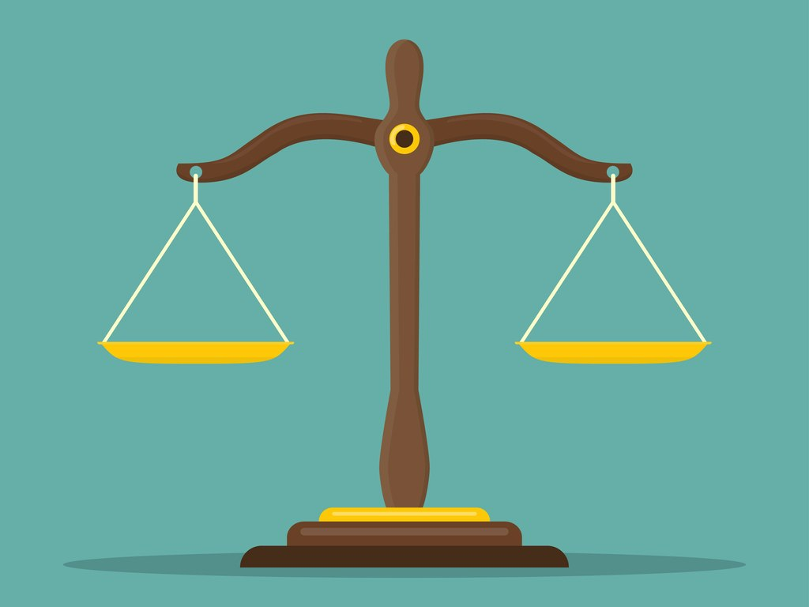
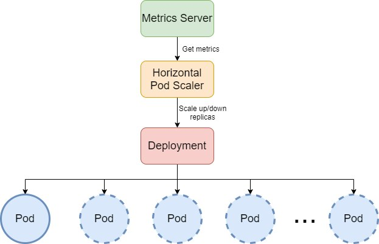
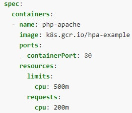
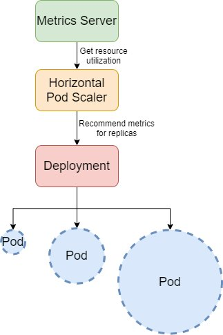
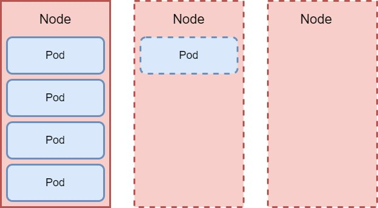

This post will define and explain software scalability in Kubernetesand look at different scalability types. Then we will present three autoscaling methods in Kubernetes: **HPA** (Horizontal Pod Autoscaler), **VPA**(Vertical Pod Autoscaler), and **CA** (Cluster Autoscaler).

##

## **Scalability Explained**

Let's take a real-life example to understand the different concepts in software scalability:
Suppose you've just opened a coffee shop, bought a simple coffee machine that can make three coffees per minute, and hired an employee who serves the clients. 
At first, you have a few clients: everything is going well, and all the people are happy about the coffee and the service because they don't have to wait too long to get their delicious coffee. As time passes, your coffee shop becomes famous in town, and more people buy their coffee from you. But there is a problem. You have only one employee and too many clients, so the waiting time is considerably higher, and people are complaining about your service. The coffee machine could make three coffees per minute, but the employee can handle only one client per minute. You decide to hire two more employees. With this, you've solved the problem for a while. 
After some time, near the coffee shop, the city opens a fun park, so more and more tourists are coming and drinking their coffee in your famous coffee shop. So you decide to hire more people, but the waiting time is almost the same even with more employees. The problem is that your coffee machine can make three coffees per minute, so now your employees are waiting for the coffee machine. The solution is to buy a new coffee machine. Another problem is that the clients buy coffee from employees they already know. As a result, some employees have a lot of work, and others are idle. This is when you decide you need to hire another employee who will greet the clients and redirect them to the employee who is free or has fewer orders to prepare. 
Analyzing your income and expenses, you realize that you have many more clients during the summer than in the winter, so you decide to hire seasonal workers. Now you have three employees working full-time and the other employees are working for you only during the summer. This way, you can increase your income and decrease expenses. Furthermore, you can rent some coffee machines during the summer and give them back during the winter to minimize the costs. This way, you won't have idle coffee machines.
To translate this short story to software scalability in Kubernetes, we can replace the coffee machines with nodes, the employees with pods, the coffee shop is the cluster, and the employee who greets the clients and redirects them is the load balancer. Adding more employees means Horizontal Pod Scaling; adding more coffee machines means Cluster Scaling. Seasonal workers and renting coffee machines only for the summer season means Autoscaling because when the load is higher, we have more pods to serve the clients and more nodes to be used by pods. We have fewer expenses when the load drops (during the winter). In this analogy, Vertical Pod Scaling would hire a more experienced employee who can serve more clients simultaneously (a high-performing employee). The trigger for the Autoscaling would be the season; we scale up during the summer and scale down during the winter.
If you would like to **learn more about nodes, pods, clusters**, etc., please read my article on [**Stupid Simple Kubernetes**](https://community.suse.com/posts/stupid-simple-kubernetes-everything-you-need-to-know-to-start-using-kubernetes).

## **Horizontal Pod Autoscaling (HPA)**


**Horizontal scaling** or **scaling out** means that the number of running pods dynamically increases or decreases as your application usage changes. To know exactly when to increase or decrease the number of replicas, Kubernetes uses triggers based on the observed metrics (average CPU utilization, average memory utilization, or custom metrics defined by the user). [**HPA**](https://kubernetes.io/docs/tasks/run-application/horizontal-pod-autoscale/), a Kubernetes resource, runs in a loop (the loop duration can be configured, by default, it is set to 15 seconds) and fetches the resource metrics from the [**resource metrics API**](https://kubernetes.io/docs/tasks/debug-application-cluster/resource-metrics-pipeline/)for each pod. Using these metrics, it calculates the actual resource utilization values based on the mean values of all the pods and compares them to the metrics defined in the HPA definition. To calculate the desired number of replicas, HPA uses the following formula:

```
desiredReplicas = ceil[currentReplicas*(currentMetricValue/desiredMetricValue)]
```

To understand this formula, let's take the following configuration:

The unit suffix `m` stands for “thousandth of a core,” so this resources object specifies that the container process needs 200/1000 of a core (20%) and is allowed to use, at most, 500/1000 of a core (50 percent).
We can create an HPA that maintains between 1 and 10 replicas with the following command. It will increase or decrease the number of replicas to maintain an average CPU usage of 50 percent, or in this concrete example, 100 milli-cores.

```
kubectl autoscale deployment deployment_name --cpu-percent=50 --min=1 --max=10
```

Suppose that the CPU usage has increased to 210 percent; this means that we will have **nrReplicas = ceil[ 1 \* ( 210 / 50 )] = ceil[4.2] = 5 replicas**.

Now the CPU usage drops to 25 percent when having 5 replicas, so the HPA will decrease the number of replicas to **nrReplicas = ceil[ 5 \* ( 25 / 50 )] = ceil[2.5] = 3 replicas**.

For more examples, read [**Autoscaling in Kubernetes using HPA and VPA**](https://www.velotio.com/engineering-blog/autoscaling-in-kubernetes-using-hpa-vpa)or [**HPA Walkthrough**](https://kubernetes.io/docs/tasks/run-application/horizontal-pod-autoscale-walkthrough/).

When configuring HPA, make sure that:

1. **All pods have resource requests and limits configured** - this will be taken into consideration when HPA takes scaling decisions
2. **Use custom metrics or observed metrics** - external metrics can be a security risk because they can provide access to a large number of metrics
3. **Use HPA together with CA whenever possible**

## **Vertical Pod Autoscaling (VPA)**


**VPA****recommends optimized CPU and memory requests/limits values** (and automatically updates them for you so that the cluster resources are efficiently used).**VPA won’t add more replicas of a Pod, but it increases the memory or CPU limits**. This is useful when adding more replicas won’t help your solution. For example, sometimes you can’t scale a database (read [**Stupid Simple Kubernetes—Persistent Volumes Explained**](https://community.suse.com/posts/stupid-simple-kubernetes-persistent-volumes-explained)) just by adding more Pods. Still, you can make the database handle more connections by increasing the memory or CPU. You can use the VPA when your application serves heavyweight requests requiring higher resources.
HPA can be useful when, for example, your application serves many lightweight (i.e., low resource-consuming) requests. In that case, scaling the number of replicas can distribute the workload on each pod. The VPA, on the other hand, can be useful when your application serves heavyweight requests requiring higher resources. 
**HPA and VPA are incompatible**. Do not use both together for the same set of pods. HPA uses the resource request and limits to trigger scaling, and in the meantime, VPA modifies those limits, so it will be a mess unless you configure the HPA to use either custom or external metrics. Read more about VPA and HPA [**here**](https://www.velotio.com/engineering-blog/autoscaling-in-kubernetes-using-hpa-vpa).

## **Cluster Autoscaling (CA)**


While HPA scales the number of Pods, the **CA changes the number of nodes**. When your cluster runs low on resources, the CA provision a new computation unit (physical or virtual machine) and adds it to the cluster. If too many empty nodes exist, the CA will remove them to reduce costs.
Learn more about Cluster Autoscaling in [**Architecting Kubernetes Clusters—Choosing the Best Autoscaling Strategy**](https://learnk8s.io/kubernetes-autoscaling-strategies).

## **Conclusion**

In the first part of this article, we provided a **real-life example** to explain the different concepts used in **software scalability**. Then we defined and presented the three **scalability methods provided by Kubernetes**, **HPA**(Horizontal Pod Autoscaler), **VPA** (Vertical Pod Autoscaler), and **CA**(Cluster Autoscaler).

## Want to Learn More from our Stupid Simple Series?

Read our eBook: Stupid Simple Kubernetes. Download it [here!](https://more.suse.com/Stupid_Simple_Kubernetes_ebook.html)
[](https://more.suse.com/Stupid_Simple_Kubernetes_ebook.html)
