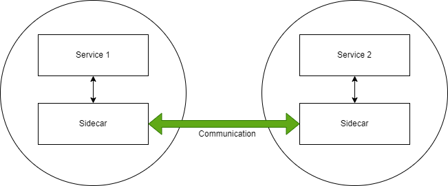
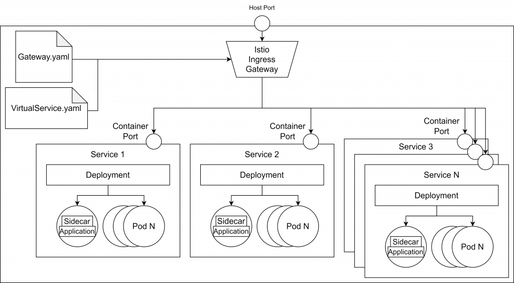
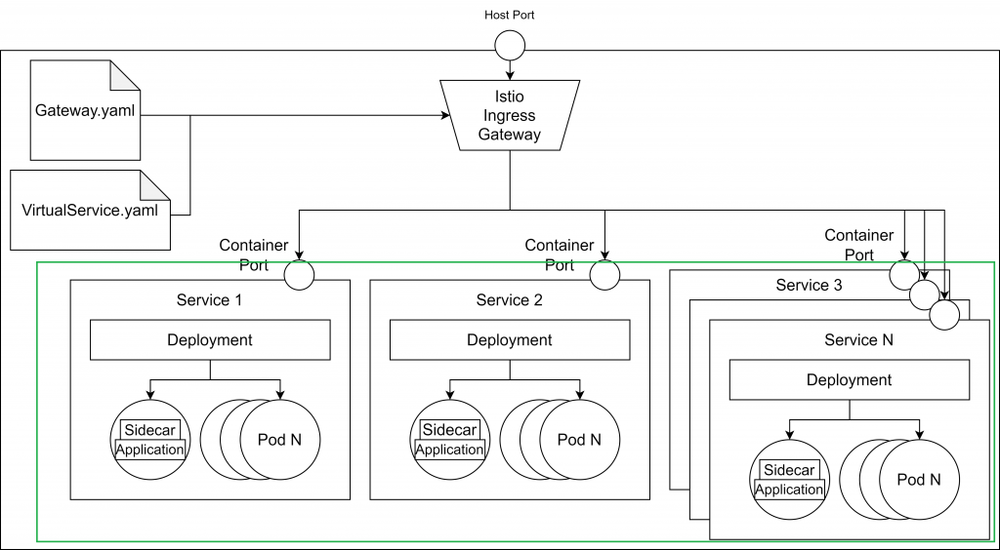

We covered the what, when and why of Service Mesh in a [previous post](https://www.suse.com/c/rancher_blog/stupid-simple-service-mesh-what-when-why/). Now I’d like to talk about why they are critical in Kubernetes. 

To understand the importance of using service meshes when working with microservices-based applications, let's start with a story.  

Suppose that you are working on a big microservices-based banking application, where any mistake can have serious impacts. One day the development team receives a feature request to add a rating functionality to the application. The solution is obvious: create a new microservice that can handle user ratings. Now comes the hard part. The team must come up with a reasonable time estimate to add this new service.  

The team estimates that the rating system can be finished in 4 sprints. The manager is angry. He cannot understand why it is so hard to add a simple rating functionality to the app.  

To understand the estimate, let's understand what we need to do in order to have a functional rating microservice. The CRUD (Create, Read, Update, Delete) part is easy -- just simple coding. But adding this new project to our microservices-based application is not trivial. First, we have to implement authentication and authorization, then we need some kind of tracing to understand what is happening in our application. Because the network is not reliable (unstable connections can result in data loss), we have to think about solutions for retries, circuit breakers, timeouts, etc.  

We also need to think about deployment strategies. Maybe we want to use shadow deployments to test our code in production without impacting the users. Maybe we want to add A/B testing capabilities or canary deployments. So even if we create just a simple microservice, there are lots of cross-cutting concerns that we have to keep in mind.  

Sometimes it is much easier to add new functionality to an existing service than create a new service and add it to our infrastructure. It can take a lot of time to deploy a new service, add authentication and authorization, configure tracing, create CI/CD pipelines, implement retry mechanisms and more. But adding the new feature to an existing service will make the service too big. It will also break the rule of single responsibility, and like many existing microservices projects, it will be transformed into a set of connected macroservices or monoliths. 

We call this the cross-cutting concerns burden -- the fact that in each microservice you must reimplement the cross-cutting concerns, such as authentication, authorization, retry mechanisms and rate limiting. 

What is the solution to this burden? Is there a way to implement all these concerns once and inject them into every microservice, so the development team can focus on producing business value? The answer is [**Istio**](https://istio.io/latest/).  

### **Set Up a****Service Mesh in Kubernetes Using Istio**

Istio solves these issues using **sidecars**, which it automatically injects into your pods. Your services won't communicate directly with each other -- they’ll communicate through sidecars. The sidecars will handle all the cross-cutting concerns. You define the rules once, and these rules will be injected automatically into all of your pods.   



#### **Sample Application**

Let’s put this idea into practice. We’ll build a sample application to explain the basic functionalities and structure of Istio.  

In the previous post, we created a service mesh by hand, using envoy proxies. In this tutorial, we will use the same services, but we will configure our Service Mesh using **Istio**and **Kubernetes**.  

The image below depicts that application architecture.  



1. [**Kubernetes**](https://kubernetes.io/docs/setup/)(we used the 1.21.3 version in this tutorial)

1. [**Helm**](https://helm.sh/docs/intro/install/) (we used the v2)

1. [**Istio**](https://istio.io/latest/news/releases/1.1.x/announcing-1.1.17/) (we used 1.1.17) - [setup tutorial](https://istio.io/latest/docs/setup/getting-started/)

1. [**Minikube**](https://minikube.sigs.k8s.io/docs/start/), [**K3s**](https://k3s.io/) or Kubernetes cluster enabled in Docker

#### **Git Repository**

My [**Stupid Simple Service Mesh in Kubernetes**](https://github.com/CzakoZoltan08/StupidSimpleServiceMeshWithIstioAndKubernetes) repository contains all the scripts for this tutorial. Based on these scripts you can configure any project. 

#### **Running Our Microservices-Based Project Using Istio and Kubernetes**

As I mentioned above, step one is to configure Istio to inject the sidecars into each of your pods from a namespace. We will use the default namespace. This can be done using the following command: 

```
kubectl label namespace default istio-injection=enabled 
```

In the second step, we navigate into the*/kubernetes* folder from the downloaded repository, and we apply the configuration files for our services: 

```
kubectl apply -f service1.yaml 
kubectl apply -f service2.yaml 
kubectl apply -f service3.yaml 
```

After these steps, we will have the green part up and running: 

 

For now, we can’t access our services from the browser. In the next step, we will configure the **Istio Ingress and Gateway**, allowing traffic from the exterior. 

The **gateway configuration** is as follows: 

```
apiVersion: networking.istio.io/v1alpha3 
kind: Gateway 
metadata:   
    name: http-gateway 
spec: 
    selector:  
        istio: ingressgateway 
    servers: 
        - port: 
            number: 80 
            name: http 
            protocol: HTTP 
        hosts:    - “*”  
```

Using the selector *istio: ingressgateway,* we specify that we would like to use the default ingress gateway controller, which was automatically added when we installed Istio. As you can see, the gateway allows traffic on port 80, but it doesn't know where **to route the requests**. To define the routes, we **need a so-called VirtualService**, which is another custom Kubernetes resource defined by Istio. 

```
apiVersion: networking.istio.io/v1b 
kind: VirtualService 
metadata: 
    name: sssm-virtual-services 
spec: 
    hosts:  - "*" 
    gateways:  - http-gateway 
    http:   
        - match: 
            - uri: 
                prefix: /service1 
            route: 
                - destination: 
                    host: service1 
                    port: 
                        number: 80 
        - match: 
            - uri: 
                prefix: /service2 
            route: 
                - destination: 
                    host: service2 
                    port: 
                        number: 80 
```

The code above shows an example configuration for the VirtualService. In line 7, we specified that the virtual service applies to the requests coming from the gateway called http-gateway and from line 8 we define the rules to match the services where the requests should be sent. Every request with /service1 will be routed to the service1 container while every request with /service2 will be routed to the service2 container. 

At this step, we have a working application. Until now there is nothing special about Istio -- you can get the same architecture with a simple Kubernetes Ingress controller, without the burden of sidecars and gateway configuration.  

Now let's see what we can do using Istio rules. 

**Security in Istio** 

Without Istio, every microservice must implement authentication and authorization. Istio removes the responsibility of adding authentication and authorization from the main container (so developers can focus on providing business value) and moves these responsibilities into its sidecars. The sidecars can be configured to request the access token at each call, making sure that only authenticated requests can reach our services. 

```
apiVersion: authentication.istio.io/v1beta1 
kind: Policy 
metadata: 
    name: auth-policy 
spec:   
    targets:   
        - name: service1   
        - name: service2   
        - name: service3  
        - name: service4   
        - name: service5   
    origins:  
    - jwt:       
        issuer: "{YOUR_DOMAIN}"      
        jwksUri: "{YOUR_JWT_URI}"   
    principalBinding: USE_ORIGIN 
```

As an identity and access management server, you can use [**Auth0**](https://auth0.com/), [**Okta**](https://www.okta.com/) or other **OAuth**providers. You can learn more about authentication and authorization using Auth0 with Istio in [**this article**](https://medium.com/google-cloud/back-to-microservices-with-istio-part-2-authentication-authorization-b079f77358ac). 

**Traffic Management Using Destination Rules** 

Istio’s [**official documentation**](https://istio.io/latest/docs/reference/config/networking/destination-rule/) says that the **DestinationRule***"defines policies that apply to traffic intended for a service after routing has occurred."* This means that the DestionationRule resource is **situated**somewhere **between the Ingress controller and our services**. Using DestinationRules, we can define policies for *load balancing*, *rate limiting* or even *outlier detection* to detect unhealthy hosts.  

#### **Shadowing**

Shadowing, also called Mirroring, is useful when you want to test your changes in production silently, without affecting end users. All the requests sent to the main service are mirrored (a copy of the request) to the secondary service that you want to test. 

Shadowing is easily achieved by defining a destination rule using subsets and a virtual service defining the mirroring route.  

The destination rule will be defined as follows: 

```
apiVersion: networking.istio.io/v1beta1 
kind: DestinationRule 
metadata:   
    name: service2 
spec:   
    host: service2 
    subsets:   
    - name: v1      
      labels:       
          version: v1 
    - name: v2     
      labels:       
          version: v2 
```

As we can see above, we defined two subsets for the two versions.  

Now we define the virtual service with mirroring configuration, like in the script below: 

```
apiVersion: networking.istio.io/v1alpha3 
kind: VirtualService 
metadata:   
    name: service2 
spec:   
    hosts:     
    - service2   
    http:   
    - route:     
        - destination:         
          host: service2 
          subset: v1            
        mirror:       
            host: service2 
            subset: v2 
```

In this virtual service, we defined the main destination route for service2 version v1. The mirroring service will be the same service, but with the v2 version tag. This way the end user will interact with the v1 service, while the request will also be sent also to the v2 service for testing. 

#### **Traffic Splitting**

Traffic splitting is a technique used to test your new version of a service by**letting only a small part (a subset) of users to interact** with the new service. This way, if there is a bug in the new service, only a small subset of end users will be affected.  

This can be achieved by modifying our virtual service as follows: 

```
apiVersion: networking.istio.io/v1alpha3 
kind: VirtualService 
metadata:   
    name: service2 
spec:   
    hosts:     
    - service2  
    http:   
    - route:     
        - destination:         
              host: service2         
              subset: v1       
         weight: 90            
         - destination:         
               host: service2 
               subset: v2       
         weight: 10    
```

The most important part of the script is the **weight**tag, which defines the percentage of the requests that will reach that specific service instance. In our case, 90 percent of the request will go to the v1 service, while only 10 percent of the requests will go to v2 service. 

#### **Canary Deployments**

In canary deployments, newer versions of services are**incrementally rolled** out to users to minimize the risk and impact of any bugs introduced by the newer version. 

This can be achieved by **gradually decreasing the weight of the old version** while **increasing the weight of the new version**. 

#### **A/B Testing**

This technique is used when we have two or more different user interfaces and we would like to test which one offers a better user experience. We deploy all the different versions and we collect metrics about the user interaction. A/B testing can be configured using a load balancer based on consistent hashing or by using subsets. 

In the first approach, we define the load balancer like in the following script: 

```
apiVersion: networking.istio.io/v1alpha3 
kind: DestinationRule 
metadata:   
    name: service2 
spec:   
    host: service2 
    trafficPolicy:     
        loadBalancer:       
            consistentHash:         
                httpHeaderName: version 
```

As you can see, the consistent hashing is based on the version tag, so this tag must be added to our service called "service2", like this (in the repository you will find two files called service2\_v1 and service2\_v2 for the two different versions that we use): 

```
apiVersion: apps/v1 
kind: Deployment 
metadata:   
    name: service2-v2   
    labels:     
        app: service2 
spec:   
    selector:     
        matchLabels:       
            app: service2   
    strategy:     
        type: Recreate   
    template:     
        metadata:      
            labels:         
                app: service2         
                version: v2     
        spec:       
            containers:       
            - image: zoliczako/sssm-service2:1.0.0         
              imagePullPolicy: Always         
              name: service2         
              ports:           
              - containerPort: 5002         
              resources:           
                  limits:             
                      memory: "256Mi"             
                      cpu: "500m" 
```

The most important part to notice is the spec -> template -> metadata -> version: v2. The other service has the version: v1 tag. 

The other solution is based on [**subsets**](https://istio.io/latest/docs/reference/config/networking/destination-rule/). 

#### **Retry Management**

Using Istio, we can easily define the maximum number of attempts to connect to a service if the initial attempt fails (for example, in case of overloaded service or network error). 

The retry strategy can be defined by adding the following lines to the end of our virtual service: 

```
retries:   
    attempts: 5 
    perTryTimeout: 10s 
```

With this configuration, our service2 will have five retry attempts in case of failure and it will wait 10 seconds before returning a timeout. 

Learn more about traffic management in [**this article**](https://medium.com/google-cloud/back-to-microservices-with-istio-p1-827c872daa53). You’ll find a great workshop to configure an end-to-end service mesh using Istio [here](https://www.istioworkshop.io/01-workshop-overview/). 

## **Conclusion**

In this chapter, we learned how to set up and configure a service mesh in Kubernetes using Istio. First, we configured an ingress controller and gateway and then we learned about traffic management using destination rules and virtual services.  

## Want to Learn More from our Stupid Simple Series?

Read our eBook: Stupid Simple Kubernetes. Download it [here!](https://more.suse.com/Stupid_Simple_Kubernetes_ebook.html)

[](https://more.suse.com/Stupid_Simple_Kubernetes_ebook.html)
