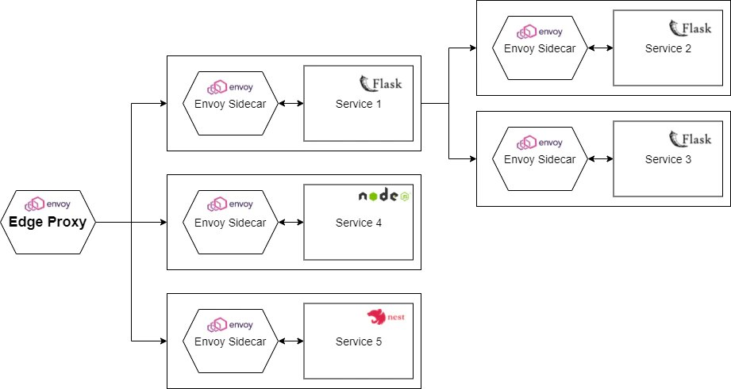
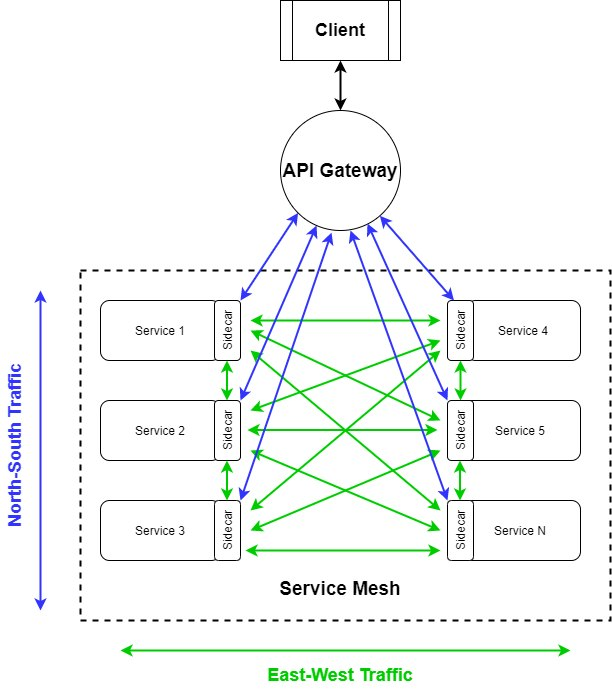
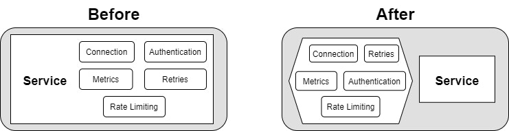
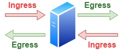
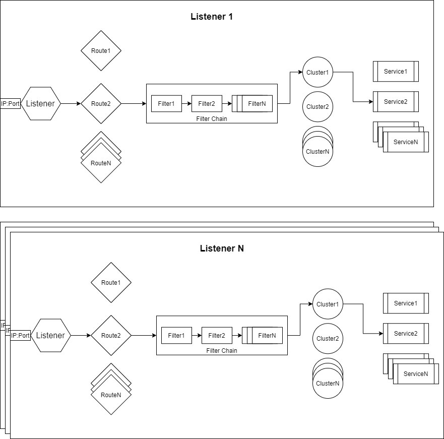
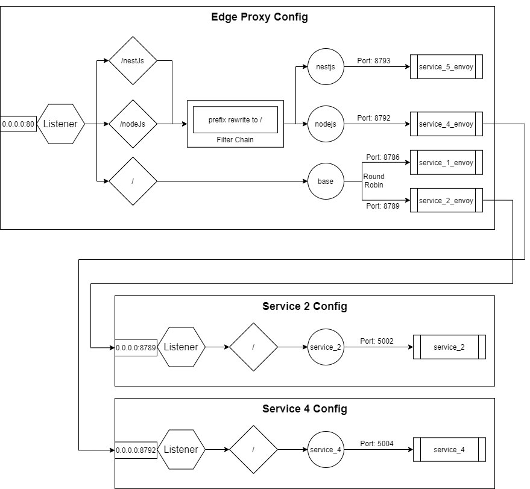

Recently microservices-based applications became very popular and with the rise of microservices, the concept of Service Mesh also became a very hot topic. Unfortunately, there are only a few articles about this concept and most of them are hard to digest.

In this blog, we will try to **demystify the concept of Service Mesh using "Stupid Simple" explanation****s**, diagrams, and examples to make this concept more transparent and accessible for everyone. In the **first article**, we will talk about **the basic building blocks of a Service Mesh** and we will implement a **sample application** to have a practical example of each theoretical concept. In the **next articles**, based on this sample app, we will touch more advanced topics, like **Service Mesh in Kubernetes**, and we will talk about some more **advanced Service Mesh implementations like [Istio](https://istio.io/),**[**Linkerd**](https://linkerd.io/), etc.

To understand the concept of [**Service Mesh**](https://en.wikipedia.org/wiki/Service_mesh), the first step is to understand **what problems**it solves and **how it solves them**.

Software architecture has evolved a lot in a short time, from classical monolithic architecture to microservices. Although many praise microservice architecture as the holy grail of software development, it introduces some serious challenges.



Overview of the sample application

For one, a microservices-based architecture means that we have a **distributed system.**Every distributed system has challenges such as *transparency*, *security*, *scalability*, *troubleshooting,* and *identifying the root cause of issues*. In a monolithic system, we can find the root cause of a failure by tracing. But in a microservice-based system, each service can be written in different languages, so tracing is no trivial task. Another challenge is *service-to-service communication.* Instead of focusing on business logic, developers need to take care of *service discovery*, *handle connection errors*, *detect latency*, *retry logic*, etc. Applying [**SOLID**](https://medium.com/backticks-tildes/the-s-o-l-i-d-principles-in-pictures-b34ce2f1e898)principles on the **architecture level** means that these kinds of network problems **should be****abstracted away and not mixed with the business logic**. This is why we need Service Mesh.

## Ingress Controller vs. API Gateway vs. Service Mesh

As I mentioned above, we need to apply [**SOLID**](https://medium.com/backticks-tildes/the-s-o-l-i-d-principles-in-pictures-b34ce2f1e898)**principles on an architectural level**. For this, it is important to set the boundaries between Ingress Controller, API Gateway, and Service Mesh and understand each one's role and responsibility.

On a stupid simple and oversimplified level, these are the responsibilities of each concept:

1. [**Ingress Controller**](https://www.nginx.com/resources/glossary/kubernetes-ingress-controller/): allows a **single IP port to access all services from the cluster**, so its main responsibilities are path mapping, routing and simple load balancing, *like a reverse proxy*
2. **API Gateway**: **aggregates and abstracts away APIs**; other responsibilities are rate-limiting, authentication, and security, tracing, etc. In a microservices-based application, you need a way to distribute the requests to different services, gather the responses from multiple/all microservices, and then prepare the final response to be sent to the caller. This is what an API Gateway is meant to do. It is responsible for **client-to-service communicatio****n,**[**north-south traffic**](https://en.wikipedia.org/wiki/North-south_traffic).
3. [**Service Mesh**](https://www.nginx.com/blog/what-is-a-service-mesh/):responsible for **service-to-service communication,**[**east-west traffic**](https://en.wikipedia.org/wiki/East-west_traffic). We'll dig more into the concept of Service Mesh in the next section.

**Service Mesh** and **API Gateway** have overlapping functionalities, such as rate-limiting, security, service discovery, tracing, etc. but they work on different levels and solve different problems. **Service Mesh** is responsible for the **flow of requests between services.** **API Gateway** is responsible for the **flow of requests between the client and the services**, aggregating multiple services and creating and sending the final response to the client.



The main responsibility of an API gateway is to accept traffic from outside your network and distribute it internally, while the main responsibility of a service mesh is to route and manage traffic within your network. They are complementary concepts and a well-defined microservices-based system should combine them to ensure application uptime and resiliency while ensuring that your applications are easily consumable.

## What Does a Service Mesh Solve?



As an oversimplified and stupid simple definition, a Service Mesh is an *abstraction layer hiding away and separating networking-related logic from business logic*. This way developers can focus only on implementing business logic. We implement this abstraction using a **proxy**, which sits in the front of the service. It takes care of all the network-related problems. This allows the service to focus on what is really important: the business logic. In a microservice-based architecture, we have multiple services and each service has a proxy. Together, these *proxies are called Service Mesh*.

As best practices suggest, *proxy and service should be in separate containers*, so each container has a **single responsibility**. In the world of Kubernetes, the container of the proxy is implemented as a [**sidecar**](https://www.magalix.com/blog/the-sidecar-pattern). This means that each service has a sidecar containing the proxy. A single Pod will contain two containers: the service and the sidecar. Another implementation is to use one proxy for multiple pods. In this case, the proxy can be implemented as a Deamonset. The most common solution is using sidecars. Personally, I prefer sidecars over Deamonsets, because they keep the logic of the proxy as simple as possible.

There are multiple Service Mesh solutions, including [Istio](https://istio.io/), [Linkerd](https://linkerd.io/), [Consul](https://www.consul.io/), [Kong](https://konghq.com/kong-mesh/), and [Cilium](https://cilium.io/). (We will talk about these solutions in a later article.) Let's focus on the basics and understand the concept of Service Mesh, starting with [**Envoy**](https://www.envoyproxy.io/docs/envoy/latest/intro/what_is_envoy#).This is a high-performance proxy and not a complete framework or solution for Service Meshes (in this tutorial, we will build our own Service Mesh solution). Some of the Service Mesh solutions use Envoy in the background (like Istio), so before starting with these higher-level solutions, it's a good idea to understand the low-level functioning.

## Understanding Envoy

### Ingress and Egress



**Simple definitions:**

- Any traffic sent to the server (service) is called **ingress**.
- Any traffic sent from the server (service) is called **egress**.

The **Ingress**and the **Egress**rules should be added to the **configuration of the Envoy proxy**, so the sidecar will take care of these. This means that *any traffic* to the service *will first go to the Envoy sidecar.* Then the *Envoy proxy redirects the traffic to the real service*. Vice-versa, any traffic from this service will go to the Envoy proxy first and Envoy resolves the destination service using [Service Discovery](https://avinetworks.com/glossary/service-discovery/#:~:text=Microservices%20service%20discovery%20is%20a,microservices%20architecture%20discovery%20includes%20both%3A&text=a%20central%20server%20%28or%20servers,a%20global%20view%20of%20addresses.). By intercepting the inbound and outbound traffic, Envoy can implement service discovery, circuit breaker, rate limiting, etc.

### The Structure of an Envoy Proxy Configuration File



Every Envoy configuration file has the following components:

1. **Listeners:**where we configure the IP and the Port number that the Envoy proxy listens to
2. **Routes:**the received request will be routed to a cluster based on rules. For example, we can have path matching rules and prefix rewrite rules to select the service that should handle a request for a specific path/subdomain. Actually, the **route is just another type of filter**, which is mandatory. Otherwise, the proxy doesn't know where to route our request.
3. **Filters:**Filters can be chained and are used to enforce different rules, such as rate-limiting, route mutation, manipulation of the requests, etc.
4. **Clusters:**act as amanager for a group of logically similar services (the cluster has similar responsibility as a service in Kubernetes; it defines the way a service can be accessed), and acts as a load balancer between the services.
5. **Service/Host:**the concrete service that handles and responds to the request

Here is an example of an Envoy configuration file:

```
---
admin:  
  access_log_path: "/tmp/admin_access.log"  
  address:     
    socket_address: 
      address: "127.0.0.1" 
      port_value: 9901
static_resources:   
  listeners:    
   -       
      name: "http_listener"      
      address:         
        socket_address:           
          address: "0.0.0.0"          
          port_value: 80      
      filter_chains:          
        filters:             
          -               
            name: "envoy.http_connection_manager"              
            config:                
              stat_prefix: "ingress"                
              codec_type: "AUTO"               
              generate_request_id: true                
              route_config:                   
                name: "local_route"                  
                virtual_hosts:                    
                  -                       
                    name: "http-route"                      
                    domains:                         
                      - "*"                      
                    routes:                       
                      -                           
                        match:                             
                          prefix: "/nestjs"                          
                        route:                            
                          prefix_rewrite: "/"                            
                          cluster: "nestjs"                        
                      -                           
                        match:                             
                            prefix: "/nodejs"                          
                          route:                            
                            prefix_rewrite: "/"                            
                            cluster: "nodejs"                         
                       -                           
                         match:                             
                           path: "/"                          
                         route:                            
                           cluster: "base"                
              http_filters:                  
                -                     
                  name: "envoy.router"                    
                  config: {}  

  clusters:    
    -       
      name: "base"      
      connect_timeout: "0.25s"      
      type: "strict_dns"      
      lb_policy: "ROUND_ROBIN"      
      hosts:        
        -           
          socket_address:             
            address: "service_1_envoy"            
            port_value: 8786        
        -           
          socket_address:             
            address: "service_2_envoy"            
            port_value: 8789        
    -      
      name: "nodejs"      
      connect_timeout: "0.25s"      
      type: "strict_dns"      
      lb_policy: "ROUND_ROBIN"      
      hosts:        
        -          
          socket_address:            
            address: "service_4_envoy"            
            port_value: 8792        
    -      
      name: "nestjs"      
      connect_timeout: "0.25s"      
      type: "strict_dns"      
      lb_policy: "ROUND_ROBIN"      
      hosts:        
        -          
          socket_address:            
            address: "service_5_envoy"            
            port_value: 8793
```

The configuration file above translates into the following diagram:



This diagram did not include all configuration files for all the services, but it is enough to understand the basics. You can find this code in my [**Stupid Simple Service Mesh repository**](https://github.com/CzakoZoltan08/Stupid-Simple-Service-Mesh).

As you can see, between *lines 10-15* we defined the **L****istener**for our Envoy proxy. Because we are working in Docker, the host is 0.0.0.0.

After configuring the listener, between *lines 15-52* we define the **Filters**. For simplicity we used only the basic filters,**to match the routes****and****to rewrite the target routes**. In this case, if the subdomain is "host:port/nodeJs," the router will choose the *nodejs*cluster and the URL will be rewritten to "host:port/" (this way the request for the concrete service won't contain the /nodesJs part). The logic is the same also in the case of "host:port/nestJs". If we don't have a subdomain in the request, then the request will be routed to the cluster called *base*without prefix rewrite filter.

Between lines 53-89 we defined the **clusters**. The *base*cluster will have two services and the chosen load balancing strategy is *round-robin*. Other available strategies can be found [**here**](https://www.envoyproxy.io/docs/envoy/latest/intro/arch_overview/upstream/load_balancing/load_balancers). The other two clusters (*nodejs*and *nestjs*) are simple, with only a single service.

The **complete code**for this tutorial can be found in my [**Stupid Simple Service Mesh git repository**](https://github.com/CzakoZoltan08/Stupid-Simple-Service-Mesh).

## Conclusion

In this article, we learned about the **basic concepts of Service Mesh**. In the first part, we understood the **responsibilities and differences between the Ingress Controller, API Gateway, and Service Mesh.**Then we talked about what **Service Mesh** is and **what problems it solves**. In the second part, we introduced [**Envoy**](https://www.envoyproxy.io/docs/envoy/latest/intro/what_is_envoy#), a performant and popular proxy, which we used to build our Service Mesh example. We learned about the **different parts of the Envoy configuration files** and **created a Service Mesh with five example services** and **a front-facing edge proxy**.

In the **next article**, we will look at how to use **Service Mesh with Kubernetes** and will create an example project that can be used as a **starting point in any project using microservices**.

There is another ongoing **“Stupid Simple AI”** series. The first two articles can be found here: [**SVM and Kernel SVM**](https://towardsdatascience.com/svm-and-kernel-svm-fed02bef1200) and [**KNN in Python**](https://towardsdatascience.com/knn-in-python-835643e2fb53).

## Want to Learn More from our Stupid Simple Series?

Read our eBook: Stupid Simple Kubernetes. Download it [here!](https://more.suse.com/Stupid_Simple_Kubernetes_ebook.html)

[](https://more.suse.com/Stupid_Simple_Kubernetes_ebook.html)
