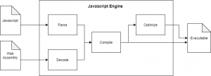
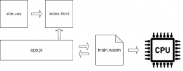

In this blog post, we’ll introduce you to WebAssembly. We’ll start with a history lesson on the Assembly language, which was created to make programming easier and boost productivity. Then we’ll move on to WebAssemby, a descendent of Assembly, and cover what it is, the problems it solves and how it does that.

## Assembly

Decades ago, if you wanted to program a computer, you had to write **binary code**. We called it **machine code** because it is the native language of any computer (maybe this will change with the rise of quantum computing, but for now, every computer works on binary code). This machine code can run directly on a computer without a compiler, transpiler or other high-level actions.

Writing machine code and debugging it are not easy tasks, so computer scientists realized they needed a higher-level language to **boost productivity** and **make computer programming easier**. From that need, the **Assembly** language was born. This language is easier to write and understand than machine code because instead of 0s and 1s, it uses **instructions closer to human language**, like add, mul, div, mov, etc.

To translate the code written in Assembly language, you need an **assembler** and a linker. However, there is still a **1-to-1 relationship between the Assembly language and the machine code**, which means that one assembly instruction will be translated to exactly one instruction in machine code. This is not true in high-level languages like C, C++, C#, etc. Because the Assembly language is very close to machine code, it is also **very fast** (faster than any high-level language). High-level languages need to be compiled. As code complexity grows, it will be harder and harder for compilers to generate efficient and optimized machine codes, which means lower performance. So, if you need high performance, the ideal choice is the Assembly language.

Compared to Assembly, high-level languages have other advantages, like increased productivity, easier maintenance and portability, but they cannot compete with the Assembly language’s performance.

## WebAssembly

Now the question is, **“What is WebAssembly?”** We could say that WebAssembly is the assembly language for web apps. That would only be partially true because WebAssembly is a byte code, and Assembly is a language converted into byte code. What WebAssembly is trying to create is language that runs as fast as possible, close to Assembly speeds, but on the web (hence the naming).

Rationally speaking, the next questions would be, ***“Why do we need WebAssembly and what problem does it solve?”*** And in this case, the problem is Javascript. Don’t misconstrue this; Javascript is a great language, but there are many issues regarding performance.

Why is it so slow? One of the main reasons is that **Javascript is dynamically typed**, which means that a variable can store **any data type**, from simple ints, through strings, and even more complex types as arrays or objects. That can be an advantage when writing the code, but statically typed languages like C, C++, etc., produce more efficient machine code. In these cases, the compiler has type and size information for each variable.

Another reason Javascript is slower than WebAssembly is that **it takes more steps to parse it**. Parsing JavaScript entails converting plain text to an [abstract syntax tree (AST)](https://www.twilio.com/blog/abstract-syntax-trees) and then converting that to binary representation. WebAssembly uses binary format, which makes decoding much faster. The **WebAssembly code is typed statically**, so the Javascript engine doesn’t need to guess the types of the variables during compilation. WebAssembly **code optimization** happens **during the compilation**, so there is no extra optimization step (like in Javascript). In the following diagram, we can see the steps needed to convert Javascript or WebAssembly into executable code:

 

**Javascript was d****esigned to display****only static pages.** It was created to provide an **API to manipulate the DOM**; it wasn’t made with performance in mind. Nowadays, we have lots of CPU-intensive computations on the web, like physics, face detections, maybe some ML, etc., and for these CPU-intensive tasks, Javascript is no longer enough.

Another problem is that on the web, **you don’t have many choices other than Javascript**. In the backend, there are multiple options like C, C++, C#, Java, etc., but when it comes to the web you are stuck with Javascript. Yes, there are other languages, like Typescript, but all these languages are somehow converted or “transpiled” in Javascript.

This is where WebAssembly comes into the picture. The term WebAssembly is inspired by the Assembly language, which generates optimized and high-speed programs in machine code that run entirely within the web platform. That means you can integrate WebAssembly libraries for CPU-intensive calculations (such as compression, face identification, and physics) into current web programs that use Javascript for less intensive work.

If we want to define **WebAssembly** as simply as possible, it is **binary code compiled for browsers**.

Besides increased performance, WebAssembly has another important feature; it is a **universal compile target**. That means we are no longer dependent on Javascript and we can write our code in whatever language we would like (C, C++, C#, etc.), and compile it to WebAssembly. You can find a list of languages that can be compiled in WebAssembly [here](https://github.com/appcypher/awesome-wasm-langs).

## How WebAssembly Works

In high-level languages like C, C++, C#, etc., we write the code and it runs on multiple processors, which means that we have portability. But how did we solve the problem of portability? We added a layer of abstraction, a “virtual processor” (the interpreter), which interprets the intermediate bytecode and turns it into a bytecode compatible with a specific processor. Before or after the interpreter, we could add an optimization step, but we would like to keep things simple for now.

In Web Assembly, the idea is the same but for different browsers, not processors.

This way, we can write code in **any high-level language** (that can be compiled in [.wasm](https://webassembly.org/), a file extension for WebAssembly binary code) and it will run in the browser. That means CPU-intensive algorithms can be written in C and run in the browser, solving the problem of portability and dramatically increasing its performance.

**That doesn’t mean we don’t need Javascript anymore**. For CPU-intensive calculations, WebAssembly is excellent. Still, **it has no direct DOM access**, so you may find it slower than JavaScript for DOM manipulation due to extra I/O overhead despite its superior performance.

The combination of WebAssembly and Javascript is a powerful tool because **Javascript can focus on DOM manipulation** (its original purpose), and **WebAssembly can handle CPU-intensive tasks**.

Usually, we have the following structure when working with WebAssembly:

 

So, WebAssembly is just another file that the browser can download and **Javascript is the glue between the WebAssembly and the web app**. In this case, the app.js can interact with the DOM, but it can also interact with WebAssembly, and vice versa. But, as you can see in the diagram above, WebAssembly cannot interact with the DOM (which hopefully will change in the future). We still need Javascript for dynamic and interactive web apps. So, if we want to manipulate the DOM using WebAssembly, it will need to talk to Javascript, manipulating the DOM. That is why DOM manipulation is slower with WebAssembly than using Javascript directly.

If you would like to learn more about how WebAssembly works, [here](https://medium.com/jspoint/the-anatomy-of-webassembly-writing-your-first-webassembly-module-using-c-c-d9ee18f7ac9b) is a great article about *“The anatomy of WebAssembly.”*

## Advantages of WebAssembly

Even if everybody is talking about WebAssembly’s **performance**, that is not its biggest advantage, in my opinion. Yes, in some specific use cases the WebAssembly has higher performance than Javascript, but when it comes to the DOM, Javascript rules.

In my opinion, the most important advantages WebAssembly brings with it are **portability** and **flexibility**.

To run an application on a device, it must be compatible with its processor’s architecture and the device’s operating system. Without portability, you have to compile the same code for every processor architecture and operating system combination. With WebAssembly, there is only **one compilation step**, and **it runs on all modern browsers**.

The other significant advantage is **flexibility**. Before WebAssembly, we had the same constant frustration that there weren’t any choices other than Javascript on the web. But with WebAssembly, you can write your code in your favorite programming language, compile it to .wasm (the extension for WebAssembly), and it will work. So, you can write web applications in C, C++, C# (see the [Blazor](https://dotnet.microsoft.com/apps/aspnet/web-apps/blazor) project), etc. Also, bottlenecks in existing Javascript programs can be rewritten in a better language when optimizing performance.

## Conclusions

This article ***introduced WebAssembly, why*** it was created, ***what*** problems it solves, and ***how*** it solves those problems.

WebAssembly is a great language that opens up a whole new world of web development because programmers can choose whatever language they like to write web apps; they are not obliged to use Javascript anymore. Javascript won’t go away anytime soon, but with the rise of WebAssembly we have other choices to build our web applications, not just Javascript.

Want to learn more about WebAssembly? [Join our Summer is Open session on Kubewarden](https://community.suse.com/courses/5382798/about), an open source policy engine that leverages the power of WebAssembly. Live session is Tuesday, August 10.

## Want to Learn More from our Stupid Simple Series?

Read our eBook: Stupid Simple Kubernetes. Download it [here!](https://more.suse.com/Stupid_Simple_Kubernetes_ebook.html)

