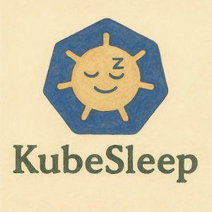
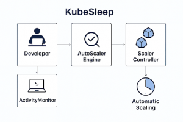
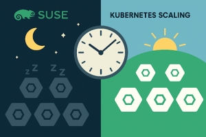

🟢 Disclaimer: This feature is part of an April 1st announcement. While KubeSleep isn't real (yet), the challenges it highlights around cost and efficiency certainly are. Enjoy the read and who knows what the future holds?
We're excited to announce Kubesleep, a smart Kubernetes operator developed by [SUSE](https://www.suse.com/) that optimizes cluster efficiency and significantly reduces infrastructure costs. Kubesleep automatically scales workloads based on actual developer activity, intelligently detecting periods of inactivity and scaling down resources to save energy and expenses. Best of all, your clusters smoothly scale back up before developers even notice.

## Why KubeSleep?

Every software developer knows the frustration of managing infrastructure resources that sit idle overnight or during inactive hours, unnecessarily inflating cloud costs. With KubeSleep, you eliminate wasted resources by automating scaling decisions around actual work patterns.


## How Does KubeSleep Work?

KubeSleep includes three primary components:

- **ActivityMonitor** A lightweight tool integrated directly into developers' IDEs or terminals that tracks inactivity (like keyboard or mouse idling).
- **AutoScaler Engine** A Kubernetes operator analyzing inactivity metrics to predict optimal scaling schedules.
- **Scaler Controller** Automatically adjusts the number of pods based on the AutoScaler Engine’s predictions.



####

## Instant Support for RKE2

Whether you’re running a full Kubernetes stack or using our lightweight RKE2 distribution, designed for edge computing or smaller deployments, KubeSleep works seamlessly right out of the box. Simply deploy it into your existing cluster, annotate your deployments, and watch your resource usage optimize itself.
For more information on SUSE's innovative Kubernetes solutions, visit our SUSE Kubernetes page and learn how to maximize your cluster performance and cost efficiency.

### Getting Started

#### Step 1: Deploy the Operator

```
helm repo add kubesleep https://charts.suse.com/kubesleep
helm repo update
helm install kubesleep kubesleep/operator --namespace kube-system
```

#### Step 2: Enable Scaling on Your Apps

Simply annotate your deployments:

```
apiVersion: apps/v1
kind: Deployment
metadata:
name: backend-app
annotations:
kubesleep.suse.com/enabled: "true"
kubesleep.suse.com/min-replicas: "1"
kubesleep.suse.com/max-replicas: "5"
spec:
replicas: 3
selector:
matchLabels:
app: backend-app
template:
metadata:
labels:
app: backend-app
spec:
containers:
- name: backend-app
image: suse/backend:v1.0
```

#### Step 3: Developer Integration (Optional)

Optionally, developers can enhance accuracy by adding an ActivityMonitor sidecar:

```
containers:
- name: activity-monitor
image: suse/kubesleep-activity:latest
env:
- name: TEAM_ID
value: "engineering-team-1"
resources:
requests:
memory: "15Mi"
cpu: "5m"
```

## Observability Built-In

KubeSleep comes integrated with [SUSE Observability](https://www.suse.com/solutions/observability/), providing clear PromQL-based metrics:

- kubesleep\_inactive\_hours\_total{team="engineering-team-1"}
  Total hours saved due to inactivity.
- kubesleep\_scaling\_actions\_total{action="scale\_down"}
  Number of times the system scaled down.
- kubesleep\_scaling\_actions\_total{action="scale\_up"}
  Number of times the system scaled up.

These metrics help your platform engineers instantly understand the cost savings and resource optimizations gained by using KubeSleep.

## A Developer-Friendly Solution

- Easy deployment via Helm
- Minimal setup, just annotations and optional lightweight sidecar
- Seamless integration with SUSE’s [K3s](https://www.suse.com/products/k3s/) and [RKE2](https://docs.rke2.io/) Kubernetes distributions
- Instant visibility through built-in observability
- Native integration in your IDE

KubeSleep bridges practical infrastructure savings and developer productivity. Give it a try and see how much your team can save during your next inactive period!

While the announcement may seem plausible, it is important to note that it is currently an April Fools' Day joke and not a present reality. For a comprehensive understanding of our current platform capabilities and to explore how we can assist you with existing solutions, please visit: https://www.suse.com/products/rancher/
