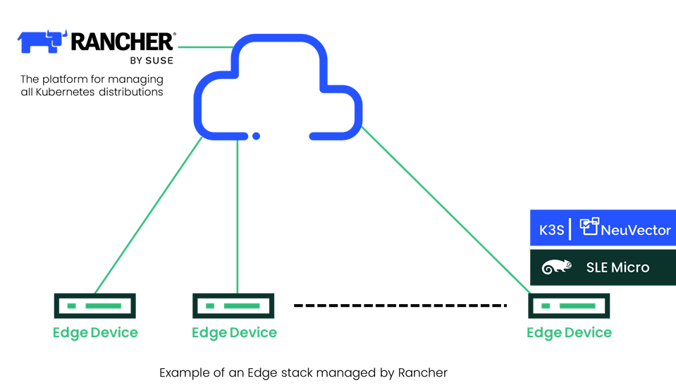
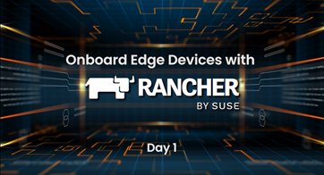
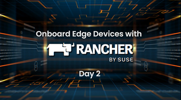

We are proud to introduce SUSE Edge 2.0, which will empower customers to accelerate and scale edge infrastructures and transform edge operations.

## **What is SUSE Edge 2.0?**

SUSE Edge 2.0 is a purpose-built, fully integrated solution for managing the full lifecycle of Edge devices at scale. By leveraging the latest versions of Rancher, SLE Micro and SUSE NeuVector, the SUSE Edge 2.0 solution brings a much-needed integrated platform that simplifies, centralizes and automates Kubernetes and Linux OS lifecycle management across distributed edge locations.

To set customers up for success for the next generation of edge devices and allow them to scale, [SUSE Edge](https://www.suse.com/solutions/edge-computing/) 2.0 delivers a full range of cloud native edge management solutions with security seamlessly integrated across the full stack – from applications to Kubernetes to operating systems. With varying edge uses – general edge, telco and automotive – requiring additional capabilities, only SUSE provides a use-case-based edge solution to match the customer's needs.

## **What are the key benefits of SUSE Edge 2.0?**

- **Reduced operational complexity:** Customers will benefit from a fully integrated solution that offers cost-efficient, centralized management at scale for unsupervised edge locations. This enables IT operators to add new edge devices easily and deliver rolling updates without impacting availability. Additionally, it reduces the IT skills required for organizations to deploy modern, cloud native applications at the edge.
- **Ability to manage both Kubernetes and OS:** SUSE Edge 2.0 manages Kubernetes and the underlying operating system from a single control plane, including world-class break-fix support, expert consulting and successful planning services. This enables customers to deliver simplified operations at every stage of development, including design, deployment and maintenance, when running complex, cloud native workloads in edge-based locations.
- **Operating system built for the edge:** The latest release of SLE Micro 5.3, which is purpose-built for containerized and virtualized workloads, is now fully integrated with Rancher. Together,  Rancher and [Elemental](https://github.com/rancher/elemental-toolkit), an open source project that provides full lifecycle management for edge devices running SLE Micro, will provide seamless deployment of SLE Micro 5.3 and give customers the ability to manage OS + Kubernetes from one dashboard. Additionally, with Elemental being fully open source, customers now have even more choices for the underlying infrastructure.
- **Security for any distributed environment:** With SUSE Edge 2.0, customers can securely implement edge applications at any remote location, in a mini data center or as an Industrial IoT (IIOT) edge device. Additionally, most secure organizations such as defense and government can incorporate SLE Micro, which is planned to be listed at National Information Assurance  Partnership (NIAP) as under evaluation for FIPS 140-3 certification (a U.S. government computer security standard used to approve cryptographic modules) and international Common Criteria.

## **SUSE Edge Enables You to Simplify Edge Deployments**

You don’t need onsite technical expertise to onboard and update or dedicated staff to manage the operating systems on edge devices.
What if you could manage the full lifecycle of edge devices from one dashboard? With Rancher, you can do just that and do it at scale.

#### In these two videos, you will learn how simple day 1 and day 2 operations can be.

##

## 

## **Attend Webinar - Forrester and SUSE**

Join us for a lively, interactive session to inform your edge computing strategy with Guest Speaker, Forrester Principal Analyst Michele Pelino, and SUSE General Manager for Edge, Keith Basil.

[**Find Value at the Edge: Innovation Opportunities and Use Cases**](https://more.suse.com/Find_Value_at_the_Edge_webinar.html)

**November 16, 2022,  8 AM - 9 AM PST,** [**Register Here**](https://more.suse.com/Find_Value_at_the_Edge_webinar.html)

## **Meet us at Cloud Native Computing Conference: KubeCon**

The SUSE team proudly demonstrates the capabilities of the SUSE edge solution at [KubeCon & CloudNativeCon from Oct 25 – 28](https://more.suse.com/kcna22). Visit us there, check out the cool demos and learn from the conference sessions.

### Learn more

- [Resiliency with Kubernetes at Home Depot](https://youtu.be/N6PDtEiLY7Y)
- [Survey results of IT professionals - understand how carriers, telcos, MSPs, and CSPs are innovating and optimizing edge computing applications](https://more.suse.com/esg-ebook-digital-ecosystems.html).
- [IT operations at the Edge](https://www.suse.com/solutions/edge-computing/)
- [SUSE Edge 2.0 Solution Sheet](https://links.imagerelay.com/cdn/3404/ql/7e249f5283d14104a121b17d3d8b6467/suse-edge-ds.pdf)
