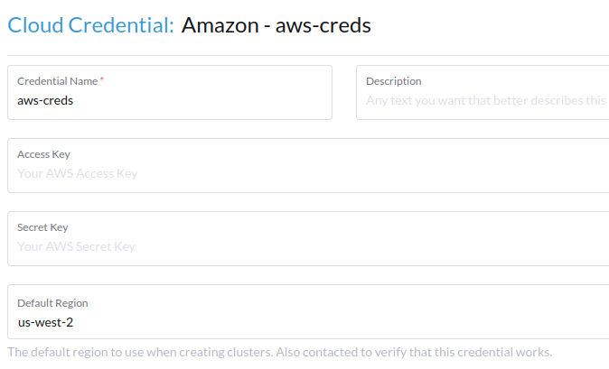
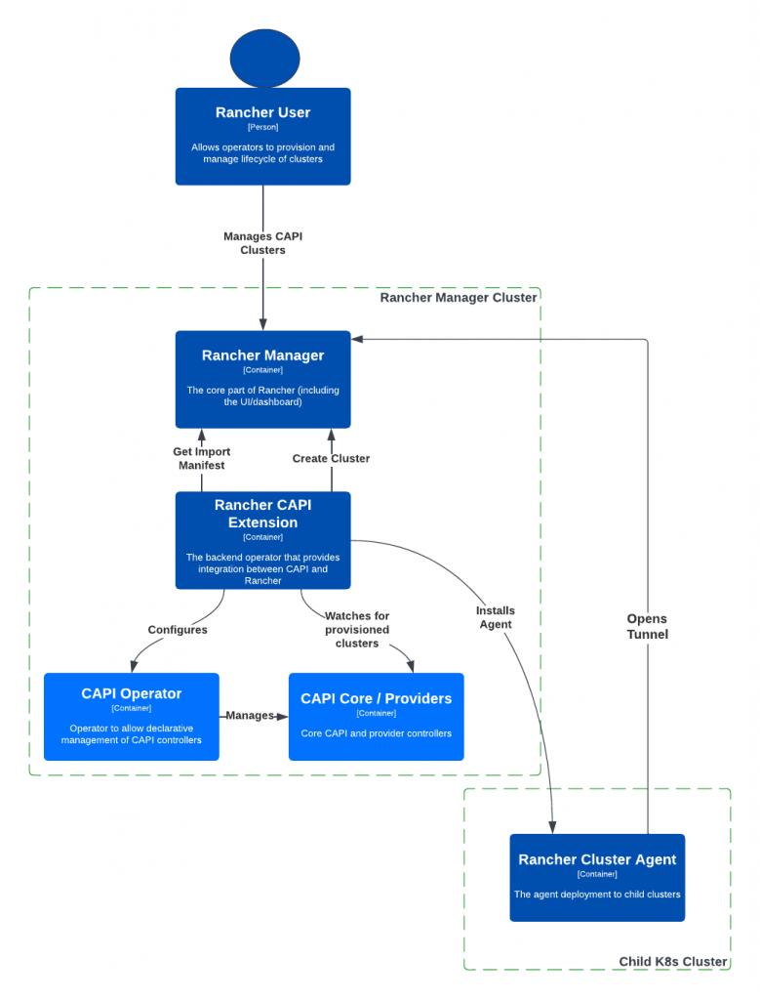
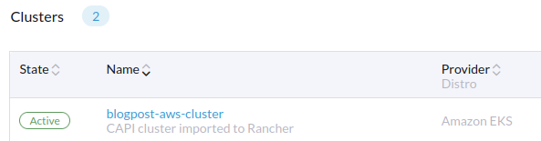
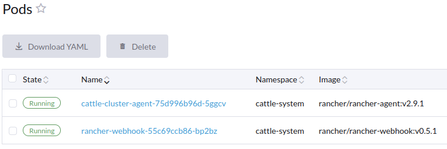
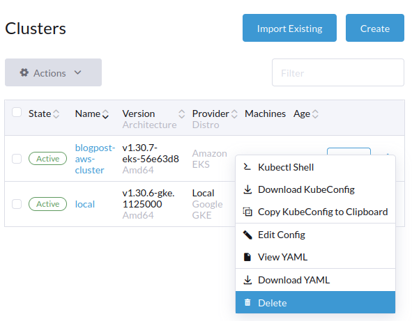

If you’re new to Kubernetes or looking to modernize your cluster management workflows, [Cluster API and SUSE® Rancher Prime](https://www.suse.com/c/rancher_blog/suse-rancher-prime-meets-cluster-api-what-you-need-to-know/) make it easier than ever to provision and manage clusters declaratively.

This guide walks you through enabling Cluster API in SUSE Rancher Prime, deploying your first cluster and exploring advanced features like GitOps.

Some helpful documentation can be found [here](https://documentation.suse.com/cloudnative/cluster-api/v0.17/en/tutorials/quickstart.html) and a few pre-requisites for this hands-on walkthrough:

- A running SUSE Rancher Prime cluster
- [Rancher Cloud Credentials](https://ranchermanager.docs.rancher.com/reference-guides/user-settings/manage-cloud-credentials) configured to grant access to a supported infrastructure provider (e.g. AWS which we will use) to create cloud resources.
- The SUSE Rancher Prime Cluster API extension installed on your Rancher.
- Kubectl configured to connect to your SUSE® Rancher Prime cluster

After learning about Cluster API and how it works with SUSE Rancher Prime, let's do something real. We'll create a cluster using Cluster API and put it into SUSE Rancher Prime. While we chose AWS to host the Kubernetes cluster and the [Cluster API Provider for AWS](https://github.com/kubernetes-sigs/cluster-api-provider-aws/), this guide is applicable for any other provider. To see a list of the CAPI Providers we actively test, we recommend you refer to the [official documentation](https://documentation.suse.com/cloudnative/cluster-api/v0.17/en/reference/certified.html).
> ***NOTE:** This is the second blog post of the series SUSE Rancher Prime Meets Cluster API.* *If you want to know more about Cluster API, we invite you to read the [first blog post](https://www.suse.com/c/rancher_blog/suse-rancher-prime-meets-cluster-api-what-you-need-to-know/) of the series.*

## Provider Installation

Installing a Cluster API Provider is very easy using the CAPIProvider resource provided by SUSE Rancher Prime Cluster API extension. This resource adds an extra layer of abstraction and makes it easier to manage provider configuration and versioning.

SUSE Rancher Prime Cluster API extension only includes the main CAPI controller and Cluster API Provider for RKE2. This makes it easy to install and customize. If you want to follow along with the demo, you will need to install the AWS infrastructure provider:

```
apiVersion: turtles-capi.cattle.io/v1alpha1
kind: CAPIProvider
metadata:
  name: aws
spec:
  type: infrastructure
  credentials:
    rancherCloudCredential: aws-creds
  features:
    clusterTopology: true
    machinePool: true
```

This is the definition of a CAPIProvider resource that will deploy the AWS infrastructure provider. Due to the configurable nature of this resource, you can use it to manage other CAPI Providers and configure provider-specific features. In this case, we are enabling clusterTopology and machinePool.

Most cloud providers require the user to be authenticated to create new infrastructure resources. The integration between CAPI and SUSE Rancher Prime makes it easier to set up credentials. Existing Rancher Cloud Credentials can be used by CAPI to work with cloud vendors. The rancherCloudCredential parameter is used here to reference by name the credentials that the provider is configured with.


*Rancher Cloud Credentials configuration*

## Cluster Definition

The [Cluster API Provider for AWS](https://cluster-api-aws.sigs.k8s.io/) allows creating two types of clusters in AWS:

- **Self-Managed:** these are standard Kubernetes clusters deployed to EC2 instances where the user handles control plane bootstrap and management. This is where a provider like CAPRKE2 must be used together with CAPA to be able to provision the cluster.
- **Managed**: these are clusters deployed to specific Cloud services, in this case AWS EKS (other cloud vendors have their own flavors), where the user is completely abstracted from the control plane.

We will be setting up a managed cluster on EKS. The following template shows that you need a few basic steps to get a fully working Kubernetes cluster:

```
---
apiVersion: cluster.x-k8s.io/v1beta1
kind: Cluster
metadata:
  name: blogpost-aws-cluster
spec:
  clusterNetwork:
    pods:
      cidrBlocks: ["192.168.0.0/16"]
  infrastructureRef:
    kind: AWSManagedControlPlane
    apiVersion: controlplane.cluster.x-k8s.io/v1beta2
    name: "blogpost-aws-cluster-control-plane"
  controlPlaneRef:
    kind: AWSManagedControlPlane
    apiVersion: controlplane.cluster.x-k8s.io/v1beta2
    name: "blogpost-aws-cluster-control-plane"
---
kind: AWSManagedControlPlane
apiVersion: controlplane.cluster.x-k8s.io/v1beta2
metadata:
  name: "blogpost-aws-cluster-control-plane"
spec:
  region: "us-west-1"
  version: "v1.30"
---
apiVersion: cluster.x-k8s.io/v1beta1
kind: MachinePool
metadata:
  name: "blogpost-aws-cluster-pool-0"
spec:
  clusterName: blogpost-aws-cluster
  template:
    spec:
      clusterName: blogpost-aws-cluster
      bootstrap:
        dataSecretName: ""
      infrastructureRef:
        name: "blogpost-aws-cluster-pool-0"
        apiVersion: infrastructure.cluster.x-k8s.io/v1beta2
        kind: AWSManagedMachinePool
---
apiVersion: infrastructure.cluster.x-k8s.io/v1beta2
kind: AWSManagedMachinePool
metadata:
  name: "blogpost-aws-cluster-pool-0"
spec:
  instanceType: t3.large
```

This template is configured with sensible defaults and ready to be applied to a cluster. Registering these resources in the Kubernetes API will make the CAPI controller trigger the cluster provisioning mechanism. The CAPI Infrastructure Provider for AWS will handle the creation and configuration of all required resources in the cloud.

## Cluster Deployment

Let’s create a file cluster.yaml that contains the cluster definition presented in the previous section so you can create a cluster using kubectl with the following command:

```
kubectl apply -f cluster.yaml
```

The provisioning phase includes tasks such as configuring networking resources and creating the EKS cluster and its compute capacity, a process that usually takes 5-10min. You can inspect the new CAPI cluster resource and check its status:

```
kubectl get clusters.cluster.x-k8s.io
```

## Import Cluster To Rancher

The extension’s functionality centers around a Kubernetes controller that watches CAPI cluster resources, specifically clusters.cluster.x-k8s.io, and manages the creation of corresponding Kubernetes resources that represent the cluster within the SUSE Rancher Prime ecosystem. This controller also allows you to remove a cluster from SUSE Rancher Prime. While the cluster will no longer be visible or managed in SUSE Rancher Prime, the actual cluster will not be deleted. We refer to this as an un-import operation.

When the cluster is done provisioning, we’ll be able to leverage the integration between CAPI and Rancher and import the new cluster to SUSE Rancher Prime. SUSE Rancher Prime Cluster API extension will monitor namespaces and clusters that contain the label cluster-api.cattle.io/rancher-auto-import=true and will automatically import them into Rancher by deploying the Rancher Agent to the workload cluster so Rancher can communicate with it.


*CAPI integration with Rancher*

Labeling can be done at any point in time, so you could have a namespace where you expect all CAPI clusters to be imported and you simply have to label it once. All clusters (existing or new) will be imported when the controller reconciles them.

The following is the command you can run to label only the new cluster:

```
kubectl label clusters.cluster.x-k8s.io blogpost-aws-cluster cluster-api.cattle.io/rancher-auto-import=true
```

After labeling, the controller will identify the cluster as marked for import and will deploy Rancher Agent to the workload cluster. This process can take up to a few minutes and you will eventually see it become available in Rancher UI.


*Provisioned cluster is now available in Rancher*

**Congratulations!** You have successfully provisioned a Kubernetes cluster using Cluster API and imported it to SUSE Rancher Prime.

You can now operate this cluster via Rancher. Let’s take a look at the pods in the cattle-system namespace where we can locate the Rancher Agent that enables communication with the workload cluster.


*Rancher agent running in the workload cluster*

## Un-Import Cluster

If you decide you no longer need the CAPI cluster available in Rancher, you can remove it directly via Rancher UI and the controller will take care of un-importing it. To avoid interfering with the lifecycle of the CAPI cluster, this action does not remove the cluster itself, so it’ll still be available and its infrastructure will remain unchanged. With this operation, you are simply removing it from the list of Rancher-managed workload clusters.


*Un-import CAPI cluster*

If you wish to remove the cluster completely, you can do so using kubectl:

```
kubectl delete clusters.cluster.x-k8s.io blogpost-aws-cluster
```

In this case, the AWS provider will detect this delete request and will manage cluster deletion, including all associated infrastructure and networking cloud resources.

## Your Feedback is Valued

The CAPI work we’re doing is for you, and we want to ensure it meets your needs. If you have feedback on CAPI and its integration into SUSE Rancher Prime, please share it with your SUSE contact. Your insights will help us make this API integration even more valuable for your organization and others in the Rancher community.

---

Blog post originally authored by:


Carlos Salas
