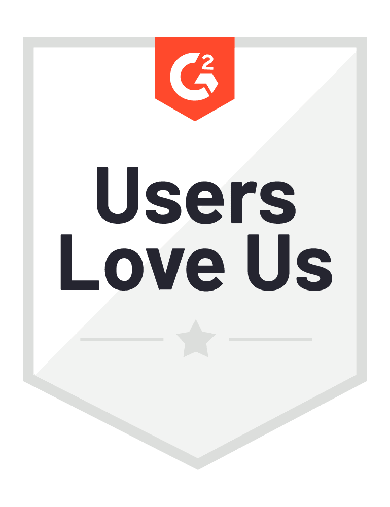
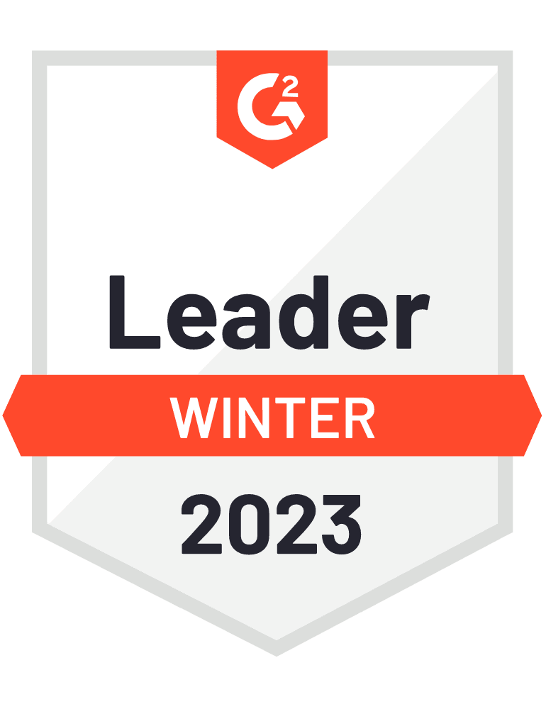
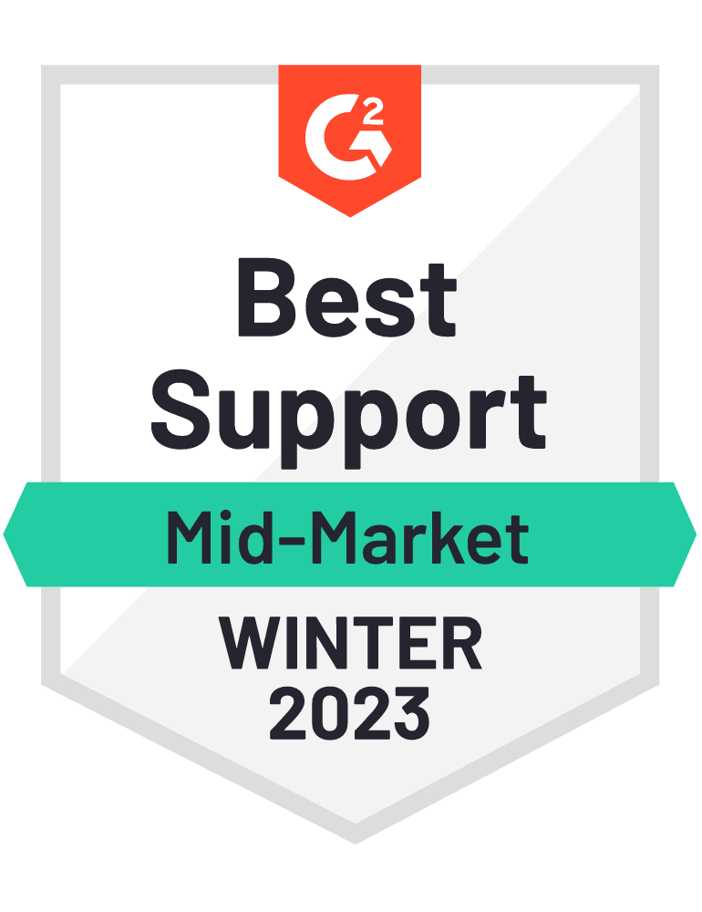
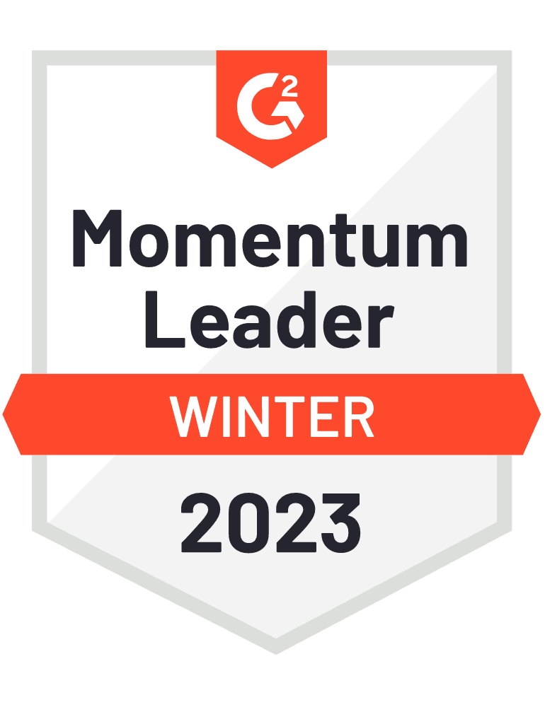
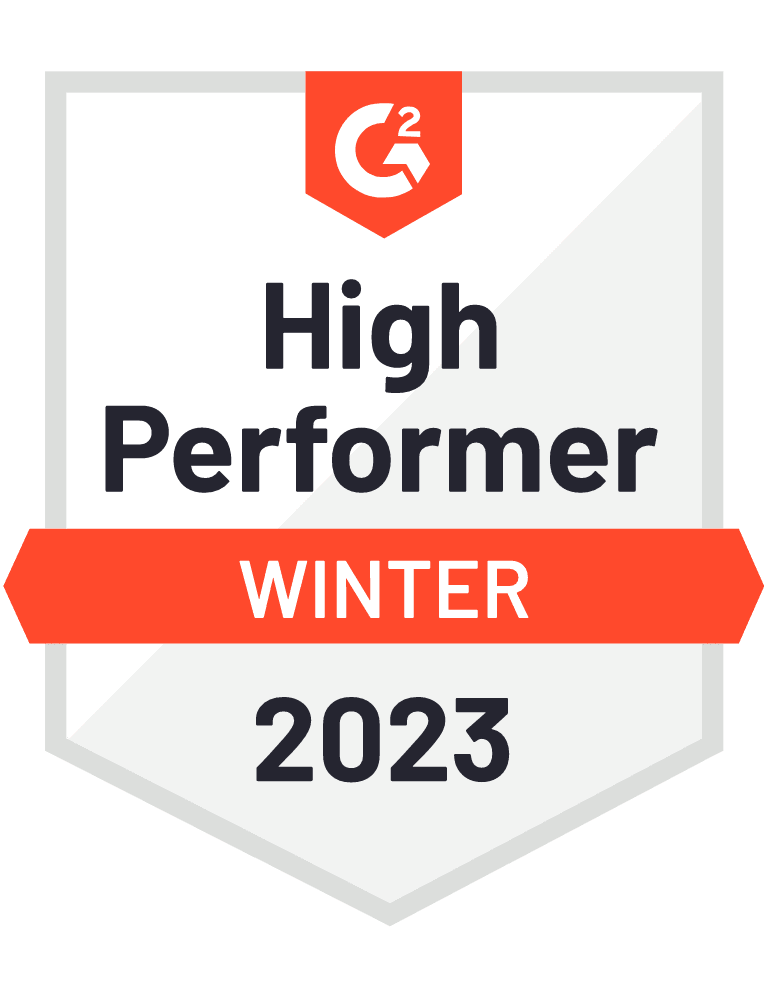

  

 

 

 

 

 

I’m pleased to share that [G2](https://www.g2.com/), the world’s largest and most trusted tech marketplace, has recognized our solutions in its 2023 Winter Report. We received a total of 15 badges across our business units for Rancher, SUSE Linux Enterprise Server (SLES), SLE Desktop and SLE Real Time – including the Users Love Us badge for all products – as well as three badges for the openSUSE community with Leap and Tumbleweed.

We recently celebrated 30 years of service to our customers, partners and the open source communities and it’s wonderful to keep the celebrations going with this recognition by our peers. Receiving 15 badges this quarter reinforces the depth and breadth of our strong product portfolio as well as the dedication that our team provides for our customers.

As the use of hybrid, multi-cloud and cloud native infrastructures grows, many of our customers are looking to containers. For their business success, they look to [**Rancher**](https://www.rancher.com/products/rancher), which has been the leading multi-cluster management for nearly a decade and has one of the strongest adoption rates in the industry.

G2 awarded Rancher four badges, including High Performer badges in the Container Management and the Small Business Container Management categories and Most Implementable and Easiest Admin in the Small Business Container Management category.

Tacking on to the [**latest badges**](https://www.suse.com/c/suse-receives-15-g2-badges/) that [**SLES**](https://www.suse.com/products/server/) received in October, SLES received Momentum Leader and Leader in the Server Virtualization category once again; Momentum Leader and High Performer in the Infrastructure as a Service category; and two badges in the Mid-Market Server Virtualization category for Best Support and High Performer.

In addition, [**SLE Desktop**](https://www.suse.com/products/desktop/) was again awarded two High Performer badges in the Mid-Market Operating System and Operating System categories. [**SLE Real Time**](https://www.suse.com/products/realtime/) also received a High Performer badge in the Operating System category. The openSUSE community distribution [**Leap**](https://get.opensuse.org/leap/15.4/) was recognized as the Fastest Implementation in the Operating System category. It’s clear that our Business Critical Linux solutions continue to be the cornerstone of success for many of our customers and that we continue to provide excellent service for the open source community.

Here’s what some of our customers said in their reviews on G2:

*“[Rancher is a] complete package for Kubernetes.”*

*“RBAC simple management is one of the best upsides in Rancher, attaching Rancher post creation process to manage RBAC, ingress and [getting] a simple UI overview of what is going on.”*

*“ [Rancher is the] best tool for managing multiple production clusters of Kubernetes orchestration. Easy to deploy services, scale and monitor services on multiple clusters.”*

*“SLES the best [for] SAP environments. The support is fast and terrific.”*

Providing our customers with solutions that they know they can rely on and trust is critical to the work we do every day. These badges are a direct response to customer feedback and product reviews and underscore our ability to serve the needs of our customers for all of our solutions. I’m looking forward to seeing what new badges our team will be rewarded in the future as a result of their excellent work.
