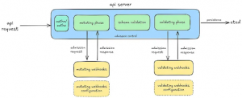
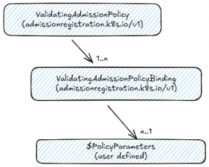
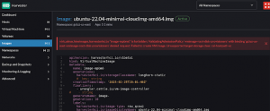
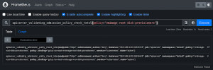
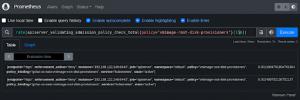
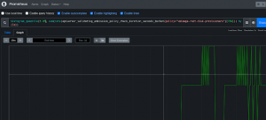

[SUSE Virtualization](https://www.suse.com/products/rancher/virtualization/) - Enforcing Admission Resource Integrity With Validating Admission Policy
With more enterprises using SUSE Virtualization (formerly Harvester) as the bedrock virtualization platform to host their modern cloud-native AI and edge workloads, it’s important that the platform provides seamless built-in guardrails to validate and sanitize resources admitted into the environment. Invalid resource specification can leave the platform, its guest clusters and user workloads in non-compliant compromised states, with potential data corruption, loss and unauthorized exposure.
This article explains how [SUSE Virtualization](https://www.suse.com/products/rancher/virtualization/) utilizes Kubernetes’ dynamic admission webhook[1] and validating admission policy[2] to ensure the integrity of workload resources admitted into your virtualization platform. It shows how SUSE Virtualization administrators can write custom validation policies to protect their heterogenous multi-tenant environments, using familiar Kubernetes tools. It also reduces deployment and delivery frictions for workload owners by providing them with insights into the built-in validation policies.

## Admission Resource Validation

The Kubernetes’ dynamic admission webhook allows platform administrators and workload owners to encode validation policies using modern programming languages, to interrogate resources ingested into the platform. An example of a validation policy may be one that enforces rules which prohibit all admitted pods from exposing port 80 and binding to host path volumes.
The webhook validates API requests that intend to modify the states of Kubernetes resources like pods, virtual machines, persistent volumes and storage classes. Inputs that failed the validation criteria are rejected by the platform, with human-readable error messages logged and rendered on the SUSE Virtualization UI.
Recently, the SUSE Virtualization team has taken admission resource validation a step further by bundling the platform with out-of-box Kubernetes’ validating admission policy. This recent Kubernetes feature provides SUSE Virtualization administrators and workload owners with powerful tools to express and maintain custom admission validation policies.
Before diving deeper into both the admission webhook and admission policy, let’s take a brief look at how Kubernetes’ admission control flow works.

## About Admission Control

The admission control flow[3] is made up of a number of admission controllers, which are gatekeeping plugins within the Kubernetes API Server that intercept and check authenticated API requests sent to interact with Kubernetes resources. These controllers can mutate and validate Kubernetes resources, and allow and deny these API requests.

Kubernetes users can introduce custom validation policies into the admission control flow either by embedding them in validating admission webhooks or creating validating admission policy resources. Both the webhooks and policy resources run during the *validating phase* of the admission control flow.
The validating admission webhooks are implemented as 3rd party components that the Kubernetes API server communicates with. They serve HTTP callback endpoints that accept admission requests from the Kubernetes API server. These webhooks evaluate the admission object against a set of validation rules to confirm compliance. The outcome of the evaluation, which includes the decision to accept or reject the request, is encapsulated in admission responses sent back to the Kubernetes API server.
The admission validation policy is an alternative to the admission webhooks. It is part of the Kubernetes’ core admissionregistration.k8s.io/v1 API version group. This API is implemented on top of Kubernetes’ built-in policy framework where validation rules are expressed in the Common Expression Language[4] (CEL). The CEL validation rules are evaluated and run directly in the Kubernetes API Server. The CEL language framework is sufficiently lightweight and safe, supported by a straight-forward syntax and grammar, with built-in pre-parsing and type checking mechanisms.
Both admission webhook and resource policy offers a flexible and expressive framework to implement validation rules to satisfy many admission validation use cases.

## Validating Admission Webhook In SUSE Virtualization

SUSE Virtualization comes bundled with a collection of admission webhooks. Some of these webhooks are maintained by SUSE Virtualization maintainers while others are maintained by upstream open source projects like KubeVirt[5].
This section provides Linux commands to help SUSE Virtualization administrators to examine these admission webhooks.
All subsequent commands are tested with:

- SUSE Virtualization 1.4.1
- kubectl v1.31.2
- yq v4.45.1

From a terminal with the appropriate kubeconfig settings to access SUSE Virtualization v1.4, run the following command to see the list of validating webhook configuration resources:

```
$ kubectl get validatingwebhookconfiguration

NAME                                 WEBHOOKS   AGE

harvester-load-balancer-webhook      1       13d

harvester-network-webhook            1       13d

harvester-node-disk-manager-webhook  1       13d

harvester-node-manager-webhook       1       13d

harvester-snapshot-validation-webhook   1       13d

harvester-validator                  1       13d

longhorn-webhook-validator           1       13d

rancher.cattle.io                    7       13d

rke2-ingress-nginx-admission         1       13d

validating-webhook-configuration     12      13d

virt-api-validator                   19      13d

virt-operator-validator              3       13d
```

These are resources that provide the necessary configuration to facilitate the admission validation exchanges between the Kubernetes API Server and SUSE Virtualization. 
Using the harvester-validator as an example, the following command shows that there is a webhook named harvester-webhook in the harvester-system namespace, listening at :443/v1/webhook/validation:

```
$ kubectl get validatingwebhookconfiguration harvester-validator -oyaml | yq r - 'webhooks[0].clientConfig.service'

name: harvester-webhook

namespace: harvester-system

path: /v1/webhook/validation

port: 443
```

The Kubernetes API Server uses this information to locate the webhook’s HTTPS endpoint. The not-shown .clientConfig.caBundle property holds the CA certificate used to facilitate secure TLS communication between the Kubernetes API Server and the platform.
The webhooks[0].rules section describes the admission events that the webhook watches. Each admission event is a tuple composed of the API version, operation and resource kind.
For example, the following command identify the list of resources whose update events will be forwarded to the harvester-webhook for admission validation:

```
$ kubectl get validatingwebhookconfiguration harvester-validator -oyaml | yq '.webhooks[0].rules[] | select(.operations[] == "UPDATE") | {"resource": .resources}'

- nodes

- persistentvolumeclaims

- keypairs

- virtualmachines

- virtualmachines/status

- virtualmachineimages

- virtualmachinebackups

- virtualmachinerestores

- settings

- virtualmachinetemplateversions

- storageclasses

- namespaces

- addons

- versions

- resourcequotas

- schedulevmbackups
```

Using the KubeVirt’s virtualmachines.kubevirt.io API as an example, when an update operation is performed on an instance of the resource, the harvester-webhook webhook ensures that: 

- The virtual machine (VM) specification is well-formed with termination grace period and reserve memory defined
- The persistent volume claim (PVC) referenced by the VM’s volume claim isn’t taken up another VM
- The resource requirements of the VM do not exceed the upper bounds defined by the owner namespace’s resource quota

All these checks are put in-place to ensure that an VM update operation doesn’t put the platform and workloads into incoherent states such as when multiple virtual machines attempting to write to the same volumes concurrently.
Other implementations of the SUSE Virtualization validation webhooks can be found at <https://github.com/harvester/harvester>, made available under the open source Apache 2.0 license.
The webhook admission configuration includes other properties relevant to debugging and error handling scenarios:
failurePolicy Defines how unrecognized errors from the admission endpoint are handled. Supported values are Ignore or Fail (default). || timeoutSeconds | Specifies the timeout for this webhook. After the timeout passes, the webhook call will either be ignored or the API call will fail based on the failure policy. The timeout value must be between 1 and 30 seconds. Default to 10 seconds. For more information on the validating webhook configuration, see the Kubernetes API documentation[6].Validating Admission Policy In SUSE VirtualizationThis section describes features that are available only in SUSE Virtualization 1.5   Admission webhooks normally come with non-negligible infrastructure, software and security maintenance overheads. Since the validation code is compiled into the webhooks, any attempts to fix bugs or address new security vulnerabilities will require releasing new versions of the webhooks. Moreover, there isn’t a way to temporarily disable a subset of the validation rules to accommodate upgrade exceptionalities. Disabling the validation rules means bringing down the webhooks. In SUSE Virtualization 1.5, SUSE Virtualization starts utilizing the validating admission policy as an alternative to admission webhooks, in order to address these shortcomings. The validating admission policy is composed of 2 core APIs:  - ValidatingAdmissionPolicy - Defines a collection of CEL-based validation rules used to validate admission requests. It specifies the kind of resources that the policy applies to, the kind of resources that can be used to parameterize the validation rules, and how rules violation is reported. - ValidatingAdmissionPolicyBinding - Enables the validation policy by defining the matching resources criteria using namespace and object selectors. It also references the specific parameter resource instances used for interpreting the parameters within the validation rules. Without the binding definition, the policy will have no effects on the rest of the cluster.  The parameter resources can be represented by native types such as ConfigMap or custom CRD types, scoped to either the cluster level or namespace level.  In SUSE Virtualization 1.5, SUSE Virtualization administrators can modify the pod and service CIDR settings. An admission validation policy is added to ensure immutability of these CIDRs post-installation. Specifically, this policy prevents the CIDRs from being tampered with during node promotion[7], which may jeopardize the underlying pod and service networking. From a terminal, run the following command to examine the harvester-immutable-promote-cidr validating admission policy resource:  ``` $ kubectl get validatingadmissionpolicy                                NAME                            VALIDATIONS   PARAMKIND   AGE  harvester-immutable-promote-cidr   1          <unset>  2m28s ```  The validation rules are defined within the .spec.validations[0].expression property of the harvester-immutable-promote-cidr policy resource:  ``` $ kubectl get validatingadmissionpolicy harvester-immutable-promote-cidr -oyaml | yq '.spec.validations[0].expression'          (variables.oldPodCIDR == "" || variables.newPodCIDR == variables.oldPodCIDR) &&  (variables.oldServiceCIDR == "" || variables.newServiceCIDR == variables.oldServiceCIDR )&&  (variables.oldClusterDNS == "" || variables.newClusterDNS == variables.oldClusterDNS) ```  The rules are expressed using CEL. Administrators can easily examine these rules using familiar tools like kubectl. The rules simply say that during an update, the pod CIDR, service CIDR and DNS service IP must remain unchanged. If any one of these conditions fails, the update operation will be rejected.Doing It YourselfOne of the main benefits of validating admission policy is that it belongs to the Kubernetes’ core admissionregistration.k8s.io/v1 API version group. SUSE Virtualization users can use it to satisfy their admission validation requirements without requiring additional installations. The new support for 3rd party storage solutions[8] enables SUSE Virtualization users to use other CSI providers besides Longhorn to provision storage for their VM images and root disks. SUSE Virtualization utilizes KubeVirt Containerized Data Importer (CDI) to provision PVCs that can be used as image disks for KubeVirt VMs. Imagine a SUSE Virtualization platform managing two tenants which map to guest clusters gcluz-us-west and gcluz-us-east. The existing data centers’ setups provide cluster gcluz-us-west with the flexibility to choose from a list of 3rd party storage providers. Meanwhile, tenants of the gcluz-us-east cluster have access to the default Longhorn provisioner only. The following validating admission policy would be a fitting solution for this scenario:  ``` apiVersion: admissionregistration.k8s.io/v1  kind: ValidatingAdmissionPolicy  metadata:    name: vmimage-root-disk-provisioners  spec:    failurePolicy: Fail    paramKind:      apiVersion: v1      kind: ConfigMap    matchConstraints:      resourceRules:      - apiGroups:   ["harvesterhci.io"]        apiVersions: ["v1beta1"]        operations:  ["CREATE","UPDATE"]        resources:   ["virtualmachineimages"]        scope: Namespaced    validations:    - expression: object.spec.backend in params.data.backends.split(",")      messageExpression: "'Failed to create VM image. Unsupported backend storage: ' + object.spec.backend"      reason: Invalid    - expression: "!has(params.data.targetStorageClassNames) || !has(object.spec.targetStorageClassName) || object.spec.targetStorageClassName in params.data.targetStorageClassNames.split(',')"      messageExpression: "'Failed to create VM image. Unsupported target storage class: ' + object.spec.targetStorageClassName"      reason: Invalid ```  The important validation rules are defined within the .spec.validations property. They ensure all newly created or updated virtual machine images use only the backend and targetStorageClassName defined in the params resources. The params resources are represented by two separate ConfigMaps which hold the respective configurations for the gcluz-us-west and gcluz-us-east clusters:  ``` apiVersion: v1  kind: ConfigMap  metadata:    name: policy-vmimage-root-disk-provisioners    namespace: gcluz-us-west  data:    backends: "cdi,backingimage"    targetStorageClassNames: "v2-single-replica,lvm-striped,harvester-longhorn"  ---  apiVersion: v1  kind: ConfigMap  metadata:    name: policy-vmimage-root-disk-provisioners    namespace: gcluz-us-east  data:    backends: backingimage    targetStorageClassNames: "harvester-longhorn" ```  Then we create two ValidatingAdmissionPolicyBinding resources to bind the namespace-scoped parameters to the policy:  ``` apiVersion: admissionregistration.k8s.io/v1  kind: ValidatingAdmissionPolicyBinding  metadata:    name: gcluz-us-west-vmimage-root-disk-provisioners  spec:    policyName: vmimage-root-disk-provisioners    validationActions: [Deny]    paramRef:  name: policy-vmimage-root-disk-provisioners  namespace: gcluz-us-west  parameterNotFoundAction: Deny    matchResources:  namespaceSelector:     matchExpressions:     - key: kubernetes.io/metadata.name       operator: In       values: ["gcluz-us-west"]  ---  apiVersion: admissionregistration.k8s.io/v1  kind: ValidatingAdmissionPolicyBinding  metadata:    name: gcluz-us-east-vmimage-root-disk-provisioners  spec:    policyName: vmimage-root-disk-provisioners    validationActions: [Deny]    paramRef:  name: policy-vmimage-root-disk-provisioners  namespace: gcluz-us-east  parameterNotFoundAction: Deny    matchResources:  namespaceSelector:     matchExpressions:     - key: kubernetes.io/metadata.name       operator: In       values: ["gcluz-us-east"] ```  With these resources deployed, any attempts to create virtual machine images which violate the policies will automatically be rejected by SUSE Virtualization. For example, an update request to modify a virtual machine image in the gcluz-us-east to use an unapproved csi-hostpath-sc target storage class will be rejected:  Error message showing policy violation If the rancher-monitoring add-on is enabled[9], key metrics such as the total number of policy violations, policy evaluation rate and execution latencies can be observed using Prometheus:  Metrics on total policy evaluation occurrences  Metrics on rate of policy evaluations  Metrics on p95 policy evaluation latencies ConclusionThis article describes how [SUSE Virtualization](https://www.suse.com/products/rancher/virtualization/) utilizes Kubernetes’ dynamic admission webhook and validating admission policy to ensure the integrity of workload resources admitted into your virtualization platform. Since its inception, SUSE Virtualization comes with a collection of built-in validating admission webhooks to ensure critical resources like pods, virtual machines, persistent storages are protected against incoherent inputs that might destabilize the states of the platform and user workloads. In SUSE Virtualization 1.5, users can utilize Kubernetes’ validating admission policy API to introduce their custom validation policies into the admission control workflow, without additional installation. With the help of the ranching-monitoring add-on, meaningful metrics can be collected to show the occurrences of policy violation, policy evaluation rates and latencies. With more new exciting features planned, SUSE Virtualization will continue to extend and improve on both its admission webhooks and admission policies used to safeguard the platform’s states. The platform administrators will gain more visibility into the scope, error handling and controls of these validation policies. [According to IDC](https://more.suse.com/IDC_Business_Value_for_SUSE_Rancher_Prime_with_Virtualization.html), organizations using SUSE Rancher Prime with Virtualization ***achieve up to* 258% ROI or $3.4 million in average benefits per year**. *SUSE Virtualization is a modern, open, interoperable, hyperconverged infrastructure (HCI) solution built on Kubernetes. It is an open-source alternative designed for operators seeking a cloud-native HCI solution. You can get it up and running today by following the “Getting Started” instructions at* [*https://docs.harvesterhci.io*](https://docs.harvesterhci.io)*.*References[1] <https://kubernetes.io/docs/reference/access-authn-authz/extensible-admission-controllers/> [2] <https://kubernetes.io/docs/reference/access-authn-authz/validating-admission-policy/> [3] <https://kubernetes.io/docs/reference/access-authn-authz/admission-controllers/> [4] <https://cel.dev/> [5] <https://kubevirt.io/> [6] <https://kubernetes.io/docs/reference/generated/kubernetes-api/v1.32/#validatingwebhook-v1-admissionregistration-k8s-io> [7] <https://docs.harvesterhci.io/v1.5/host/>  [8] <https://github.com/harvester/harvester/pull/7640> [9] <https://docs.harvesterhci.io/v1.4/monitoring/harvester-monitoring/> |
