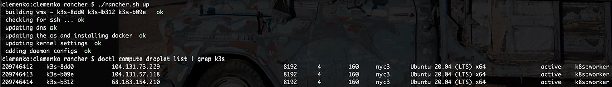
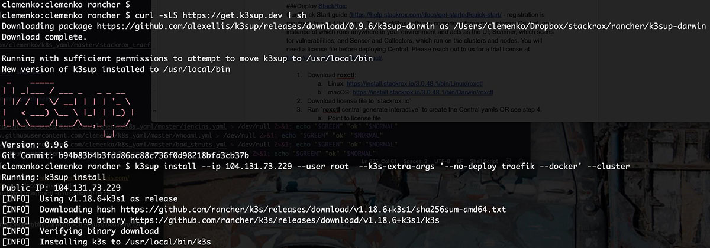
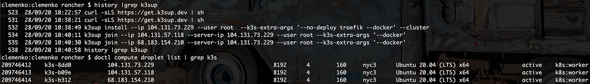
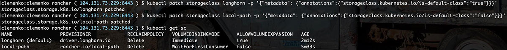
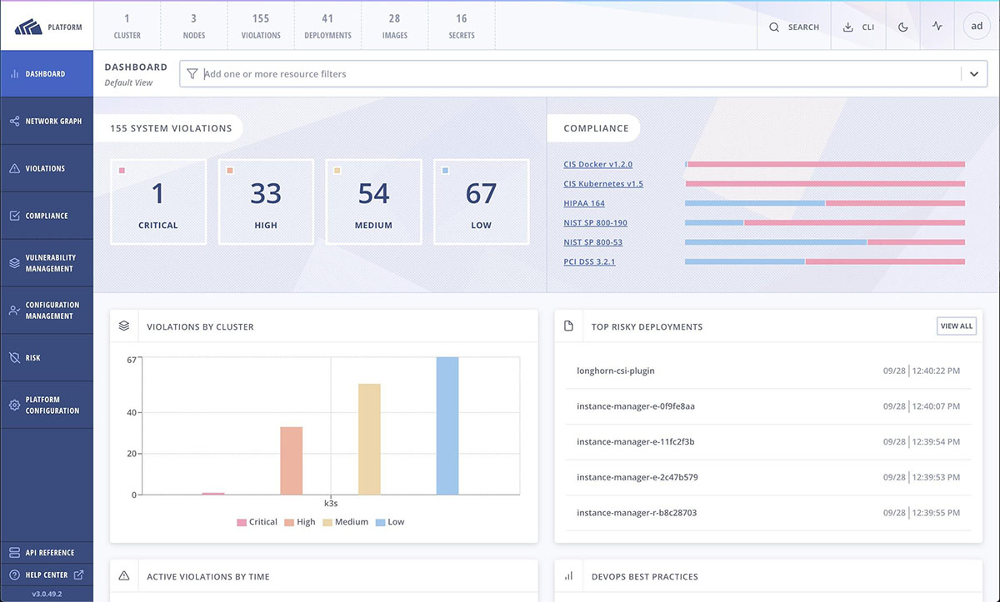

Discover what’s new in Rancher 2.5[Learn More](https://www.rancher.com/products)

As a Senior Solutions Engineer helping customers deploy cloud-native technologies, I have been using Docker and Rancher for more than five years. Heck, I even helped steer [Rancher](https://rancher.com/products/rancher/2.5) for offline use when it was the 0.19 release. I have loved the product and company for YEARS.

We all know how complicated it is to set up Kubernetes, and customers love Rancher because it simplifies that rollout. But once you get the cluster running, a more significant challenge awaits: how do you ensure your Kubernetes applications are up to date and secure? That’s where StackRox comes in. Rancher and StackRox share a passion for making complicated technology approachable and easy to use. We’re excited to walk you through the “best of breed” combination of Rancher and StackRox delivers. In this blog, you will learn how to deploy Rancher and StackRox together quickly and efficiently.

When it comes to thinking about the best way to run Kubernetes, Rancher provides several compelling advantages. The company has a proven track record for delivering enterprise-grade solutions. Also, Rancher has created many projects that streamline Kubernetes, such as [K3s](https://k3s.io/) and [Longhorn](https://longhorn.io/), to name two, and we’ll look at those tools in more depth to see how they enable simplicity and ease of deployment.

## Making Kubernetes More Secure with StackRox

Just as [Rancher helps you run Kubernetes more easily](https://rancher.com/products/rancher/2.5), StackRox enables you to secure it more quickly and effectively. If we look at the container and Kubernetes security landscape, we see an evolution of capabilities. First-generation container security platforms focus on the container — they apply controls at the container layer, taking actions isolated from the orchestrator and using proprietary mechanisms to apply them.

StackRox delivers the next generation in container security, with a Kubernetes-native architecture that leverages Kubernetes’ declarative data and built-in controls for richer context and native enforcement. Rich context improves security insights, and leveraging native Kubernetes controls means your security and your infrastructure gain all the Kubernetes benefits of automation, scale, speed, consistency and portability. For example, suppose you use Kubernetes network policies to isolate sensitive namespaces or pods, rather than a proprietary firewall. In that case, you know those controls will run at scale and won’t fail even if the security software itself fails.

## Why Combine Rancher and StackRox?

With this joint focus on manageability, enterprise scale, reliability and simplified operations, Rancher and StackRox make a powerful combination. We’ve deployed our platforms together at companies across every major industry, and we have an especially strong joint presence within Federal Government agencies. We’ve solved the challenges of running in a wide array of deployments, including the most sensitive, air-gapped environments out there. The two platforms together can truly be installed anywhere in the world.

Here’s what you get when you combine StackRox and Rancher:

- Enterprise-grade Kubernetes and security platforms
- Faster deployment
- Unmatched observability and control
- The ability to run in offline environments

So what does it take to get this power combo deployed? Here’s a list of environment needs, and then we’ll walk through the install process for both platforms.

### Prerequisties

- At least three nodes with 4 cores and 8 GB of RAM each (all need Internet access)
- Any cloud or on-prem infrastructure
- Docker CE installed
- Ubuntu or Centos updated
- Root SSH access enabled

### Installation Process

For this example, we are going to deploy on [Digital](http://digitalocean.com/)[O](http://digitalocean.com/)[cean](http://digitalocean.com/). I prefer simplicity over complexity, so we’ll use K3s for our deployment. You can run all the following commands from a remote client, jump host or the first node in the cluster. We are also going to use Longhorn for stateful storage. It is really simple to add Longhorn once the cluster is up. Here is what my three-node cluster looks like in DigitalOcean.

#### Let’s Deploy [K3s](https://k3s.io/):

For the K3s deployment, we’ll take advantage of a great tool called [K3sup](https://github.com/alexellis/k3sup) by Alex Ellis, which streamlines the installation process. I have a few command-line switches that I use. I prefer Docker over containerd. I also prefer installing Traefik with its CRD. Please keep in mind that you will need to change some variables for the commands to work correctly.

Variable primer :

- server = the first node’s ip
- user = the user to ssh into the node, root?
- worker# = the ip address of the following node

Deploy [K3s](https://k3s.io/):

1. Download [k3sup](https://github.com/alexellis/k3sup) : `curl -sLS https://get.k3sup.dev | sh`
2. Install the first node. `k3sup install --ip $server --user $user --k3s-extra-args '--no-deploy traefik --docker' --cluster`
3. Install the second node. `k3sup join --ip $worker1 --server-ip $server --user $user --k3s-extra-args '--docker'`
4. Repeat #3 for all remaining nodes in the cluster.
5. Move the resulting kubeconfig file `mv kubeconfig ~/.kube/config`.
6. Validate the cluster is up: `kubectl get nodes`.

#### Let’s Deploy [Longhorn](https://longhorn.io/):

This process is very easy – the Longhorn team provides a YAML for everything you need.

1. Install Longhorn: `kubectl apply -f`<https://raw.githubusercontent.com/longhorn/longhorn/master/deploy/longhorn.yaml>
2. Make Longhorn default: `kubectl patch storageclass longhorn -p '{"metadata": {"annotations":{"storageclass.kubernetes.io/is-default-class":"true"}}}'`
3. Remove local-path as default: `kubectl patch storageclass local-path -p '{"metadata": {"annotations":{"storageclass.kubernetes.io/is-default-class":"false"}}}'`
4. Validate it is running `watch kubectl get pod -n longhorn-system`

#### Let’s Deploy [StackRox](https://www.stackrox.com/):

Our Quick Start guide (<https://help.stackrox.com/docs/get-started/quick-start/> - registration is required) lays out the steps. The StackRox software comprises three main pieces: Central, one instance of which runs anywhere in your environment and acts as the UI; Scanner, which scans for vulnerabilities; and Sensor and Collectors, which run on the clusters and nodes. You will need a license file before deploying Central. Please reach out to us for a trial license at <https://www.stackrox.com/contact/>.

1. Download **roxctl** :
2. Linux:<https://install.stackrox.io/3.0.48.1/bin/Linux/roxctl>
3. macOS:<https://install.stackrox.io/3.0.48.1/bin/Darwin/roxctl>
4. Download license file to `stackrox.lic`
5. Run `roxctl central generate interactive` to create the Central yamls OR see step 4.
6. Point to license file
7. Ingress, Load Balancer, or NodePort?
8. Hostpath, PVC, or ephemeral storage - longhorn
9. Online?
10. Run `roxctl central generate k8s pvc --storage-class longhorn --license stackrox.lic --enable-telemetry=false --lb-type np --password $PASSWORD` to automate the central setup.
11. Setup **Central** `./central-bundle/central/scripts/setup.sh` to setup the namespace. Use the help.stackrox.com email address.
12. Install **Central** `kubectl create -R -f central-bundle/central`
13. Validate Central is running `watch kubectl get pod -n stackrox`
14. Run **Scanner** setup `./central-bundle/scanner/scripts/setup.sh`
15. Install the **Scanner** `kubectl create -R -f central-bundle/scanner`
16. Get service port number from `kubectl get svc -n stackrox`
17. Download **Sensor** bundle from GUI “Platform Configuration → Clusters → + New Cluster”
18. Unzip and install **Sensor** bundle with `./sensor/sensor.sh`Use the help.stackrox.com email address.
19. Validate everything is running `watch kubectl get pod -n stackrox`
20. Find the NodePort port. `kubectl -n stackrox get svc central-loadbalancer` and get the 30000 or higher port number.
21. PROFIT! :D
22. Navigate to [https://$server:$port](about:blank)

Here is the example of the install <https://asciinema.org/a/aiipfMTI5JS113qDjljgoxfbR>.

To avoid having to manually deploy all these elements separately, I’ve created a [script](https://github.com/clemenko/rancher/blob/master/rancher.sh) that deploys all the components. Please note these key points:

- Export your StackRox registry password `export REGISTRY_PASSWORD=XXXX`
- The script will build vms and set up DNS on DigitalOcean
- You can choose Rancher or K3s
- READ THE SCRIPT - don’t assume it will work out of the box
- ./rancher.sh usage ← will show all!

And as you’ll see if you run the script, it installs the Traefik CRD and has TLS passthrough for Central’s front door. It also installs Jenkins and a few small demo apps.

Here is what it looks like : <https://asciinema.org/a/hpnt6tWbGN0fSLTyhCXHu0fb8>.

## Conclusion

Anyone looking to simplify both the management and security of Kubernetes will find a compelling combination in Rancher plus StackRox. Rancher makes it easier for you to deploy, manage and scale Kubernetes. Add StackRox to the mix, and you can tap into a broad set of security features that take advantage of Rancher and Kubernetes, including vulnerability management, configuration management, risk profiling, compliance, network segmentation and runtime detection.

We’re happy to share more details on getting the most out of your Rancher plus StackRox deployment and how our joint customers are benefiting from the combination – reach out to [sdr@stackrox.com](mailto:sdr@stackrox.com) to get more details and your free trial license key.

Discover what’s new in Rancher 2.5[Learn More](https://www.rancher.com/products)
