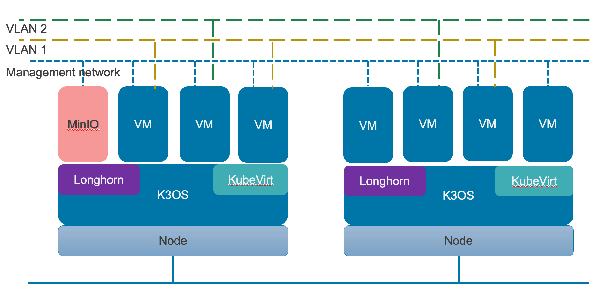
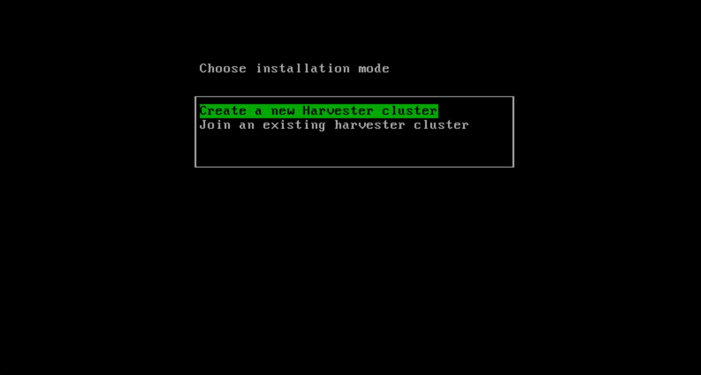
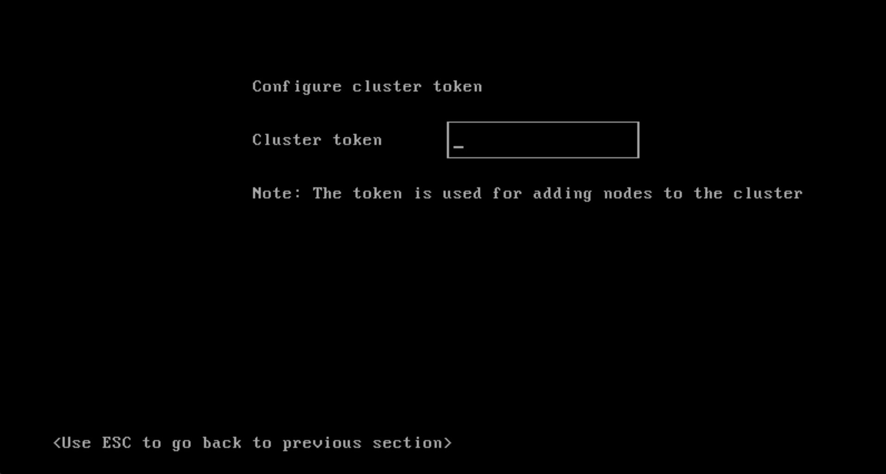
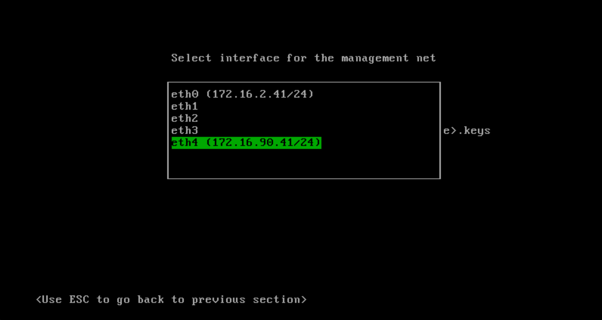

Declarative Security with Rancher, KubeLinter and StackRox on Jan. 26 [Join our Master Class](https://info.rancher.com/kubernetes-master-class-jan26-2021-stackrox) As companies adopt container technologies, they face a significant challenge - how do we secure this new attack surface? It’s an issue that you often see backlogged in favor of solving storage, networking and monitoring issues. Add on the challenge of educating the workforce on one of the [fastest-growing open source](https://www.cncf.io/blog/2017/06/05/30-highest-velocity-open-source-projects/) projects to date, and it’s no wonder security has lagged as the primary focus for teams. In fact, The New Stack published a survey that shows that almost [50 percent of Kubernetes users say security is their top](https://thenewstack.io/top-challenges-kubernetes-users-face-deployment/) unresolved issue.

In this blog, we aim to demystify the Kubernetes security threats, showcase best practices for securing your cluster, and provide useful tools to enable your developers. These tools include:

- Rancher Kubernetes Engine (RKE) for declarative deployments
- KubeLinter for developer-focused security checks
- StackRox for enforcing security policies across build, deploy, and runtime

We encourage you to join the Kubernetes Security Master Class: Tapping Native Controls in Kubernetes to Protect your Cloud-Native Apps. This online Master Class will thoroughly flesh out the topics covered below and demonstrate how you can better secure your cloud-native workloads.

## Background

### Rancher Kubernetes Engine (RKE)

RKE is a [CNCF-certified Kubernetes distribution](https://rancher.com/docs/rke/latest/en/) that runs entirely within Docker containers. It addresses the installation complexity of Kubernetes by removing most host dependencies and presenting a stable path for deployment, upgrades, and rollbacks. RKE uses a declarative YAML file to configure and create Kubernetes environments. This enables reproducible on-prem or remote environments.

### KubeLinter

KubeLinter is a static analysis tool that checks Kubernetes YAML files to ensure that the declared application configuration adheres to best practices. [KubeLinter is StackRox’s first open source tool](https://github.com/stackrox/kube-linter) designed for implementing security checks from the command line as well as a part of the CI process. KubeLinter is a binary that takes in paths to YAML files and runs a list of checks against them. Admins and developers can create their own policies to enforce, enabling quicker and more automated deployments.

### StackRox

[StackRox Kubernetes Security Platform](https://www.stackrox.com/) protects vital applications across build, deploy and runtime. StackRox deploys in your infrastructure and integrates with your DevOps tooling and workflows to deliver frictionless security and compliance. The StackRox Policy Engine includes hundreds of built-in controls to enforce DevOps and security best practices, industry standards such as CIS Benchmarks and NIST, configuration management of both containers and Kubernetes runtime security. StackRox profiles your workloads to enable you to make informed decisions about the workloads’ security.

### Together

RKE, KubeLinter, and StackRox enable you to deploy repeatable, secure clusters, visualize profile and access security vulnerabilities, and create declarative security policies. Let’s talk about the threats these applications can tackle together.

## Assessing the Threat

Let’s start by focusing on the Kubernetes vectors of attack. Microsoft recently published an attack matrix for Kubernetes based off of the [MITRE ATT&CK framework](https://www.microsoft.com/security/blog/2020/04/02/attack-matrix-kubernetes/).



The framework is adapted for Kubernetes and based on [real-world observations and cases](http://techgenix.com/5-kubernetes-security-incidents/). Luckily, there are [strategies to mitigate](https://www.stackrox.com/post/2020/09/protecting-against-kubernetes-threats-chapter-9-impact/) all of the various issues. First, we can start by hardening our Kubernetes control plane. After that, we will shift focus to securing our running container workloads.

## Control-Plane Hardening

The Kubernetes control plane includes the following components:

- **Kubernetes API Server**
- **kube-scheduler**
- **kube-controller-manager**
- **etcd (if applicable)**
- **cloud-controller-manager (if applicable)**

**etcd** will likely be on the control plane node; however, it can have a remote environment for high availability use cases. The **cloud-controller-manager** is installed in provider instances as well.

### Kubernetes API Server

The Kubernetes REST API server is the core component of the control-plane. The server handles REST API calls, which include all communication between the various components and the user. This dependency makes securing the API server a top concern. There are some [specific vulnerabilities in previous versions](https://www.stackrox.com/post/2020/01/top-5-kubernetes-vulnerabilities-of-2019-the-year-in-review/#:~:text=Kubernetes%20API%20DoS%20vulnerability%20%28CVE-2019-1002100%29&text=CVE-2019-1002100%20was%20a,server%20to%20utilize%20excessive%20resources.) that are fixed with a simple upgrade to a newer version. However, the following hardening tasks are also within your control.

- Enabling Role-based Access Control (RBAC)
- Ensuring all API traffic is TLS-encrypted
- Enabling audit logging
- Setting up authentication for all K8s API clients

With a deployment tool such as RKE, this declarative format for setting up your cluster is easy. Below is a snippet of a default RKE config.yml file. We can see that we can enable audit logging, TLS (between Kubernetes components), and RBAC by default.

```
  kube-api:
    image: ""
    extra_args: {}
    extra_binds: []
    extra_env: []
    win_extra_args: {}
    win_extra_binds: []
    win_extra_env: []
    service_cluster_ip_range: 10.43.0.0/16
    service_node_port_range: ""
    pod_security_policy: false
    always_pull_images: false
    secrets_encryption_config: null
    audit_log: null
    admission_configuration: null
    event_rate_limit: null
…
authentication:
  strategy: x509
  sans: []
  webhook: null
…
authorization:
  mode: rbac
  options: {}
```

Setting up authentication for all K8s API clients is an ongoing challenge. We need to apply a [zero-trust](https://www.stackrox.com/wiki/zero-trust-networks-in-kubernetes-cloud-native-applications/) model to any workloads that will run in our cluster.

### kube-scheduler

Kubernetes’ default scheduler, kube-scheduler, is designed to be pluggable. You can build your scheduler or have multiple schedulers for different workloads. Regardless of the implementation, it needs to be secure and there are a few tasks to ensure that it is.

- Set a secure port for communication to the API server
- Ensure the scheduler runs with minimum required permissions (RBAC)
- Restrict file permissions on kube-scheduler pod specification and kubeconfig files

With RKE, we can secure its connection to the API server by verifying the default scheduler addresses set to 127.0.0.1. Also, restrict file permissions by making sure the root user owns the scheduler YAML file.

```
stat -c %U:%G /etc/kubernetes/manifests/kube-scheduler.yaml
```

### kube-controller-manager

The Kubernetes systems regulator, the kube-controller-manager, is a daemon that regulates the system using core control loops. Securing the controller requires a similar strategy as the scheduler.

- Set a secure port for communication to the API server
- Ensure the scheduler runs with minimum required permissions (RBAC)
- Restrict file permissions on kube-controller-manager pod specification and kubeconfig files

Like the scheduler, we can ensure that the communication uses the local address (not an unsecured loopback interface) and ensure the root user owns the controller YAML file.

```
stat -c %U:%G /etc/kubernetes/manifests/kube-controller-manager.yaml
```

### etcd

The last core component of the control plane is its key-value store, etcd. All Kubernetes objects are located in etcd, which means all of your configuration files and secrets are stored as well. The best practice is to encrypt secrets or manage secret information with a separate secrets management solution such as Hashicorp Vault or a cloud provider secrets management service. Some key factors to remember when you are managing the database are:

- Limit read/write access to the datastore
- Encryption

We want to limit any updates or changes to the manifests to the services that are allowed access. Using RBAC controls partnered with a [zero-trust](https://www.stackrox.com/wiki/zero-trust-networks-in-kubernetes-cloud-native-applications/) model will get you started. Lastly, encryption with etcd can be cumbersome. [Rancher has a unique approach](https://rancher.com/docs/rke/latest/en/config-options/secrets-encryption/) where the keys are generated as part of the initial cluster configuration. [Kubernetes has a similar policy](https://kubernetes.io/docs/tasks/administer-cluster/encrypt-data/), although the file with the keys needs to be secure as well. Your organization’s security requirements will dictate where and how you will secure your sensitive information.

### Cloud-controller-manager

The cloud cloud-controller-manager is unique to cloud providers or any distribution which requires our cluster to communicate with the provider’s API. When working with cloud providers, admins will not have access to the master nodes of their cluster and, therefore, will not have the ability to run the hardening steps previously outlined.

## Securing Workloads using Kubernetes-Native Controls

Now that our control plane is secure, it is time to work on our applications running in Kubernetes. Similar to the previous section, let’s break down the various layers of security.

- Container Image Security
- Runtime
- Persistence
- Network
- Role-Based Access Control (RBAC)

In the section below, we will dive deep into the various considerations for each section. In addition, the Master Class will give us more time to demonstrate the Kubernetes functionality in a comprehensive way.

### Container Image Security

Managing your containers before they are used is the first hurdle in container adoption. In the beginning, we need to consider:

- Selection of base images
- Update frequency
- Non-essential software
- Accessibility to build/CI tools

The salient points are used to select secure base images, limit unnecessary packages and to secure a registry. Nowadays, most of the registries have image scanning built in to make your life easier. The StackRox Kubernetes Security Platform can automatically enforce policies on what images can be used to launch containers and identify security issues, including vulnerabilities and problematic packages, in image layers separate from the underlying base operating system (OS) image.



If you want to learn more, read this [in-depth article about container image security](https://www.stackrox.com/post/2020/04/container-image-security-beyond-vulnerability-scanning/).

### Runtime

Runtime security spans different Kubernetes functionality with the core goal of ensuring that our workloads are secure. [Pod Security Policies](https://kubernetes.io/docs/concepts/policy/pod-security-policy/) are a great place to start securing your containers with the ability to control:

- Linux capabilities
- The SELinux context of the container
- Usage of host networking and ports
- Use of the host filesystem
- The user and group IDs of the container

Keep in mind the [zero-trust](https://www.stackrox.com/wiki/zero-trust-networks-in-kubernetes-cloud-native-applications/) approach to systems, where capabilities should be set so the container has the minimum functionality required at runtime to function. For better visualization, StackRox’s risk profiling automatically identifies containers with potentially useful tools to attackers, including bash. It also alerts the use of suspicious tools and monitors, detects and alerts concerning runtime activity, such as executing abnormal or unexpected processes within containers.



### Persistence

Running stateful workloads in Kubernetes creates a backdoor into your containers. The attack surface increases by attaching storage and possibly giving executables or information to a container that it should not access. Best practice in Kubernetes ensures that stateful workloads run with the least privilege required. Other considerations include:

- Use Namespaces as natural boundaries for storage.
- No privileged containers
- Use a [Pod Security Policy](https://kubernetes.io/docs/concepts/policy/pod-security-policy/) to restrict pod volume access

StackRox helps mitigate these threats by delivering dynamic policy-driven admission control as part of the StackRox platform. This enables organizations to enforce security policies automatically, including limitations on host mounts and their writability before containers are ever deployed into Kubernetes clusters.

### Network Access

Network access is a tough challenge in Kubernetes due to the lack of visibility into your containers. By default, network policies are disabled, and every pod can reach other pods on the Kubernetes network. Without this default, newcomers would have a tough time getting started. As your organization matures, we should strive to lock down all traffic except the traffic we deem necessary. This can be done using [network policies](https://kubernetes.io/docs/concepts/services-networking/network-policies/#default-policies) configured by namespaces. It is also important to focus on the following:

- Using Namespaces as natural boundaries for [network policies](https://kubernetes.io/docs/concepts/services-networking/network-policies/#default-policies)
- Enabling a default to deny policy in each namespace
- Using [network policies](https://kubernetes.io/docs/concepts/services-networking/network-policies/#default-policies) that are specific to the traffic required by each pod

One of the significant challenges with network policies is visualization. StackRox helps protect against network mapping by monitoring active network traffic between pods and automatically generating and configuring Network Policies to restrict communications to only what is necessary for application components to operate.



### Role-Based Access Control (RBAC)

RBAC is central to securing your cluster. Kubernetes RBAC permissions are additive; therefore, RBAC’s only vulnerability is if an administrator or user grants exploitable permissions. The most common problem we encounter is users having cluster-admin access when they shouldn’t. Fortunately, there are more RBAC best practices to minimize issues:

- Use different service accounts for different types of workloads and apply the principle of least privilege
- Regularly audit your clusters’ RBAC configurations
- Use different service accounts for different types of workloads and apply the principle of least privilege.
- Avoid cluster-admin overuse

An [RKE cluster uses RBAC](https://rancher.com/docs/rke/latest/en/config-options/authorization/) as the default authentication option during cluster setup. StackRox expands on this default option by helping organizations limit Kubernetes RBAC permissions according to the least privilege principle. We monitor the cluster RBAC settings for users and service accounts and identify ones with overly excessive privileges on clusters.

## Conclusion

It is challenging to take on [Kubernetes security](https://www.suse.com/c/best-practices-for-keeping-kubernetes-secure/) on your own. In organizations, security can get in the way of DevOps, creating hurdles that lead to abandoned security principles in the pursuit of delivery. It doesn’t have to be this way.

By proactively identifying threats and crafting reasonable policies, we further shift security left. We can assess where our time needs to be spent and avoid bogging down DevOps teams with additional responsibilities.

If you want to learn more about protecting your Kubernetes clusters and applications, sign up for the free Master Class: Tapping Native Controls in Kubernetes to Protect your Cloud-Native Apps with StackRox on January 26, 2021. We’ll use Rancher for declarative Kubernetes deployments and explore various ways to access, implement, and streamline your security code, including using KubeLinter and [StackRox](https://www.stackrox.com/).Declarative Security with Rancher, KubeLinter and StackRox on Jan. 26 [Join our Master Class](https://info.rancher.com/kubernetes-master-class-jan26-2021-stackrox)
